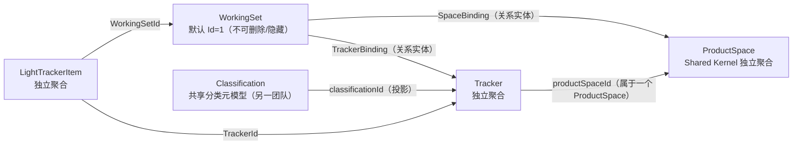

# ProductSpace、Tracker 与 WorkingSet 关系

**状态：Draft / Candidate（阶段 4 补充；未发布为正式基线）**

目的：表达 ProductSpace（独立聚合）、Tracker（独立聚合）、Classification（共享元模型）、WorkingSet 及其绑定关系。范围：领域关系，不表达数据库/ORM/部署。依据：[阶段 4 集中补充评审](../reviews/2026-11-10-stage-4-productspace-classification-review.md)、FACT-024～026、POL-012～014、INV-053～059。

图例：实线为领域关系；标注 ID reference 的为跨聚合身份引用。WorkingSet 拥有绑定规则，但物理上是否一次加载全部绑定记录不是领域问题。

说明：

- SpaceBinding 是 TrackerBinding 的业务前置；同一 WorkingSet/ProductSpace 空间绑定唯一，同一 WorkingSet/ProductSpace/Classification 槽位唯一。
- Shared Tracker 纳入子 WorkingSet 复用原 TrackerId（仅建新绑定）；非共享 Tracker 纳入创建新 Tracker 聚合（sourceId 指向来源）。
- 移除：Shared Tracker 解除 TrackerBinding（不删除聚合，**即使有 Item 也允许**）；非共享 Tracker 解绑即聚合删除，须同时满足无 Item、无组织子级、无派生子级（K2）。
- ProductSpace 不随 WorkingSet 派生复制/迁移；移除空间内最后一个 Tracker 不移除 SpaceBinding；ProductSpace 移出 WorkingSet 是独立显式操作。
- 删除 ProductSpace 前须确认**所有 WorkingSet 均无指向它的 SpaceBinding**（只检查 TrackerBinding 会留下悬空绑定），且空间下无 Tracker 聚合；不自动删除其他 WorkingSet 或 Tracker（INV-066）。
- 绑定是关系实体，不是独立聚合；不新增拥有 ProductSpace、Tracker、WorkingSet 的大聚合。

未表达：SpaceBinding/TrackerBinding 的实现形态、删除级联、事务边界、ProductSpace/Classification 内部模型。
