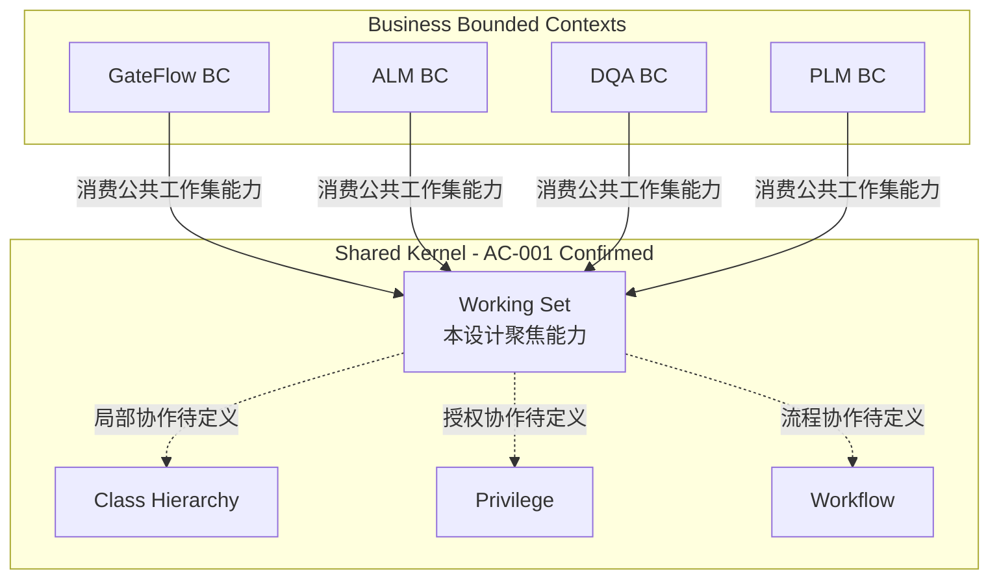

# Shared Kernel 与四个业务 Bounded Context

- **文档状态**：Reviewed
- **约束状态**：`AC-001 Confirmed`
- **设计阶段**：阶段 3.0 企业架构外框
- **依据**：`USER-ARCH-2026-11-09` 的明确说明及两张原始架构示意图
- **相关文档**：[Shared Kernel 边界](../domain/shared-kernel-boundary.md)、[候选 Context Map](../domain/context-map.md)
- **范围**：实线表达已确认的依赖方向；虚线只表达待设计的局部协作，不表示部署、聚合包含或共同事务。

## 明确不表达

- 不表示 Shared Kernel 是一个单体服务、单一限界上下文或单一聚合；
- 不表示四个业务 BC 共享同一个业务对象模型；
- 不表示 Working Set 可以绕过业务 BC 直接写 Requirement、Part 或其他专有对象；
- 不确认 `create / extend / resolve / diff / merge` 的最终接口签名、同步方式或事务边界。

## 阶段 3 局部协作候选

BC 消费依赖是 AC-001；反向运行时协作由 BC 适配器提供授权内容、语义比较、合法提交与结果回读。业务内容事实的上游是 BC，工作范围协议的上游是 Working Set；不新增 SK 核心对业务实现的依赖。Privilege/Workflow/Class Hierarchy 为各自事实提供方，精确合同与治理待定。见 [责任边界](../domain/shared-kernel-boundary.md) 与 [阶段 3 评审](../reviews/2026-11-09-stage-3-architecture-review.md)。
