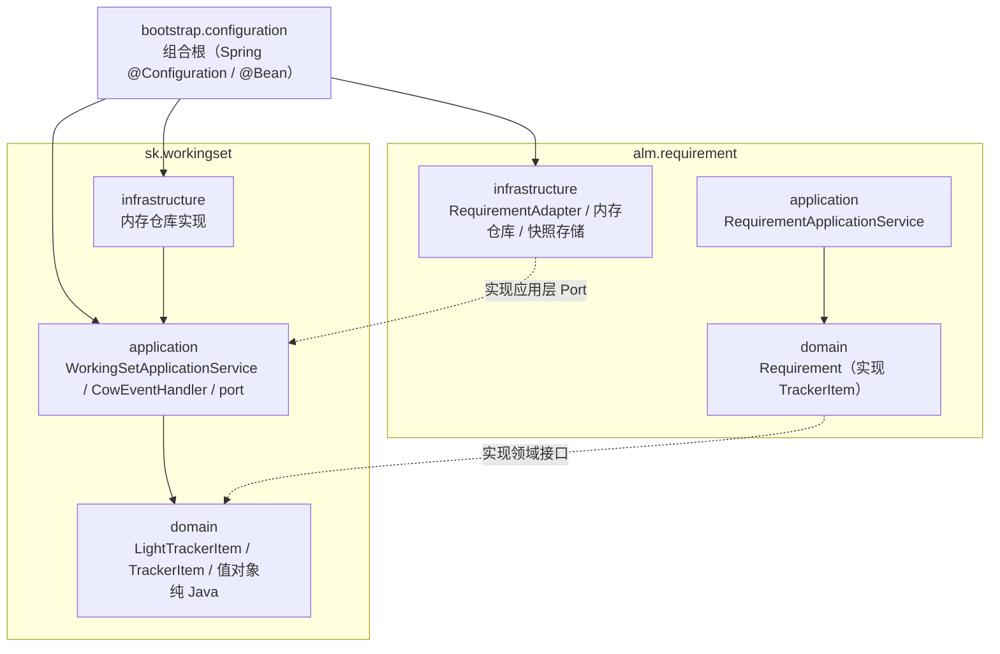
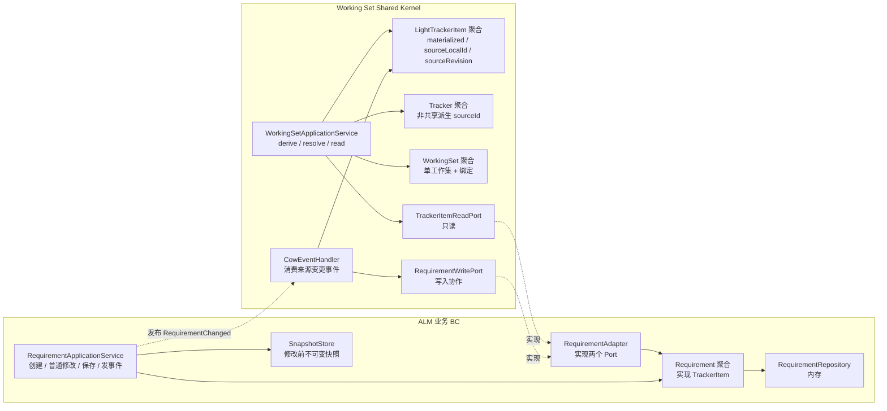
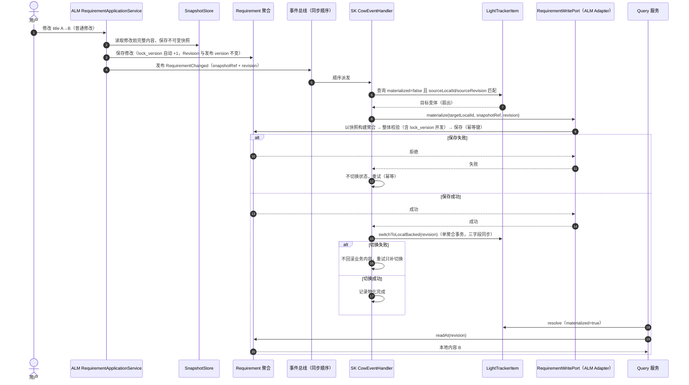
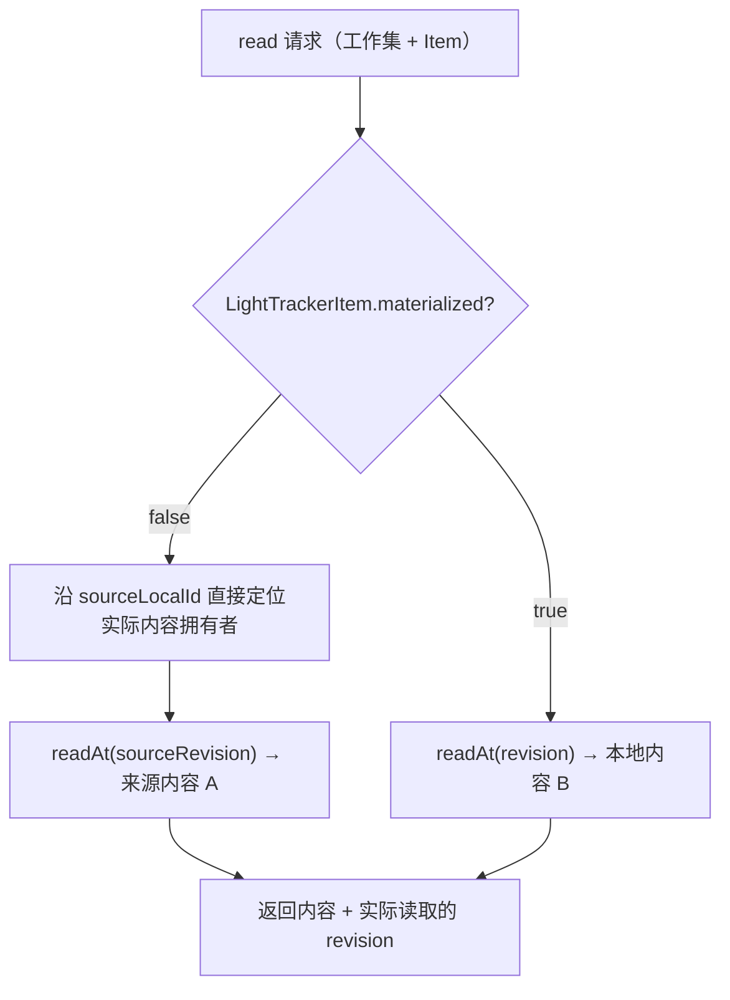

# T5-S0 架构与首次 COW 时序

**状态：Draft / Candidate（T5-S0 实施配套图；不表达生产部署与持久化；图本身未纳入正式基线）**

- 目的：表达首切片的**最小目录/包依赖**、组件依赖方向、首次 COW 时序与读取路径判定。
- 适用范围：阶段 5 · T5-S0，仅 ALM Requirement 一个业务 BC；不含 Merge、删除、权限、版本治理。
- 依据：[T5-S0 最小纵向切片设计](../implementation/t5-s0-minimal-slice-design.md)（P1～P5、A1～A3）、T3（物化协议）、T4（Port/Adapter、两层接口并存、九分类）、D-008～D-019、INV-070/071。
- 不表达：数据库表、消息中间件、部署拓扑、生产级并发控制、Mermaid 渲染结果。

## 图例

- 实线＝依赖/调用；虚线＝实现/发布关系。
- SK 只依赖两个应用层 Port 的**接口**；ALM 的 Adapter 实现它们；SK 不引用 ALM 聚合类型。
- `LightTrackerItem` 的三字段（`materialized`、`sourceLocalId`、`sourceRevision`）只在聚合行为内一次更新。
- **禁止**：`sk.*` 依赖 `alm.*`（任何包、任何形式）；`bootstrap` 是唯一允许同时引用两者的位置。

## 1. 最小目录与包依赖

读图要点：`sk.*` 各层自下而上依赖自身；`alm.requirement.domain` 单向依赖 SK 公共契约（实现 `TrackerItem`）；`alm.requirement.infrastructure` 单向依赖 SK 应用层 Port（实现 Adapter）；`bootstrap` 同时依赖两侧完成装配。**图中不画 `sk → alm` 的箭头，因为该方向被禁止（AC-01）。**

## 2. 组件依赖方向

## 3. 首次 COW 时序

## 4. 读取路径判定

## 5. 五个检查点

1. **依赖方向（AC-01）**：`sk.*` 不依赖 `alm.*`；SK 只引用 Port 接口；`bootstrap` 唯一同时引用两侧。
2. **身份稳定（AC-02）**：派生预分配 `LocalId`，首次 COW 复用，COW 前后可用同一 `LocalId` 定位变体。
3. **三字段同步**：`switchToLocalBacked` 是唯一写入入口；不一致即元数据缺陷（T3/INV-069）。
4. **失败分离**：保存失败不切换；切换失败不回滚业务内容、只补切换（A3/T3 §7）。
5. **内容固定范围**：首切片普通字段；附件、关系固定派生时状态，不被较新事件覆盖（T3 §2.1/SCN-072）。
