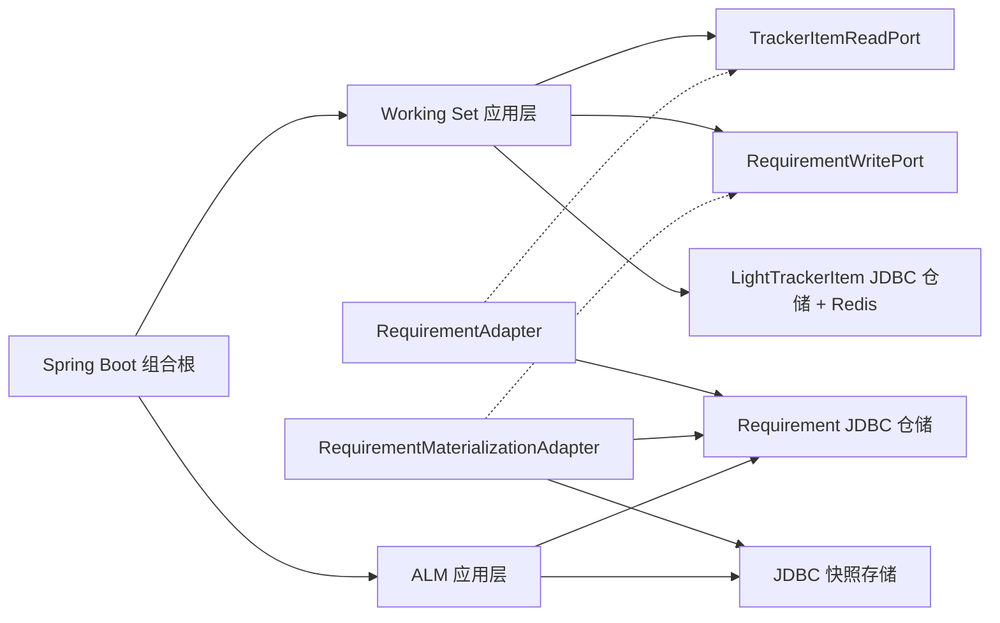
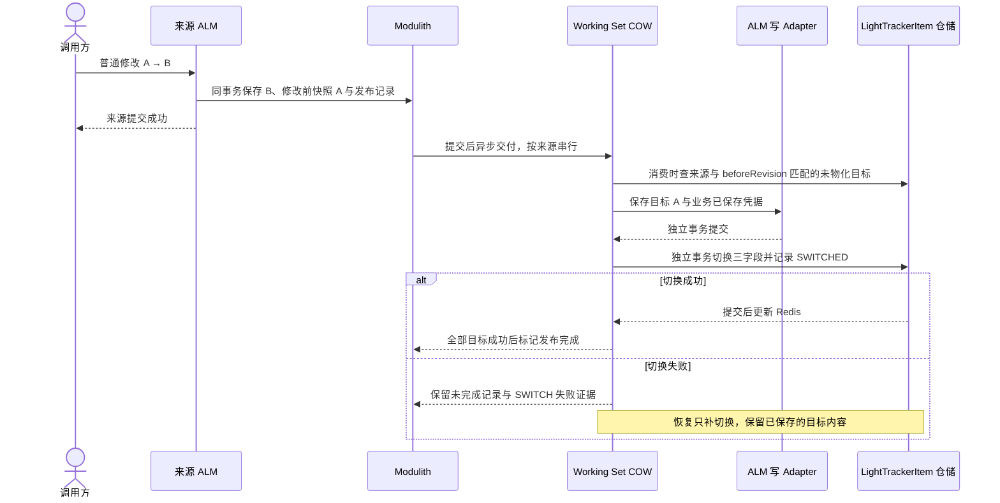

# T5 首切片架构与 COW 时序

**状态：Historical（S0 实施视图）。** D4/D15 已改变物化与 Merge 的事务边界，当前实现见 [D4 边界验证](../implementation/t5-d4-sk-boundary-verification.md) 与 [S7 验证](../implementation/t5-s7-verification-result.md)；本图保留为 S0 阶段证据。

## 组件依赖

实线表示调用或依赖，虚线表示实现接口。组合根装配两侧，Working Set 代码只依赖自己的端口。业务聚合仍实现领域接口 TrackerItem。

## 首次 COW 与切换恢复

切换前读取走来源选定版次，可暂时读到 B。切换后按目标自身身份和版次读取，首次物化内容为 A。扇出、失败记录与顺序缺口边界见 [S3 验证](../implementation/t5-s3-verification-result.md)和 [S4 验证](../implementation/t5-s4-verification-result.md)。
