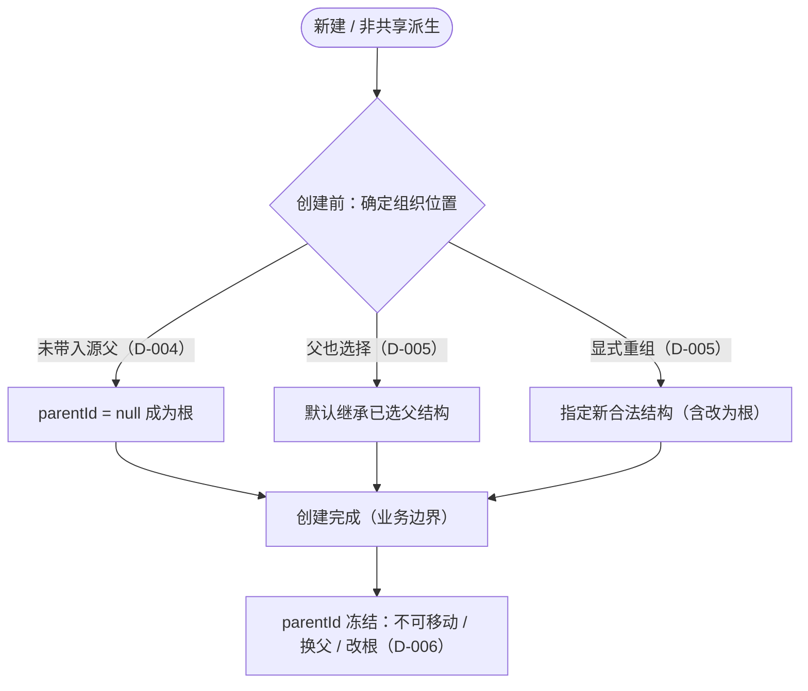

# Tracker 创建边界与组织位置不可变

**状态：Draft；图中业务语义由 D-005/D-006 确认，图本身未纳入正式基线。**

目的：展示 Tracker 组织位置的创建边界——创建完成前确定 parentId（含裁剪、默认继承与显式重组），创建完成后冻结；并把组织位置与 Tracker 身份、生命周期、直接来源、Working Set 成员扩展区分开。范围：非共享派生与原生创建的组织位置决策。依据：[D-005](../reviews/2026-11-09-stage-3-architecture-review.md#d-005)、[D-006](../reviews/2026-11-09-stage-3-architecture-review.md#d-006)、[POL-010/011](../domain/facts.md)、[INV-022/023](../domain/invariants.md)。

图例：本图只表达组织位置这一维度，不表达 Tracker 身份状态机或内容生命周期。「创建前」是业务决策窗口，「创建完成」是业务边界；其持久化、发布时点与重试协议仍待设计。本图不新增 Draft Tracker 状态机。

说明：`parentId` 的确定（根、默认继承或显式重组）全部发生在「创建完成」之前；完成后 `parentId` 冻结。`sourceId` 表达直接父级工作集来源，不随组织裁剪或重组改变（D-003/D-006）。组织位置冻结不等于 Tracker 其他属性不可变，也不等于 Working Set 成员集合封闭——后续仍可加入新 Tracker，只是不移动已有节点（D-006 第 6 项）。

未绘出：创建时父节点不存在、组织环等非法结构（反例见 [SCN-018](../scenarios/core-scenarios.md#scn-018-创建时父缺失与组织环反例)）；父后续删除（已由 K2 裁定：存在组织子级/派生子级/Item 时禁止删除，2026-11-11）；「停用」（仍开放，按 QUESTION-009.a 的停用部分）；Shared 混合树有效父、同源多派生、sourceId 可变性、派生整批原子性。
