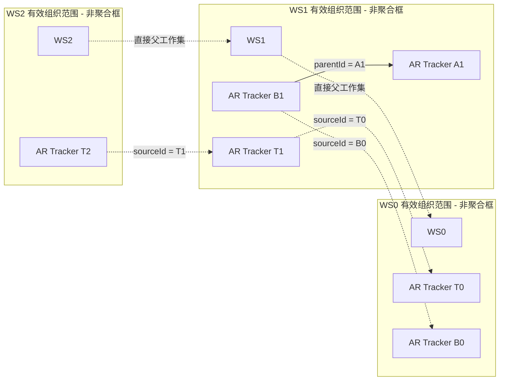
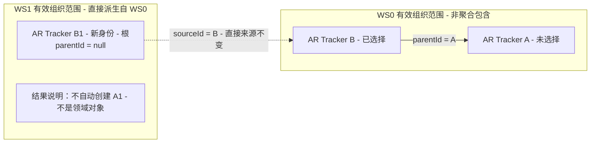

# Tracker 双维关系：组织树与派生链

**状态：Draft；图中业务语义由 D-003/D-004 确认，图本身未纳入正式基线。**

目的：展示 parentId 和 sourceId 两维共存。范围：非共享 Tracker 的多级派生与同工作集结构关系。依据：[术语](../domain/glossary.md)、[事实](../domain/facts.md)、[约束分类](../domain/invariants.md#d-003-双维关系约束审查)、[D-003](../reviews/2026-11-09-stage-3-architecture-review.md#d-003)、[SCN-014](../scenarios/core-scenarios.md#scn-014-tracker-双维关系)。

图例：每个 Tracker 节点都是独立聚合根；Working Set 外框仅表示有效组织范围，**不是聚合包含或事务边界**。实线 parentId 指向同范围结构父，虚线 sourceId 指向直接父级工作集中的来源。工作集标识之间的点线说明工作集直接派生关系，不表示 Tracker 组合。

T0/T1/T2 沿三层工作集逐级派生；T2.sourceId 不能跳到 T0。B1 同时有结构父 A1 和直接来源 B0，二者位于不同工作集，不能合并为一个关系。B0 是说明直接来源位置的示例，不宣称 A1 由谁派生，也不推断 WS0 的树被复制到 WS1。

上图未绘出的 parentId/sourceId 不表示空值；D-004 裁剪根的 parentId=null 见下图。parentId 创建后不可变已由 D-006 确认，父也选择时的默认继承与创建前显式重组已由 D-005 确认；同源多派生、sourceId 可变性、Item 归属和关系存储方式仍未裁定。

Shared 未放入本例：被多个工作集引用的同一权威 Tracker 不能因此复制成不同对象。其结构父是否跨工作集一致待裁定；每个工作集的结构有效性须按有效组织范围核对，不能只检查数据库归属。图不将 Shared 的父级转移到 Binding，也不批准任何全树聚合。

## D-004：仅选择子 Tracker，目标成为根

**图状态：Draft；裁剪结果为用户明确确认，提交过程与原子性未确认。** 本图是完成后的合法结果，不是顺序执行或事务图。每个标为 AR 的 Tracker 是独立聚合；Working Set 外框只表示有效组织范围。实线为 parentId 结构父，虚线为 sourceId 直接来源。A1 不画成实际节点，避免暗示其被创建。

源组织树为 A 下的 B，目标组织树只有根 B1。B1.parentId=null 与 B1.sourceId=B 同时成立，Tracker Hierarchy 不等于 Tracker Derivation。没有到 A 的跨工作集 parentId 边，也没有容纳整树的聚合。

适用范围：非共享、原父未选择、允许的根节点结果。父也选中时默认继承与创建前显式重组已由 D-005 确认，派生后 parentId 不可修改已由 D-006 确认；仍待裁定 Shared 混合树有效父、同源多个派生与批次原子性。见 [POL-009](../domain/facts.md#pol-009非共享派生组织裁剪用户已确认)、[POL-010/011](../domain/facts.md)、[SCN-015](../scenarios/core-scenarios.md#scn-015-非共享-tracker-派生组织裁剪)、[D-004](../reviews/2026-11-09-stage-3-architecture-review.md#d-004)。
