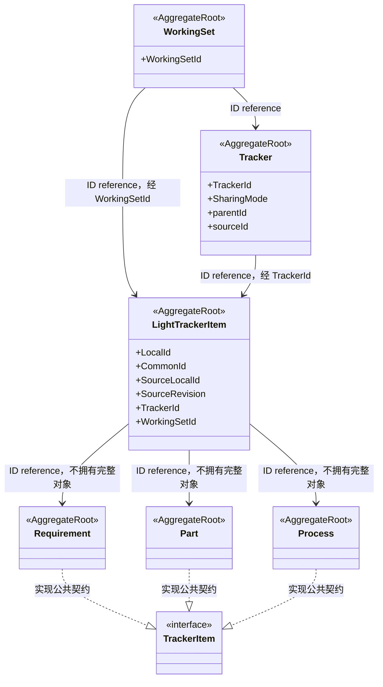

# D-007/D-008/D-010：TrackerItem 公共契约、LightTrackerItem 权威聚合与业务 BC 聚合（最小模型）

**状态：Draft / Candidate；TrackerItem 契约与 LightTrackerItem 独立聚合由 D-007/D-008 确认，LightTrackerItem 完整属性与物化协议仍候选，图未纳入正式基线。**

目的：表达 TrackerItem 公共契约、LightTrackerItem 权威聚合、各业务 BC 聚合与 Working Set 的关系。范围：跨 BC 的公共 Item 能力契约、身份/来源/定位权威与聚合边界。依据：[D-007](../reviews/2026-11-09-stage-3-architecture-review.md#d-007)、[D-008](../reviews/2026-11-09-stage-3-architecture-review.md#d-008)、[术语](../domain/glossary.md)、[聚合分析](../domain/aggregate-model.md)。

图例：`<<interface>>` 为公共能力契约，`<<AggregateRoot>>` 为聚合根。`..|>` 表达接口实现，`-->` 为跨聚合 ID reference；不含聚合组合、数据库外键或部署拓扑。业务对象实现 TrackerItem 不表示 Working Set 拥有其状态。

说明：

- **TrackerItem** 是 Working Set Shared Kernel 声明的顶级接口，不承载业务不变量（D-007）。
- **LightTrackerItem** 是 Working Set 专属独立聚合（D-008，非查询投影），承担身份、来源与有效变体定位权威：派生时分配当前 LocalId、保留 CommonId、记录 SourceLocalId/SourceRevision，经 TrackerId/WorkingSetId 指向。
- **Requirement / Part / Process** 是各自业务 BC 的完整独立聚合，通过实现 TrackerItem 获得公共能力。Working Set 不拥有其领域状态、业务生命周期与不变量；业务 BC 通过 CQRS Query 与工厂重建完整聚合。
- **Tracker** 保持独立聚合，不因管理 TrackerItem 工作范围而拥有业务对象聚合。

未表达（均候选）：LightTrackerItem 完整属性与物化协议；LocalId 是否等同业务聚合变体身份；首次物化标志与有效内容指针；物化原子性。不提前设计 Java 方法签名、ORM 结构或数据库表。
