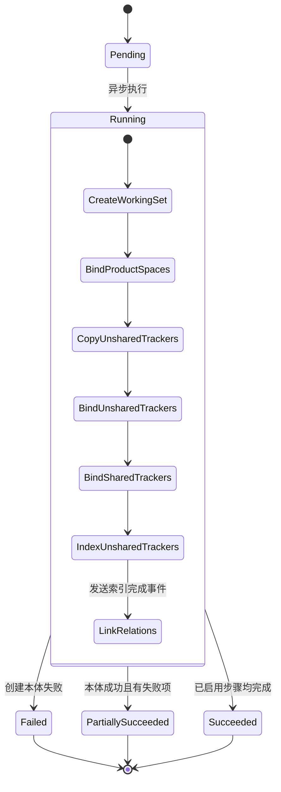

# 工作集创建任务状态与步骤

**状态：Reviewed**。描述任务与执行步骤，依据 [T7 设计](../domain/working-set-creation-lro-design.md) 和 [T7-A 评审](../reviews/2026-11-13-t7-a-creation-lro-review.md)。箭头表示推进顺序，任务按 ID 关联既有聚合。终态前的范围访问返回 `Preparing`。

