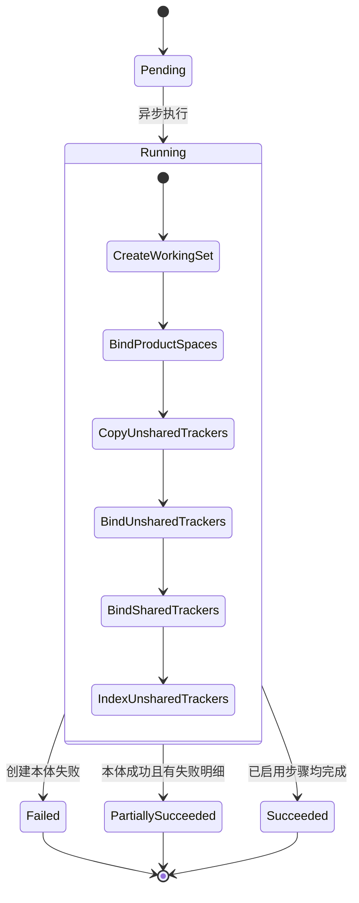

# 工作集创建任务状态与步骤

**状态：Reviewed**。覆盖 T7-D 的任务状态与执行步骤，依据 [T7 设计](../domain/working-set-creation-lro-design.md)。受理事务冻结父 Item 身份与有效来源。索引结束后随终态事务登记 `TrackerItemsIndexed`，提交后交付。关系构建的后续设计见 [QUESTION-010](../domain/open-questions.md)。

