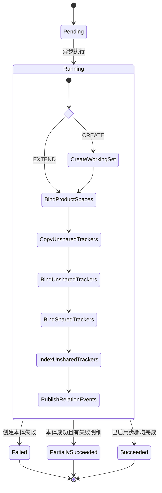

# 工作集创建与扩展任务

**状态：Reviewed**。步骤、空范围和失败语义见 [T7 设计](../domain/working-set-creation-lro-design.md)。受理记录每个 Tracker
的基线时间，索引阶段按时间分页。索引结束时登记 `TrackerItemsIndexedEvent`，关系请求在后续独立步骤发布。图只表示任务阶段，TC-002
的验收差距见 [当前实现边界](../implementation/current-boundaries.md)。

