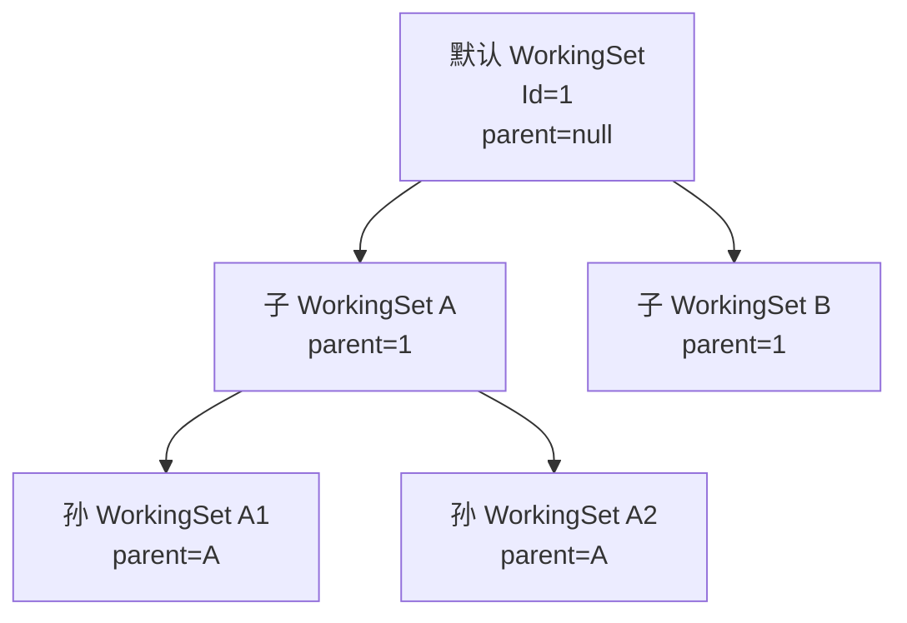
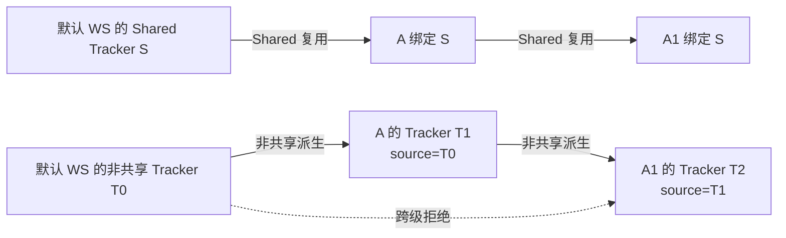
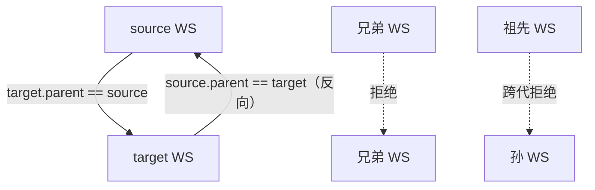
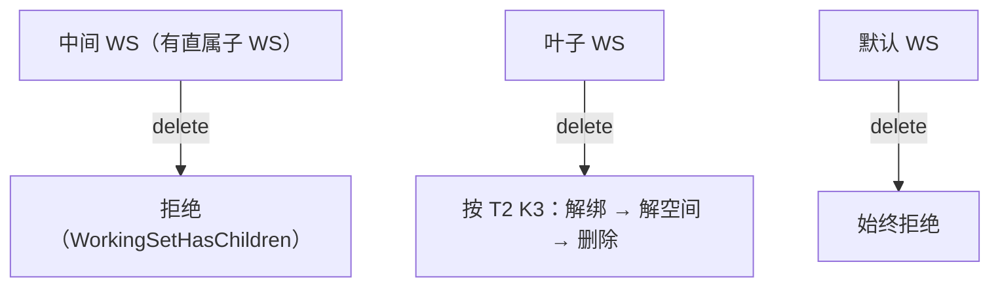

# WorkingSet 谱系与相邻父子 Merge

**状态：Draft（2026-11-12；由 FACT-028 用户裁定支撑，设计待评审）**

目的：展示 WorkingSet 单父谱系、子 WS Tracker 来源约束，以及 Merge 只允许直属父子的准入。不表达 GateFlow 版次链特例。

## 1. 谱系树

- 单父：每个非默认 WS 只有一个 `parentWorkingSetId`。
- 空范围子 WS 允许存在；谱系不因无 TrackerBinding 而缺失。
- 不允许自指、反向父子或环。

## 2. Tracker 来源约束

- 子 WS 只能从直属父 WS 获得 Tracker。
- Shared 复用父 WS 的 TrackerId；非共享创建新 Tracker + `sourceId` 指向父 WS 的 Tracker。
- 新绑定按 Tracker 来源校验直属父级范围。已有绑定的后续清理见[谱系设计](../domain/working-set-lineage-design.md)。

## 3. Merge 准入

- 只允许直属父子双向；`source/target` 是角色，不改变谱系方向。
- 兄弟、跨代一律拒绝；共享 Tracker 不参与 Merge。

## 4. 删除边界

- WorkingSet 与 Tracker 不存在“停用”生命周期（用户 2026-11-12 裁定），故不表达停用状态或命令。

## 5. 未表达内容

- 不表达 GateFlow 版次链特例。
- 不表达 Tracker 组织树（`parentId`）与派生链（`sourceId`）的内部细节，只表达它们与 WS 谱系的不同维度。
- 不表达 MergeRound/Checkpoint 的执行细节，见 T1 契约。
