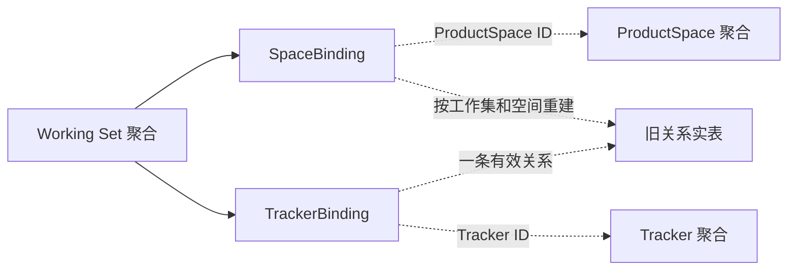

# 旧表绑定兼容

**Status: Draft**。2026-11-19，团队确认使用旧表这一项实施约束；本文不替代正式设计基线或 [ADR-0004](../adr/0004-productspace-independent-aggregate.md)。

| 术语 | 实施口径 |
| --- | --- |
| 空间挂载 | 工作集与产品空间之间存在有效 Tracker 关系。空间实体按关系重建；RELATION 表示此来源无法还原为历史初始化或手动挂载。 |
| 根文件夹 | 文件夹分类下 parent_id 为 NULL 或 0 的非共享 Tracker。同工作集、同产品空间最多一个，各工作集的根文件夹独立。它不进入比较合并。 |
| 解绑 | 删除使用方工作集的一条 Tracker 关系。最后一个业务 Tracker 解绑后保留根文件夹；显式卸载空间才解除根文件夹，继续校验内容及子节点。 |
| 隐藏 | 修改关系行 is_show，不改变绑定与空间挂载；可随时恢复。与 Tracker 的发布可见性分开。 |

文件夹的旧分类层级为 1007 / 100701 / 10070101。V4 当前的分类表只保存叶分类 10070101，作为 Tracker 的 tracker_class；Tracker 对象本身仍使用 Tracker 的自举类标识。

新库仅创建一张绑定实表 air_ws_workingset_branch_relation；旧 V4 绑定名仅为查询视图。基线字段不参与域内唯一性和范围重建。启动不会清空已有表；专用 Demo 支持重建，客户现场需先运行[只读核对](../../../deploys/db/verification/legacy-binding-preflight.sql)检查重复键、空引用、错空间和根文件夹，并确认是否仍有绕过 V4 的旧写入。

验收以 [TrackerDefaultAcceptanceTest](../../../deploys/src/test/java/bootstrap/TrackerDefaultAcceptanceTest.java) 的公共挂载、隐藏恢复及卸载入口为准。有效范围、跨聚合 ID 引用和显式删除依据 [绑定与删除契约](../domain/binding-deletion-contract-v1.md)；参考本地 DDD 的聚合章节及《实现领域驱动设计》的“通过标识引用其他聚合”，并应用 domain-modeling、ubiquitous-language、domain-driven-design 的术语和聚合检查。
