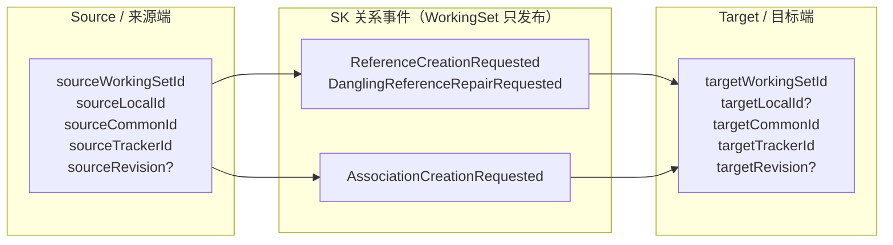

# T7-E 关系事件契约（2026-11-17 最新业务决策）

**状态：Draft（待用户确认）**。范围：T7-E 在创建/扩展工作集和 Merge 完成后的**关系事件发布**；WorkingSet 不操作 Reference/Association 聚合。

## 1. 职责边界

- Reference / Association 属于 SK，但**不属于 WorkingSet 聚合**。
- 工作集场景**不创建、不修改、不删除、不查询关系聚合**；只负责在正确时点发布关系事件。
- 关系/引用服务消费事件，建立新关系、修复悬空引用，并保存传播怀疑、关系类型、方向等额外信息。
- 常规业务 BC 修改/删除导致的关系变化由业务 BC 自行维护，不属于 T7-E。
- 工作集场景跳过权限，不产生 `Denied`；关系服务按数据可读性处理。
- 关系不参与 Compare/Merge。

## 2. 端点字段

### 2.1 Reference

Reference 不再指定“引用属性”，与 Association 一样只表达两个端点的关联，但额外固定版次：

| 端点 | 字段 |
| --- | --- |
| source | `sourceWorkingSetId`、`sourceLocalId`、`sourceCommonId`、`sourceTrackerId`、`sourceRevision` |
| target | `targetWorkingSetId`、`targetLocalId`、`targetCommonId`、`targetTrackerId`、`targetRevision` |

- `targetWorkingSetId` **必填**，悬空时也要写入；`targetLocalId` 可为空，表示目标尚未纳入/不可解析。
- 悬空引用仍保留逻辑目标（target tracker/common + revision）。
- `targetRevision` 是钉版；无钉版时为空。
- 关系身份由关系服务拥有；事件携带 `originalRelationId` 供消费方回查原始关系聚合。

### 2.2 Association

Association 不固定版次：

| 端点 | 字段 |
| --- | --- |
| source | `sourceWorkingSetId`、`sourceLocalId`、`sourceCommonId`、`sourceTrackerId` |
| target | `targetWorkingSetId`、`targetLocalId`、`targetCommonId`、`targetTrackerId` |

- 两侧端点齐全才建立 Association。
- 缺端点时关系服务保留恢复意图；工作集只发“建立新关联”事件，不自行落关联行。

### 2.3 图示



- Reference 事件带 `sourceRevision` / `targetRevision`；Association 事件不带版次。
- `targetWorkingSetId` 必填；`targetLocalId` 为空表示悬空 Reference；Association 创建事件要求端点在消费时齐全。
- 箭头是 ID 关联，不是聚合包含。

## 3. 事件类

事件统一带元数据：

```text
eventId            事件唯一标识
originalRelationId 原始 Reference/Association 聚合唯一标识
originId           触发本次事件的任务/轮次标识
originType         CREATION / EXTENSION / MERGE
occurredAt         事件发生时间
```

### 3.1 `ReferenceCreationRequested`

用途：创建/扩展时发现新的上游引用，请求关系服务建立 Reference。

载荷：

- 元数据；
- `ReferenceEndpoint source`；
- `ReferenceEndpoint target`（`targetWorkingSetId` 必填，`targetLocalId` 可空）。

### 3.2 `DanglingReferenceRepairRequested`

用途：目标后续被纳入/变得可解析时，请求关系服务修复同一 Reference。

载荷同 `ReferenceCreationRequested`，但 `originalRelationId` 必须是已有 Reference 聚合 ID；不得新建另一条引用。

### 3.3 `AssociationCreationRequested`

用途：创建/扩展时发现新的上游关联，请求关系服务建立 Association。

载荷：

- 元数据；
- `AssociationEndpoint source`；
- `AssociationEndpoint target`（无 revision）。

### 3.4 消费方回查

消费方按 `originalRelationId` 查询原始关系的：

- 传播怀疑；
- 关系类型/规则；
- 单向/双向标识；
- 来源业务对象、属性/关系元数据；
- 关系版本。

事件本身只负责定位原始关系；不复制这些可回查字段。

## 4. Step 与事件时点

### 4.1 创建/扩展工作集

阶段顺序：

```text
工作集本体
→ 产品空间
→ Tracker 复制/绑定
→ Item 索引
→ PUBLISH_RELATION_EVENTS（独立 step）
```

- `PUBLISH_RELATION_EVENTS` 在索引完成后执行；
- 只发布：
  - `ReferenceCreationRequested`（新引用）；
  - `DanglingReferenceRepairRequested`（目标已可解析的既有悬空引用）；
  - `AssociationCreationRequested`（新关联）。
- 下游引用/关联不发布事件。
- 不执行关系聚合写操作。

### 4.2 Merge

```text
Merge 完成
→ PUBLISH_RELATION_REPAIR_EVENTS（独立 step）
```

- Merge 成功后，按本轮实际变化的目标变体发布 `DanglingReferenceRepairRequested`；
- 需要新建的引用/关联按 Merge 决策结果发布对应创建事件；
- 关系修复不参与 Merge 成功判定。

### 4.3 失败语义

- 现阶段关系/引用处理失败**不自动重试**；
- 工作集侧只标记 `PUBLISH_RELATION_EVENTS` / `PUBLISH_RELATION_REPAIR_EVENTS` 失败；
- 关系服务消费失败由关系服务记录，不回滚工作集或 Merge；
- 不阻塞主流程，允许任务最终为 `PartiallySucceeded`；
- 后续是否重试、回滚或对账，另行裁定（QUESTION-018）。

## 5. 关系服务侧的守卫矩阵

以下由关系服务消费事件后执行，不是 WorkingSet 的行为：

| 场景 | Reference | Association |
| --- | --- | --- |
| 目标缺失 | 保留悬空 Reference；逻辑目标/钉版保留 | 保留恢复意图，不落 Association |
| 目标软删 | 保留行，标记软删 | 暂停/意图 |
| 目标永久删除 | 保留悬空，不自动重建 | 丢弃关系/意图 |
| 目标后续纳入 | 修复同一 `originalRelationId` | 按意图建立关联 |
| 钉版不可读 | 保留 pin，标记历史不可用，不降级 HEAD | 目标不可读标记 |
| 权限 | 工作集跳过；关系服务按自身权限策略处理 | 同左 |

## 6. 已实现的契约骨架

- `RelationSourcePort`：业务 BC 只读事实端口，提供 `upstreamReferences`、`upstreamAssociations`、`referencesTargeting`、`associationsTargeting` 及 `ReferenceFact`/`AssociationFact`。
- `EmptyRelationSourcePort`：业务 BC Adapter 尚未接入时的空实现，不伪造事件。
- `RelationEventPublisher`：按 fact 生成 `eventId`，保留业务 `originalRelationId`，发布三类 `...Requested` 事件。
- `RelationEventContractTest`、`RelationEventPublisherTest` 覆盖端点、悬空 target、Association 无版次和发布元数据。
- T7 创建/扩展已接入 `PUBLISH_RELATION_EVENTS`：索引后逐 Tracker 发布新引用/关联/悬空修复事件；失败记录为任务明细并进入 `PartiallySucceeded`，不自动重试。
- **尚未接入**：Merge 的 `PUBLISH_RELATION_REPAIR_EVENTS` step。

## 7. 待确认

1. `originalRelationId` 是业务关系聚合 ID，还是 WorkingSet 侧生成的关联事件 ID？建议使用业务关系聚合 ID。
2. `targetWorkingSetId` 悬空时也必填；`targetLocalId` 允许为空。此条已确认。
3. `PUBLISH_RELATION_EVENTS` 是否进入 T7 任务 stage/终态，还是独立关系构建记录；建议进入 stage 但不阻塞主流程。
4. Merge 后关系修复是独立 step，还是由 Merge 事件触发关系服务自行处理；建议独立 step + 事件。
5. 事件命名是否采用 `...Requested`（推荐，因为 WorkingSet 不拥有关系聚合）还是 `...Created`。
