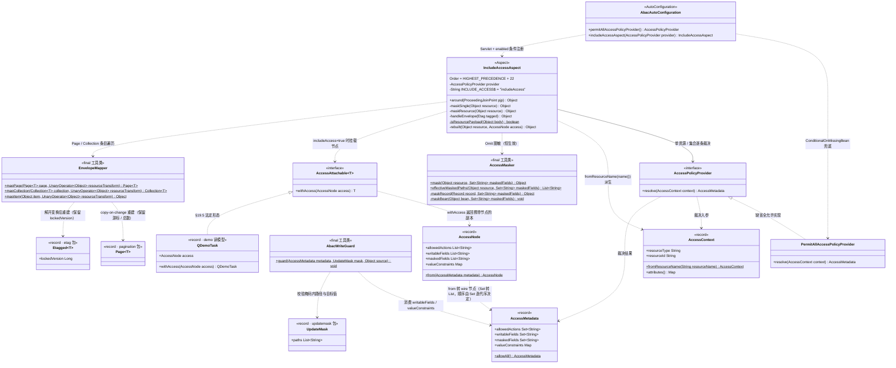
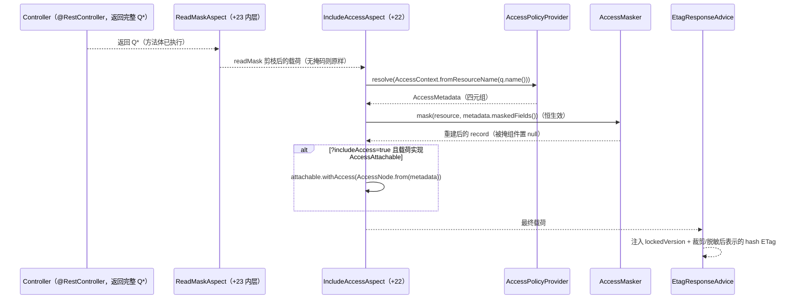

# abac — 多粒度访问控制（ABAC）契约执行：读脱敏 + `_access` 伴随节点 + 写路径校验

## 解决的问题

权限裁决（谁能看哪条数据、读写哪些字段、可写哪些值）是领域知识，**裁决引擎归属 IdentityAccess BC**（RBAC / ReBAC / ABAC 融合方案尚未定型，主规范 §19 登记）；但裁决结果在 RESTful 契约上的**表达与执行**是所有资源 BC 的共性需求。若各 BC 各写一套「字段置 null / 拼权限节点 / 逐字段 if 判越权」，必然出现口径漂移与反模式（脱敏挂条件、条目不可见返回 403 泄漏存在性、逐字段权限包装等，§19.7）。本包把裁决结果的**消费端契约与执行机制**收口：

- **消费缝隙**：`AccessPolicyProvider` SPI（BC / 宿主声明 Bean 供数）+ `AccessContext`（资源类型 + ID）+ `AccessMetadata`（四元组裁决结果）——资源 BC 只消费，**严禁私自实现裁决逻辑**（§19.5）。
- **读路径**：`IncludeAccessAspect` 拦截全部 `@RestController` 返回值，字段级脱敏（Omit）**恒生效**（不依赖任何开关）；`?includeAccess=true` 时仅单资源挂载 `_access` 伴随节点（`AccessNode`）。不可变 record 的脱敏由 `AccessMasker` 经规范构造器**重建**完成（置 null + `NON_NULL` 从报文消失）。
- **写路径**：`AbacWriteGuard` 静态工具承载 §19.3 校验链的「字段级写权限」与「值级约束」两步（403 + 逐条 `fieldViolations`，一次返回全部），由应用层命令服务显式调用。
- **共享信封遍历**：`EnvelopeMapper` 是 readMask 投影、ABAC 脱敏与流式导出共用的唯一 `Page` / `Collection` / `Etagged` 条目遍历实现（copy-on-change）。
- **向后兼容缺省**：`PermitAllAccessPolicyProvider` 全允许（零脱敏、零约束），未接入裁决的端点行为与历史完全一致；`AbacAutoConfiguration` 自动装配。

**边界**：条目级不可见 → 404（防存在性泄漏）由业务读路径按裁决结果落实（应用层返回 null → Controller 抛 NOT_FOUND），不在本包切面内；本包不实现裁决引擎，demo main 也不含裁决模拟（测试侧注入示范见 `DemoAbacQuickTest`）。

## 标准符合性

对照 SSOT：`.lattice/standards/v4/v4-restful-patterns-compliance.md` 矩阵「**多粒度访问控制（ABAC）**」行；契约规范：`v4-restful-api.md` §19。

| 权威条款 | 遵循口径 |
|---|---|
| **AIP-157**（Partial responses） | 按需裁剪与扩展资源表示：无权字段 Omit 移出报文；`_access` 为伴随元数据节点（核心业务字段保持纯净，反对逐字段 `{value, readable, writable}` 包装） |
| **AIP-161**（Field masks） | `writableFields` / `maskedFields` / `valueConstraints` 键采用 camelCase 点号路径（proto3 FieldMask JSON 映射惯例）；写校验对象 = 掩码内路径及其目标值 |
| **google.rpc `BadRequest.FieldViolation`**（error_details.proto，经 AIP-193 链接引用） | 403 逐字段违规明细 `{field, code, description}` **语义对齐**，但不引入 Google 错误信封（错误契约已定决策 #4） |
| **RFC 9457**（Problem Details for HTTP APIs） | 403 错误以 `application/problem+json` 承载，`fieldViolations` 为扩展成员（`DomainException#withFieldViolations` → `problem/ProblemDetails` 渲染） |
| 《API Design Patterns》**第 8 章** Partial retrievals | 元数据伴随节点思路的来源；原书与 AIP 均未上升到「字段级权限契约」层 |

**遵循口径：⭐ 自有系统扩展**——三级粒度（条目 404 / 字段 Omit / 值约束）契约化为本项目体系化扩展（§19.1）；**当前字段级执行只有 Omit（置 null 后由 `NON_NULL` 从报文消失），无独立的 Redact（值替换）形态**。**自动化梯队：🔵 Tier B（声明式接管）**：`Q*` 按 §19.5 法定形态声明 `_access` 可空组件并实现 `AccessAttachable`，脱敏与节点挂载由切面自动完成，业务无需计算权限字段。

**相关偏离登记：D17（流式导出的 ABAC 粒度）**——`:export` 流式端点不参与本包切面（`StreamingResponseBody` 非资源 record），由 BC 在请求线程按**集合段一次裁决**掩码集（`AccessPolicyProvider.resolve` 传无 ID 的 `AccessContext`），写出线程经 `EnvelopeMapper` + `AccessMasker` 逐条应用同一集合（demo `DemoTaskExportService` 为示例）；行级 `maskedFields` 差异不适用于 `:export`，需要行级脱敏走标准 List。

关键口径（均有单测锚定：`AccessMaskerTest` / `IncludeAccessAspectTest` / `AbacWriteGuardTest`）：

- **脱敏恒生效**：不依赖 `includeAccess` 开关（反模式「脱敏挂条件」）；`maskedFields`（服务端权限脱敏）与 `readMask`（客户端主动投影）正交，叠加顺序 = 先 readMask 剪枝（+23 内层）、后 ABAC 脱敏（+22）。
- **`_access` 仅单资源**：集合 List / `:batchGet` 即便误传 `includeAccess=true` 也不挂节点（§19.2）；集合条目**逐条独立裁决**（行级 `maskedFields` 可异），且仅处理实现 `AccessAttachable` 的条目。
- **空集合 = 不启用否定推断**：`writableFields` 为空 → 写白名单不生效（向后兼容）；非空即启用（不在集合 → 403）。显式 null 清空不受值约束限制（清空语义由业务校验裁决）。
- **三码不混用**：掩码白名单 400（拼写防御，第 1 步）、版本冲突 409（第 2 步）、值掩码白名单 403（权限语义，本包）。
- 单例资源（AIP-156，`name` 无 `/`）经载荷自声明 `AccessAttachable` 参与脱敏与挂载；未自声明且 `name` 无 `/` 的载荷不裁决（防误伤业务信封）。

## 使用方法

**自动化梯队：Tier B（声明式接管）**。读路径业务近乎零代码（`Q*` 声明法定形态即可）；写路径需应用层显式调用一次 `AbacWriteGuard.guard`；裁决供数需宿主声明一个 Bean。

**生效条件**：

1. Servlet Web 应用（classpath 存在 `RequestMappingHandlerAdapter`）+ `airedge.restful.abac.enabled=true`（缺省 true）→ `IncludeAccessAspect` 经 `AbacAutoConfiguration` 自动注册（已登记 `META-INF/spring/...AutoConfiguration.imports`，不依赖宿主扫描）。
2. **生产必须显式声明 `AccessPolicyProvider` Bean**（IdentityAccess 裁决引擎供数）。⚠ 缺省 `PermitAllAccessPolicyProvider` 是**开发兼容缺省，不是生产缺省**：漏配时 ABAC 静默失效（无 403、无脱敏、无日志信号），上线前检查容器内不得残留该缺省。
3. `Q*` 读模型按 §19.5 法定形态：`@JsonInclude(NON_NULL)` + 可空组件 `@JsonProperty("_access") AccessNode access` + 实现 `AccessAttachable<Q*>`。

**① 读模型法定形态**（demo `QDemoTask` 权威示例，节选）：

```java
@JsonInclude(JsonInclude.Include.NON_NULL)
public record QDemoTask(String name, String taskId, String title, /* …业务组件… */
        Long estimatedCostCents,
        @JsonProperty("_access") AccessNode access) implements AccessAttachable<QDemoTask> {

    @Override
    public QDemoTask withAccess(AccessNode access) {
        return new QDemoTask(name, taskId, title, /* …原组件… */ estimatedCostCents, access);
    }
}
```

**② 裁决供数 Bean**（语义取自 demo 测试侧 `DemoAbacQuickTest.XDemoRoleAccessPolicyProvider`；生产身份由认证层解析，**严禁信任前端传入身份**）：

```java
@Bean
public AccessPolicyProvider accessPolicyProvider() {
    return context -> {
        // context.resourceType() = "demoTasks"，context.resourceId() = 契约 ID（纯数字字符串）
        if (currentUserIsPlainUser()) { // 操作者属性由认证层 / 裁决引擎解析
            return new AccessMetadata(
                    Set.of("demoTaskGet"),                 // allowedActions（operationId）
                    Set.of("title", "description"),        // writableFields
                    Set.of("estimatedCostCents"),          // maskedFields（读取恒 Omit）
                    Map.of("description", Set.of("ALLOWED_DESC"))); // valueConstraints
        }
        return AccessMetadata.allowAll();
    };
}
```

**③ 写路径调用**（demo `DemoTaskCommandService#applyUpdate` 真实代码；§19.3 校验链第 3 / 4 步，前置的掩码白名单 400 与 `lockedVersion` 409 由 lib 其他切面完成）：

```java
AccessMetadata access = accessPolicyProvider.resolve(new AccessContext("demoTasks", command.taskId()));
AbacWriteGuard.guard(access, new UpdateMask(mask), command); // 越权 → 403 + 逐条 fieldViolations
```

**HTTP 示例——读路径**（`GET /v1/demoTasks/{id}?includeAccess=true`，当前用户无权读成本）：

```json
{
  "name": "demoTasks/623809242866016",
  "taskId": "623809242866016",
  "title": "行星减速齿轮箱总成",
  "lockedVersion": 3,
  "_access": {
    "allowedActions": ["demoTaskGet"],
    "writableFields": ["title", "description"],
    "maskedFields": ["estimatedCostCents"],
    "valueConstraints": { "description": ["ALLOWED_DESC"] }
  }
}
```

`estimatedCostCents` 已被 Omit（值置 null + `NON_NULL` 从报文消失，仅 `maskedFields` 留痕）；不带 `?includeAccess=true` 时脱敏照样生效、`_access` 键不出现。

**HTTP 示例——写路径 403**（`PATCH /v1/demoTasks/101?updateMask=title,description`，body `{"title":"新标题","description":"新描述","lockedVersion":3}`，裁决 `writableFields = ["title"]`——`description` 在掩码白名单内但不可写）：

```http
HTTP/1.1 403 Forbidden
Content-Type: application/problem+json

{
  "type": "https://api.airedgesoft.com/errors/forbidden",
  "title": "Forbidden",
  "status": 403,
  "detail": "当前用户不可写字段: description",
  "code": 300010018,
  "requestId": "req-1",
  "fieldViolations": [
    { "field": "description", "code": 300010018, "description": "当前用户不可写字段: description" }
  ]
}
```

目标值超出候选集时（如 `valueConstraints.description = ["ALLOWED_DESC"]` 而写入 `"新描述"`）逐条 `code = 300010019`（`VALUE_CONSTRAINT_VIOLATED`，`args` 携带路径与目标值）；多字段违规一次返回全部 `fieldViolations`。

## 设计方案



类职责一览（包内 11 个类型全覆盖）：

| 类名 | 职责 | 关键属性 | 关键方法 |
|---|---|---|---|
| `AccessPolicyProvider` | 裁决结果 SPI（消费缝隙，裁决引擎归 IdentityAccess BC） | — | `resolve(AccessContext)` → `AccessMetadata` |
| `PermitAllAccessPolicyProvider` | 缺省全允许实现（开发兼容缺省；⚠ 生产漏配 = ABAC 静默失效） | — | `resolve` 恒返 `AccessMetadata.allowAll()` |
| `AccessContext` | 裁决请求上下文（资源类型 + 契约 ID；身份由认证层解析） | `resourceType`、`resourceId` | `fromResourceName(String)`（按最后一个 `/` 切分；无 `/` = 类型级裁决）、`attributes()`（恒返回空 Map，预留扩展点，当前无宿主载荷字段） |
| `AccessMetadata` | 单条目裁决结果四元组（消费端契约，紧凑构造器防御性拷贝） | `allowedActions`、`writableFields`、`maskedFields`、`valueConstraints`（`Map<String, Set<String>>`） | `allowAll()`（四集合全空 = 全允许缺省） |
| `AccessNode` | `_access` wire 伴随节点（§19.2；`?includeAccess=true` 时随单资源返回） | 同四元组（`List` / `Map<String, List<String>>` 形态；`Set.copyOf` 不保证插入序，故 List 顺序不承诺稳定） | `from(AccessMetadata)` |
| `AccessAttachable<T>` | 「可挂载 `_access`」载荷契约（`Q*` record 实现；集合条目脱敏的准入判定） | — | `withAccess(AccessNode)` → 携带节点的新实例（record 不可变，返回副本） |
| `AccessMasker` | 字段级脱敏（Omit）执行器：record 经规范构造器重建置 null / Map 键不可变拷贝移除；bean 走 setter 置 null | — | `mask(Object, Set<String>)`（无掩码原样返回；被掩基本类型组件抛 `IllegalStateException`）、`effectiveMaskedPaths(Object, Set<String>)`（诊断探测，缺失路径静默跳过） |
| `EnvelopeMapper` | `Page` / `Collection` / `Etagged` 条目级 copy-on-change 映射（readMask / ABAC / 流式导出共用） | — | `mapPage`（保留 `nextPageToken` / `totalSize`）、`mapCollection`（稀疏位不补、保迭代序）、`mapItem`（解 `Etagged` 信封保留 `lockedVersion`）；无变化返回原引用 |
| `IncludeAccessAspect` | 读路径切面：脱敏恒生效 + `?includeAccess=true` 单资源挂节点；先 mask 后 attach（同一份裁决，无「声明已掩、报文仍有值」窗口） | `provider`、`INCLUDE_ACCESS = "includeAccess"`；`@Order(HIGHEST_PRECEDENCE + 22)` | `around(ProceedingJoinPoint)`（`@Around("@within(RestController)")`）；私有 `maskSingle` / `maskResource` / `handleEnvelope` / `isResourcePayload`（`name()` 含 `/` 或自声明 `AccessAttachable`）/ `rebuilt` |
| `AbacWriteGuard` | 写路径校验（§19.3 第 3 步字段写权限 + 第 4 步值约束；403 + 逐条 `fieldViolations` 一次全量） | — | `guard(AccessMetadata, UpdateMask, Object source)`（值经 `PropertyAccess.read` 点号路径读取；显式 null 跳过值约束；空 `writableFields` 不启用白名单） |
| `AbacAutoConfiguration` | 自动装配：缺省 Provider 兜底 + 切面条件注册；`AbacWriteGuard` 为静态工具无 Bean | — | `permitAllAccessPolicyProvider()`（`@ConditionalOnMissingBean(AccessPolicyProvider)`）、`includeAccessAspect(provider)`（`@ConditionalOnClass(RequestMappingHandlerAdapter)` + `airedge.restful.abac.enabled` 缺省 true + `@ConditionalOnMissingBean`） |

关键协作流程（读路径：先 readMask 剪枝 → ABAC 脱敏 → `_access` 挂载 → ETag 装配）：



集合形态（`Page` / `Collection`）：`EnvelopeMapper` 逐条遍历，仅对实现 `AccessAttachable` 的条目按各自 `name()` **逐条独立裁决**并脱敏，不挂 `_access`；有条目变化才重建信封（游标 / 总数 / `lockedVersion` 保留），零变化原引用透传。写路径：adapters / 应用层在掩码白名单 400 与版本断言 409 之后调用 `AbacWriteGuard.guard`，越权路径与目标值违规合并为一次 403 全量下发。

真实配置项 / 错误码：

- 配置：`airedge.restful.abac.enabled`（缺省 `true`；置 `false` 关闭切面注册，仅建议迁移期使用）。`includeAccess` 参数接受 `true`（忽略大小写 / 首尾空白）或 `1`。
- 错误码（`DomainRestCode`，模块号 001）：`FIELD_NOT_WRITABLE = 300010018`（403，「当前用户不可写字段: %s」）；`VALUE_CONSTRAINT_VIOLATED = 300010019`（403，「字段 %s 的目标值不在允许范围内: %s」）。均经 `DomainException.withFieldViolations` 携带逐条明细，由 `problem/ProblemDetails` 按 locale 渲染为 RFC 9457 扩展成员。
- 协议保留命名空间：`_access`（`_` 前缀，§2）；`allowedActions` 取值 = 端点 `operationId`（如 `demoTaskGet`），生命周期流转走冒号动词 + `allowedActions`，**不得**把状态字段放进 `writableFields`（§19.7）。