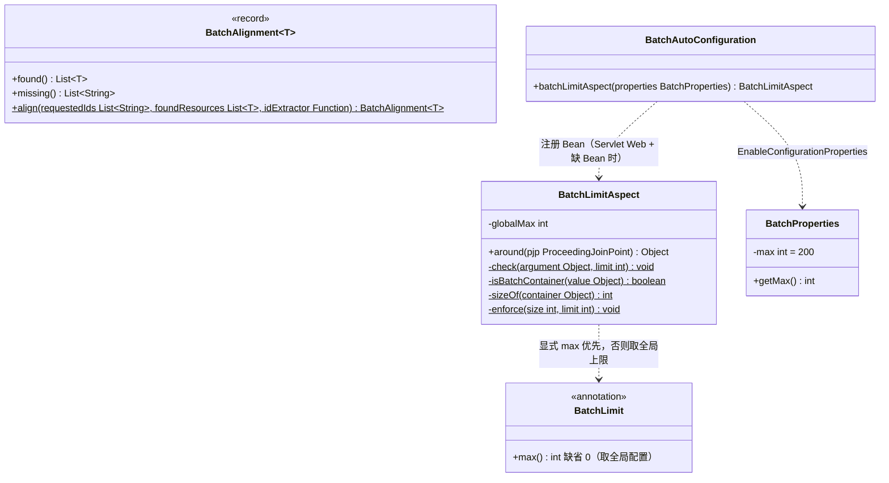

# batch — 同构批量操作的条数上限门禁与 :batchGet 稀疏对齐保序

## 解决的问题

同构批量端点（`:batchGet` / `:batchCreate` / `:batchUpdate` / `:batchDelete`）有两个必须框架收口的协议问题：

1. **容量攻击与超长事务**：客户端一次传几千条 ID「批量拉全表」，必须在适配层入口设硬性条数上限，超限在方法体执行前 400 快速失败；
2. **批量读的顺序与缺失语义**：存储层 `IN` 查询返回顺序不保证，且部分 ID 可能已被删除——批量读**不得**因 1 项缺失整批 404，命中项须按请求 ID 顺序对齐（稀疏返回），缺失清单单独给出供留痕 / 信封使用。

本包提供 `@BatchLimit` 注解 + 切面（上限门禁）与 `BatchAlignment.align(...)`（稀疏对齐工具）两件基建。

## 标准符合性

对照 SSOT：[.lattice/standards/v4/v4-restful-patterns-compliance.md](../../../../../../../../../../.lattice/standards/v4/v4-restful-patterns-compliance.md)「同构批量操作 (Batch Operations)」主题（矩阵 §2.2，遵循情况 **🔹 AIP 未定义**——AIP 对批量单项失败是否打断整批留白，项目在原书基础上自立裁决）。

| 权威 | 条款 | 遵循口径 |
|---|---|---|
| Google AIP | **AIP-231**（Batch: Get）、**AIP-233**（Batch: Create）、**AIP-234**（Batch: Update）、**AIP-235**（Batch: Delete） | 批量本体形态参照；`:batchGet` 承载与原子性按下述偏离登记执行 |
| 《API Design Patterns》 | 第 16 章 Batch operations（另涉 ch18 Bulk operations 的原子性立场） | 批量**写**保持 all-or-nothing（对齐原书 ch16/18）；批量**读**偏离原书「1/N 失败整批失败」 |
| RFC | RFC 9457（Problem Details） | 超限 400 / 批量写违规 422 均经 `application/problem+json` 承载 |

**相关偏离登记**（矩阵 §3 / §3.3）：

- **D3**：`:batchGet` **稀疏返回 + 顺序对齐**——缺失 ID 静默跳过（不占位、不报错），命中项顺序与去重后入参完全一致，缺失清单单独返回（`BatchAlignment` 即此语义的落点）；
- **D14**：`:batchGet` 用 **POST + body ID 数组**（AIP-231 要求 GET + `names` 查询参数、禁 body；项目为突破 URL 长度限制显式偏离）；
- **D10**：批量写违规一次性全量下发 **422 + `fieldViolations`（`items[N]` 项级寻址，不设 `failedIndex` 单下标字段）**。

**与应用层的分工**：批量写的 all-or-nothing 编排（整批判定、一实例一事务、失败本地补偿、`items[N]` 违规寻址、`validateOnly` 正交预检）在**应用层 CommandService** 执行（demo `DemoTaskCommandService#batchCreate / #batchUpdate` 为权威示例），本包不含事务 / 补偿逻辑，只提供入口上限门禁与读侧对齐工具。长流程 / 大批量走 `202 + LRO`（`lro` 包）。

## 使用方法

**自动化梯队：🔵 Tier B（声明式注解驱动）**——`@BatchLimit` 声明即生效（超限校验零手写）；`BatchAlignment.align` 为一行调用的静态工具。

### 1. :batchGet（demo 真实用法，摘自 `DemoTaskBatchController`）

```java
@BatchLimit                       // 缺省取全局上限（airedge.restful.batch.max，缺省 200），超限 400（方法体不执行）
@PostMapping("/v1/demoTasks:batchGet")
public Page<QDemoTask> batchGet(@RequestBody List<String> taskIds) {
    // 单条 IN 查询（消 N+1）；稀疏对齐保序由 BatchAlignment 收口
    List<String> requested = taskIds.stream().distinct().toList();
    BatchAlignment<QDemoTask> alignment = BatchAlignment.align(requested,
            queryService.listByIds(requested), QDemoTask::taskId);
    log.debug("batchGet requested={}, found={}, missing={}",
            requested.size(), alignment.found().size(), alignment.missing());
    return new Page<>(alignment.found(), null, alignment.found().size());
}
```

注意：集合尾段冒号动词须用**方法级全路径**声明（类上不加 `@RequestMapping`，否则 Spring MVC 路径拼接会在中间插入 `/`，破坏 AIP-136 `POST /v1/demoTasks:batchGet` 契约）。

### 2. @BatchLimit 的实参形态覆盖

```java
@BatchLimit                       // demo 真实用法：缺省取全局上限（200）
@PostMapping("/v1/demoTasks:batchDelete")
public BatchDeleteResponse batchDelete(@RequestBody List<String> taskIds) { ... }

// 可按端点收紧上限（示意）：@BatchLimit(max = 50)

// record 包装同样被校验：切面展开一层 RecordComponent，
// 全部 Collection / Map / 数组型组件逐一取条数（第二个集合超限同样 400）
@BatchLimit
@PostMapping("/v1/demoTasks:batchUpdate")
public BatchUpdateResponse batchUpdate(
        @RequestParam(value = "validateOnly", required = false, defaultValue = "false") boolean validateOnly,
        @RequestBody BatchUpdateDemoTaskRequest request) { ... }   // demo 另有 taskId 空集合守卫，此处略
```

顶层 `Collection` / `Map` / 数组直接取条数；record 只展开一层（更深嵌套非批量语义，交给字段级校验）；null 实参 / 散参（String 等）跳过。巨量数据导出**不适用**本注解（应走流式 `streaming.StreamingExportSupport`）。

### 3. HTTP 请求 / 响应示例

```http
POST /v1/demoTasks:batchGet
Content-Type: application/json

["101", "102", "103"]
```

→ `200 OK`（`102` 已删除 / 不存在，静默跳过；`Page` 信封，`totalSize` = 本次返回条数）：

```json
{ "items": [ { "taskId": "101", "...": "..." }, { "taskId": "103", "...": "..." } ],
  "totalSize": 2 }
```

传 201 条 ID → `400 Bad Request`（`application/problem+json`，code `300010015`，detail「批量请求条数超限: 201（上限 200）」）。

## 设计方案



> `BatchAlignment` 与 `BatchLimitAspect` 无直接调用关系：切面在方法执行前做门禁，Controller 方法体内调用 `align` 做读侧对齐（同一批量端点内先门禁、后对齐）。

### 类职责一览

| 类 | 职责 | 关键属性 | 关键方法 |
|---|---|---|---|
| `BatchLimit` | 方法级注解：声明批量端点条数上限 | `max`（缺省 0 = 取全局配置 `airedge.restful.batch.max`；显式正值按端点覆盖） | — |
| `BatchLimitAspect` | `@Around` 切面（`@Order(HIGHEST_PRECEDENCE + 18)`）：扫描全部实参，顶层 Collection/Map/数组直接取条数，record 展开一层组件逐一校验；任一超限抛 `DomainException(BATCH_LIMIT_EXCEEDED)` | `globalMax`（构造器注入，缺省 200） | `around(ProceedingJoinPoint)` |
| `BatchProperties` | 全局配置（前缀 `airedge.restful.batch`）：未显式声明 max 时的缺省上限 | `max=200` | 标准 getter/setter |
| `BatchAlignment<T>` | `:batchGet` 稀疏对齐结果 record：命中项按请求顺序、缺失清单单独返回 | `found`（请求序命中资源）、`missing`（请求序、已去重的未命中 ID） | `align(requestedIds, foundResources, idExtractor)`（静态泛型工厂） |
| `BatchAutoConfiguration` | 自动装配：注册配置与切面（`BatchAlignment` 为静态工具无需装配） | — | `batchLimitAspect(BatchProperties)`（`@ConditionalOnWebApplication(SERVLET)` + `@ConditionalOnMissingBean`，BC 可同型覆盖） |

### 关键协作流程

**batchGet 对齐**（`BatchAlignment.align`）：

1. `requestedIds` 为 null / 空 → 直接返回空对齐结果（双空清单）；
2. 存储返回的资源按 `idExtractor` 建 `LinkedHashMap`（同 ID 重复命中 `putIfAbsent` 只取首个）；
3. 请求 ID 经 `LinkedHashSet` **去重保序**后逐一查表：命中进 `found`（严格按请求顺序），未命中进 `missing`（不占位、不报错）；
4. 双清单 `List.copyOf` 不可变返回；调用方以 `found` 装 `Page` 信封，`missing` 留痕日志 / 埋点。

**上限门禁**（`BatchLimitAspect`）：方法执行前遍历实参 → 批量容器（Collection / Map / 数组）取 `size` → `size > max` 即 400，方法体不执行；record 包装展开一层组件全部逐一校验（防从次要集合绕过）。

### 配置项 / 错误码

| 项 | 值 | 说明 |
|---|---|---|
| 自动装配 | `META-INF/spring/...AutoConfiguration.imports` 注册 `BatchAutoConfiguration` | 不依赖宿主 `scanBasePackages` |
| `300010015` | `BATCH_LIMIT_EXCEEDED` → 400 | detail 携带实际条数与上限（`批量请求条数超限: %s（上限 %s）`） |
| 缺省上限 | `airedge.restful.batch.max`（缺省 200） | 全局配置；`@BatchLimit(max = N)` 按端点覆写 |
| 批量写违规 | 422 + `fieldViolations`（`items[N]`）/ 版本冲突 409 | 由应用层编排下发（D10），非本包错误码 |