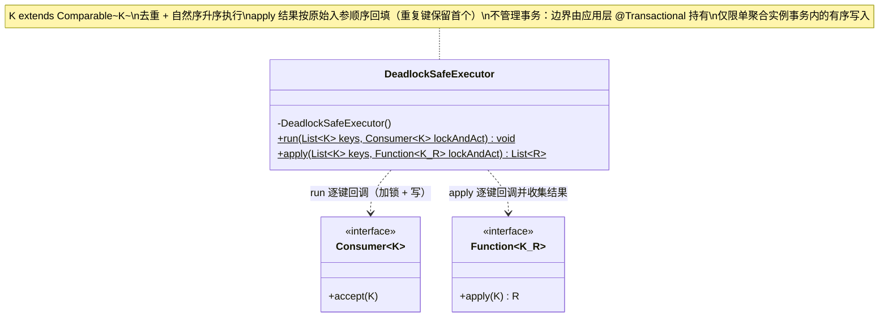

# concurrency — 主键升序加锁防死锁执行器

> 一句话定位：把「排序 → 依次加锁执行 → 结果按原始入参顺序回填」收口为一个静态工具，用全局确定的加锁全序消除同一组行上的锁等待环（死锁）。

## 解决的问题

并发事务以**不同顺序**对同一组行执行 `SELECT … FOR UPDATE` / `UPDATE` 时会形成锁等待环 → 数据库死锁。只要所有事务都按**主键升序**加锁（全局全序），环即不可能形成。本包提供 `DeadlockSafeExecutor`：

- 入参键**去重 + 自然序升序**后依次执行调用方回调（回调内做加锁读 + 写）；
- `apply` 形态把结果按**原始入参顺序**回填（与 `BatchAlignment` 同款保序语义，重复键只保留首个结果）；
- 空 / null 入参安全退化（`run` 直接返回，`apply` 返回空列表）。

**职责边界**：本类**不管理事务**——事务边界由应用层 `*CommandService` 的 `@Transactional` 持有；回调内异常即中断，已执行部分随外层事务回滚。

## 标准符合性

对照 SSOT：[`.lattice/standards/v4/v4-restful-patterns-compliance.md`](../../../../../../../../../../.lattice/standards/v4/v4-restful-patterns-compliance.md) 矩阵主题「**多资源操作与分布式事务**」：

- **《API Design Patterns》第 17 章** Multi-resource operations（两阶段提交与补偿事务模式）。
- **AIP 立场**：AIP 未设分布式事务专条，原则上不推荐跨服务分布式事务，推荐 Sagas / 事件驱动最终一致性。
- **遵循口径：🅰️ 遵循 AIP**——项目遵循 DDD 聚合设计原则（IDDD Rule 3 / Lattice One Transaction Rule：**一个事务只修改一个聚合实例**）；跨聚合（含同类型多实例）只允许只读校验，写变更走领域事件最终一致；批量 all-or-nothing 由「一实例一事务 + 失败本地补偿」兑现，长流程 / 大批量走 `202 + LRO`。
- **本类是该主题下的 Tier D 基建**（矩阵原文：框架提供 `DeadlockSafeExecutor` 主键升序加锁防死锁工具）。纯并发安全工具，无直接对应的 AIP 编号 / RFC 条款；它支撑的是上述事务纪律下的**有序写入**。
- **使用红线（矩阵明示）**：只用于**单聚合实例事务内**的有序写入（如聚合内多行子实体的确定性加锁次序）；跨实例批量已改为「一实例一事务 + 失败本地补偿」，**不得据此在同一事务内写多个聚合实例**。
- 无偏离登记（D#）涉及本类；相关的批量语义偏离（D3 / D10）属 batch 包主题。

## 使用方法

**自动化梯队：🟠 Tier D（核心领域语义，框架提供基建）**。纯静态工具类：**无 Spring Bean、无自动装配、无配置项、无注解**——不在 `AutoConfiguration.imports` 中注册，是否使用、锁哪些行、事务边界在哪，完全由业务工程师显式决策。

真实签名（泛型键须实现 `Comparable`）：

```java
public static <K extends Comparable<K>> void run(List<K> keys, Consumer<K> lockAndAct)
public static <K extends Comparable<K>, R> List<R> apply(List<K> keys, Function<K, R> lockAndAct)
```

### 示例 1：无返回值形态（单测 `DeadlockSafeExecutorTest` 真实用例）

```java
List<Long> executionOrder = new CopyOnWriteArrayList<>();
DeadlockSafeExecutor.run(List.of(30L, 10L, 20L), executionOrder::add);
// executionOrder == [10, 20, 30] —— 无论入参顺序如何，恒按主键升序执行（全局加锁全序）

DeadlockSafeExecutor.run(List.of(2L, 2L, 1L), executionOrder::add);
// 去重：只执行 [1, 2]
```

### 示例 2：结果保序回填（单测真实用例）

```java
List<String> results = DeadlockSafeExecutor.apply(List.of(30L, 10L, 20L), key -> {
    // 回调内执行加锁读 + 业务动作（如 SELECT … FOR UPDATE 后写入），须在外层 @Transactional 内
    return "r" + key;
});
// 执行次序：10 → 20 → 30（升序加锁）
// results == ["r30", "r10", "r20"] —— 结果按原始入参顺序回填，非执行顺序
```

### 示例 3：典型业务形态（应用层事务内，聚合内子实体有序写入）

```java
@Transactional
public void reorderSteps(String taskId, List<Long> stepIds) {
    DemoTask task = repository.byId(taskId);          // 单聚合实例事务
    DeadlockSafeExecutor.run(stepIds, stepId -> {
        // 按主键升序对聚合内步骤行加锁并写入，杜绝并发重排死锁
        repository.lockStepForUpdate(taskId, stepId);
        repository.applyStepChange(taskId, stepId);
    });
}
```

仓内配套：lib-jdbc `JdbcSoftDelete.softDeleteByIds` 批量软删即按「主键升序执行，兼容 `DeadlockSafeExecutor` 的加锁次序约定」构建。

## 设计方案

### 类图（覆盖包内全部 1 个类）



> `Consumer` / `Function` 为 JDK `java.util.function` 外部接口（协作方，非本包类型）；泛型约束真实签名为 `<K extends Comparable<K>>` 与 `<K extends Comparable<K>, R>`。

### 类职责一览

| 类名 | 职责 | 关键属性 | 关键方法 |
|---|---|---|---|
| `DeadlockSafeExecutor` | final 工具类（私有构造器，纯静态）：确定性加锁次序执行器——键去重后按自然序升序依次执行回调，消除锁等待环；`apply` 用 `LinkedHashMap` 收集结果后按原始入参顺序对齐回填（`results.remove(key)` 保证重复键只取首个），返回不可变 `List.copyOf` | 无实例状态 | `static <K extends Comparable<K>> void run(List<K>, Consumer<K>)`（null / 空直接返回）；`static <K extends Comparable<K>, R> List<R> apply(List<K>, Function<K, R>)`（null / 空返回 `List.of()`） |

### 关键协作流程

1. 调用方（应用层 `@Transactional` 方法内）传入原始顺序的聚合键列表与「加锁 + 业务动作」回调；
2. `distinct().sorted(Comparator.naturalOrder())` 得到全局统一的加锁次序——所有并发事务对同一组键产生相同次序，锁等待图无环；
3. 依次执行回调（`run` 用 `forEach`；`apply` 先按升序执行并把结果存入 `LinkedHashMap`）；
4. `apply` 再遍历**原始入参**键序，从 map 中 `remove` 并追加结果——顺序对齐 + 重复键天然只保留首个；
5. 任一回调抛异常即中断传播，已执行部分随外层事务回滚（本类不做补偿、不吞异常）。

### 配置项 / 错误码 / 常量

无。本类不注册 Bean、不读取配置、不抛业务错误码；死锁防护效果依赖调用方遵守「回调内先加锁后写入 + 外层单聚合实例事务」的约定。