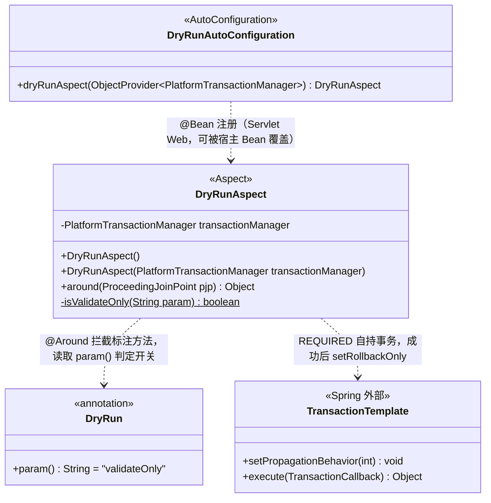
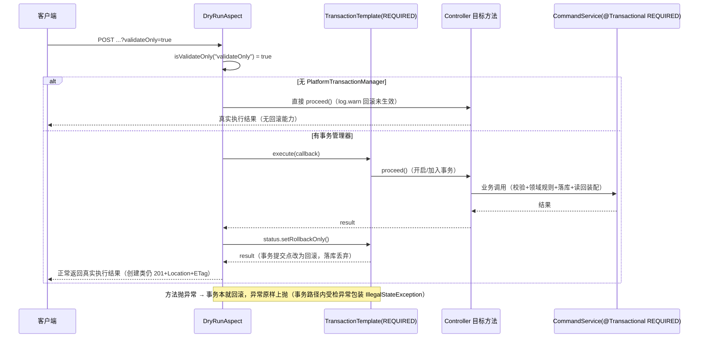

# dryrun — validateOnly 仿真预检：完整执行 + 事务回滚，零落库拿到真实校验结论

## 解决的问题

调用方（前端表单「校验」按钮、上游系统试算）希望在**不产生任何副作用**的前提下，知道「这笔创建 / 命令请求如果真正提交，会不会成功、结果长什么样」。模拟推演式的预检容易与真实执行路径失真（漏跑领域规则、漏跑唯一性约束）。

本包提供 `@DryRun` 注解 + `DryRunAspect` 切面：请求带 `?validateOnly=true` 时，切面用 `TransactionTemplate`（`PROPAGATION_REQUIRED`）**自持事务**包住目标方法并**完整执行**——全部参数校验、领域规则、事件发布、响应读回装配照常跑；成功返回前置 `setRollbackOnly`，响应正常返回（调用方拿到真实执行结果），落库变更随事务回滚丢弃。校验失败则异常照常抛出（事务本就回滚），走全局异常链返回对应 problem+json。业务代码零编写 `if (validateOnly) return;`。

## 标准符合性

对照 SSOT：`.lattice/standards/v4/v4-restful-patterns-compliance.md` §2.2「仿真预检 (Dry-Run)」主题行。

| 标准 | 条款 | 遵循口径 |
|------|------|----------|
| AIP-163 | Change validation（变更校验） | **🅰️ 遵循 AIP**：`validate_only` 为请求消息字段语义，经标准 HTTP 映射（body 载资源、其余请求字段映射 URI Query）以 **Query 参数 `?validateOnly=true`** 承载；预检执行完整校验后不落库 |
| 《API Design Patterns》(Geewax) | 第 27 章 Request validation | 机制遵照（完整校验、零副作用）；原书将 `validateOnly` 作为 Body 布尔字段演示，本项目弃用该形式 |
| AIP-134 | Standard methods: Update（HTTP 映射条款） | Query 承载正是该条款的规范形式（`:batchCreate` 请求体为命令数组，Query 亦是唯一可行载体） |

**偏离登记 D8（validateOnly 预检形态）**：原书 ch27 Body 布尔字段 → Query 参数。按矩阵 §3 说明，D8 属「遵 AIP 弃原书」，**对 AIP 非偏离**；与 `updateMask` / `readMask` 的 Query 形态同源对齐，便于网关统一识别与缓存友好。

## 使用方法

**自动化梯队：🟢 Tier A（框架完全接管），业务逻辑层无需感知**——不写任何 `validateOnly` 分支、Controller 不声明 `@Transactional`。端点侧唯一动作是在写端点方法上**声明 `@DryRun` 注解**（触发开关），其余全部由切面黑盒闭环。

生效条件：

1. `DryRunAutoConfiguration` 经 `META-INF/spring/org.springframework.boot.autoconfigure.AutoConfiguration.imports` 自动装配（Servlet Web 应用时注册 `DryRunAspect`，`@ConditionalOnMissingBean` 可被宿主覆盖）；
2. 目标方法标注 `@DryRun`（切面 `@Around("@annotation(...DryRun)")`，order = `HIGHEST_PRECEDENCE + 19`，位于条件请求 +15 / 掩码 +16 / 排序 +17 / 批量上限 +18 等协议切面之后——预检回滚的是事务，参数校验类切面先行）；
3. 请求 Query 带 `validateOnly=true`（大小写不敏感）或 `validateOnly=1`（值经 trim；`false` / 缺省 = 原样执行）。参数名可经 `@DryRun(param = "...")` 定制；
4. 容器存在 `PlatformTransactionManager`；**无事务管理器时降级为直接执行并告警**（校验结论仍成立，但无法回滚——单测 / 非事务宿主路径）。

真实示例（demo 权威用法：`airedge-v4/demo-singlemodule/.../adapters/DemoProjectController.java` 的 `create`）：

```java
@DryRun
@ResponseStatus(HttpStatus.CREATED)
@PostMapping
@EtagResource
public QDemoProject create(@RequestBody CreateDemoProjectRequest request) {
    // 常规创建逻辑，无任何 validateOnly 分支；不声明 @Transactional
    ...
}
```

HTTP 预检请求 / 响应（**创建类预检仍返回 201 + Location + ETag**，端点状态码语义不变；数据已回滚，Location 指向的资源实际不存在）：

```http
POST /v1/demoProjects?validateOnly=true HTTP/1.1
Content-Type: application/json

{"code":"PRJ-001","name":"示范项目"}
```

```http
HTTP/1.1 201 Created
Location: /v1/demoProjects/1234567890
ETag: "sha256-..."

{ ...真实执行装配出的资源表示（落库已回滚）... }
```

校验失败时与真实提交完全一致：异常照常上抛（如 400 / 422 problem+json），事务回滚。

**事务边界**：切面自持事务，应用层 `*CommandService` 的 `@Transactional` 以 `REQUIRED` 加入本事务（事务纪律：`@Transactional` 只出现在 application 层，Controller / 领域层禁止——矩阵规则 12）。目标方法抛受检异常时（事务路径内）包装为 `IllegalStateException`（受检异常不属于控制器方法契约，避免新增自定义异常类型）；无事务管理器的降级路径直接执行，受检异常原样传播。

## 设计方案



> `DryRun` 为方法级运行时注解（`@Target(METHOD)`、`@Retention(RUNTIME)`、`@Documented`）；`DryRunAspect` 标注 `@Aspect @Order(Ordered.HIGHEST_PRECEDENCE + 19)`。`TransactionTemplate` / `PlatformTransactionManager` 为 Spring 外部协作类，仅为表达回滚链画出。

### 类职责一览

| 类名 | 职责 | 关键属性 | 关键方法 |
|------|------|----------|----------|
| `@DryRun`（注解） | 端点预检语义声明（opt-in 触发开关） | `param()` 缺省 `"validateOnly"`（值 `true`/`1` 视为开启） | — |
| `DryRunAspect` | 开关判定 → 自持事务完整执行 → 成功前置 `setRollbackOnly`；无事务管理器降级告警放行 | `transactionManager`（可 null） | `around(ProceedingJoinPoint)`（`@Around` 通知）、`isValidateOnly(String)`（从 `RequestContextHolder` 取当前请求参数） |
| `DryRunAutoConfiguration` | 自动装配切面：`ObjectProvider` 注入事务管理器（可为空），`@ConditionalOnMissingBean(DryRunAspect.class)` | — | `dryRunAspect(ObjectProvider~PlatformTransactionManager~)` |

### 关键协作流程（DryRun 事务回滚链）



### 配置项 / 行为参数

| 项 | 值（以代码为准） |
|----|------------------|
| 开关参数 | Query `validateOnly=true`（忽略大小写、trim）或 `validateOnly=1`；`false` / 其他值 / 缺省 = 照常执行 |
| 参数名定制 | `@DryRun(param = "customName")` |
| 切面顺序 | `@Order(Ordered.HIGHEST_PRECEDENCE + 19)`（协议切面族之后） |
| 事务传播 | `TransactionDefinition.PROPAGATION_REQUIRED`（已有事务则加入） |
| 降级路径 | 无 `PlatformTransactionManager` → `log.warn` 后直接执行（校验结论成立、不回滚） |
| 受检异常 | 事务路径内包装为 `IllegalStateException("DryRun 目标方法抛出受检异常", t)`；无事务管理器降级路径原样传播 |
| 非 Web 上下文 | `RequestContextHolder` 无 `ServletRequestAttributes` → 视为未开启，原样执行 |
| 可配置 Bean | 宿主声明自定义 `DryRunAspect` Bean 即覆盖默认装配；无独立 `application.yml` 配置项 |

测试参考：`src/test/java/com/airedgesoft/lib/restful/dryrun/DryRunAspectTest.java`（开关真值表 `true`/`1`/`false`/缺省、无事务放行、异常传播；事务内 `setRollbackOnly` 路径由宿主集成验证）。