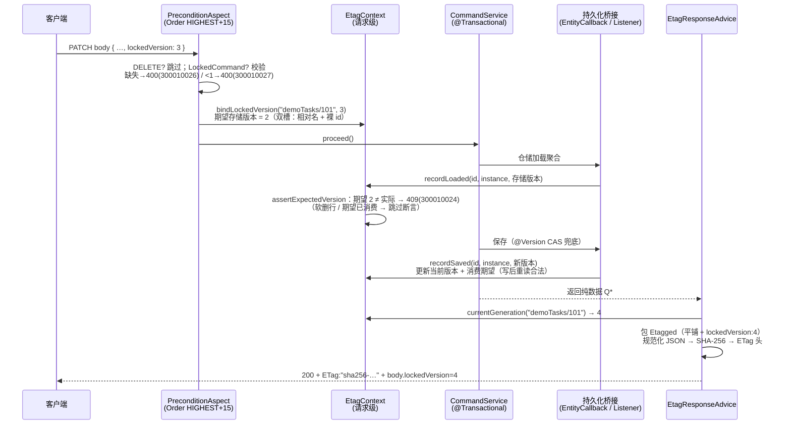

# etag — 并发代数（lockedVersion）与表示 hash ETag 的协议装配基建

> 一句话定位：让「乐观并发控制（body `lockedVersion`）」与「HTTP 缓存校验（响应头 `ETag: "sha256-…"`）」彻底分离，并由框架在请求出入口全自动装配——业务应用层 / 领域层对版本概念零感知。

## 解决的问题

1. **写请求防并发覆盖**：两个客户端同时修改同一资源时，后提交者不能静默覆盖先提交者。本包以请求体 `lockedVersion`（对外并发代数，≥1 = 存储 `@Version` + 1）作为并发凭据，框架切面强制校验（缺失 / 非法 → 400，不匹配 → 409），仓储加载时做前置断言，写入时由存储乐观锁 CAS 兜底。
2. **响应自动携带并发代数**：应用层读模型 `Q*` 是纯数据 record（不声明版本字段），框架在 HTTP 出口按端点身份声明从请求级上下文取当前代数，平铺注入 body 的 `lockedVersion`（单资源与集合条目同名同义），业务零手写。
3. **HTTP 缓存校验器**：所有可序列化响应恒下发 `ETag: "sha256-…"`（最终响应表示的规范化序列化 hash，与并发无关；序列化失败则跳过 ETag 不阻断业务）；标注 `@EnableRepresentationCache` 的只读端点额外评估 `If-None-Match` 支持 304，节省重复拉取的带宽。
4. **创建响应补 Location**：201 Created 响应按载荷 `name()`（AIP-122 相对资源名）自动派生 `Location: /v1/{name}`。
5. **版本观测零侵入**：Spring Data JDBC 实体回调 / lib-jdbc 聚合生命周期监听器自动把加载 / 保存的存储版本登记进请求级上下文（`EtagContext`），仓储与映射器无需手工登记。

**关键裁决（决策 C4 / C5）**：`ETag` 只是表示 hash（缓存校验器），**不作为并发令牌**；`If-Match` 不参与业务并发；并发只依赖 body `lockedVersion`。二者不再互相派生。

## 标准符合性

对照 SSOT：[`.lattice/standards/v4/v4-restful-patterns-compliance.md`](../../../../../../../../../../.lattice/standards/v4/v4-restful-patterns-compliance.md)（28 主题矩阵）。

| 矩阵主题 | 权威标准 | 遵循口径 | 偏离登记 | 本包承载 |
|---|---|---|---|---|
| 并发控制与版本防并发 | **AIP-154**（Resource freshness / etag）；《API Design Patterns》**第 28 章** Concurrency control；RFC 9110（409 Conflict） | **🅰️ 遵循 AIP**：版本不匹配统一 409（对齐 AIP-154 的 ABORTED→409）；凭据位置遵项目裁决走 **body `lockedVersion`** 而非 AIP 的 `If-Match` / etag 字段 | **D13**（凭据位置：body lockedVersion）、**D11**（冲突状态码 409，对齐 AIP 非偏离） | `LockedCommand` / `BatchLockedCommand` / `IdentifiedLockedCommand` / `PreconditionAspect` / `EtagContext` 断言链 |
| 标准方法：获取 (Get) | **AIP-131**（Standard methods: Get）；《API Design Patterns》**第 6 章**；RFC 9110 §8.8.3（ETag）、§13.1.2（If-None-Match）、§15.4.5（304） | **✅ 完全遵照**：业务读默认恒 200（不评估 `If-None-Match`）；仅 `@EnableRepresentationCache` 端点支持 304（**📘 遵 RFC 9110 条件请求语义**，含 `*`、逗号列表、`W/` 弱校验器归一） | — | `EtagResponseAdvice` 恒下发表示 hash ETag；304 判定 = 本次表示 hash 与 `If-None-Match` 归一后精确比较（`EnableRepresentationCache` + `EtagSupport.normalize`）；`EtagHashCache` 仅写侧登记，当前不参与 304 决策 |
| 标准方法：创建 (Create) | **AIP-133**（Standard methods: Create）；《API Design Patterns》**第 6 章**；**RFC 9110 §15.3.2**（201 Created）、§10.2.2（Location） | **✅ 完全遵照**：201 + `Location` + 新资源 ETag 属 REST 惯例，由框架按载荷 `name()` 自动派生 | — | `EtagResponseAdvice.applyLocationForEnvelope` / `assembleSingle`（`ResourceName` 读 `name()`） |
| 标准方法：删除 (Delete) | AIP-135；RFC 9110 §9.2.2（DELETE 幂等） | **📘 遵照 RFC**：删除 / 恢复族**豁免版本校验**（`@DeleteMapping` 及冒号动词 / 方法名属 `delete` / `undelete` / `expunge` / `purge` / `batchDelete` 的自定义端点切面直接跳过；命令不实现 `LockedCommand` 亦天然豁免） | **D2**（幂等 204，由 softdelete 包兑现；本包承载豁免口径） | `PreconditionAspect.isDeleteMethod` + `LockedCommand` 接口识别 |

补充口径（矩阵 §3.1）：409 同时承载业务状态机冲突，两类以 `code` 区分——版本类固定 `300010024`，客户端按 code 决定「刷新重试」还是「满足前置条件」。`Etag` / `Etagged` / `EtagSupport` 为协议类型，**BC 业务代码禁止引用**（ArchUnit 规则 11b：BC 代码不得引用 `Etagged` / `Etag` / `EtagSupport` 协议类型；另有 Controller 端点须返回纯数据 `Q*` / `Page<Q*>` 的规则，协议装配由框架依 `@EtagResource` 完成）。

## 使用方法

**自动化梯队：🟢 Tier A（框架完全接管）**。两个自动装配类均已注册在 `META-INF/spring/org.springframework.boot.autoconfigure.AutoConfiguration.imports`（`EtagAutoConfiguration`、`PreconditionAutoConfiguration`），引入 lib-restful 依赖即生效，不依赖宿主 `scanBasePackages`。**业务层无需感知版本校验、代数注入、ETag 计算与 Location 派生**，生效条件与轻量声明如下：

| 能力 | 生效条件 | 业务感知 |
|---|---|---|
| 写路径 `lockedVersion` 校验 + 409 | Servlet Web 环境 + 请求体 record 实现 `LockedCommand`（批量实现 `BatchLockedCommand`）；`airedge.restful.precondition.enabled` 缺省 true | 只需在写请求体声明 `Long lockedVersion` 组件 |
| 响应注入 `lockedVersion` | 实体声明 `@Version`（Spring Data JDBC）或走 lib-jdbc `JdbcAggregateStore`（桥接 Bean 按 classpath 条件自动激活）；端点标注 `@EtagResource` 声明并发身份 | `Q*` 保持纯数据，不声明版本字段 |
| `ETag: "sha256-…"` 头 | 恒生效（所有可序列化响应；序列化失败跳过） | 零感知 |
| 201 + `Location: /v1/{name}` | 端点标注 `@ResponseStatus(HttpStatus.CREATED)`，载荷有 `name()` 访问器 | 零感知 |
| 条件读取 304 | 端点或 Controller 类显式标注 `@EnableRepresentationCache`（默认关闭，opt-in） | 一个注解 |

### 示例 1：写请求强制版本（demo `DemoTaskController` / 单测 `PreconditionAspectTest` 真实形态）

```java
// adapters 层请求体：实现 LockedCommand 即被框架强制校验
public record LockedVersionRequest(Long lockedVersion) implements LockedCommand {}

// 无业务体的自定义方法端点（:activate / :complete）
@PostMapping("/{taskId}:activate")
@EtagResource("taskId")            // 并发身份 = 路径变量 taskId（父聚合）
public QDemoTask activate(@PathVariable("taskId") String taskId,
        @RequestBody LockedVersionRequest request) {
    commandService.activate(taskId);
    return requireTask(taskId);    // 返回纯数据 Q*，lockedVersion/ETag 由框架装配
}
```

```http
PATCH /v1/demoTasks/101?updateMask=title
Content-Type: application/json

{ "title": "新标题", "lockedVersion": 3 }
```

```http
HTTP/1.1 200 OK
ETag: "sha256-9f86d081884c7d65…（最终表示的 SHA-256 hex）"

{ "name": "demoTasks/101", "taskId": "101", "title": "新标题", "lockedVersion": 4 }
```

失败形态（RFC 9457 problem+json，由全局异常处理器翻译）：

- body 缺 `lockedVersion` → **400**，`code = 300010026`（"写请求必须携带 lockedVersion"）；
- `lockedVersion < 1` → **400**，`code = 300010027`（"lockedVersion 必须为正整数: …"）；
- 与当前代数不符 → **409**，`code = 300010024`（"资源 demoTasks/101 已变化（期望版本 2），请刷新后重试"）。

### 示例 2：批量写逐条版本（`PreconditionAspectTest` 真实样例）

```java
record BatchItem(String id, Long lockedVersion) implements IdentifiedLockedCommand {}
record BatchCommand(List<BatchItem> items) implements BatchLockedCommand {}

@PostMapping("/v1/demoTasks:batchUpdate")
public void batchUpdate(@RequestBody BatchCommand command) { … }
```

每个条目必须携带 `id` + `lockedVersion`：任一条缺失 / 非法 → 400（整批拒绝，不进入业务事务）；任一条不匹配 → 409，整批原子不落库。

### 示例 3：条件读取 304（demo `DemoTaskController#get` 权威示例）

```java
@GetMapping("/{taskId}")
@EtagResource("taskId")
@EnableRepresentationCache        // 读多写少、客户端重复拉取的只读端点才开启
public QDemoTask get(@PathVariable("taskId") String taskId) { return requireTask(taskId); }
```

```http
GET /v1/demoTasks/101
→ 200 OK
  ETag: "sha256-…"
  Vary: Authorization, Accept, Accept-Encoding
  Cache-Control: private, no-cache
  body: { "name": "demoTasks/101", …, "lockedVersion": 3 }

GET /v1/demoTasks/101
If-None-Match: "sha256-…"        ← 回传上次 ETag（支持 W/ 弱形态、逗号列表、*）
→ 304 Not Modified（无 body）
```

未标注注解的端点忽略 `If-None-Match`，恒 200 + 响应体（ETag 头照常下发）。

### 示例 4：创建 201 + Location（`EtagResponseAdviceTest` 验证行为）

```http
POST /v1/demoTasks
→ 201 Created
  Location: /v1/demoTasks/777     ← 按载荷 name() 派生
  ETag: "sha256-…"
  body: { "name": "demoTasks/777", …, "lockedVersion": 1 }
```

### 非 HTTP 场景（单测 / 定时作业）

无请求上下文时 `EtagContext` 回退线程级状态，须用显式作用域建立期望（finally 还原，防线程池泄漏）：

```java
EtagContext.withExpected("demoTasks/101", 2L, () -> {   // 参数为存储版本（代数 - 1）
    repository.byId("101");                            // 加载断言：不符 → 409
});
EtagContext.clear();                                    // 清空线程回退状态
```

## 设计方案

### 类图（覆盖包内全部 20 个顶层类型 + 4 个嵌套类型）

```mermaid
classDiagram
    class Etag {
        <<interface>>
        +lockedVersion() Long
    }
    class Etagged~T~ {
        <<record>>
        +T resource
        +Long lockedVersion
        +of(T resource, Long lockedVersion) Etagged$
        +from(T resource, String resourceName) Etagged$
    }
    class LockedCommand {
        <<interface>>
        +lockedVersion() Long
    }
    class IdentifiedLockedCommand {
        <<interface>>
        +id() String
    }
    class BatchLockedCommand {
        <<interface>>
        +items() List
    }
    class EtagResource {
        <<annotation>>
        +value() String
    }
    class EnableRepresentationCache {
        <<annotation>>
    }
    class PreconditionAspect {
        -PreconditionProperties properties
        +around(ProceedingJoinPoint pjp) Object
        -bindSingle(Method, Object[], LockedCommand)$
        -bindBatch(BatchLockedCommand)$
        -bindingTarget(Method, Object[]) String$
        -isDeleteMethod(Method) boolean$
    }
    class PreconditionProperties {
        -boolean enabled = true
        +isEnabled() boolean
        +setEnabled(boolean)
    }
    class PreconditionAutoConfiguration {
        +preconditionAspect(PreconditionProperties) PreconditionAspect
    }
    class EtagContext {
        -ThreadLocal~State~ FALLBACK$
        +bindLockedVersion(String resourceName, long generation)$
        +expectedStorageVersion(Object identityOrName) Long$
        +assertExpectedVersion(Object identityOrName, Long actualVersion)$
        +recordLoaded(Object identityOrName, Object instance, Long storageVersion)$
        +recordObserved(Object identityOrName, Object instance, Long storageVersion)$
        +recordSaved(Object identityOrName, Object instance, Long newStorageVersion)$
        +currentGeneration(Object identityOrName) Long$
        +currentStorageVersion(Object identityOrName) Long$
        +withExpected(Object identityOrName, Long storageVersion, Runnable action)$
        +capture() Snapshot$
        +restore(Snapshot snapshot)$
        +clear()$
        ~rawIdOf(Object identityOrName) String$
    }
    class Snapshot {
        <<record>>
        +Map~String,Long~ expected
        +Map~String,Long~ current
        +Set~String~ expectationConsumed
    }
    class State {
        -int OBSERVE_LIMIT = 8192$
        -Map~String,Long~ expected
        -Map~String,Long~ current
        -Map~Object,Long~ loaded
        -Set~String~ expectationConsumed
        -boolean observationOverflowReported
        -isEmpty() boolean
    }
    class EtagSupport {
        +normalize(String header) String$
        +generationOf(Long storageVersion) Long$
        +storageVersionOf(Long generation) Long$
    }
    class EtagResponseAdvice {
        -EtagHashCache hashCache
        -ObjectMapper objectMapper
        -ObjectMapper CANONICAL_MAPPER$
        +supports(MethodParameter, Class) boolean
        +beforeBodyWrite(Object, MethodParameter, MediaType, Class, ServerHttpRequest, ServerHttpResponse) Object
        -assemble(Object, Method, MethodParameter, ServerHttpResponse) Object
        -applyEtag(Object, ServerHttpResponse, boolean conditionalRead) Object
        -representationEtag(Object body) String
        -matches(String ifNoneMatch, String etag) boolean$
        -cacheKey(HttpServletRequest) String$
    }
    class EtagIdentities {
        +declaredVariable(Method) String$
        +resolve(Method, Object payload, HttpServletRequest) String$
        +bindingTarget(Method, Object[] args, HttpServletRequest) String$
        +uniquePathVariable(Method) String$
        +selfId(Object payload) String$
        +pathVariable(String name, HttpServletRequest) String$
        +collection(HttpServletRequest) String$
        +currentRequest() HttpServletRequest$
    }
    class ResourceName {
        -ConcurrentHashMap~Class,Method~ ACCESSORS$
        +of(Object payload) String$
    }
    class EtagHashCache {
        <<interface>>
        +get(String key) Optional~String~
        +put(String key, String hash)
    }
    class InMemoryEtagHashCache {
        -Map~String,String~ hashes
        +DEFAULT_MAX_ENTRIES int = 4096$
        +get(String key) Optional~String~
        +put(String key, String hash)
    }
    class EtagAutoConfiguration {
        +etagHashCache() EtagHashCache
        +etagResponseAdvice(EtagHashCache) EtagResponseAdvice
    }
    class JdbcAggregateEtagBridgeConfiguration {
        +etagAggregateLifecycleListener() EtagAggregateLifecycleListener
    }
    class JdbcEntityLifecycleConfiguration {
        +etagEntityLifecycleCallback(MappingContext) EtagEntityLifecycleCallback
        +aggregatePersistence(JdbcAggregateTemplate, RelationalMappingContext) AggregatePersistence
        +aggregateLifecycle(JdbcTemplate, RelationalMappingContext) AggregateLifecycle
    }
    class EtagAggregateLifecycleListener {
        +attach()
        +retract()
        +onLoaded(Object identity, Object aggregate, Long version)
        +onSaved(Object identity, Object aggregate, Long newVersion)
    }
    class EtagEntityLifecycleCallback {
        -MappingContext mappingContext
        +onAfterConvert(Object aggregate) Object
        +onAfterSave(Object aggregate) Object
        -observe(Object aggregate, boolean saved)
        -isSoftDeleted(RelationalPersistentEntity, PersistentPropertyAccessor) boolean$
    }

    Etagged ..|> Etag : wire 信封实现（lockedVersion 唯一声明源）
    IdentifiedLockedCommand --|> LockedCommand : 批量条目 = 版本 + id
    BatchLockedCommand ..> IdentifiedLockedCommand : items() 逐条携带
    PreconditionAspect ..> LockedCommand : 识别写请求并强制校验
    PreconditionAspect ..> BatchLockedCommand : 批量逐条校验绑定
    PreconditionAspect ..> EtagContext : bindLockedVersion 绑定期望
    PreconditionAspect ..> EtagIdentities : 解析绑定身份（与响应侧同口径）
    PreconditionAspect ..> EtagResource : 读取身份声明
    PreconditionAspect --> PreconditionProperties : 总开关
    PreconditionAutoConfiguration ..> PreconditionAspect : Bean 注册（可覆盖）
    PreconditionAutoConfiguration ..> PreconditionProperties : EnableConfigurationProperties
    EtagContext *-- State : 请求级 / 线程级状态
    EtagContext ..> EtagSupport : 代数与存储版本具名换算
    EtagResponseAdvice ..> Etagged : 包装纯数据 Q*（单资源与 Page 条目）
    EtagResponseAdvice ..> EtagContext : currentGeneration 取代数
    EtagResponseAdvice ..> EtagIdentities : 解析并发身份
    EtagResponseAdvice ..> ResourceName : name() 派生 Location
    EtagResponseAdvice ..> EtagSupport : If-None-Match 归一比较
    EtagResponseAdvice --> EtagHashCache : 条件读取写表示 hash
    EtagResponseAdvice ..> EnableRepresentationCache : 304 开关判定
    InMemoryEtagHashCache ..|> EtagHashCache : 进程内默认实现
    EtagIdentities ..> ResourceName : 载荷自身资源名
    EtagIdentities ..> EtagResource : 路径变量声明优先
    EtagAutoConfiguration ..> EtagResponseAdvice : Bean 注册（可覆盖）
    EtagAutoConfiguration ..> InMemoryEtagHashCache : ConditionalOnMissingBean
    EtagAutoConfiguration *-- JdbcAggregateEtagBridgeConfiguration : lib-jdbc 在 classpath 时激活
    EtagAutoConfiguration *-- JdbcEntityLifecycleConfiguration : spring-data-jdbc 在 classpath 时激活
    JdbcAggregateEtagBridgeConfiguration ..> EtagAggregateLifecycleListener : 自注册监听器 Bean
    JdbcEntityLifecycleConfiguration ..> EtagEntityLifecycleCallback : 实体回调 Bean
    EtagAggregateLifecycleListener ..> EtagContext : recordLoaded（含断言）/ recordSaved
    EtagEntityLifecycleCallback ..> EtagContext : 存活行 recordLoaded / 软删行 recordObserved / 保存 recordSaved
```



> 图中 `BatchLockedCommand.items()` 精确返回类型为 `List<? extends IdentifiedLockedCommand>`；`EtagIdentities` / `ResourceName` 为包私有工具类；`State` 为 `EtagContext` 私有嵌套类；两个 `Jdbc*Configuration` 为 `EtagAutoConfiguration` 的静态嵌套配置。`AggregatePersistence` / `AggregateLifecycle` 属 `persistence` 包（由本包自动装配顺带注册，不在本包类图展开）。

### 类职责一览

| 类名 | 职责 | 关键属性 | 关键方法 |
|---|---|---|---|
| `Etag` | 携带对外并发代数的响应契约接口（`lockedVersion` 唯一声明源；record 可实现接口故用接口非基类） | — | `Long lockedVersion()` |
| `Etagged<T>` | 协议适配器信封：`@JsonUnwrapped` 平铺载荷 + `lockedVersion` 恰好一次（`NON_NULL` 无版本省略）；仅供框架装配，BC 禁引用 | `resource`（禁止 null）、`lockedVersion` | `of(T, Long)`、`from(T, String)`（从 `EtagContext` 取代数） |
| `LockedCommand` | 写命令版本契约：body 实现即强制携带 `lockedVersion`；Create / 删除恢复族不实现天然豁免 | — | `Long lockedVersion()` |
| `IdentifiedLockedCommand` | 批量条目契约：`id` + `lockedVersion` 双必填 | — | `String id()`（继承 `lockedVersion()`） |
| `BatchLockedCommand` | 批量写命令契约：逐条校验后才进业务事务 | — | `List<? extends IdentifiedLockedCommand> items()` |
| `EtagResource` | 端点并发身份声明（METHOD 级）：有值 = 路径变量指向的资源（子资源端点指父聚合）；无值 = 载荷自身 `name()` | `value()` 缺省 `""` | — |
| `EnableRepresentationCache` | 条件读取 304 开关（TYPE / METHOD 级，默认关闭）；不影响 ETag 头下发 | — | — |
| `PreconditionAspect` | 写路径版本切面（`@Order(HIGHEST_PRECEDENCE + 15)`，环绕 `@RestController`）：删除 / 恢复族（`@DeleteMapping` + 冒号动词 / 方法名识别）跳过；单资源 / 批量校验 + 绑定；身份不明 → 400 显式失败 | `properties` | `around(ProceedingJoinPoint)`；私有 `bindSingle` / `bindBatch` / `bindingTarget`（委托 `EtagIdentities`）/ `requireGeneration` / `isDeleteMethod` |
| `PreconditionProperties` | 配置项 `airedge.restful.precondition.enabled`（缺省 true，关闭即停用校验与绑定，仅建议迁移期使用） | `enabled` | `isEnabled()` / `setEnabled(boolean)` |
| `PreconditionAutoConfiguration` | 注册切面 Bean：Servlet Web + `RequestMappingHandlerAdapter` 在 classpath + 开关开启 + 无同型 Bean | — | `preconditionAspect(PreconditionProperties)` |
| `EtagContext` | 请求级并发上下文（传输不做策略）：期望版本（adapters 绑定）/ 当前版本（响应之源）按资源相对名键控；`loaded` 仅观测登记（只写不读，CAS 基线实际由 `persistence.AggregateSnapshots` 承担）；保存即消费期望（写后重读合法）；相对名 / 裸 id 双槽精确匹配，无后缀模糊回退；优先 `RequestContextHolder` 请求属性，非 HTTP 回退 ThreadLocal | `FALLBACK`（ThreadLocal）、`REQUEST_ATTRIBUTE` | `bindLockedVersion(String, long)`、`expectedStorageVersion(Object)`、`assertExpectedVersion(Object, Long)`、`recordLoaded` / `recordObserved` / `recordSaved(Object, Object, Long)`、`currentGeneration(Object)`、`currentStorageVersion(Object)`、`withExpected(Object, Long, Runnable)`、`capture()` / `restore(Snapshot)`（跨线程传播，LRO / 流式）、`clear()`、`rawIdOf(Object)` |
| `EtagContext.State`（嵌套） | 三 map + 消费集合的状态载体；`loaded` 仅写不读；观测上限 8192 行（超限 once-warn 停止登记） | `expected` / `current`（Map）、`loaded`（IdentityHashMap）、`expectationConsumed`（Set）、`OBSERVE_LIMIT = 8192` | `isEmpty()` |
| `EtagSupport` | 协议头归一与代数换算工具（**不生成 ETag**）：`If-None-Match` 去空白 / `W/` / 首尾引号；代数 ↔ 存储版本 ±1 的具名唯一落点（规范禁手写 ±1） | — | `normalize(String)`、`generationOf(Long)`（null→1）、`storageVersionOf(Long)`（null→null） |
| `EtagResponseAdvice` | `@ControllerAdvice` 出口装配（消息转换前）：① 恒算表示 hash ETag（规范化排序序列化 + SHA-256）；② 按身份注入 `lockedVersion`（单资源包 `Etagged`、`Page` 逐条包装——**条目身份与单资源同口径**，子资源集合经端点声明 / 唯一路径变量指向父聚合代数）；③ 201 补 Location；④ 条件读取 304 + Vary / Cache-Control + 写 hash 缓存。身份未知不注入版本（WARN 每请求一次）；序列化失败跳过 ETag 不阻断业务 | `hashCache`、`objectMapper`、`CANONICAL_MAPPER`（字段 / Map 键排序 + NON_NULL） | `supports(…)`（恒 true）、`beforeBodyWrite(…)`；私有 `assemble` / `assembleSingle` / `wrapItems(List, Method)` / `applyEtag` / `representationEtag` / `matches` / `cacheKey` / `isCreatedResponse` / `setHeader` |
| `EtagIdentities`（包私有） | 并发身份解析：`@EtagResource` 路径变量优先 → **唯一路径变量回退**（+ 请求集合段拼相对名）→ 载荷 `name()`；写侧绑定 `bindingTarget` 同口径（运行时值优先，回退方法实参）；集合段经 `RequestCollections` 剥离 contextPath | — | `declaredVariable(Method)`、`resolve(Method, Object, HttpServletRequest)`、`bindingTarget(Method, Object[], HttpServletRequest)`、`uniquePathVariable(Method)`、`selfId(Object)`、`pathVariable(String, HttpServletRequest)`、`collection(HttpServletRequest)`、`currentRequest()` |
| `ResourceName`（包私有） | 反射读取载荷 `name()` 访问器（AIP-122 相对名，须含 `/`）；缺失 / 非 String / 形态不符 → null（非资源载荷不参与装配）；访问器按类缓存 | `ACCESSORS`（ConcurrentHashMap） | `of(Object)` |
| `EtagHashCache` | 表示 hash 缓存端口：只存元数据 hash 不存响应体；宿主可以 Redis 同型 Bean 覆盖；**当前实现只写不读**（304 由本次计算 hash 判定，不查缓存） | — | `Optional<String> get(String)`、`put(String, String)` |
| `InMemoryEtagHashCache` | 进程内默认实现（**有界 LRU**，缺省上限 4096 条、按访问序淘汰）：key 含 URI + 查询串 + 授权哈希，规模随资源 × 查询组合 × 用户增长而非端点数，故必须有界；需要 TTL / 跨实例共享时宿主以 Redis 实现覆盖 | `hashes`（synchronized LinkedHashMap accessOrder） | `get` / `put`（null 键值忽略） |
| `EtagAutoConfiguration` | 注册 advice 与 hash 缓存 Bean（均 `@ConditionalOnMissingBean` 可覆盖）；两个嵌套配置按 classpath 条件桥接持久化生命周期 | — | `etagHashCache()`、`etagResponseAdvice(EtagHashCache)` |
| `JdbcAggregateEtagBridgeConfiguration`（嵌套） | lib-jdbc `JdbcAggregateStore` 在 classpath 时注册聚合监听器 | — | `etagAggregateLifecycleListener()` |
| `JdbcEntityLifecycleConfiguration`（嵌套） | spring-data-jdbc 在 classpath 时注册实体回调，并顺带注册 `persistence` 包的 `AggregatePersistence` / `AggregateLifecycle` | — | `etagEntityLifecycleCallback(MappingContext)`、`aggregatePersistence(…)`、`aggregateLifecycle(…)` |
| `EtagAggregateLifecycleListener` | lib-jdbc 写模型桥接：`@PostConstruct` 挂入全局监听表 / `@PreDestroy` 注销（按实现类幂等）；该路径无 `@Version` 谓词承载客户端期望，**加载期断言即唯一校验点**（409 使当次事务回滚） | — | `attach()` / `retract()`、`onLoaded(Object, Object, Long)` → `recordLoaded`、`onSaved(…)` → `recordSaved` |
| `EtagEntityLifecycleCallback` | Spring Data JDBC 实体回调（`AfterConvertCallback` / `AfterSaveCallback`）：按元数据提取 `@Id` / `@Version` 登记；**无版本属性整体跳过**（不造假代数）；存活行 `recordLoaded`（含期望断言）、软删行 `recordObserved`（只登记不断言，软删列名取自 `SoftDeleteContext`）；同时登记 `AggregateSnapshots` 供存库取 CAS 基线；保存 `recordSaved` | `mappingContext` | `onAfterConvert(Object)`、`onAfterSave(Object)`；私有 `observe(Object, boolean)`、`isSoftDeleted(…)` |

### 关键协作流程

**写路径（PATCH / 冒号动词，版本校验切面链）**：



**读路径（GET）**：无期望绑定 → 加载登记只观测不断言 → advice 注入当前代数 + 表示 hash ETag；标注 `@EnableRepresentationCache` 时评估 `If-None-Match`（`EtagSupport.normalize` 归一后精确比较，支持 `*` 与逗号列表），命中（本次表示 hash 与 `If-None-Match` 匹配）→ 304 无 body；未命中 → 200 并按「方法 + URI + 查询串 + Authorization/Accept 哈希」为 key 写入 `EtagHashCache`（只写不读；不落明文授权，防跨权限复用）。

**创建路径（POST 201）**：保存登记新版本 → advice 检测 `@ResponseStatus(CREATED)`（方法或类级）→ `ResourceName.of(payload)` 取 `name()` → `Location: /v1/{name}`；载荷已显式为 `Etagged` 时缺 `name()` 直接抛 `IllegalStateException`（快速失败防错误 Location）。

**为何在 advice 而非切面装配响应**：Controller 声明返回 `Q*`，CGLIB 代理对返回值做声明类型 checkcast，切面替换为 `Etagged` 会抛 `ClassCastException`；`ResponseBodyAdvice` 在消息转换前作用于已生成对象，无此约束。

### 配置项 / 错误码 / 常量

| 类别 | 项 | 值 / 语义 |
|---|---|---|
| 配置 | `airedge.restful.precondition.enabled` | 缺省 `true`；关闭后 body `lockedVersion` 校验与绑定一并停用（仅建议迁移期旧端点） |
| 错误码 | `DomainRestCode.LOCKED_VERSION_REQUIRED` | **300010026** → 400，"写请求必须携带 lockedVersion" |
| 错误码 | `DomainRestCode.LOCKED_VERSION_INVALID` | **300010027** → 400，"lockedVersion 必须为正整数: %s"（含批量条目缺 id / 身份不明） |
| 错误码 | `DomainRestCode.VERSION_CONFLICT`（复用 `CommonResCode`） | **300010024** → 409，"资源 %s 已变化（期望版本 %s），请刷新后重试" |
| 响应头 | `ETag` | 恒为 `"sha256-<hex>"`（最终表示规范化序列化 hash，含 body 内 lockedVersion） |
| 响应头 | `Location` | 201 时 `/v1/{name}`（`URI_PREFIX = "/v1/"`） |
| 响应头 | `Vary` / `Cache-Control` | 条件读取开启时 `Authorization, Accept, Accept-Encoding` / `private, no-cache` |
| 常量 | `EtagContext.State.OBSERVE_LIMIT` | `8192`（单请求观测登记行数上限，超限 once-warn；非 HTTP 长驻线程内存兜底） |
| 边界 | 线程模型 | 默认仅同步 MVC 单线程链路；`@Async` / 并行流不自动传播，跨线程用 `capture()` / `restore(Snapshot)` 显式传递（CAS 基线不传播，目标线程重新加载时重建）；非 HTTP 作用域用 `withExpected` |