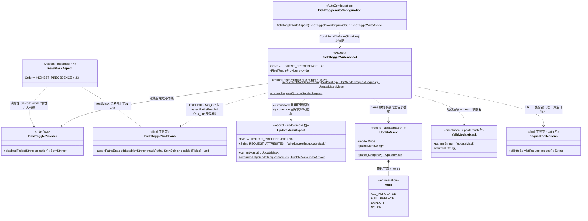

# fieldtoggle — 预定义字段开关（部署期启停：读投影剔除 / 点名引用 400 / 候选集剔除）

## 解决的问题

部分**预定义的可选字段**（如 demo 的 `estimatedCostCents`）需要按部署形态启用 / 停用（不同客户部署不需要某些能力）。若由各端点自行 if 判断「字段是否启用」，会出现读写口径不一致、批量通道漏判、停用后客户端点名引用被静默忽略等问题。本包把「字段是否存在」的判定收口为**部署期配置 + 框架执行**（主规范 §20）：

- **声明缝隙**：`FieldToggleProvider` SPI——BC 实现并注册为 Bean，声明「按 URI 集合段的当前停用字段集合」（配置中心承载启停）；框架只收口执行，不承载配置。
- **写路径**：`FieldToggleWriteAspect` 拦截 `@ValidUpdateMask` 端点——updateMask **点名**引用停用字段 → 400 + 逐字段 `fieldViolations`（字段不存在语义，方法体不执行）；**省略 / `*` 掩码**的候选集**剔除**停用字段、不 400（客户端从不点名该字段，否则部署期一停用任何省略 / `*` PATCH 恒 400 且无从规避）。
- **违规组装**：`FieldToggleViolations` 为读投影掩码与写掩码两通道共用的 400 组装工具（批量等 body 承载掩码的通道也由 BC 命令服务调用它补位，同一错误码）。
- **读路径**：剔除执行**不在本包**——并入 `readmask.ReadMaskAspect` 剪枝通道（其经 `ObjectProvider` 惰性取用本包 SPI）：停用字段恒从读投影剔除；`?readMask` 显式点名停用字段同样 400。
- **零开销缺省**：`FieldToggleAutoConfiguration` 以 `@ConditionalOnBean(FieldToggleProvider)` 装配——**无 Provider Bean 时整组能力静默不激活**，读写路径零改动、零开销。

**语义边界**：停用即「该字段对当前部署**不存在**」，不是权限概念（停用判定先于 §19 ABAC 裁决）；不提供运行时动态扩展字段（§15 万能属性 Map 禁令）；可开关字段**必须是对象类型**（`Long` / `String` / 值对象）——读剔除依赖置 null + `NON_NULL`，基本类型无 null 态，配置停用只会告警而字段照常下发。

## 标准符合性

对照 SSOT：`.lattice/standards/v4/v4-restful-patterns-compliance.md` 矩阵「**预定义字段开关（Field Availability Toggles）**」行；契约规范：`v4-restful-api.md` §20。

| 权威条款 | 遵循口径 |
|---|---|
| **AIP-157**（Partial responses） | 可选预定义字段就是普通字段，读投影语义照常适用；停用字段从响应剔除 |
| **AIP-161**（Field masks） | 掩码引用不存在字段按未知字段拒绝（点名 400）；掩码即请求体字段路径选择器——掩码通道已覆盖「请求体引用」面，显式掩码外的 body 字段按 AIP-134 语义忽略（不算「携带」） |
| 《API Design Patterns》**第 5 章** Resource shapes | 原书与 AIP 立场一致：资源模式为**静态强类型结构**，均未定义运行时动态字段机制——本项目完全遵照，启停只是部署期配置，不生成多套 schema |
| **RFC 9457**（Problem Details） | 400 以 problem+json + `fieldViolations` 扩展成员承载 |

**遵循口径：✅ 完全遵照**（原书与 AIP 一致，项目实现与两者一致）；本行**无专属偏离登记（D#）**。**自动化梯队：🔵 Tier B（声明式接管）**：BC 只声明一个 Provider Bean（配置中心按 BC 管理启停），读剔除 / 写拦截 / 候选集收窄由框架切面收口。

关键口径（单测锚定：`FieldToggleWriteAspectTest`；读侧见 `readmask/ReadMaskAspectTest`）：

- **点名 400 / 省略与 `*` 剔除**：EXPLICIT 模式走点名 400（NO_OP 掩码无路径，断言自然通过）；ALL_POPULATED（省略）/ FULL_REPLACE（`*`）从已归一掩码候选集过滤停用字段后经 `UpdateMaskAspect.override` 回写请求属性——下游命令服务读到的掩码不含停用字段，与读侧「省略掩码 = 停用字段静默剪枝」两态方向一致。
- **集合键唯一口径**：`RequestCollections.of(request)` 派生 URI 集合段（`/v1/demoTasks/101` → `demoTasks`；`/v1/demoTasks:batchUpdate` → `demoTasks`，冒号动词剥离、contextPath 剥离）——BC 注册表与框架裁决共用同一把 key，其他集合的停用声明不波及本端点。
- **校验链协作**：本切面 `@Order(HIGHEST_PRECEDENCE + 20)` 内层于 `UpdateMaskAspect`（+16）——先 400 未知字段（静态白名单）、后 400 停用 / 剔除，一次请求违规逐层暴露；复用其已解析掩码（`UpdateMaskAspect.currentMask()`），无掩码属性 / 无请求上下文 → 放行不做二次裁决。
- 停用集合须**不可变**（`Set.copyOf` 等），框架在请求路径上直接读取；Provider 返回 null 视为无停用（切面侧容错），接口契约要求无停用返回空集。

## 使用方法

**自动化梯队：Tier B——BC 声明一个 Bean 即接管，端点代码零改动**。

**生效条件**：

1. BC 实现 `FieldToggleProvider` 并注册为 Bean（Servlet Web 应用）→ `FieldToggleWriteAspect` 经 `FieldToggleAutoConfiguration` 自动注册（`AutoConfiguration.imports` 已登记）；读剔除由 `readmask.ReadMaskAspect` 自动并入（无需额外装配）。
2. 写拦截仅覆盖 `@ValidUpdateMask` 标准端点；**批量端点**（`:batchUpdate` 等逐项掩码经 body 承载、不经该切面）由 BC 命令服务调用 `FieldToggleViolations.assertPathsEnabled` 补位——同一停用集合、同一错误码。
3. 可开关字段为对象类型组件（基本类型停用只告警不生效，§20）。

**① BC 声明注册表**（demo `PredefinedFieldToggles` 真实实现，节选；配置 prefix `airedge.demo.fields` 为 **demo BC 自有**配置，lib 本身无配置项）：

```java
@Component
@EnableConfigurationProperties(PredefinedFieldToggleProperties.class) // prefix = "airedge.demo.fields"
public class PredefinedFieldToggles implements FieldToggleProvider {

    public static final Set<String> TOGGLEABLE = Set.of("estimatedCostCents"); // BC 声明的可开关字段
    private final Set<String> disabledFields; // 构造器自配置读入并校验 ⊆ TOGGLEABLE（非法配置启动快速失败）

    @Override
    public Set<String> disabledFields(String collection) {
        return "demoTasks".equals(collection) ? disabledFields : Set.of(); // 非本 BC 集合 → 空集
    }

    /** 批量等 body 掩码通道补位（违规组装委托 lib FieldToggleViolations）。 */
    public void assertWritable(List<String> maskPaths) {
        FieldToggleViolations.assertPathsEnabled(maskPaths, disabledFields);
    }
}
```

部署期停用配置（demo BC）：

```yaml
airedge:
  demo:
    fields:
      disabled: [estimatedCostCents]
```

**② HTTP 行为示例**（`estimatedCostCents` 已停用）：

写路径——点名引用 400（`PATCH /v1/demoTasks/101?updateMask=title,estimatedCostCents`，方法体不执行）：

```http
HTTP/1.1 400 Bad Request
Content-Type: application/problem+json

{
  "type": "https://api.airedgesoft.com/errors/invalid-argument",
  "title": "Bad Request",
  "status": 400,
  "detail": "引用了已停用的预定义字段: estimatedCostCents",
  "code": 300010029,
  "fieldViolations": [
    { "field": "estimatedCostCents", "code": 300010029, "description": "引用了已停用的预定义字段: estimatedCostCents" }
  ]
}
```

写路径——省略掩码 / `?updateMask=*`：**不 400**，候选集剔除停用字段后照常执行（如 `*` 展开为 `title,description,estimatedCostCents` → 下游实际掩码 `title,description`）。

读路径（由 `readmask` 包执行）——`GET /v1/demoTasks/101`：响应中 `estimatedCostCents` 键消失（置 null + `NON_NULL`），其余字段原样；`GET /v1/demoTasks/101?readMask=estimatedCostCents`：点名引用 → 同上 400（`300010029`）。

**③ Java 侧直接调用**（批量通道 / 框架内）：

```java
FieldToggleViolations.assertPathsEnabled(mask.paths(), provider.disabledFields("demoTasks"));
// 未引用 → 静默返回；引用 → DomainException(400 PREDEFINED_FIELD_DISABLED) + 全部命中 fieldViolations
```

## 设计方案



类职责一览（包内 4 个类型全覆盖）：

| 类名 | 职责 | 关键属性 | 关键方法 |
|---|---|---|---|
| `FieldToggleProvider` | 停用注册表 SPI：BC 声明「按集合段的当前停用字段集合」（部署期配置，配置中心承载）；无 Bean = 整组能力静默不激活 | — | `disabledFields(String collection)`（集合键经 `RequestCollections.of` 派生；无法定位 → null，实现应返回空集；集合须不可变） |
| `FieldToggleWriteAspect` | 写路径收口：`@ValidUpdateMask` 端点掩码点名停用字段 → 400；省略 / `*` 候选集剔除后 `override` 回写；无掩码属性 / 无请求上下文 / 停用集空 → 放行 | `provider`；`@Order(HIGHEST_PRECEDENCE + 20)`（内层于 UpdateMaskAspect +16） | `around(ProceedingJoinPoint)`（`@Around("@annotation(ValidUpdateMask)")`）；私有 `requestedMode`（重解析原始 Query 参数判模式，原始串已被 +16 校验不触异常）、`currentRequest` |
| `FieldToggleViolations` | 停用违规组装（读投影掩码 / 写掩码 / 批量 body 掩码三通道共用）：命中字段全量收集 → 400 + 逐字段 `fieldViolations`，首个命中字段作提示词参数 | — | `assertPathsEnabled(Iterable<String>, Set<String>)`（停用集空 / 未命中 → 静默返回） |
| `FieldToggleAutoConfiguration` | 条件装配：宿主存在 Provider Bean 才注册写切面（`@ConditionalOnBean` + Servlet + `@ConditionalOnMissingBean`，BC 可同型 Bean 覆盖）；读路径装配在 `readmask` 包 | — | `fieldToggleWriteAspect(FieldToggleProvider)` |

关键协作流程（写路径校验链，读路径见 `readmask` 包 README）：

1. `UpdateMaskAspect`（+16 外层）：解析 `?updateMask` 三态 → 静态白名单校验（未知字段 400 `UPDATE_MASK_UNKNOWN`）→ 归一为 EXPLICIT 路径清单挂请求属性 `airedge.restful.updateMask`。
2. `FieldToggleWriteAspect`（+20 内层）：`currentMask()` 取已解析掩码；`RequestCollections.of(request)` 派生集合键 → `provider.disabledFields(collection)`；按**原始请求模式**分流——
   - `FULL_REPLACE`（`*`）/ `ALL_POPULATED`（省略）：从候选路径过滤停用字段 → `UpdateMaskAspect.override(request, new UpdateMask(kept))` → 放行（下游命令服务消费收窄后的掩码）；
   - `EXPLICIT` / `NO_OP`：`FieldToggleViolations.assertPathsEnabled` → 点名命中即 400，方法体不执行。
3. 读路径：`ReadMaskAspect`（+23）把停用集并入待置 null 集（无 `?readMask` 也剔除），显式点名停用字段先 400；停用判定先于 ABAC 脱敏（+22）——字段停用即不存在，不再进入脱敏 / 可写判定（§20）。

真实配置项 / 错误码：

- **lib 本身无配置开关**：激活条件 = 容器内存在 `FieldToggleProvider` Bean（`@ConditionalOnBean`）；启停配置由 BC 自持（demo：`airedge.demo.fields.disabled`，`PredefinedFieldToggleProperties`）。
- 错误码（`DomainRestCode`）：`PREDEFINED_FIELD_DISABLED = 300010029`（400 `INVALID_ARGUMENT`，「引用了已停用的预定义字段: %s」）——readMask 点名、updateMask 点名、批量 body 掩码三通道同码。
- 治理（§20 / §11.1）：关闭已启用字段判**破坏性变更**；`filter` / `orderBy` 白名单不含停用字段（引用即 400，由各自包白名单承载）；OpenAPI schema 恒声明全量预定义字段（静态契约，不生成多套 schema）。