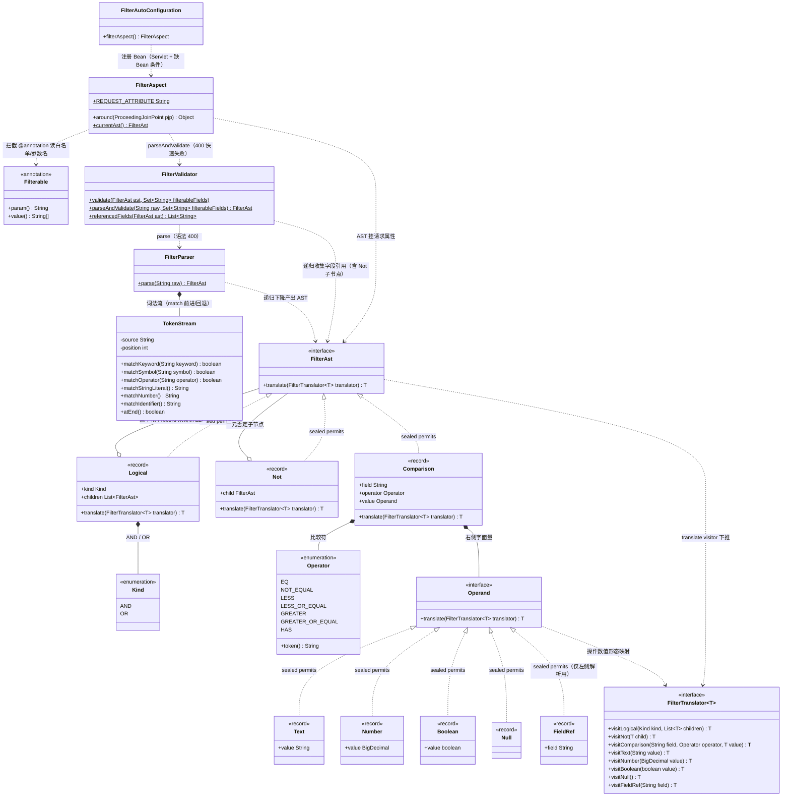
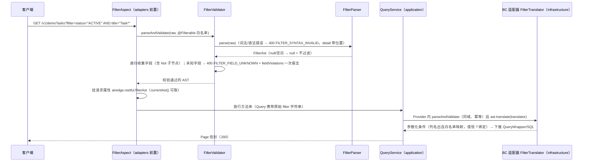

# filter — AIP-160 集合过滤表达式：解析 → 白名单校验 → SPI 参数化下推

## 解决的问题

集合 List 端点需要让客户端用结构化表达式（`?filter=status="ACTIVE" AND title="Task*"`）精确筛选数据。若各 BC 各自手写字符串解析或直接拼接 SQL，会带来三类风险：

1. **SQL 注入**：用户输入直接进入 WHERE 子句；
2. **越权读**：语法错误被静默忽略等于把过滤条件整段丢弃——返回全集；
3. **拼写静默**：未知字段不报错，客户端盲目试错、结果失真。

本包提供统一工具链：手写递归下降解析器产出 **AST**（`FilterParser` / `FilterAst`），按 `@Filterable` 声明的**字段白名单**校验（`FilterValidator`），再由持久层适配器实现 `FilterTranslator<T>` SPI 把 AST **参数化下推**为查询条件（值恒 `?` 绑定，无拼接注入面）。语法非法与字段越界均 **400 快速失败**（方法体不执行），错误经 RFC 9457 `application/problem+json` 承载。

## 标准符合性

| 权威 | 条款 | 遵循口径 |
|---|---|---|
| Google AIP | **AIP-160（Filtering）** | ✅ **完全遵照**（语法子集）。逻辑 `AND`/`OR`/`NOT`（`-` 与 `NOT` 等价，AIP-160:73-75）；**OR 优先级高于 AND**（AIP-160:65-67，`a AND b OR c` = `a AND (b OR c)`，与多数编程语言相反）；六比较符 `=` `!=` `<` `<=` `>` `>=` 与成员判断 `:`（has）；括号分组；字符串字面量内 `*` 通配（AIP-160:116-117）；`null` 三值语义（AIP-160:141-146，由适配器求值/下推兑现）；比较**左侧必须字段路径、右侧只接受字面量**（AIP-160:98-99，禁字段-字段比较） |
| 《API Design Patterns》（JJ Geewax, Manning 2021） | **第 20 章 Filtering** | 服务端构建 AST 投影到查询引擎，与原书一致 |
| IETF | **RFC 9457**（Problem Details for HTTP APIs） | 400 错误响应契约（`code` + `detail` + `fieldViolations` 扩展成员） |

**子集边界（预留扩展，非偏离）**：函数调用（AIP-160:201-204 may 级）、空格分隔裸字面量的「模糊 AND」变体（should 级）当前解析器**不含**；字段类型对齐校验（AIP-160:225-227 must）尚未实现——解析器不比对字面量类型与字段类型（如 `status = 123` 也会产出 AST，由适配器按字段语义处理 / 收窄），引入类型化过滤字段时须补 must 级校验。`FilterAst.FieldRef` 操作数与 `visitFieldRef` 为字段间比较预留的扩展位——解析器当前拒绝右侧字段引用。

**偏离登记**：无（矩阵判定 ✅ 完全遵照，D1~D17 均不涉及本主题）。

**自动化梯队**：🔵 **Tier B（声明式注解驱动）**——业务仅需在 Controller 方法上标注 `@Filterable` 白名单；解析、校验、400 映射由框架切面接管；SQL/条件下推由 BC 适配器实现 SPI 完成。对照 SSOT：`.lattice/standards/v4/v4-restful-patterns-compliance.md` §2.2「集合过滤表达式」行。

## 使用方法

### 1. Controller 声明白名单（声明即所得）

真实示例（`demo-singlemodule` `DemoTaskController#list`）：

```java
@Filterable({"status", "projectId", "title"})   // 可过滤字段白名单（camelCase 契约字段）
@Sortable({"taskId", "title", "createTime"})
@GetMapping
public Page<QDemoTask> list(
        @RequestParam(value = "pageSize", required = false) Integer pageSize,
        @RequestParam(value = "pageToken", required = false) String pageToken,
        @RequestParam(value = "filter", required = false) String filter,
        @RequestParam(value = "orderBy", required = false) String orderBy,
        @RequestParam(value = "showDeleted", required = false) Boolean showDeleted) {
    return queryService.listTasks(new ListDemoTasksQuery(pageSize, pageToken, filter, orderBy));
}
```

`FilterAspect`（`@Order(Ordered.HIGHEST_PRECEDENCE + 16)`）在方法执行前解析 `?filter=...`（参数名可经 `@Filterable(param = "...")` 配置，缺省 `filter`）并按 `value()` 白名单校验；失败抛 `DomainException` → 400，方法体不执行。解析后的 AST 挂请求属性 `FilterAspect.REQUEST_ATTRIBUTE`（`"airedge.restful.filterAst"`），可经静态方法取用：

```java
FilterAst ast = FilterAspect.currentAst();   // 未标注 / 无请求 / 空过滤 → null
```

### 2. 应用层 / 适配器自足解析（非 HTTP 路径同样生效）

demo 的权威消费模式：Query record 只携带**原始 filter 字符串**（纯数据，不依赖 Servlet 上下文），读 Provider 在 infrastructure 层自行解析 + 校验 + 下推（与切面同域白名单，二次解析幂等；作业 / 单测直调同样受保护）：

```java
// DemoTaskProviderImpl#listByFilter（infrastructure/providers）
FilterAst ast = FilterValidator.parseAndValidate(filter, new HashSet<>(FILTERABLE_FIELDS));
// MyBatis-Plus 路径：AST → 绑定参数 SQL 片段，一次性下推 QueryWrapper
SqlFragment fragment = ast.translate(new DemoTaskSqlTranslator());   // 实现 FilterTranslator<SqlFragment>
wrapper.apply(toApplySql(fragment.sql()), fragment.params().toArray()); // ? → {n}，值恒参数绑定
```

`FilterTranslator<T>` 的 8 个 visit 方法由适配器实现：`visitLogical` 保序组合 AND/OR 与括号、`visitComparison` 产出「列 + 操作符 + 值」三元组（列名出自开发者白名单映射）、`visitText/visitNumber/visitBoolean/visitNull` 产出操作数值形态（数字为 `BigDecimal`，按列类型收窄）。demo 中 `*` 通配 → `LIKE … ESCAPE '\'`、`null` 字面量 → `IS [NOT] NULL`、三值逻辑（null 字段跳过、`NOT` 下仍跳过）均在翻译器/求值器兑现——**解析器只产 AST，语义落点在适配器**。

### 3. HTTP 请求示例

```http
GET /v1/demoTasks?filter=status%3D%22ACTIVE%22%20AND%20title%3D%22Task*%22&pageSize=20
```

即 `?filter=status="ACTIVE" AND title="Task*"`（空格与引号需 URL 编码）。更多合法形态（与 `FilterParserTest` 一致）：

- `deleteTime != null AND archived = false`（null / 布尔字面量）
- `NOT status = "DONE"`、`- status = "CANCELLED"`（两种否定等价）
- `(a = 1 OR b = 2) AND c = 3`（括号覆盖优先级；建议复合条件恒用显式括号）
- `title : "foo"`（has 成员判断）
- `customFields.riskLevel = "HIGH"`（camelCase 点号嵌套路径，须入白名单）
- `note = "say \"hi\""`（双引号字符串，`\"` 转义）

非法形态 → 400：`start < end`（右侧字段引用）、`a =`（缺操作数）、`(a = 1`（括号不配对）、`status = "未闭合`、`1 = a`（左侧非字段）、`a = 1 b = 2`（未消费输入）、`filter=foo="bar"`（未知字段，`fieldViolations` 一次报全）。

### 生效条件

- `FilterAutoConfiguration` 已登记于 `META-INF/spring/org.springframework.boot.autoconfigure.AutoConfiguration.imports`；`FilterAspect` Bean 仅在 **Servlet Web 应用**且容器无同型 Bean 时注册（`@ConditionalOnWebApplication(SERVLET)` + `@ConditionalOnMissingBean`）。
- `FilterParser` / `FilterValidator` 为静态工具、`FilterAst` 为纯数据、`FilterTranslator` 为 SPI——**均无需装配**，非 Web 环境可直接使用。
- 无 HTTP 请求上下文时切面跳过（不报错）；白名单保护由调用方经 `FilterValidator.parseAndValidate` 自足执行。

## 设计方案

### 类图（覆盖包内全部 7 个顶层类型 + 12 个嵌套类型）



> 嵌套类型归属：`Logical`（含 `Kind`）、`Not`、`Comparison`、`Operator`、`Operand`、`Text`、`Number`、`Boolean`、`Null`、`FieldRef` 均为 `FilterAst` 的嵌套类型；`TokenStream` 为 `FilterParser` 的私有嵌套词法流。

### 类职责一览

| 类名 | 职责 | 关键属性 | 关键方法 |
|---|---|---|---|
| `Filterable` | List 端点过滤白名单声明注解（方法级、RUNTIME 保留） | `param` 缺省 `"filter"`；`value` 缺省 `{}` | `param()`、`value()` |
| `FilterAspect` | `@Filterable` 切面：方法前解析 + 校验，AST 挂请求属性；失败 400 方法体不执行 | `REQUEST_ATTRIBUTE = "airedge.restful.filterAst"`；`@Order(HIGHEST_PRECEDENCE + 16)` | `around(ProceedingJoinPoint)`、静态 `currentAst()` |
| `FilterAutoConfiguration` | 自动装配：注册 `FilterAspect`（Servlet Web + `@ConditionalOnMissingBean`） | — | `filterAspect()` |
| `FilterParser` | AIP-160 子集手写递归下降解析器（无外部依赖）；null/空白 → null；任何词法/语法错误 → 400 带出错位置，禁止静默忽略 | 私有构造（纯静态工具） | 静态 `parse(String raw)` |
| `FilterParser.TokenStream` | 词法流：关键字（大小写不敏感、边界判定）/符号/双字符操作符优先/字符串（转义还原）/数字/标识符匹配，前进或回退 | `source`、`position` | `matchKeyword`、`matchSymbol`、`matchOperator`、`matchStringLiteral`、`matchNumber`、`matchIdentifier`、`atEnd` |
| `FilterValidator` | 白名单校验：收集 AST 全部字段引用（含 `Not` 子节点、`FieldRef` 值），未知字段一次性报全 400 + 逐字段 `fieldViolations` | 私有构造（纯静态工具） | 静态 `validate(FilterAst, Set<String>)`、`parseAndValidate(String, Set<String>)`、`referencedFields(FilterAst)` |
| `FilterAst` | 过滤表达式 AST 根（sealed interface）；visitor 下推入口 | permits `Logical`/`Comparison`/`Not` | `translate(FilterTranslator<T>)` |
| `FilterAst.Logical` | 逻辑节点（AND/OR），同层扁平化、左结合（解析器产出的 children ≥ 2；record 构造器仅 `List.copyOf`，不强制条数） | `kind`、`children` | `translate(...)` → `visitLogical` |
| `FilterAst.Logical.Kind` | 逻辑组合种类枚举 | `AND`、`OR` | — |
| `FilterAst.Not` | 一元否定节点（`NOT expr` / `-expr`） | `child` | `translate(...)` → `visitNot` |
| `FilterAst.Comparison` | 比较节点：白名单域字段路径 op 字面量 | `field`、`operator`、`value` | `translate(...)` → `visitComparison` |
| `FilterAst.Operator` | 比较符枚举（含词法 token 形态） | `EQ("=")`、`NOT_EQUAL("!=")`、`LESS("<")`、`LESS_OR_EQUAL("<=")`、`GREATER(">")`、`GREATER_OR_EQUAL(">=")`、`HAS(":")` | `token()` |
| `FilterAst.Operand` | 操作数根（sealed interface） | permits `Text`/`Number`/`Boolean`/`Null`/`FieldRef` | `translate(FilterTranslator<T>)` |
| `FilterAst.Text` | 字符串字面量（已去引号与转义还原；`*` 通配语义由适配器兑现） | `value` | `translate(...)` → `visitText` |
| `FilterAst.Number` | 数字字面量（整数与十进制） | `value`（`BigDecimal`） | `translate(...)` → `visitNumber` |
| `FilterAst.Boolean` | 布尔字面量 | `value`（`boolean`） | `translate(...)` → `visitBoolean` |
| `FilterAst.Null` | `null` 字面量（如 `deleteTime != null` 回收站查询） | — | `translate(...)` → `visitNull` |
| `FilterAst.FieldRef` | 字段引用（左侧字段路径解析用；右侧禁字段，扩展位） | `field` | `translate(...)` → `visitFieldRef` |
| `FilterTranslator<T>` | AST → 持久层适配器值的下推 SPI（infrastructure/adapters 层实现；应用层只携带原始字符串或纯数据 AST） | 泛型 `T` = 目标条件形态（MP Wrapper 片段 / SQL 片段 + 参数组合） | `visitLogical`、`visitNot`、`visitComparison`、`visitText`、`visitNumber`、`visitBoolean`、`visitNull`、`visitFieldRef` |

### 关键协作流程



要点：

- **两类错误分工**：语法非法（`FilterParser`）与字段越界（`FilterValidator`）是不同错误码；校验失败一律 400 快速失败，**禁止静默忽略**（静默 = 丢弃过滤条件返回全集 = 越权读）。
- **优先级**：`andExpr := orExpr (AND orExpr)*`、`orExpr := unary (OR unary)*`——OR 结合更紧（AIP-160:65-67）；双字符操作符（`<=` `>=` `!=`）优先匹配，不被单字符截断。
- **下推安全**：翻译在 infrastructure/adapters 层进行；字段名来自开发者白名单（可安全映射为列名），**值恒参数绑定**，禁止各 BC 自拼过滤字符串。

### 错误码与默认值（以代码为准）

| 项 | 值 |
|---|---|
| 语法非法 | `DomainRestCode.FILTER_SYNTAX_INVALID` = **300010016**，`INVALID_ARGUMENT` → 400，detail 带出错位置与原文 |
| 未知字段 | `DomainRestCode.FILTER_FIELD_UNKNOWN` = **300010017**，`INVALID_ARGUMENT` → 400，`fieldViolations` 逐字段一次报全 |
| 请求参数名 | `@Filterable.param()` 缺省 `"filter"`；白名单 `value()` 缺省空集 |
| 空过滤 | `null` / 空白 → AST 为 `null`（不过滤，不报错） |
| 切面顺序 | `Ordered.HIGHEST_PRECEDENCE + 16` |
| 请求属性键 | `"airedge.restful.filterAst"` |
| 装配条件 | Servlet Web 应用 + 容器无 `FilterAspect` Bean；已登记 `AutoConfiguration.imports` |