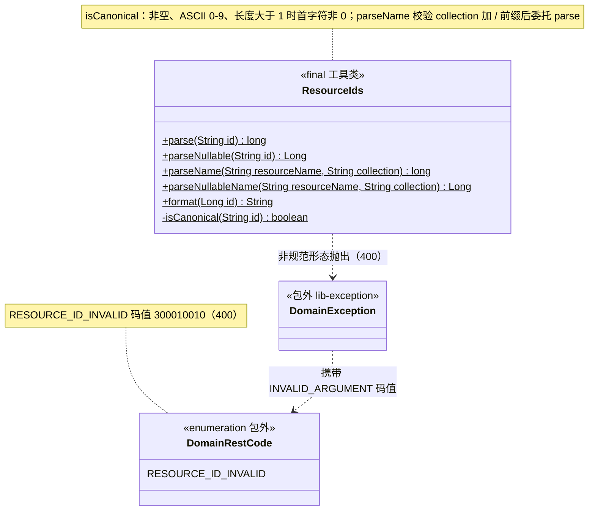

# id — 技术主键 HTTP 契约（String）↔ 领域/持久化（Long）统一转换工具

## 解决的问题

v4 契约层（路径变量、Query、Command / Query / Result / `Q*` 字段）的技术主键一律 **String（十进制纯数字，短雪花）**，领域层与持久化继续用 Long。若各 BC 自写 `Long.valueOf` / `Long.parseLong`，会放行全角数字、前导零等 Unicode/非规范形态——同一资源出现多个「合法」ID 串，违背 AIP-122 资源名唯一性，且错误报文口径漂移。`ResourceIds` 把转换收口为唯一工具（规范 v4-restful-api §2，**禁止各 BC 自写 `Long.valueOf`**）：

- **只接受规范形态**：ASCII `[0-9]`、无前导零（单个 `"0"` 除外）；空串 / 非数字 / 负号 / 空白 / 全角数字（`１２３` / `٣`）/ 前导零（`00123`）/ 超出 long 范围 / null 一律 400。
- 附带 **AIP-122 相对资源名解析**：`parseName("productSpaces/623809242866016", "productSpaces")` → 末端 id；集合段不符 / 缺 id 同判 400。

转换只发生在两处：入参在 adapters 解析路径变量 / 应用服务消费 Command 字段时调 `parse`；出参在应用服务产出 Result / `Q*` 时调 `format`。

## 标准符合性

| 权威条款 | 遵循口径 |
|---|---|
| **AIP-122**（Resource names） | 契约 ID 为十进制纯数字字符串；规范形态唯一（拒前导零 / Unicode 数字）保证「同一资源只有一个合法 ID 串」；`parseName` 解析 `{collection}/{id}` 相对资源名 |
| 《API Design Patterns》第 5 章 Resource identification（矩阵「资源导向架构与拓扑」行，AIP-121/122/123） | 资源标识在 HTTP 边界统一 String 形态的支撑工具 |
| 矩阵「基础数据类型与单位」行（AIP-140 等） | 「契约主键统一为 HTTP String（短雪花纯数字）」口径的机制落点 |

如实说明：本包是**纯转换基建**，矩阵未给 ID 转换单列条目或自动化梯队；它支撑上述 Tier C（资源拓扑/命名门禁）与 Tier A（基础类型契约）主题的落地——非法形态在边界即抛 `DomainException`，由 problem 包翻译为 RFC 9457 400 报文。**不涉及 AIP-155**（请求标识/幂等键归 `idempotency` 包 `Idempotency-Key` 头）。

## 使用方法

**业务需显式调用**（非零感知；但只是两个静态方法，无注解无装配）。非法输入自动抛 `DomainException(DomainRestCode.RESOURCE_ID_INVALID, id)` → 400 problem+json，无需手写校验分支。

```java
// adapters：路径变量 String → long（demo RequirementController 同口径）
requirementCommand.delete(ResourceIds.parse(id));

// 应用层出参：Long → 契约 String（demo QRequirement 同口径，null 透传）
new QRequirement(ResourceIds.format(requirement.getId()), ...);

// 可空入参：null → null，其余同 parse
Long parentId = ResourceIds.parseNullable(command.parentId());

// AIP-122 相对资源名 → 末端 id（demo CreateRequirementRequest 同口径）
long id = ResourceIds.parseName("productSpaces/623809242866016", "productSpaces"); // 623809242866016L
Long nullable = ResourceIds.parseNullableName(null, "requirements");                // null
```

HTTP 示例（非法 ID，单测 `ResourceIdsTest` 锚定的拒绝形态之一）：

```http
GET /v1/productSpaces/00123 HTTP/1.1

HTTP/1.1 400 Bad Request
Content-Type: application/problem+json

{
  "type": "https://api.airedgesoft.com/errors/invalid-argument",
  "title": "Invalid Argument",
  "status": 400,
  "detail": "资源 ID 必须为十进制纯数字字符串: 00123",
  "code": 300010010,
  "requestId": "..."
}
```

合法边界（单测）：`"0"` 是规范形态（parse → 0L）；`"623809242866016"` 正常解析；`format(42L)` → `"42"`、`format(null)` → null。

## 设计方案



类职责一览（本包 1 个类）：

| 类名 | 职责 | 关键属性 | 关键方法 |
|---|---|---|---|
| `ResourceIds` | 契约 String ↔ Long 唯一转换口径 + AIP-122 相对资源名末端 id 解析；非规范形态统一 400 | 私有构造器（纯静态工具，无状态） | `parse(String): long`、`parseNullable(String): Long`、`parseName(String, String): long`、`parseNullableName(String, String): Long`、`format(Long): String`；私有 `isCanonical(String)` |

关键协作流程：adapters / 应用服务边界调用 `parse` / `parseName` → `isCanonical` 判规范形态（不合规即抛 `DomainException(RESOURCE_ID_INVALID, id)`；合规但超 long 范围时 `NumberFormatException` 同样转译为 `RESOURCE_ID_INVALID`，保留原因链）→ BC advice 经 `ProblemDetails.build` 翻译为 400 problem+json；出参方向 `format` 做 null 透传的 `Long.toString`。

真实错误码：

- `DomainRestCode.RESOURCE_ID_INVALID`：`DomainErrorType.INVALID_ARGUMENT`（400），码值 **300010010**，模板「资源 ID 必须为十进制纯数字字符串: %s」（lib-restful 协议错误码，模块号 001）。
- 本包无配置项、无自动装配。