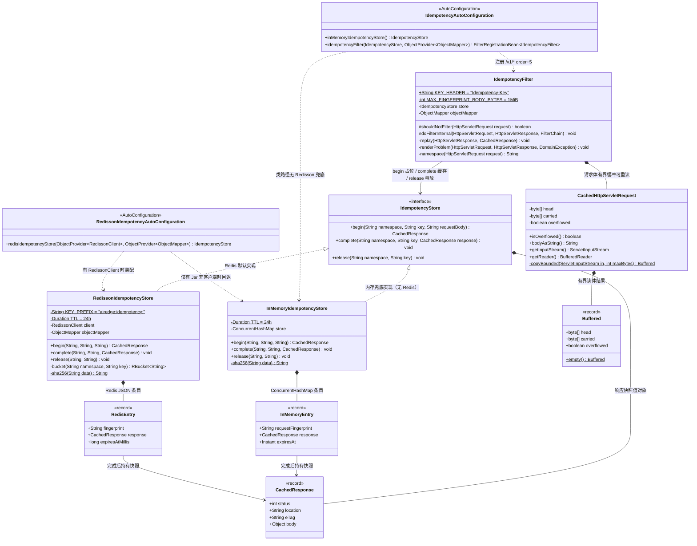
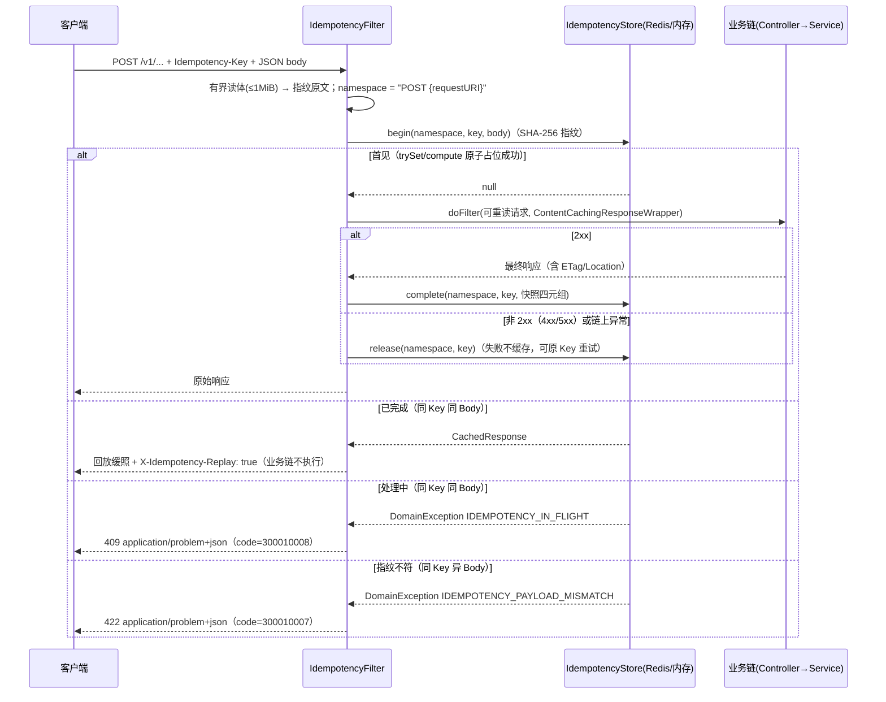

# idempotency — POST 幂等防护：Idempotency-Key 抓头、并发加锁、指纹校验与响应快照回放

## 解决的问题

网络重试、用户双击、客户端超时重发都会让同一笔写请求被执行多次（重复创建资源、重复触发命令）。本包把幂等去重做成**框架默认行为**：所有携带 `Idempotency-Key` 请求头的 `POST` 端点（创建 / 批量创建 / `:{verb}` 冒号命令）自动受防护——

- 同 Key 同 Body 首见 → 放行执行，成功响应以**快照**（状态码 + Location + ETag + 附加头（`Vary` / `Cache-Control`）+ body 文本）缓存；回放与首次语义等价（内存实现原样文本；Redis 实现经 JSON 树化往返，JSON 格式可能规范化）；
- 同 Key 同 Body 重试 → 直接回放缓照，业务链不再执行，附 `X-Idempotency-Replay: true`；
- 同 Key 处理中并发重入 → **409 Conflict**（problem+json）；
- 同 Key 异 Body（非法复用幂等键）→ **422 Unprocessable Entity**（problem+json）；
- 失败不缓存：4xx/5xx 与链上异常均释放 Key，允许原 Key 重试。

实现形态为 Servlet Filter（`OncePerRequestFilter`）而非注解 AOP（2026-10 规范修订已退役 `@Idempotent` 注解接入，v4-restful-api.md §6.5）：幂等是 HTTP 协议关注点，Filter 使控制层**零注解零代码**，且缓存的是最终响应快照（状态码 + Location + ETag + 附加头 + body，天然包含内层装配结果），比切面缓存 DTO 再二次序列化更保真。GET / PATCH / DELETE 不在本 Filter 范围（天然幂等或由 `lockedVersion` 并发护栏承担）；**读语义 POST（如 LRO `:wait` 长轮询）亦豁免**——每次等待都应取当前快照，回放旧快照会冻结进度。

## 标准符合性

对照 SSOT：`.lattice/standards/v4/v4-restful-patterns-compliance.md` §2.2「幂等性控制 (Idempotency)」主题行。

| 标准 | 条款 | 遵循口径 |
|------|------|----------|
| AIP-155 | Request identification（请求标识） | 语义对齐（客户端派发请求标识用于去重），但**载体偏离**：不用 Body `requestId` 字段，见 D5 |
| 《API Design Patterns》(Geewax) | 第 23 章 Idempotency、第 26 章 Request deduplication | 机制思想遵照 ch26 请求去重；同 Key 异 Body 状态码偏离原书推荐，见 D4 |
| IETF 草案 | `draft-ietf-httpapi-idempotency-key-header` | **📘 遵照 RFC 草案**：`Idempotency-Key` HTTP 请求头承载（Stripe 同款事实标准）；失败不缓存、释放 Key 允许重试亦与草案一致 |
| RFC 9457 | Problem Details for HTTP APIs | 409 / 422 由 Filter 自行渲染 `application/problem+json`（Filter 在 handler 之前执行、不经 `@RestControllerAdvice`，故经 `ProblemDetails.build` 统一构建） |

**偏离登记**：

- **D5（幂等键协议载体）**：原书 / AIP-155 用 Body `requestId` 字段 → 本项目用 `Idempotency-Key` 请求头，避免治理元数据污染领域报文（矩阵 §3.2「标头优于报文」）。
- **D4（幂等同 Key 异 Body）**：原书 ch26 推荐 409 → 本项目判 **422**（请求语义逻辑错误，禁止重试覆盖）；409 专用于「同 Key 处理中重入」，两态正交隔离（矩阵 §3.2）。

## 使用方法

**自动化梯队：🟢 Tier A（框架完全接管），业务层无需感知。** Controller / CommandService 不写任何幂等代码、不打任何注解。

生效条件（全部由自动装配满足，见 `META-INF/spring/org.springframework.boot.autoconfigure.AutoConfiguration.imports` 中的 `RedissonIdempotencyAutoConfiguration` 与 `IdempotencyAutoConfiguration`，不依赖宿主 `scanBasePackages`）：

1. Servlet Web 应用；Filter 注册在 **`/v1/*`**，order = `Ordered.HIGHEST_PRECEDENCE + 5`（最外层，早于 WebMvc 一切切面与处理器）；自定义 `IdempotencyFilter` Bean 会让缺省 `FilterRegistrationBean` 整体退让（`@ConditionalOnMissingBean(IdempotencyFilter.class)` 落在注册 Bean 上），覆盖者须自行注册 `/v1/*` 与 order；
2. 请求为 **POST** 且携带非空白 `Idempotency-Key` 头（不带 Key = 不去重照常执行，界面客户端可选携带）；
3. Content-Type 为 `application/json` 或未传（无体命令端点如 `:activate` 记空串指纹，仍参与防护）；显式非 JSON（multipart 等）**文档化豁免**跳过；
4. 请求体 ≤ **1 MiB**（`Content-Length` 预检或 chunked 有界读体判定；超限跳过防护照常执行，chunked 场景以「前缀缓冲 + 原始流续传」透传完整 body，Filter 内存占用有界）。

存储实现自动选择（`IdempotencyAutoConfigurationTest` 验证）：

| 环境 | 装配结果 |
|------|----------|
| 类路径有 Redisson 且已装配 `RedissonClient`（deploy-full 经 legacy `infrastructure-tools`） | `RedissonIdempotencyStore`（默认，Redis） |
| 类路径有 Redisson Jar 但无客户端 Bean（未配置 Redis） | `InMemoryIdempotencyStore` 回退 |
| 类路径无 Redisson（本地 H2 workshop / 单测） | `InMemoryIdempotencyStore` 兜底 |
| 宿主 / BC 自定义 `IdempotencyStore` Bean | 覆盖以上全部（`@ConditionalOnMissingBean`） |

客户端 HTTP 示例（以 demo `POST /v1/demoProjects` 为例，Key 由客户端派发 UUID）：

```http
POST /v1/demoProjects HTTP/1.1
Content-Type: application/json
Idempotency-Key: 6d9b0e3a-...-c1

{"code":"PRJ-001","name":"示范项目"}
```

首次成功：

```http
HTTP/1.1 201 Created
Location: /v1/demoProjects/1234567890
ETag: "sha256-..."

{ ...资源表示... }
```

同 Key 同 Body 重试（业务不重复执行，快照回放）：

```http
HTTP/1.1 201 Created
Location: /v1/demoProjects/1234567890
ETag: "sha256-..."
X-Idempotency-Replay: true

{ ...与首次响应语义等价的 body（内存实现原样文本；Redis 实现经 JSON 树化往返）... }
```

同 Key 处理中重入 → `409` + `application/problem+json`（`code=300010008`）；同 Key 异 Body → `422` + `application/problem+json`（`code=300010007`）。problem 的 `requestId` 取自请求头 `X-Request-Id`（与 `ProblemDetails` 同一口径，见 `IdempotencyFilterTest`）。

## 设计方案



> 图中 `InMemoryEntry` / `RedisEntry` 分别为 `InMemoryIdempotencyStore.Entry` 与 `RedissonIdempotencyStore.Entry` 私有嵌套 record；`CachedHttpServletRequest` 与 `Buffered` 为 `IdempotencyFilter` 的私有嵌套类 / record。`IdempotencyFilter` 继承 Spring `OncePerRequestFilter`，`CachedHttpServletRequest` 继承 `HttpServletRequestWrapper`（外部基类未画出）。

### 类职责一览

| 类名 | 职责 | 关键属性 | 关键方法 |
|------|------|----------|----------|
| `IdempotencyStore`（接口） | 幂等键存储端口：三阶段契约 PROCESSING → COMPLETED → 过期 | — | `begin(namespace, key, requestBody)`（首见 null / 完成回放缓照 / 处理中抛 409 / 指纹不符抛 422）、`complete(...)`、`release(...)` |
| `IdempotencyStore.CachedResponse`（record） | 响应快照（状态码 + Location + ETag + 附加头 + body） | `status`、`location`、`eTag`、`body`、`headers`（`Vary` / `Cache-Control` 等；旧快照无此字段时回放退化为 Location/ETag） | record 访问器；四参兼容构造器（headers=null） |
| `InMemoryIdempotencyStore` | 内存实现（本地 H2 workshop / 单测兜底），`ConcurrentHashMap.compute` 原子占位 | `TTL = 24h`、`store` | `begin` / `complete` / `release`、`sha256` |
| `InMemoryIdempotencyStore.Entry`（record） | 内存条目：指纹 + 快照 + 过期时刻 | `requestFingerprint`、`response`、`expiresAt`（Instant） | record 访问器 |
| `RedissonIdempotencyStore` | Redis 默认实现：`trySet`（set-if-absent）原子占用、`compareAndSet` 过期交接与完成写回，多实例并发安全 | `KEY_PREFIX`、`TTL = 24h`、`client`、`objectMapper` | `begin` / `complete` / `release`、`bucket`、`serialize` / `deserialize` |
| `RedissonIdempotencyStore.Entry`（record） | Redis JSON 条目 | `fingerprint`、`response`、`expiresAtMillis`（long） | record 访问器 |
| `IdempotencyFilter` | 协议入口：抓头、派生指纹与命名空间、调 store 三阶段、回放缓照 / 渲染 problem、成功缓存 / 失败释放 | `KEY_HEADER`、`MAX_FINGERPRINT_BODY_BYTES = 1 MiB`、`store`、`objectMapper` | `shouldNotFilter`（仅 POST）、`doFilterInternal`、`replay`、`renderProblem`、`namespace` |
| `IdempotencyFilter.CachedHttpServletRequest`（嵌套类） | 请求体有界缓冲可重读；溢出时「前缀 + 尾字节 + 原始流续传」单次透传 | `head`、`carried`、`overflowed` | `isOverflowed`、`bodyAsString`、`getInputStream`、`getReader`、`copyBounded` |
| `CachedHttpServletRequest.Buffered`（record） | 有界读体结果（最多读 maxBytes+1 字节即停） | `head`、`carried`、`overflowed` | `empty()` |
| `IdempotencyAutoConfiguration` | 自动装配：Filter 注册（`/v1/*`、`HIGHEST_PRECEDENCE + 5`、name `idempotencyFilter`）+ 无 Redisson 时内存 store 兜底 | — | `inMemoryIdempotencyStore()`、`idempotencyFilter(...)` |
| `RedissonIdempotencyAutoConfiguration` | Redis 装配（类级 `@ConditionalOnClass(name="org.redisson.api.RedissonClient")` 防 NoClassDefFoundError）：有客户端 → Redis store，无客户端 → 内存回退 | — | `redisIdempotencyStore(...)` |

### 关键协作流程



要点：

- **加锁即占位**：`begin` 以原子 set-if-absent（Redis `trySet` / 内存 `compute`）写入 PROCESSING 占位条目（`response = null`），并发竞争只有一个成功；过期占位经 CAS 交接重占。
- **指纹校验**：store 内对请求体原文做 SHA-256（hex），与占位条目指纹比对；空体指纹 = 空串的 SHA-256，仍参与防护。
- **回放**：Filter 把快照写回 `HttpServletResponse`（状态码 + Location + ETag + body），回放 body 以 `application/json` UTF-8 输出；Redis 侧 body 经 ObjectMapper 树化持久化、回放反序列化为通用对象再序列化等价 JSON。
- **异常路径**：链上 `RuntimeException` / `ServletException` / `IOException` 一律 `release` 后继续上抛（否则 Key 停留处理中直至 TTL 恒 409）；`Error`（OOM 等）不兜底，交由容器终止。

### 配置项 / 错误码 / Redis Key 形态

| 项 | 值（以代码为准） |
|----|------------------|
| 请求头 | `Idempotency-Key`（`IdempotencyFilter.KEY_HEADER`）；回放标记 `X-Idempotency-Replay: true`（`REPLAY_HEADER`）；快照回写头常量 `LOCATION_HEADER` / `ETAG_HEADER` |
| Filter 作用域 | URL `/v1/*`，仅 POST；order = `Ordered.HIGHEST_PRECEDENCE + 5` |
| 命名空间 | `"POST " + requestURI`（按端点 + 实例隔离，同 Key 跨端点互不干扰） |
| Redis Key | `airedge:idempotency:{namespace}:{clientKey}`，如 `airedge:idempotency:POST /v1/demoProjects:6d9b0e3a-...`（StringCodec） |
| Redis Value | JSON `{fingerprint, expiresAtMillis, response?}`；response 为 `{status, location, eTag, body}` |
| TTL | 两实现均 **24 小时**（Redis 按 TTL 惰性清理 + CAS 交接；`complete` 保留剩余 TTL 不续期） |
| 指纹上限 | 请求体 1 MiB（`MAX_FINGERPRINT_BODY_BYTES = 1024 * 1024`），超限跳过防护 |
| 错误码 | `DomainRestCode.IDEMPOTENCY_PAYLOAD_MISMATCH`（422，`300010007`）；`DomainRestCode.IDEMPOTENCY_IN_FLIGHT`（409，`300010008`） |
| 可配置 Bean | 自定义 `IdempotencyStore` 覆盖存储选择；自定义 `IdempotencyFilter` Bean 使缺省 `FilterRegistrationBean` 退让——**不会自动注册** `/v1/*`，覆盖者须自行注册过滤器与 order；无独立 `application.yml` 配置项 |

测试参考：`src/test/java/com/airedgesoft/lib/restful/idempotency/` 下 `IdempotencyFilterTest`（作用域 / 回放 / 409 / 豁免 / 异常释放）、`IdempotencyStoreTest`（状态机契约）、`RedissonIdempotencyStoreTest`（Redis 实现契约等价）、`IdempotencyAutoConfigurationTest`（默认实现选择）。