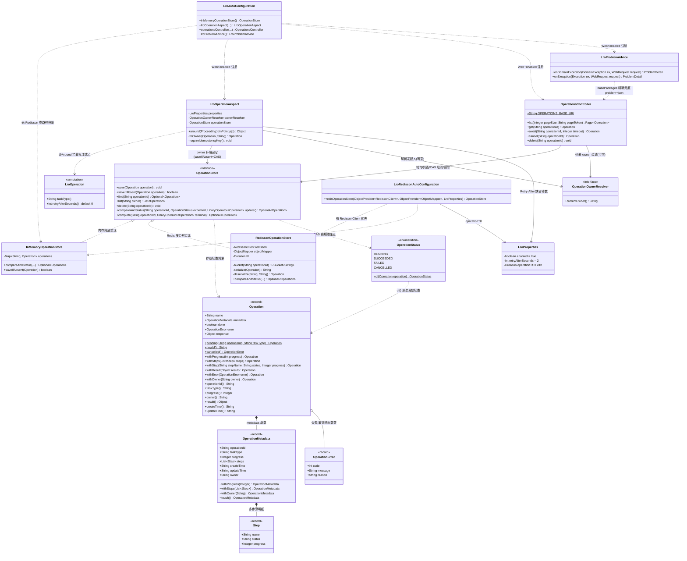
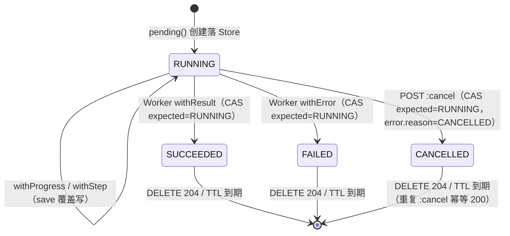

# lro — 长耗时操作（LRO）协议基建：202 受理 + 全局 `/v1/operations` 轮询 / 等待 / 取消 / 删除

## 解决的问题

跨聚合异步或长耗时写操作（批量导入、深拷贝、文件产出等）不能在一次 HTTP 请求内同步完成。本包提供 AIP-151 形态的完整 LRO 协议闭环：

- **触发端**：业务方法标注 `@LroOperation` 并返回 `Operation`，切面自动装配 **202 Accepted + `Location: /v1/operations/{operationId}` + `Retry-After`**，触发端点本身不做耗时工作；
- **状态载体**：不可变 record `Operation`，wire 形态对齐 `google.longrunning.Operation` 标准骨架 `{name, metadata, done, error, response}`，支持整体进度与多步骤（steps）明细；
- **通用端点**：lib 自托管 `OperationsController` 全局注册轮询（GET）、游标分页列表（GET 集合）、长轮询等待（`:wait`）、取消（`:cancel`）、终态清理（DELETE），业务无需为每个任务重复造轮询面；
- **状态存储**：`OperationStore` 端口 + 内存 / Redis（Redisson）双实现按类路径与 Bean 条件自动选择，多实例部署共享轮询状态；
- **终态争夺仲裁**：`:cancel` 与 Worker 完成经 `compareAndStatus` CAS 原子仲裁，杜绝 last-write-wins 导致「取消被迟到完成覆写」；
- **错误契约**：`LroProblemAdvice` 为本包自托管端点兜底 RFC 9457 problem+json，不落入宿主 / legacy catch-all。

## 标准符合性

对照 SSOT：`.lattice/standards/v4/v4-restful-patterns-compliance.md`「长耗时操作 (LRO)」主题，遵循口径 **✅ 完全遵照**，自动化梯队 **🔵 Tier B（声明式注解驱动）**。

| 权威标准 | 条款 / 章节 | 本包落点 |
|---|---|---|
| Google AIP | **AIP-151（Long-running operations）** | `Operation` 骨架（name / metadata / done / error / response）、`:cancel` 取消、`deleteOperation`（DELETE 终态清理）、全局 `operations` 资源集合对齐 google.longrunning.Operations；`:wait` 为 google.longrunning 可选方法（AIP-151 正文未定义），本项目一并实现 |
| Google AIP | **AIP-136（Custom methods）** | `:wait` / `:cancel` 冒号 camelCase 动词，写副作用一律 POST |
| Google AIP | **AIP-158（Pagination）** | `GET /v1/operations` 列表复用 `PageTokens`（AES-GCM 不透明游标）+ `PageSizeResolver`，`Page<Operation>` 信封 |
| Google AIP | **AIP-122（Resource names）** | `name = operations/{operationId}`；operationId 十进制规范形态（无前导零、long 范围），构造期快速失败 |
| 《API Design Patterns》 | **第 10 章 Long-running operations、第 11 章 Rerunnable jobs** | Operation 状态轮询对象 + Worker 推进模式 |
| IETF | **RFC 9110（HTTP Semantics）** | 202 Accepted、`Location` / `Retry-After` 响应头语义；DELETE 幂等清理 |
| IETF | **RFC 9457（Problem Details）** | `LroProblemAdvice` 统一 problem+json 错误渲染 |

相关偏离登记（见 SSOT §3）：

- **D12（错误模型）**：HTTP 错误一律 RFC 9457 problem+json，不引入 google.rpc Status 错误信封；`Operation.error` 为自定义 `Operation.OperationError(code / message / reason)`——形态仿 `google.rpc.Status` 并增 `reason` 扩展（取消以 reason 承载），不是严格的 proto 映射。
- **D5（幂等键协议载体）**：LRO 触发端点**强制**携带 `Idempotency-Key` 请求头（v4-restful-api §16），缺失同步 400（`LRO_IDEMPOTENCY_KEY_REQUIRED`），避免重试各自生成 operationId 重复执行。
- **取消错误码**：AIP-151 未定义取消专用错误码，本库自立裁决 `done=true` + `error.reason="CANCELLED"`（`code=0` 表示未指定，不借用 HTTP 499）——属 AIP 留白处的实现口径，未列入 D1~D17 偏离清单。
- **Location 形态**：统一全局 `/v1/operations/{operationId}`，非资源内嵌 `/v1/{res}/{id}/operations/...`（主规范 §4.1 口径）。

## 使用方法

**自动化梯队：Tier B（声明式接管）**。业务感知程度分两半：

- **通用轮询 / 列表 / 等待 / 取消 / 删除端点：业务层无需感知**。生效条件：Servlet Web 应用 + `airedge.restful.lro.enabled=true`（缺省 true）+ 容器中存在 `OperationStore`（自动装配兜底提供），`LroAutoConfiguration` 即全局注册 `/v1/operations` 端点族。
- **触发端点与 Worker：业务需显式声明与实现**——① 端点标注 `@LroOperation` 并返回 `Operation`；② 方法体内 `store.save(Operation.pending(...))` 并提交异步任务；③ Worker 用 `withProgress` / `withStep` 推进、`withResult` / `withError` 写终态（终态收口可用 `store.complete(id, terminal)` = CAS RUNNING→终态 + 回读；与 `:cancel` 争夺时同走 `compareAndStatus` 语义，已终态不覆写）。

### Java 示例（真实签名；参照 demo `DemoTaskBatchController.importTasks`）

```java
// adapters 层触发端点：POST /v1/demoTasks:import
@LroOperation(taskType = "demoTaskImport")            // retryAfterSeconds 可选，缺省取配置（2 秒）
@PostMapping("/v1/demoTasks:import")
public Operation importTasks(@RequestBody List<CreateDemoTaskRequest> requests) {
    Operation operation = Operation.pending(Operation.newId(), "demoTaskImport");
    operationStore.save(operation);                   // 创建即落 Store（progress=0, done=false）
    // 生产形态：此处提交异步 Worker 后立即返回 operation；demo 为同步演示形态
    Operation terminal = runImport(operation, requests);   // Worker：副作用恰执行一次
    // 终态经 CAS 落库（expected=RUNNING），与并发 :cancel 原子仲裁；updater 必须是纯函数
    return operationStore.compareAndStatus(operation.operationId(), OperationStatus.RUNNING, op -> terminal)
            .orElseGet(() -> operationStore.find(operation.operationId()).orElse(terminal));
}

// Worker 推进（application 层签名保持纯数据，Operation 协议载荷仅在 lib-restful 与 adapters 流转）
Operation p40 = operation.withProgress(40);                       // 整体进度
Operation stepped = p40.withStep("parse", "SUCCEEDED", 100);      // 多步骤按 name upsert
Operation ok = stepped.withResult(Map.of("successCount", 3));     // 成功终态：done=true, progress=100
Operation failed = operation.withError(
        new Operation.OperationError(500, "import failed", "import")); // 失败终态
operationStore.save(p40);                                          // 进度推进：save 整体覆盖（最后写赢）
```

可选 SPI：宿主注册 `OperationOwnerResolver` Bean（`String currentOwner()`）后，切面为 owner 缺失的 Operation 补填发起人并回写 Store，`GET /v1/operations` 按「我的」口径过滤；未注册则 owner 留空、列表全量可见。

### HTTP 示例

**① 触发（必须携带 Idempotency-Key，缺失 → 400）**

```http
POST /v1/demoTasks:import
Idempotency-Key: 7f9c24e5-...

HTTP/1.1 202 Accepted
Location: /v1/operations/923809242866016
Retry-After: 2

{ "name": "operations/923809242866016",
  "metadata": { "operationId": "923809242866016", "taskType": "demoTaskImport",
                "progress": 0, "createTime": "2026-03-15T09:30:00Z", "updateTime": "2026-03-15T09:30:00Z" },
  "done": false }
```

**② 轮询**：`GET /v1/operations/923809242866016` → 200 Operation（进行中 `done=false`；成功终态 `done=true` + `response` 载荷；失败 / 取消终态 `done=true` + `error`，二者互斥）；不存在 → 404；ID 非数字 / 前导零 → 400。

**③ 长轮询等待（可选能力）**：`POST /v1/operations/{id}:wait?timeout=30` → 200 Operation（终态或超时快照，超时不报错；缺省 30s、上限 60s、200ms 间隔）。实现为 Servlet 线程内定间隔轮询，**生产建议客户端走标准 GET 轮询**。

**④ 取消**：`POST /v1/operations/{id}:cancel` →
- 进行中：200，body 为取消终态（`error: {code:0, message:"operation cancelled by client", reason:"CANCELLED"}`）；
- 重复取消已取消：幂等 200 原终态；
- 已成功 / 已失败：409（`OPERATION_NOT_CANCELLABLE`）；不存在：404。

**⑤ 列表（AIP-158 游标分页）**：`GET /v1/operations?pageSize=20&pageToken=...` → 200 `{items:[Operation...], nextPageToken, totalSize}`；固定排序 `createTime desc` + `operationId asc` 平局仲裁；非法 / 篡改 / 过期 token → 400，pageSize 负数 → 400、超上限钳制。

**⑥ 删除终态记录**：`DELETE /v1/operations/{id}` → 204（成功 / 失败 / 取消可删）；进行中 → 409（`OPERATION_NOT_DELETABLE`）；不存在 → 404；自定义 Store 未实现 delete → 501（`UNSUPPORTED_BY_STORE`）。

## 设计方案

### 类图（覆盖包内全部 13 个文件、16 个类型，含 Operation 的 3 个嵌套 record）



> 注：`OperationMetadata` / `Step` / `OperationError` 为 `Operation` 的嵌套 record（`Operation.OperationMetadata`、`Operation.OperationMetadata.Step`、`Operation.OperationError`）；`InMemoryOperationStore` / `RedissonOperationStore` 覆盖 `OperationStore` 全部方法（图中仅列关键覆盖项）。

### 类职责一览

| 类名 | 职责 | 关键属性 | 关键方法 |
|---|---|---|---|
| `LroOperation` | 方法级注解：声明 LRO 触发端点（Tier B 声明式接管入口） | `taskType`（审计/路由维度）、`retryAfterSeconds`（缺省 0=取配置） | — |
| `Operation` | 不可变 LRO 状态载荷；wire 对齐 google.longrunning 骨架；紧凑构造器校验 operationId 十进制规范形态 | `name` / `metadata` / `done` / `error` / `response` | `pending` / `newId`（lib-id 短雪花）/ `withProgress` / `withSteps` / `withStep` / `withResult` / `withError` / `withOwner` / `cancelled`；`@JsonIgnore` 兼容访问器 `operationId()` 等 |
| `Operation.OperationMetadata` | 服务专属元数据（进度、多步骤、时刻、发起人） | `operationId` / `taskType` / `progress` / `steps` / `createTime` / `updateTime` / `owner` | 包私有 `withProgress` / `withSteps` / `withOwner` / `touch`（仅推进 updateTime） |
| `Operation.OperationMetadata.Step` | 多步骤子任务明细 | `name`（唯一标识）/ `status`（PENDING/RUNNING/SUCCEEDED/FAILED）/ `progress`（0–100 可选） | — |
| `Operation.OperationError` | 失败明细（形态仿 `google.rpc.Status`，`reason` 为 AirEdge 扩展） | `code` / `message` / `reason`（取消以 reason 承载） | — |
| `OperationStatus` | 生命周期离散状态（CAS 预期态锚点；分类唯一落点） | RUNNING / SUCCEEDED / FAILED / CANCELLED | `of(Operation)`：done=false→RUNNING；done 且无 error→SUCCEEDED；reason=CANCELLED→CANCELLED；其余→FAILED |
| `OperationStore` | 状态存储端口；save 最后写赢，终态争夺必须 CAS；delete 缺省抛 501 | — | `save` / `saveIfAbsent`（default 非原子）/ `find` / `list(owner)`（default 空）/ `delete`（default 501）/ `compareAndStatus`（default 非原子） |
| `InMemoryOperationStore` | 内存实现（单机/本地/单测兜底；重启即失） | `ConcurrentHashMap<String, Operation>` | `saveIfAbsent`=putIfAbsent；`compareAndStatus`=computeIfPresent 同键原子 CAS |
| `RedissonOperationStore` | Redis 实现（多实例共享；TTL 到期清理终态） | 键前缀 `airedge:restful:lro:operation:`、`ttl`、Jackson 序列化 | `bucket()` 单点 StringCodec 构造（读写同源）；CAS=compareAndSet 循环重试 + expire 补挂 TTL；损坏/JSON null 载荷按缺失容忍 |
| `OperationOwnerResolver` | 发起人解析 SPI（宿主注册 Bean 生效；函数式接口） | — | `currentOwner()`：当前用户 id，无法判定→null |
| `OperationsController` | 全局 `/v1/operations` 端点：列表/轮询/等待/取消/删除 | `OPERATIONS_BASE_URI`；wait 缺省 30s/上限 60s/间隔 200ms；游标复合键 `ct`/`id` | `list`（createTime desc + operationId asc，内存排序切片）/ `get` / `await` / `cancel`（CAS + 幂等重读）/ `delete`（终态裁决在端点） |
| `LroOperationAspect` | 触发装配切面（`@Order(HIGHEST_PRECEDENCE+21)`）：强制幂等键→执行→202+Location+Retry-After；owner 补填回写 Store | `properties` / `ownerResolver` / `operationStore` | `around(ProceedingJoinPoint)`；`fillOwner`（saveIfAbsent 兜底 + CAS 合并，不覆写 Worker 进度/终态）；非 Operation 返回值原样透传 |
| `LroProblemAdvice` | 本包端点 RFC 9457 兜底（`basePackages` 精确到 lro 包，`@Order(HIGHEST_PRECEDENCE)`） | — | `onDomainException`（类型直译状态码+机器码）/ `onException`（ErrorResponse 4xx 透传，其余 500） |
| `LroProperties` | 配置（前缀 `airedge.restful.lro`） | `enabled=true` / `retryAfterSeconds=2` / `operationTtl=24h` | getter/setter |
| `LroAutoConfiguration` | 主自动装配：无 Redisson 类路径兜底内存 Store；Web+enabled 注册切面/Controller/Advice（均 `@ConditionalOnMissingBean` 可被 BC 覆盖） | — | `inMemoryOperationStore` / `lroOperationAspect` / `operationsController` / `lroProblemAdvice` |
| `LroRedissonAutoConfiguration` | Redis 优先装配（类级 `@ConditionalOnClass(name=...)` 防 NoClassDefFoundError）；有 Jar 无客户端回退内存 | — | `redisOperationStore(ObjectProvider<RedissonClient>, ObjectProvider<ObjectMapper>, LroProperties)` |

### 关键协作流程

**提交 → 调度 → 轮询 → 终态**：触发端点方法体 `Operation.pending(Operation.newId(), taskType)` + `store.save` 后提交 Worker；切面校验 `Idempotency-Key`（缺失 400）→ 方法返回 Operation → 补填 owner（`saveIfAbsent` 兜底落库，已存在则 CAS 合并，绝不以触发快照覆写 Worker 已推进的状态）→ 写回响应 202 + Location + Retry-After。Worker 经 `save(withProgress/withStep)` 推进（最后写赢），终态经 `compareAndStatus(RUNNING, op -> 预计算终态)` 与并发取消仲裁；客户端按 Location GET 轮询至 `done=true`。

**状态机（`OperationStatus.of` 派生）**：



终态争夺规则：先 cancel 后迟到 complete → 完成侧 CAS 落空、取消终态存活；先 complete 后 cancel → 409；并发双 cancel → CAS 败者重读，已取消则幂等 200，记录消失则 404。**禁止 find-then-save 裸竞争**（`OperationStore` 契约）。

### 配置项 / 错误码 / 存储要点

**配置（`airedge.restful.lro.*`）**：

| 配置项 | 缺省 | 说明 |
|---|---|---|
| `enabled` | `true` | 切面 + 通用端点 + Advice 总开关 |
| `retry-after-seconds` | `2` | 202 响应 Retry-After 秒数（注解 `retryAfterSeconds > 0` 优先） |
| `operation-ttl` | `24h` | Redisson Store 键 TTL（终态数据保留时长） |

**错误码（`DomainRestCode`，经 `LroProblemAdvice` 渲染 problem+json，扩展字段 `code` / `requestId`）**：

| 机器码 | 常量 | HTTP | 场景 |
|---|---|---|---|
| 300010020 | `OPERATION_NOT_FOUND` | 404 | 轮询/等待/取消/删除未命中 |
| 300010021 | `OPERATION_NOT_CANCELLABLE` | 409 | 已成功/失败终态再取消 |
| 300010022 | `OPERATION_NOT_DELETABLE` | 409 | 进行中删除 |
| 300010030 | `LRO_IDEMPOTENCY_KEY_REQUIRED` | 400 | 触发端点缺 `Idempotency-Key` |
| 300010031 | `UNSUPPORTED_BY_STORE` | 501 | 自定义 Store 未覆盖 `delete` |
| — | `RESOURCE_ID_INVALID`（300010010）/ `PAGE_TOKEN_INVALID`（300010001）/ `PAGE_SIZE_INVALID`（300010009） | 400 | ID 非规范形态 / 游标非法篡改 / pageSize 负数 |

**存储要点**：内存实现重启即失，仅单机/开发/单测；Redis 实现键 `airedge:restful:lro:operation:{operationId}`，值为 Jackson JSON 字符串，**读写必须同源 StringCodec**（`bucket()` 单点构造）；Redisson `compareAndSet` 的 Lua 为裸 SET 会清 TTL，CAS 成功后 `expire` 补挂（两步间进程崩溃存在无 TTL 窗口，终态键量小可运维清理）；损坏载荷 / JSON `null` 在 find/list/CAS 统一按缺失容忍（记日志不 500）。operationId 契约：十进制纯数字、无前导零、long 范围（用 `Operation.newId()` 天然合规；UUID 会在构造期抛 IllegalArgumentException）。

**自动装配注册**（`META-INF/spring/...AutoConfiguration.imports`）：`LroRedissonAutoConfiguration` 先于 `LroAutoConfiguration` 登记，配合双方 `@ConditionalOnMissingBean(OperationStore.class)` 达成「Redis 优先、内存兜底、BC 同型 Bean 覆盖两者」。

**测试参考**（`src/test/java/.../lro/`）：`OperationsContractTest`（端点契约 + 切面 202/owner/CAS 全场景）、`OperationTest`（生命周期 + wire 骨架）、`RedissonOperationStoreTest`（codec 同源 / CAS 竞争重试 / TTL 补挂 / 损坏载荷）、`LroStoreSelectionTest`（存储选择）、`LroProblemAdviceTest`（错误渲染）。真实业务用法见 `airedge-v4/demo-singlemodule` 的 `DemoTaskBatchController.importTasks`。