# openapi — springdoc 契约文档自动补全（框架隐式协议参数 / schema 与真实 wire 形态对齐）

## 解决的问题

v4 有多项协议行为由框架**全局拦截**、Controller 方法签名不声明（Tier A 零注解 / 禁止死参数）：`Idempotency-Key` 请求头由 `IdempotencyFilter` 自动抓取、`?readMask` 投影由 `ReadMaskAspect` 全局剪枝、`lockedVersion` 由 `EtagResponseAdvice` 注入 wire body，`updateMask` / `filter` / `orderBy` / `validateOnly` / `pageSize` / `pageToken` / `showDeleted` 亦由切面 / Filter 从 `request.getParameter` 取值。若不做补全，这些契约在 springdoc 生成的 OpenAPI 中**不可见**，前端生成客户端将缺失幂等头 / 投影参数，或看到与真实报文不符的嵌套 schema。本包提供四个定制器把文档补齐到与运行时一致：

- `IdempotencyHeaderOperationCustomizer`：为所有方法级 `@PostMapping` 端点自动注入 `Idempotency-Key` header 参数文档；`@LroOperation` 长流程端点标 `required=true`（缺失恒 400 `300010030`）。
- `ReadMaskParameterOperationCustomizer`：为方法级 `@GetMapping` 端点自动注入 `readMask` query 参数文档，可选字段清单从返回类型（`Q*` record 组件）经 `ReadMaskWhitelists.of(Method)` 派生——与运行时白名单校验**同源**；清单排序保证文档跨重启稳定。
- `EtagSchemaCustomizer`：把 `Etagged*` 组件 schema 从 springdoc 默认的 `{ resource: {...}, lockedVersion: N }` 嵌套形态改写为「被包装资源字段 + `lockedVersion`」**平铺**形态（wire 上 `@JsonUnwrapped` 平铺）。**现状说明**：定制器只命中名称以 `Etagged` 开头的组件，而当前 demo 的写返回直接是 `Q*`（`lockedVersion` 由 `EtagResponseAdvice` 在 wire 层注入，`Q*` 不声明该字段），因此该定制器对现有 schema 为惰性、`lockedVersion` 尚未自动进入 `Q*` schema——决策 C5 的目标态仍待读模型 / 文档侧补齐。
- `ContractParameterOperationCustomizer`：协议参数统一补齐——`updateMask`（`@ValidUpdateMask` 白名单）、`filter`（`@Filterable`）、`orderBy`（`@Sortable`）、`validateOnly`（`@DryRun`）、`pageSize` / `pageToken`（返回 `Page` 的 GET，默认值 / 上限取自 `PaginationProperties`）、`showDeleted`（软删开启时的 GET，参数名取自 `SoftDeleteProperties`）。参数名与白名单从注解 / 配置推导，与运行时校验同源；已显式声明的参数不重复注入。
- `OpenApiAutoConfiguration`：springdoc 在 classpath 且为 Servlet Web 应用时注册上述四者（各自 `@ConditionalOnMissingBean` 可被宿主同型 Bean 覆盖）；springdoc 缺席整体静默跳过。

三个 Operation 定制器实现 **`GlobalOperationCustomizer`** 而非普通 `OperationCustomizer`：springdoc 分组宿主（`springdoc.group-configs`）只把 context 级 Global 定制器合并进每个分组，普通定制器在分组模式下被静默丢弃——协议参数文档必须全分组生效。

## 标准符合性

本包是**纯契约文档基建**，无独立 AIP 专条，支撑矩阵以下主题（以代码事实为准）：

| 支撑主题 | 权威条款 | 本包落点 |
|---|---|---|
| **版本管理与兼容性**（矩阵 Tier C） | **AIP-180**（Backward compatibility）、**AIP-185**（API Versioning）；《API Design Patterns》第 24 章 Versioning | CI `openapi-diff` 破坏性变更门禁以本包补全后的 OpenAPI 为比对输入——隐式协议参数 / 平铺 schema 若缺席文档，diff 门禁将漏判真实契约变化 |
| 幂等性控制 | **AIP-155**（Request identification）；**D5**（弃 Body requestId 取 `Idempotency-Key` 头，遵 IETF 草案）；《API Design Patterns》第 23/26 章 | POST 端点幂等头文档自动注入；LRO 端点 required=true |
| 部分读取与字段投影 | **AIP-157**（Partial responses）、AIP-161（Field masks）；《API Design Patterns》第 8 章 | GET 端点 `readMask` 参数文档（未知字段 400、`name` 恒保留、掩码外字段置 null 不输出——description 原文口径） |
| 并发控制与版本防并发 | **AIP-154**（Resource freshness）；**D13**（并发凭据 = body `lockedVersion`）；《API Design Patterns》第 28 章 | `Etagged*` 组件 schema 平铺展开（仅命中该前缀组件；当前 demo 无此返回，`lockedVersion` 由 wire 注入、尚未进入 `Q*` schema，决策 C5 目标态待补齐） |

注意分工：运行时行为归 `idempotency` / `readmask` / `etag` 包（Tier A），本包只负责**文档面**；`openapi-diff` 门禁本身在 CI 流水线，不在本包。

## 使用方法

**自动化梯队：Tier C 契约门禁的文档基建；业务层无需感知**。Controller 不写 `@Parameters` 手写头 / 投影参数文档，也不引用 `Etagged`（ArchUnit 规则 11b）。

生效条件：

1. classpath 存在 springdoc（`@ConditionalOnClass(OperationCustomizer.class)`）且为 Servlet Web 应用（`@ConditionalOnWebApplication(type = SERVLET)`）；
2. `OpenApiAutoConfiguration` 已登记于 `META-INF/spring/org.springframework.boot.autoconfigure.AutoConfiguration.imports`，随 lib-restful 引入自动生效；
3. `readMask` 参数只在「方法级 `@GetMapping` 且返回类型能派生出 record 白名单」的端点注入（返回 `String` 等派生不出白名单则不注入；已有同名参数不重复注入——单测 `ReadMaskParameterOperationCustomizerTest` 锚定）。运行时投影另有其判定：`ReadMaskAspect` 仅对可派生白名单的 record 载荷剪枝，非 record（String / void 等）整体放行（不校验不剪枝）。

生成效果示例（无需业务代码）——`GET /v1/samples/{id}` 返回 `record QSampleView(String name, String taskId, String title)` 时，OpenAPI 自动出现：

```yaml
parameters:
  - name: readMask
    in: query
    required: false
    description: "字段投影（逗号分隔；可选字段: name/taskId/title；未知字段 400；name 恒保留；掩码外字段置 null 不输出）"
```

POST 端点自动出现：

```yaml
parameters:
  - name: Idempotency-Key
    in: header
    required: false   # @LroOperation 端点为 true
    description: "幂等键（客户端 UUID；重试必须复用同一 key；POST 端点框架默认幂等防护，携带即处理）"
```

对应 HTTP 调用（契约与文档一致）：

```http
GET /v1/samples/42?readMask=name,title HTTP/1.1

HTTP/1.1 200 OK
{ "name": "samples/42", "title": "齿轮箱", "lockedVersion": 3 }
```

## 设计方案

```mermaid
classDiagram
    class OpenApiAutoConfiguration {
        <<AutoConfiguration>>
        +idempotencyHeaderOperationCustomizer() IdempotencyHeaderOperationCustomizer
        +etagSchemaCustomizer() EtagSchemaCustomizer
        +readMaskParameterOperationCustomizer() ReadMaskParameterOperationCustomizer
        +contractParameterOperationCustomizer(pagination ObjectProvider, softDelete ObjectProvider) ContractParameterOperationCustomizer
    }
    class IdempotencyHeaderOperationCustomizer {
        -String KEY_HEADER$
        +customize(Operation operation, HandlerMethod handlerMethod) Operation
    }
    class ReadMaskParameterOperationCustomizer {
        +customize(Operation operation, HandlerMethod handlerMethod) Operation
    }
    class ContractParameterOperationCustomizer {
        -PaginationProperties pagination
        -SoftDeleteProperties softDelete
        +customize(Operation operation, HandlerMethod handlerMethod) Operation
    }
    class EtagSchemaCustomizer {
        -String WRAPPER_PREFIX$
        -String RESOURCE_PROPERTY$
        -String LOCKED_VERSION$
        +customise(OpenAPI openApi) void
        -flatten(String name, Schema wrapper, Components components) Schema
        -resolve(Schema schema, Components components) Schema
    }
    class GlobalOperationCustomizer {
        <<interface>>
    }
    class OpenApiCustomizer {
        <<interface>>
    }
    GlobalOperationCustomizer <|.. IdempotencyHeaderOperationCustomizer : POST 端点注入幂等头文档
    GlobalOperationCustomizer <|.. ReadMaskParameterOperationCustomizer : GET 端点注入 readMask 文档
    GlobalOperationCustomizer <|.. ContractParameterOperationCustomizer : 注解/配置推导协议参数文档
    OpenApiCustomizer <|.. EtagSchemaCustomizer : Etagged schema 平铺改写
    OpenApiAutoConfiguration ..> IdempotencyHeaderOperationCustomizer : ConditionalOnMissingBean 注册
    OpenApiAutoConfiguration ..> ReadMaskParameterOperationCustomizer : ConditionalOnMissingBean 注册
    OpenApiAutoConfiguration ..> ContractParameterOperationCustomizer : ConditionalOnMissingBean 注册
    OpenApiAutoConfiguration ..> EtagSchemaCustomizer : ConditionalOnMissingBean 注册
    note for IdempotencyHeaderOperationCustomizer "KEY_HEADER 引用 IdempotencyFilter.KEY_HEADER（值 Idempotency-Key）"
    note for EtagSchemaCustomizer "常量值：WRAPPER_PREFIX=Etagged，RESOURCE_PROPERTY=resource，LOCKED_VERSION=lockedVersion"
    note for GlobalOperationCustomizer "springdoc 包外接口：分组模式下仅 Global 定制器合并进每个分组"
```



（`GlobalOperationCustomizer` / `OpenApiCustomizer` 为 springdoc 包外接口，列出示意实现关系。）

类职责一览：

| 类名 | 职责 | 关键属性 | 关键方法 |
|---|---|---|---|
| `OpenApiAutoConfiguration` | springdoc 在场时注册四定制器（可被宿主同型 Bean 覆盖），缺席整体跳过 | `@ConditionalOnClass(OperationCustomizer)` + `@ConditionalOnWebApplication(SERVLET)` | 四个 `@Bean @ConditionalOnMissingBean` 工厂方法 |
| `IdempotencyHeaderOperationCustomizer` | POST 端点注入 `Idempotency-Key` header 文档；`@LroOperation` 端点 required=true；已存在不重复注入 | `KEY_HEADER`（引用 `IdempotencyFilter.KEY_HEADER`） | `customize(Operation, HandlerMethod)` |
| `ReadMaskParameterOperationCustomizer` | GET 端点注入 `readMask` query 文档；白名单经 `ReadMaskWhitelists.of(method)` 派生并排序拼接；派生为空 / 非 GET / 已存在则跳过 | —（参数名引用 `ReadMaskAspect.READ_MASK_PARAM`） | `customize(Operation, HandlerMethod)` |
| `ContractParameterOperationCustomizer` | 协议参数统一补齐：`updateMask` / `filter` / `orderBy` / `validateOnly`（注解推导）、`pageSize` / `pageToken`（返回 `Page` 的 GET）、`showDeleted`（软删开启的 GET）；已存在不重复注入 | `pagination` / `softDelete`（可空，缺省回落 20/100 与不注入 showDeleted） | `customize(Operation, HandlerMethod)` |
| `EtagSchemaCustomizer` | 名称以 `Etagged` 开头的组件 schema 改写为平铺形态（资源字段 + `lockedVersion`，保留 description 与 required；`$ref` 解析到 components） | `WRAPPER_PREFIX` / `RESOURCE_PROPERTY` / `LOCKED_VERSION` | `customise(OpenAPI)`；私有 `flatten` / `resolve` |

关键协作流程：springdoc 扫描 HandlerMethod 生成 Operation → 三个 Global 定制器按方法注解（`AnnotatedElementUtils` 判定 `@PostMapping` / `@GetMapping` / `@LroOperation` / `@ValidUpdateMask` / `@Filterable` / `@Sortable` / `@DryRun`）与返回类型追加参数文档 → 文档汇总后 `EtagSchemaCustomizer.customise` 对 components 做 `replaceAll` 平铺改写 → 产出与真实 wire 一致的 OpenAPI，供前端代码生成与 CI `openapi-diff` 门禁消费。

真实配置项 / 常量：

- 请求头：`Idempotency-Key`（LRO 端点缺失 → 400，错误码 `300010030`）。
- Query 参数：`readMask`（逗号分隔；未知字段 400；`name` 恒保留）；`updateMask` / `filter` / `orderBy` / `validateOnly` / `pageSize` / `pageToken` / `showDeleted`（从注解与配置推导，Controller 无需声明死参数）。
- schema 字段：`lockedVersion`（仅平铺 `Etagged*` 信封 schema 时显式出现；`Q*` 单资源 / 列表条目 schema 当前不改写，尚未自动进入）。
- 相关 springdoc 配置：`springdoc.group-configs`（分组模式下仅 Global 定制器生效——本包实现选型依据）。