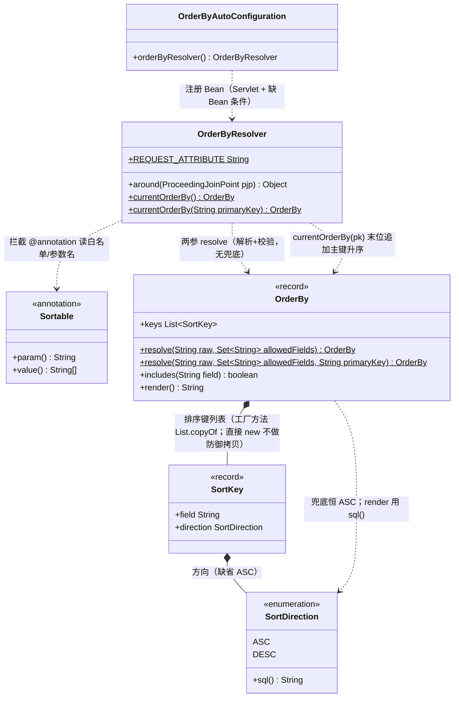

# orderby — AIP-132 集合排序：白名单解析 + 主键升序末位兜底

## 解决的问题

集合 List 端点的 `?orderBy=createTime desc,taskId asc` 需要确定性解析与治理：

1. **注入与穿透**：排序字段直接拼入 SQL ORDER BY，若不做白名单校验，用户输入可注入任意表达式或按敏感/无索引字段排序拖垮数据库；
2. **拼写静默**：未知字段不报错会让客户端误以为排序生效；
3. **翻页漂移**：排序非全序（存在平局）时，游标分页（`PageTokens`）的 seek 定位会漏行/重行——必须以**主键升序作为末位兜底**保证全序稳定。

本包提供：`@Sortable` 声明式白名单 + `OrderByResolver` 切面（HTTP 前置校验，未知字段/非法方向 400），以及纯静态工具 `OrderBy.resolve(...)`（解析、校验、主键兜底、SQL 片段渲染），供应用层 QueryService 在非 HTTP 路径同样自足生效。

## 标准符合性

| 权威 | 条款 | 遵循口径 |
|---|---|---|
| Google AIP | **AIP-132（Standard methods: List）** | ✅ **完全遵照**。`orderBy` 为逗号分隔字段名 + 方向修饰；AIP-132 只定义 ` desc` 后缀（升序为缺省，**未定义 `asc` 字面后缀——`asc` 为本项目拼写**，解析器两者都接受且大小写不敏感）；所有可排序字段设白名单，未知字段 400；**必须以主键（升序）作为最后兜底排序项以保序** |
| 《API Design Patterns》（JJ Geewax, Manning 2021） | **第 22 章 Sorting** | 与原书一致：逗号分隔多字段、服务端白名单、确定性排序 |
| IETF | **RFC 9457**（Problem Details for HTTP APIs） | 400 错误响应契约（`code` + `detail` + `fieldViolations` 扩展成员） |

**主键兜底的落位口径**：切面只做「解析 + 白名单校验」（两参 `resolve`）；**主键升序末位兜底由应用层三参 `OrderBy.resolve(raw, allowedFields, primaryKey)` 显式落位**（或 `OrderByResolver.currentOrderBy(primaryKey)`）——固定主键**升序**、客户端已显式声明主键时尊重用户方向、不重复追加。demo `DemoTaskQueryService#listTasks` 为权威示例。

**偏离登记**：无（矩阵判定 ✅ 完全遵照，D1~D17 均不涉及本主题；`asc` 拼写为项目对 AIP 留白处的补充，非偏离）。

**自动化梯队**：🔵 **Tier B（声明式注解驱动）**——业务仅需在 Controller 方法上标注 `@Sortable` 白名单；解析与 400 映射由切面接管，主键兜底一行三参 `resolve` 显式声明。对照 SSOT：`.lattice/standards/v4/v4-restful-patterns-compliance.md` §2.2「集合排序」行。

## 使用方法

### 1. Controller 声明白名单（声明即所得）

真实示例（`demo-singlemodule` `DemoTaskController#list`）：

```java
@Filterable({"status", "projectId", "title"})
@Sortable({"taskId", "title", "createTime"})   // 可排序字段白名单（camelCase 契约字段）
@GetMapping
public Page<QDemoTask> list(
        @RequestParam(value = "pageSize", required = false) Integer pageSize,
        @RequestParam(value = "pageToken", required = false) String pageToken,
        @RequestParam(value = "filter", required = false) String filter,
        @RequestParam(value = "orderBy", required = false) String orderBy,
        @RequestParam(value = "showDeleted", required = false) Boolean showDeleted) {
    return queryService.listTasks(new ListDemoTasksQuery(pageSize, pageToken, filter, orderBy));
}
```

`OrderByResolver`（`@Aspect`，`@Order(Ordered.HIGHEST_PRECEDENCE + 17)`）在方法执行前解析 `?orderBy=...`（参数名可经 `@Sortable(param = "...")` 配置，缺省 `orderBy`）并按 `value()` 白名单校验；未知字段/非法方向 → 400，方法体不执行。解析结果挂请求属性 `OrderByResolver.REQUEST_ATTRIBUTE`（`"airedge.restful.orderBy"`），**不侵入 Query record 签名**：

```java
OrderBy order = OrderByResolver.currentOrderBy();          // 未标注 / 无请求上下文 → null
OrderBy stable = OrderByResolver.currentOrderBy("taskId"); // + 主键升序末位兜底（游标分页场景）
```

### 2. 应用层显式解析 + 主键兜底（权威示例）

`DemoTaskQueryService#listTasks`（application/query，排序以 Query 入参为唯一信源，不感知 Servlet 上下文）：

```java
public static final Set<String> SORTABLE_FIELDS = Set.of("taskId", "title", "createTime");

public Page<QDemoTask> listTasks(ListDemoTasksQuery query) {
    int pageSize = pageSizeResolver.resolve(query.pageSize());
    List<QDemoTask> matched = demoTaskProvider.listByFilter(query.filter());
    // 解析 + 白名单校验（未知字段/非法方向 → 400）+ 末尾主键升序兜底；
    // HTTP 路径切面已先行校验，此处二次解析幂等；非 HTTP 直调（作业/单测）同样生效
    OrderBy order = OrderBy.resolve(query.orderBy(), SORTABLE_FIELDS, "taskId");
    matched = applyOrderBy(matched, order);   // 按 order.keys() 组装 Comparator（DESC 翻转）
    // ... 游标 seek + 切片 + nextToken（见 pagination 包）
}
```

SQL 路径用 `render()` 产出 ORDER BY 片段（字段集来自开发者白名单、非用户输入，可直接拼入；如需「契约字段 → 列名」映射，先以映射后的列名构造白名单）：

```java
OrderBy order = OrderBy.resolve("title desc", Set.of("title", "id"), "id");
order.render();      // "title DESC, id ASC"
order.includes("id"); // true（已声明主键则不重复追加、尊重用户方向）
OrderBy empty = OrderBy.resolve(null, Set.of("title"));
empty.render();      // ""（空掩码 → 空串，调用方不拼 ORDER BY 子句）
```

### 3. HTTP 请求示例

```http
GET /v1/demoTasks?orderBy=createTime%20desc,taskId%20asc&pageSize=20
```

即 `?orderBy=createTime desc,taskId asc`（空格需 URL 编码）。合法形态（与 `OrderByTest` 一致）：

- `field1 desc,field2 asc`（多字段逗号分段，段内空白分隔字段与方向）
- `field1 DESC , field2`（方向大小写不敏感；缺省 `asc`；空段跳过）
- `id desc,title`（用户已声明主键 → 尊重其方向，兜底不重复追加）

非法形态 → 400（`ORDER_BY_FIELD_UNKNOWN`）：`field1, unknown1 desc`（未知字段，`fieldViolations` 一次报全）、`field1 sideways`（非法方向）、`field1 asc desc`（段内超过两个 token）。

### 生效条件

- `OrderByAutoConfiguration` 已登记于 `META-INF/spring/org.springframework.boot.autoconfigure.AutoConfiguration.imports`；`OrderByResolver` Bean 仅在 **Servlet Web 应用**且容器无同型 Bean 时注册。
- `OrderBy.resolve(...)` 为静态工具，无需装配；无 HTTP 请求上下文时切面跳过，单测/作业线程直调三参 `resolve` 手工链同样获得白名单 + 兜底保护。

## 设计方案

### 类图（覆盖包内全部 5 个顶层类型 + 1 个嵌套 record）



> 嵌套类型归属：`SortKey` 为 `OrderBy` 的嵌套 record。

### 类职责一览

| 类名 | 职责 | 关键属性 | 关键方法 |
|---|---|---|---|
| `Sortable` | List 端点排序白名单声明注解（方法级、RUNTIME 保留）；白名单值须与契约字段同形（camelCase 点号路径） | `param` 缺省 `"orderBy"`；`value` 缺省 `{}` | `param()`、`value()` |
| `OrderByResolver` | `@Sortable` 切面：方法前解析 + 白名单校验（400 前置），结果挂请求属性；提供含主键兜底的取用入口 | `REQUEST_ATTRIBUTE = "airedge.restful.orderBy"`；`@Order(HIGHEST_PRECEDENCE + 17)` | `around(ProceedingJoinPoint)`、静态 `currentOrderBy()`、静态 `currentOrderBy(String primaryKey)` |
| `OrderByAutoConfiguration` | 自动装配：注册 `OrderByResolver`（Servlet Web + `@ConditionalOnMissingBean`） | — | `orderByResolver()` |
| `OrderBy` | `orderBy` 多字段解析 + 白名单校验 + 主键兜底 + SQL 片段渲染（纯数据 record；`resolve` 工厂产出不可变 `keys`，直接构造不做防御拷贝） | `keys`（`List<SortKey>`） | 静态 `resolve(String, Set<String>)`、静态 `resolve(String, Set<String>, String)`、`includes(String)`、`render()` |
| `OrderBy.SortKey` | 单个排序键：契约字段名（白名单域）+ 方向 | `field`、`direction` | record 访问器 |
| `SortDirection` | 排序方向枚举（AIP-132；缺省升序） | `ASC`、`DESC` | `sql()`（返回 `name()`，即 `ASC`/`DESC` SQL 片段） |

### 关键协作流程

1. **HTTP 前置校验**：`OrderByResolver.around` 读 `@Sortable` 注解 → `OrderBy.resolve(request.getParameter(param), Set.of(value))`（两参，无兜底）→ 挂请求属性 → 放行方法体。未知字段/非法方向在方法体执行前即 400。
2. **应用层落位兜底**：QueryService 以 Query 入参为唯一信源调三参 `OrderBy.resolve(raw, allowedFields, primaryKey)`——解析结果**末尾强制追加主键升序**（用户未显式声明主键时）；已声明则尊重用户方向、不重复追加。排序全序稳定是游标分页（`PageTokens` 复合 seek）不漏不重的前提。
3. **消费**：内存路径按 `keys()` 组装 `Comparator`（`DESC` 翻转、`thenComparing` 级联）；SQL 路径用 `render()` 产出 `field1 DESC, field2 ASC, id ASC` 片段（空掩码 → 空串，调用方不拼 ORDER BY 子句）。
4. **解析细节**：逗号分段、空段跳过；段内 `\s+` 分隔字段与方向；方向小写归一后仅接受 `asc`/`desc`，其他或段内超过两个 token → 立即 400；未知字段先收集、**一次性报全**（`fieldViolations` 逐字段）。

### 错误码与默认值（以代码为准）

| 项 | 值 |
|---|---|
| 未知字段 / 非法方向 | `DomainRestCode.ORDER_BY_FIELD_UNKNOWN` = **300010014**，`INVALID_ARGUMENT` → 400（未知字段附 `fieldViolations` 一次报全；方向非法/段形态非法直接抛出，detail 为违规段原文） |
| 请求参数名 | `@Sortable.param()` 缺省 `"orderBy"`；白名单 `value()` 缺省空集 |
| 方向缺省 | `asc`（大小写不敏感；`asc` 为项目拼写，AIP-132 只定义 `desc` 后缀） |
| 空入参 | `null` / 空白 → 空 `keys`（`render()` 为空串） |
| 主键兜底 | 三参 `resolve` / `currentOrderBy(primaryKey)`：末位追加 `primaryKey ASC`；`primaryKey` null/空白不兜底；已声明不重复追加 |
| 切面顺序 | `Ordered.HIGHEST_PRECEDENCE + 17`（filter 切面 +16 之后） |
| 请求属性键 | `"airedge.restful.orderBy"` |
| 装配条件 | Servlet Web 应用 + 容器无 `OrderByResolver` Bean；已登记 `AutoConfiguration.imports` |