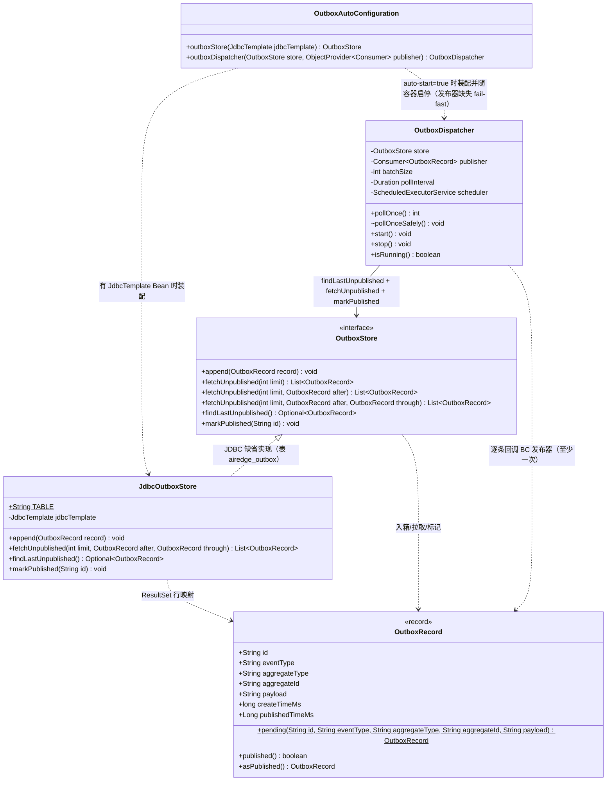
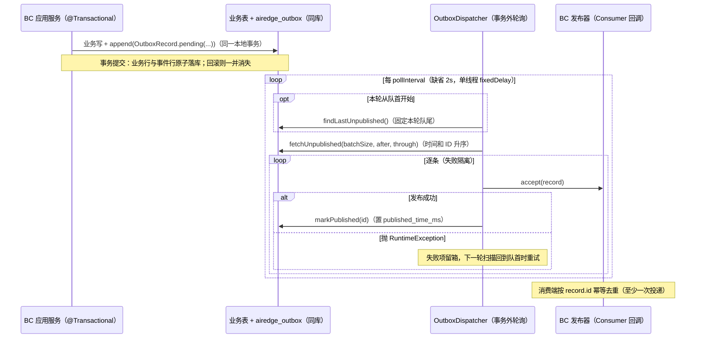

# outbox — Transactional Outbox 本地消息表基建：业务写与事件入箱同事务，事务外轮询派发（至少一次投递）

## 解决的问题

DDD「一个事务只修改一个聚合实例」（One Transaction Rule）之下，跨聚合 / 跨进程的通知不能与业务写同事务直接投递外部消息（MQ / 事件网关）——先写库后发消息会丢通知，先发消息后写库会发假事件。本包提供本地消息表（Transactional Outbox）基建：

- **原子入箱**：`OutboxStore.append` 在宿主 Spring 事务内执行（`JdbcTemplate` 参与当前事务），业务表与 `airedge_outbox` 表**同库同事务**写入——业务写回滚则事件一并回滚，不存在「写成功但事件丢失」；
- **异步派发**：`OutboxDispatcher` 在事务外轮询未发布记录，逐条回调 BC 提供的发布器（`Consumer<OutboxRecord>`，如 Modulith 事件网关 / MQ producer），成功即 `markPublished`；
- **失败隔离与重试**：单条发布失败留箱下轮重试，不中断本批后续；单轮整体失败（DB 抖动）被吞掉记日志，轮询循环不被 `scheduleWithFixedDelay` 静默终止；
- **至少一次语义**：派发成功的标记与发布动作非原子，重复投递不可避免——**消费端必须按 `OutboxRecord.id` 幂等去重**。

## 标准符合性

对照 SSOT：`.lattice/standards/v4/v4-restful-patterns-compliance.md`「多资源操作与分布式事务」主题，遵循口径 **🅰️ 遵循 AIP**，自动化梯队 **🟠 Tier D（核心领域语义——框架提供基建，业务显式决策）**。

- **《API Design Patterns》第 17 章 Multi-resource operations**：原书讨论两阶段提交与补偿事务；AIP 不推荐跨服务分布式事务，倾向事件驱动的最终一致性。本项目取 AIP 立场：跨聚合（含跨聚合根类型与同类型多实例）只允许只读校验，写变更一律走领域事件与异步消费保证最终一致性——本包的本地消息表正是「领域事件可靠出箱」这一立场的落地基建。
- **AIP 编号**：**无直接对应专条**（矩阵该主题 AIP 栏为立场性描述：不推荐分布式事务、推荐 Sagas / 事件溯源）。如实说明：Outbox 属支撑该主题（以及批量 all-or-nothing 的「一实例一事务 + 失败本地补偿」、长流程 `202 + LRO`）的 Tier D 基础设施，不是某个 AIP 条款的协议实现。
- **RFC**：无直接对应的 RFC 条款（本包不定义 HTTP 契约；对外 HTTP 语义由触发它的业务端点承担）。
- **偏离登记**：D1~D17 中无本包专属条目；其所支撑主题的口径（跨聚合禁同事务写、批量本地补偿）见 SSOT 矩阵「多资源操作与分布式事务」「同构批量操作」两行。

## 使用方法

**自动化梯队：Tier D。业务层需要显式接入，非零感知**——框架只自动装配存储与（可选的）派发器及其启停，以下决策必须由 BC 承担：

1. **建表**：执行 `classpath:schema/outbox-postgresql.sql`（生产，经 Flyway / DDL 流水线）或 `outbox-h2.sql`（测试 schema.sql）；lib 不自动执行 DDL；
2. **同事务入箱**：在 application 层 `@Transactional` 方法内调用 `outboxStore.append(...)`（存储 Bean 由 `OutboxAutoConfiguration` 在宿主具备 `JdbcTemplate` 时自动注册，BC 声明同型 Bean 可覆盖）；
3. **提供发布器并启动派发**：发布器是 BC 业务语义（发到哪里、什么契约），两种形态二选一——① **BC 自管**（生产推荐）：BC 装配 `OutboxDispatcher` Bean（注入 `Consumer<OutboxRecord>`）并显式 `start()` / `stop()`，自动装配见同型 Bean 即退让、不代管启停；② **单机快速接入**：配置 `airedge.restful.outbox.auto-start=true`，自动装配注册 `OutboxDispatcher` 并**随容器生命周期启停**（Bean 初始化即 `start()`、容器关闭 `stop()`；首轮轮询延迟一个间隔，缺省 2s），发布器取容器中的 `Consumer<OutboxRecord>` Bean，**缺失即启动失败（fail-fast）**——不做 no-op 兜底，避免事件被 `markPublished` 后静默丢弃；
4. **消费端幂等**：按记录 `id` 去重（至少一次投递）。

### Java 示例（真实签名；入箱侧参照 demo `DemoTaskCommandService.activate`）

```java
// ① application 层：业务写与事件入箱同事务（demo 真实用法）
@Transactional
public void activate(String taskId) {
    DemoTask task = demoTaskRepository.byId(new DemoTaskId(taskId));
    task.activate();
    demoTaskRepository.save(task);
    // 与业务写同事务入箱；载荷为 JSON 字符串（事件契约由 BC 定义，经 Jackson 序列化，禁手工拼接）
    outboxStore.append(OutboxRecord.pending(UUID.randomUUID().toString(),
            "demo.task.activated", "demoTasks", taskId, activatedPayload(taskId, task)));
}

// ② BC 装配派发器：发布器回调 + 显式启动（batchSize=50、间隔 2s 与自动装配缺省一致）
@Bean
public OutboxDispatcher outboxDispatcher(OutboxStore store) {
    OutboxDispatcher dispatcher = new OutboxDispatcher(store,
            record -> mqProducer.send(record.eventType(), record.payload()), // Consumer<OutboxRecord>
            50, Duration.ofSeconds(2));
    dispatcher.start();   // 单线程后台轮询（daemon 线程 "outbox-dispatcher"；重复 start 幂等）
    return dispatcher;
}

// ③ 单测 / 宿主自管调度：只调单轮派发，返回成功发布条数
int published = dispatcher.pollOnce();
```

本包不定义 HTTP 端点，无请求/响应示例；入箱由业务端点（如 `POST /v1/demoTasks/{taskId}:activate`）的事务触发，派发结果对 HTTP 调用方不可见（最终一致）。

## 设计方案

### 类图（覆盖包内全部 5 个类型）



> 注：`OutboxAutoConfiguration` 的 `outboxDispatcher` 第二参数实际类型为 `ObjectProvider<java.util.function.Consumer<OutboxRecord>>`（图中以 `~` 记法压平嵌套泛型）；`TABLE` 常量值为 `"airedge_outbox"`。

### 类职责一览

| 类名 | 职责 | 关键属性 | 关键方法 |
|---|---|---|---|
| `OutboxRecord` | 本地消息表记录（不可变 record）；载荷为 JSON 字符串，事件契约由 BC 定义 | `id`（UUID，消费端幂等去重锚点）/ `eventType` / `aggregateType` / `aggregateId` / `payload` / `createTimeMs`（Epoch 毫秒）/ `publishedTimeMs`（未发布为 null） | `pending(...)`（新建未发布，createTimeMs=当前时刻）/ `published()` / `asPublished()`（已发布副本） |
| `OutboxStore` | 存储端口（移植 MQ 中转表 / Redis Stream 时实现本接口） | — | `append`（同事务入箱）/ `findLastUnpublished()`（取得扫描终点）/ `fetchUnpublished(limit, after, through)`（按入箱时间和 ID 读取边界内的未发布批次）/ `markPublished(id)` |
| `JdbcOutboxStore` | JDBC 缺省实现；表名/列名固定，与业务表同库同事务 | `TABLE="airedge_outbox"`、`JdbcTemplate` | `append` 写入六列。`fetchUnpublished` 按 `(create_time_ms, id)` 切页。`markPublished` 幂等写入发布时间。 |
| `OutboxDispatcher` | 发布侧轮询派发器（至少一次；失败隔离） | `store` / `publisher`（构造器判空）/ `batchSize`（≤0 回退 50）/ `pollInterval`（null/零/负回退 2s）/ 单线程 daemon `scheduler` | `pollOnce()`（返回成功条数；单条失败记 warn 留箱重试）/ 包私有 `pollOnceSafely()`（吞 Throwable 防 scheduleWithFixedDelay 静默终止）/ `start()`（synchronized 幂等）/ `stop()`（shutdownNow，幂等）/ `isRunning()`（scheduler 非 null） |
| `OutboxAutoConfiguration` | 自动装配：`@AutoConfigureAfter(JdbcTemplateAutoConfiguration)` 保证 JdbcTemplate 先注册（否则 OutboxStore 被静默跳过）；两 Bean 均 `@ConditionalOnMissingBean` 可被 BC 覆盖 | — | `outboxStore(JdbcTemplate)`（`@ConditionalOnClass`+`@ConditionalOnBean(JdbcTemplate)`）/ `outboxDispatcher(...)`（仅 `airedge.restful.outbox.auto-start=true`；`@Bean(initMethod="start", destroyMethod="stop")` 随容器启停，batchSize=50、间隔 2s；发布器取容器 `Consumer<OutboxRecord>`，**缺失抛 `IllegalStateException` fail-fast**） |

### 关键协作流程：落表 → 投递 → 确认



入箱原子性由宿主事务管理器保证，派发在事务外。发布成功与 `markPublished` 之间进程崩溃会重复投递，因此采用至少一次交付。派发按 `create_time_ms` 和 `id` 升序扫描，每轮固定开始时的队尾，持续入箱的记录进入下一轮。`pollOnceSafely` 记录单次轮询异常，保留未发布记录并继续轮询。

### 配置项 / 存储 schema 要点

**配置**：`airedge.restful.outbox.auto-start`（缺省 `false`）——为 `true` 时自动装配 `OutboxDispatcher`（batchSize=50、间隔 2s）并**随容器生命周期启停**（`initMethod="start"` / `destroyMethod="stop"`，首轮轮询延迟一个间隔）；发布器取容器中的 `Consumer<OutboxRecord>` Bean，**缺失即启动失败**（`IllegalStateException`，提示装配发布器或关闭 auto-start 改由 BC 自管）——不做 no-op 兜底，杜绝「事件被标记已发布后丢弃」。生产接入推荐 BC 自管 Dispatcher Bean（自动装配退让，启停由 BC 决定）。本包无错误码定义（不承载 HTTP 契约）。

**表 `airedge_outbox`**（DDL：`src/main/resources/schema/outbox-postgresql.sql` / `outbox-h2.sql`，两脚本仅 `payload` 类型不同：PG `TEXT` / H2 `CLOB`）：

| 列 | 类型 | 说明 |
|---|---|---|
| `id` | VARCHAR(64) PK | 记录主键（UUID；消费端幂等去重锚点） |
| `event_type` | VARCHAR(128) NOT NULL | 事件类型（如 `demo.task.created`） |
| `aggregate_type` | VARCHAR(128) NOT NULL | 聚合类型（如 `demoTasks`） |
| `aggregate_id` | VARCHAR(64) NOT NULL | 聚合契约 ID |
| `payload` | TEXT / CLOB NOT NULL | 事件载荷 JSON（原样承载，契约由 BC 定义） |
| `create_time_ms` | BIGINT NOT NULL | 入箱时刻（Epoch 毫秒；派发排序键） |
| `published_time_ms` | BIGINT NULL | 发布完成时刻（NULL=未发布） |

索引：`idx_airedge_outbox_unpublished (published_time_ms, create_time_ms)`——覆盖「未发布 + 入箱序」轮询查询。

**测试参考**（`src/test/java/.../outbox/`）：`JdbcOutboxStoreTest`（真实 H2 执行 DDL 往返：入箱序拉取 / 标记后不再拉取 / 载荷原样）、`OutboxDispatcherTest`（顺序派发与标记、失败隔离留箱重试、空箱零派发、`pollOnceSafely` 吞异常轮询续命）、`OutboxAutoConfigurationTest`（开关关闭不装配 / auto-start 真轮询并随容器停止 / 缺发布器 fail-fast / BC 自管 Bean 时装配退让不代管启停）。真实业务用法见 `airedge-v4/demo-singlemodule` 的 `DemoTaskCommandService`（`activate` 同事务入箱 `demo.task.activated`）。
