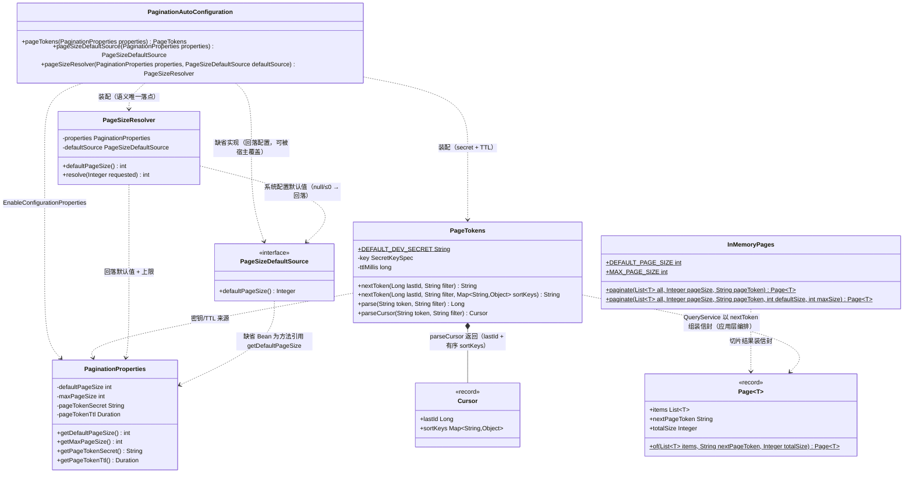
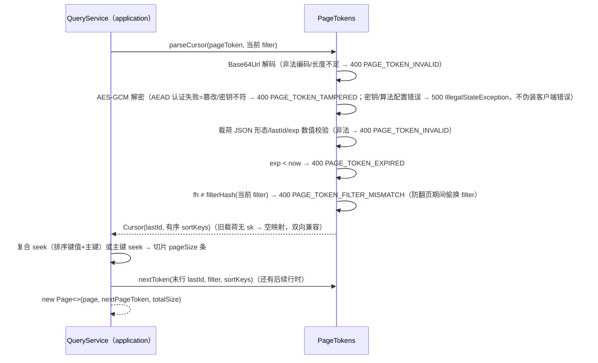

# pagination — AIP-158 游标分页：Page 信封 + AES-GCM 不透明游标 + pageSize 语义唯一落点

## 解决的问题

集合查询分页若沿用旧栈 `pageNum`/`offset` 深分页，会有三类问题：

1. **深分页拖垮数据库**（offset 扫描）与**跳页数据漂移**（翻页期间数据增删导致漏行/重行）；
2. **游标可篡改**：明文 offset/ID 游标可被客户端解码、伪造、偷换过滤条件；
3. **pageSize 语义散落**：各 BC 自行硬编码默认值/上限，系统配置的「页面滚动加载数量」被截断或失效。

本包提供统一治理：`Page<T>` 通用分页信封（AIP-132 List 信封）、`PageTokens` AES-GCM 加密不透明游标（签发/解析/防篡改/过期/filter 指纹绑定，可选复合排序键 seek）、`PageSizeResolver` + `PageSizeDefaultSource`（pageSize 语义唯一落点，默认值经 SPI 对接系统智能规则）、`InMemoryPages`（聚合内有界集合的内存分页例外）。**分页编排（切片、seek、nextPageToken 计算、totalSize）在应用层 QueryService；Controller 禁止注入分页组件**（主规范 §7.1.3）。

## 标准符合性

| 权威 | 条款 | 遵循口径 |
|---|---|---|
| Google AIP | **AIP-158（Pagination）** | ✅ **完全遵照**。`pageSize`/`pageToken` → `nextPageToken` 游标分页；`page_token` 为**不透明且 URL-safe 字符串**（本项目在其基础上强化为 AES-GCM 加密）；未传或 `0` → 取默认值（AIP-158:63-64，0 不得报错）；负值 → `INVALID_ARGUMENT`（AIP-158:68）；分页字段必须真实实现且默认值非无限（AIP-158:173-176，小集合允许「取全量再切片」的内存版 = `InMemoryPages` 例外，主规范 §7 登记）；**禁止暴露 offset/pageNumber 参数** |
| Google AIP | **AIP-132（Standard methods: List）** | List 必须以信封返回、严禁裸数组：`Page<T>`（`items`/`nextPageToken`/`totalSize`）为 lib-restful 统一维护的协议信封白名单成员（与 `Etagged<T>` 同列），规避各资源同构 `{Noun}Page` 样板类爆炸 |
| 《API Design Patterns》（JJ Geewax, Manning 2021） | **第 19 章 Pagination** | 游标（Cursor）方案；加密不透明游标对齐原书口径，不做偏离 |
| IETF | **RFC 9457**（Problem Details for HTTP APIs） | 游标/pageSize 非法的 400 错误响应契约 |

**内存游标例外（登记于主规范 §7，非 D# 偏离）**：聚合内**有界集合**（步骤/版次/链接等子资源）用 `InMemoryPages` 的 Base64Url 编码偏移游标——可解码、**不承载授权与过滤语义**；标准 List 游标恒为 AES-GCM 形态。

**偏离登记**：无（矩阵判定 ✅ 完全遵照，D1~D17 均不涉及本主题）。

**自动化梯队**：🟢 **Tier A（框架完全接管）——游标安全与参数语义层面**：`PageTokens`（签发/解析/防篡改/过期/filter 指纹绑定）与 `PageSizeResolver`（缺省/400/钳制）由 lib-restful 自动装配，业务注入即用、零手写防御分支。**分页编排本身属应用层职责**（QueryService 按主规范 §7.1.3 模板执行；Controller 只做 Query 参数提取与直通，严禁注入 `PageTokens`/`PageSizeResolver` 或编写切片/游标截断逻辑）。对照 SSOT：`.lattice/standards/v4/v4-restful-patterns-compliance.md` §2.2「分页机制」行。

## 使用方法

### 1. 应用层 QueryService 注入编排（权威示例）

简单主键序分页（`DemoProjectQueryService#listProjects`）：

```java
private final PageTokens pageTokens;            // 构造器注入（自动装配 Bean）
private final PageSizeResolver pageSizeResolver;

public Page<QDemoProject> listProjects(ListDemoProjectsQuery query) {
    int limit = pageSizeResolver.resolve(query.pageSize());   // 缺省/0→默认；负→400；超限钳制
    List<QDemoProject> all = /* 全量并按主键升序排序 */;
    Long afterId = pageTokens.parse(query.pageToken(), null); // 首页 null；篡改/过期/filter 不符 → 400
    List<QDemoProject> page = all.stream()
            .filter(p -> afterId == null || Long.parseLong(p.projectId()) > afterId)
            .limit(limit).toList();
    String nextPageToken = null;
    if (/* 还有后续行 */) {
        nextPageToken = pageTokens.nextToken(Long.parseLong(page.get(page.size() - 1).projectId()), null);
    }
    return new Page<>(page, nextPageToken, all.size());       // 末页 token = null
}
```

复合排序键 seek（`DemoTaskQueryService#listTasks`，`orderBy` 非主键序翻页）：

```java
OrderBy order = OrderBy.resolve(query.orderBy(), SORTABLE_FIELDS, "taskId"); // 主键升序末位兜底（orderby 包）
PageTokens.Cursor cursor = pageTokens.parseCursor(query.pageToken(), query.filter());
// cursor.lastId() = 主键兜底位；cursor.sortKeys() = 有序排序键值对（旧游标为空映射 → 退化为主键 seek）
List<QDemoTask> after = matched.stream().filter(t -> afterCursor(t, cursor)).toList();
List<QDemoTask> page = after.stream().limit(pageSize).toList();
// 签发：sortKeys 用 LinkedHashMap 保序，键名编码（如 "createTime desc"）由 BC 按自身 orderBy 约定自定
String nextPageToken = pageTokens.nextToken(Long.parseLong(last.taskId()), query.filter(), sortKeysOf(last, order));
return new Page<>(page, nextPageToken, matched.size());
```

有界子集合内存分页（`DemoTaskQueryService#listSteps`）：

```java
return InMemoryPages.paginate(steps, query.pageSize(), query.pageToken());
// 默认 50 / 上限 200；游标 = Base64Url(offset)；totalSize = 全量条数；末页 nextPageToken = null
```

### 2. Controller 只做协议直通（禁止注入分页组件）

```java
@GetMapping
public Page<QDemoTask> list(
        @RequestParam(value = "pageSize", required = false) Integer pageSize,
        @RequestParam(value = "pageToken", required = false) String pageToken,
        @RequestParam(value = "filter", required = false) String filter,
        @RequestParam(value = "orderBy", required = false) String orderBy) {
    return queryService.listTasks(new ListDemoTasksQuery(pageSize, pageToken, filter, orderBy));
}
```

### 3. HTTP 请求示例

```http
GET /v1/demoTasks?pageSize=20&filter=status%3D%22ACTIVE%22&orderBy=createTime%20desc
```

响应（`Page` 信封，`@JsonInclude(NON_NULL)`；末页省略 `nextPageToken`）：

```json
{ "items": [ { "name": "demoTasks/623809242866016", "taskId": "623809242866016", "...": "..." } ],
  "nextPageToken": "kR7x…（AES-GCM 不透明字符串，客户端不可解码）",
  "totalSize": 42 }
```

翻页：`GET /v1/demoTasks?pageSize=20&filter=status%3D%22ACTIVE%22&pageToken=kR7x…`——**filter 必须与签发时一致**（指纹绑定，偷换 → 400）。子资源：`GET /v1/demoTasks/{taskId}/taskSteps?pageSize=2&pageToken=Mg`（`Mg` = Base64Url("2")，内存游标例外）。

### 生效条件

- `PaginationAutoConfiguration` 已登记 `AutoConfiguration.imports`：`PageTokens`、`PageSizeDefaultSource` 与 `PageSizeResolver` 均为 `@ConditionalOnMissingBean`（BC/宿主声明同型 Bean 即覆盖——如以 KMS 托管密钥的 `PageTokens` 实现）。
- **默认条数来源优先级**：宿主注入的 `PageSizeDefaultSource`（bridge-v3 `V3PageSizeDefaults` 直读 v3 智能规则「页面滚动加载数量」`SmartRuleNode.scrollLoadSize`，可选 50/100/200/500）＞ 回落配置 `default-page-size`（缺省 20）。各 BC 零改动即随系统配置生效；`V3PageSizeDefaults` 为双栈共存期 SPI，legacy 下线时移除。
- `Page` / `InMemoryPages` 为纯数据/静态工具，无需装配。

## 设计方案

### 类图（覆盖包内全部 7 个顶层类型 + 1 个嵌套 record）



> 嵌套类型归属：`Cursor` 为 `PageTokens` 的嵌套 record。`PageSizeDefaultSource` 为 `@FunctionalInterface` 端口；缺省 Bean 是 `properties::getDefaultPageSize` 方法引用（依赖关系，非类型继承）。属性缺省值（20 / 100 / 开发密钥 / 30m）见下方配置表。

### 类职责一览

| 类名 | 职责 | 关键属性 | 关键方法 |
|---|---|---|---|
| `Page<T>` | 通用集合分页信封（AIP-132/158；协议信封白名单成员）；紧凑构造器归一：`items` null → 空列表、`List.copyOf` 不可变；`nextPageToken` 空白 → null；`@JsonInclude(NON_NULL)` | `items`、`nextPageToken`、`totalSize` | 静态 `of(List<T>, String, Integer)`；record 访问器 |
| `PageTokens` | AES-GCM 不透明游标编解码（供各 BC QueryService 注入）：签发/解析/防篡改/过期/filter 指纹绑定；可选复合排序键 `sk` 节点（向后兼容旧载荷） | `DEFAULT_DEV_SECRET`（仅开发）；`key`（SHA-256 派生 AES-256）；`ttlMillis`；IV 12 字节、GCM tag 128 位 | `PageTokens(String secret, Duration ttl)`、`nextToken(Long, String)`、`nextToken(Long, String, Map<String,Object>)`、`parse(String, String)`、`parseCursor(String, String)` |
| `PageTokens.Cursor` | 解析后的游标：`lastId` = 最后一条记录主键（seek 兜底位，null = 首页）；`sortKeys` = 有序排序键值对（紧凑构造器保序不可变；旧载荷为空映射） | `lastId`、`sortKeys` | record 访问器 |
| `PageSizeResolver` | `pageSize` 语义唯一落点（各 BC 禁止自行实现/硬编码）：缺省/0 → 默认；负值 → 400；超上限钳制 | `properties`、`defaultSource` | `PageSizeResolver(PaginationProperties, PageSizeDefaultSource)`、`defaultPageSize()`、`resolve(Integer)` |
| `PageSizeDefaultSource` | 单页默认条数来源端口（`@FunctionalInterface` 技术缝隙）：真实来源为 v3 智能规则「页面滚动加载数量」，由 bridge-v3 `V3PageSizeDefaults` 接管；null/≤0 = 未配置 → 回落配置 | — | `defaultPageSize()` |
| `PaginationAutoConfiguration` | 分页装配：`PageTokens` 恒装配；`PageSizeDefaultSource`/`PageSizeResolver` 缺 Bean 条件装配（宿主同型 Bean 即覆盖） | `@EnableConfigurationProperties(PaginationProperties.class)` | `pageTokens(...)`、`pageSizeDefaultSource(...)`、`pageSizeResolver(...)` |
| `PaginationProperties` | 分页与游标配置（前缀 `airedge.restful.pagination`）：回落默认条数、上限、游标密钥与 TTL | `defaultPageSize=20`、`maxPageSize=100`、`pageTokenSecret=DEFAULT_DEV_SECRET`、`pageTokenTtl=30m` | 各 getter/setter |
| `InMemoryPages` | 小规模有界集合（子资源/只读投影）内存分页：取全量再切片；游标 = Base64Url(offset)，非法/负 offset → 400；pageSize 语义与 `PageSizeResolver` 一致 | `DEFAULT_PAGE_SIZE=50`、`MAX_PAGE_SIZE=200`；私有构造 | 静态 `paginate(List<T>, Integer, String)`、静态 `paginate(List<T>, Integer, String, int, int)` |

### 关键协作流程

**游标签发（nextToken）**：载荷 `JSON{lastId, fh, exp[, sk]}` → AES-GCM 加密（随机 12 字节 IV，128 位认证标签）→ `Base64Url(IV‖密文)`（无填充）。`fh` = filter 的 **SHA-256 前 8 字节十六进制**（替代可碰撞的 `String.hashCode`；null/空白 filter → 空串）；`exp` = 签发时刻 + TTL；`sk` = 可选有序排序键值对（`LinkedHashMap` 保序，值为 JSON 标量）。`lastId` 为 null（末页）→ 返回 null，响应省略字段。

**游标解析（parse / parseCursor）校验链**（客户端输入违规一律 400；服务端密钥 / 算法配置错误 → 500，见图中标注；首页 null/空白 → `Cursor(null, {})`）：



**pageSize 语义**（`PageSizeResolver.resolve`）：默认值 = `PageSizeDefaultSource` 返回值（>0 时）＞ 回落 `default-page-size`；`null`（未传）或 `0` → 默认值；负值 → 400 `PAGE_SIZE_INVALID`；其余 → `min(requested, max(max-page-size, 默认值))`——**有效上限不低于系统默认值**，保证智能规则配置的滚动加载数量（50/100/200/500）不被服务端上限截断。`InMemoryPages` 同语义（默认 50、上限 200，ceiling = max(maxSize, defaultSize)）。

**totalSize 语义按端点固定**（主规范 §7）：标准 List = 过滤后匹配总数；`:batchGet` = 本次返回条数；子资源内存分页 = 全量条数。同一端点禁止两种语义混用。

### 配置项 / 错误码 / 默认值 / 上限（以代码为准）

配置前缀 `airedge.restful.pagination`（`PaginationProperties`）：

| 配置项 | 缺省值 | 说明 |
|---|---|---|
| `default-page-size` | **20** | 回落默认条数（智能规则不可得时使用） |
| `max-page-size` | **100** | 上限配置；有效上限 = `max(本值, 默认条数)` |
| `page-token-secret` | `"airedge-dev-page-token-secret-change-me"`（`PageTokens.DEFAULT_DEV_SECRET`） | 游标加密密钥，经 SHA-256 派生 AES-256；**生产必须覆盖**；轮换即更换密钥，既有游标全部失效；空白密钥构造即 `IllegalArgumentException` |
| `page-token-ttl` | **30 分钟** | 游标有效期；构造传 null/负 Duration 回落 30 分钟 |

错误码（`DomainRestCode`，均 `INVALID_ARGUMENT` → 400，RFC 9457 承载）：

| 错误码 | 码值 | 触发 |
|---|---|---|
| `PAGE_TOKEN_INVALID` | **300010001** | Base64 非法/长度不足/载荷 JSON 形态非法/sk 键非字符串；`InMemoryPages` offset 游标非法或为负 |
| `PAGE_TOKEN_EXPIRED` | **300010002** | `exp` 早于当前时刻（提示从首页重新查询） |
| `PAGE_TOKEN_FILTER_MISMATCH` | **300010003** | 游标 filter 指纹与当前 filter 不符 |
| `PAGE_TOKEN_TAMPERED` | **300010004** | AEAD 认证失败（篡改/密钥不符） |
| `PAGE_SIZE_INVALID` | **300010009** | pageSize 负值（0 取默认不报错，AIP-158:63-64/68） |

其他常量：`InMemoryPages.DEFAULT_PAGE_SIZE = 50`、`InMemoryPages.MAX_PAGE_SIZE = 200`（AIP-158:174 默认非无限）；服务端加密配置错误（密钥/算法）→ `IllegalStateException`（500），不伪装成客户端错误。