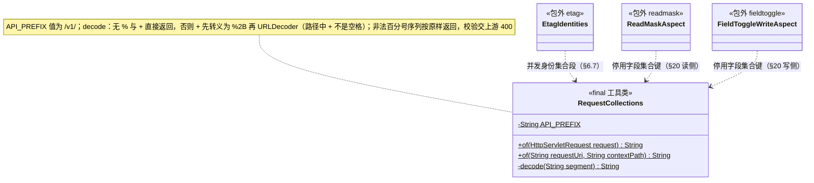

# path — 请求 URI → 资源集合段派生的唯一口径（协议治理共用 key）

## 解决的问题

ETag 并发身份（§6.7）、预定义字段开关集合键（§20）、ABAC 集合裁决（§19）都需要从当前请求 URI 派生**资源集合段**（如 `demoTasks`）。若各处自写字符串截取，会出现两类静默事故：

1. **contextPath 未剥离**：Servlet 规范下 `getRequestURI()` 含 contextPath——部署 `server.servlet.context-path=/plm` 时真实 URI 为 `/plm/v1/demoTasks/101`，不剥离则 `/v1/` 前缀判定恒失败，所有依赖集合段的协议治理**整体静默失效且无任何日志**。
2. **集合键漂移**：百分号编码冒号（`demoTasks%3AbatchUpdate`）、矩阵参数（`demoTasks;v=1`）若不归一，BC 注册表与框架裁决出现「两把 key」精确串匹配失配。

`RequestCollections` 把派生收口为唯一口径：剥 contextPath → 取 `/v1/` 后首个路径段 → 百分号解码 → 剥矩阵参数（`;`）→ 剥冒号动词（`:`）；无法解析返回 `null`（调用方按「无集合上下文」处理）。

## 标准符合性

本包是**纯基建工具**，无独立 AIP 专条；支撑矩阵以下主题（以代码事实为准）：

| 支撑主题 | 权威条款 | 本包落点 |
|---|---|---|
| 资源导向架构与拓扑 | **AIP-121**（Resource-oriented design）、**AIP-122**（Resource names）；《API Design Patterns》第 4/5 章 | `/v1/{collection}/...` 拓扑中集合段的运行时识别——冒号动词剥离对应 AIP-136 自定义方法挂载在集合段之后的形态 |
| 并发控制与版本防并发 | AIP-154；**D13**（body `lockedVersion`） | `EtagIdentities` 经本工具派生集合段作为 `@EtagResource` 身份解析上下文（§6.7 并发身份） |
| 预定义字段开关 / 部分读取 | AIP-157 / AIP-161（矩阵 Tier B 行） | `ReadMaskAspect` / `FieldToggleWriteAspect` 以本工具派生集合键查 `FieldToggleProvider.disabledFields(collection)`——BC 注册表与框架裁决同一口径（`FieldToggleProvider` javadoc 明文引用） |
| 多粒度访问控制（ABAC）/ 流式导出 | **D17**（流式导出集合段一次裁决） | demo `DemoTaskBatchController.export` 在请求线程 `exportService.maskedFields(RequestCollections.of(request))` 按集合段裁决掩码集 |

## 使用方法

**自动化梯队：随宿主机制生效（etag Tier A / 字段开关与投影 Tier A/B 的底层 key 派生）；标准读写路径业务层无需感知**——框架切面内部调用本工具。生效条件：端点挂在 `/v1/` 前缀下（与 `@RequestMapping("/v1/...")` 一致）；非 `/v1/` 请求派生为 null，相关治理按「无集合上下文」降级。

业务仅在**绕过切面的自定义路径**（如流式导出）需要显式调用：

```java
// 流式导出：请求线程按集合段一次裁决掩码集（demo export 真实用法）
Set<String> masked = exportService.maskedFields(RequestCollections.of(request));

// 也可直接按 URI + contextPath 派生（无 HttpServletRequest 场景 / 单测）
RequestCollections.of("/plm/v1/demoTasks/101", "/plm");        // "demoTasks"
RequestCollections.of("/v1/demoTasks:batchUpdate", null);      // "demoTasks"
RequestCollections.of("/v1/demoTasks%3AbatchUpdate", "");      // "demoTasks"（先解码再剥动词）
RequestCollections.of("/v1/demoTasks;v=1/101", "");            // "demoTasks"（矩阵参数剥离）
RequestCollections.of("/gateway/plm/v1/demoTasks/101", "");    // "demoTasks"（网关重写兜底：从首个 /v1/ 起算）
RequestCollections.of("/demoTasks/101", "");                   // null（非版本化前缀）
RequestCollections.of("/v1/", "");                             // null（空白段）
```

（以上全部为单测 `RequestCollectionsTest` 锚定的真实断言。）

部署相关配置项：`server.servlet.context-path`（如 `/plm`）——本工具自动剥离，宿主无需额外配置。

## 设计方案



类职责一览（本包 1 个类；包外调用方列出示意协作）：

| 类名 | 职责 | 关键属性 | 关键方法 |
|---|---|---|---|
| `RequestCollections` | 请求 URI → 集合段派生唯一口径：剥 contextPath → `/v1/` 首段 → 解码 → 剥矩阵参数与冒号动词；解析失败 null | `API_PREFIX = "/v1/"`（私有）、私有构造器 | `of(HttpServletRequest)`（null 请求 → null）、`of(String requestUri, String contextPath)`；私有 `decode(String)` |

关键协作流程（派生管线，顺序即代码顺序）：

1. `request == null` / `requestUri == null` → null；
2. contextPath 非空且为前缀 → 剥离；
3. 剥后不以 `/v1/` 开头 → 兜底从 URI 中**首个** `/v1/` 起算（网关重写 / forward 场景）；找不到 → null；
4. 取 `/v1/` 后至下一 `/` 的首段（嵌套子资源取**顶层**集合段）；
5. 百分号解码（`%3A` → `:`；`+` 先转义 `%2B`，路径中 `+` 不是空格；非法序列原样返回交上游 400）；
6. 截断 `;`（矩阵参数）与 `:`（集合级冒号动词）之后内容；
7. 空白 → null，否则返回集合段。

真实配置项 / 常量：路径前缀 `/v1/`（硬编码常量，与契约版本代际一致）；宿主 `server.servlet.context-path`；本包无错误码、无媒体类型、无自动装配。