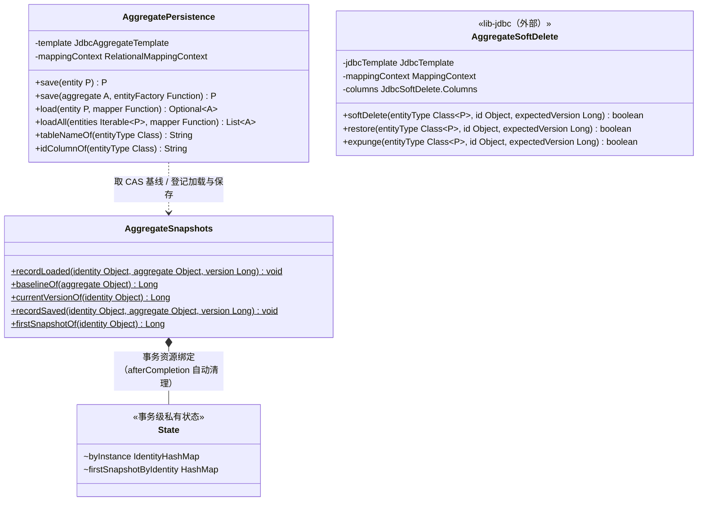

# persistence — Spring Data JDBC 写模型的协议持久化支撑：版本基线取给与聚合存库入口

## 解决的问题

v4 写模型若采用 Spring Data JDBC，有两个协议相关的持久化难题必须由框架在**存库入口**解决，而不能留给业务仓储：

1. **版本播种时机**：Spring Data JDBC 依据实体版本属性判定 INSERT / UPDATE，版本必须在 `save` 调用**之前**就在实体里——实体回调（`BeforeConvert`）发生在判定之后，来不及补版本。「谁把 CAS 基线放进实体」必须由框架完成；
2. **并发基线来源的两种形态**：不可变实体（`save(aggregate, factory)`）以**该聚合实例**加载时的快照为 CAS 基线——陈旧实例以旧基线写入被数据库拒绝（乐观锁失败），不会静默覆盖他人提交；可变 PO（`save(entity)`）在实体版本为空时取**该身份在本事务内的首次快照**播种（实体已有版本则不覆盖），同事务内保存成功后再把该身份快照推进到新版本。

本包两个类分别承载：`AggregatePersistence`（存库 / 加载入口）、`AggregateSnapshots`（事务级加载快照登记）。业务对象与 HTTP 协议概念（ETag / lockedVersion）完全隔离——版本对业务是纯数据流。

**聚合软删除生命周期（软删 / 恢复 / expunge）属持久化语句语义，归 lib-jdbc**：Spring Data JDBC 写模型走 lib-jdbc `AggregateSoftDelete`（表 / 主键 / 版本列取自实体元数据，软删 / 恢复同语句推进 `version = version + 1`，软删列模型由调用方声明）。

> 适用面：**Spring Data JDBC 写模型**（demo-multimodule `BomRepositoryImpl` 为真实用例）。demo-singlemodule 的写仓储走 lib-jdbc 受控 SQL 机制，不经本包；lib-jdbc 的并发代数登记由 `etag.EtagAggregateLifecycleListener` 桥接。

## 标准符合性

对照 SSOT：[.lattice/standards/v4/v4-restful-patterns-compliance.md](../../../../../../../../../../.lattice/standards/v4/v4-restful-patterns-compliance.md)。本包**无直接对应的独立标准主题**（矩阵 28 主题中没有「持久化」条目），它是以下两个主题的**存储侧支撑基建**：

| 被支撑主题 | 权威条款 | 本包支撑点 |
|---|---|---|
| 并发控制与版本防并发（**🅰️ 遵循 AIP**，🟢 Tier A） | **AIP-154**（Resource freshness / etag）、《API Design Patterns》第 28 章 Concurrency control；**D13**（并发凭据走 body `lockedVersion`，非 If-Match）、**D11**（版本不匹配 409，对齐 AIP-154 ABORTED→409） | `AggregateSnapshots` 提供 CAS 基线、`AggregatePersistence` 播种版本并把乐观锁失败转译为 409（`CommonResCode.VERSION_CONFLICT`，code `300010024`） |
| 软删除与回收站机制（**✅ 完全遵照**，🟢 Tier A 读路径） | **AIP-164**（Soft delete）、《API Design Patterns》第 25 章 Soft delete | 写路径三件套由 lib-jdbc `AggregateSoftDelete` 兑现（软删 / 恢复同语句推进版本；expunge 仅对已软删行生效）；本包只承担该主题的**读侧可见性**所依赖的存库口径（`delete_flag` / `updated_time` 由实体携带保存） |

错误契约经 RFC 9457（`DomainException` → Problem Details）；数据约束冲突（唯一键 / 外键）转译为 409 `CommonResCode.CONSTRAINT_CONFLICT`。**不虚构其他 AIP 映射**。

## 使用方法

**自动化梯队：🟢 Tier A（并发控制主题）的存储侧基建**——版本基线的取给、登记、推进、冲突转译全部框架完成，**领域 / 应用层零版本感知**；基础设施层仓储只需把加载 / 存库改经本包入口（一行调用），不写任何版本判断。

**生效条件**：宿主类路径存在 `org.springframework.data.jdbc.core.JdbcAggregateTemplate` 时，`etag.EtagAutoConfiguration.JdbcEntityLifecycleConfiguration` 自动注册 `AggregatePersistence` Bean（`@ConditionalOnMissingBean` 可覆盖）。本包**无独立 AutoConfiguration**（`AutoConfiguration.imports` 中经 `EtagAutoConfiguration` 间接生效）。

### 仓储真实用法（demo-multimodule `BomRepositoryImpl`）

```java
@Repository
public class BomRepositoryImpl implements BomRepository {
    private final JdbcAggregateTemplate jdbcAggregateTemplate;
    private final AggregatePersistence aggregatePersistence; // 框架自动装配注入

    @Override
    public void save(Bom bom) {
        aggregatePersistence.save(toPO(bom)); // 可变 PO：框架播种版本基线后存库
    }

    @Override
    public Optional<Bom> findById(BomId id) {
        // 框架完成「加载 → 映射 → 登记来源行」，业务只给映射函数
        return aggregatePersistence.load(
                jdbcAggregateTemplate.findById(id.value(), BomPO.class), this::toDomain);
    }

    @Override
    public List<Bom> listAll() {
        return aggregatePersistence.loadAll(
                jdbcAggregateTemplate.findAll(BomPO.class), this::toDomain);
    }
}
```

### 不可变实体（record）形态

```java
// 框架把加载基线交给映射函数（null = 新聚合），业务只做映射、不查版本
aggregatePersistence.save(aggregate, version -> toEntity(aggregate, version));
```

### 聚合软删 / 恢复 / 彻底删除（lib-jdbc `AggregateSoftDelete`）

```java
// 表名 / 主键列 / 版本列取自实体元数据（@Table / @Id / @Version）；软删列模型由调用方声明（取自软删配置）
AggregateSoftDelete softDelete = new AggregateSoftDelete(jdbcTemplate, mappingContext, columns);
boolean done = softDelete.softDelete(TaskPO.class, id);  // false → 调用方映射 404 或幂等 204
boolean back = softDelete.restore(TaskPO.class, id);     // :undelete；false → 404
boolean gone = softDelete.expunge(TaskPO.class, id);     // :expunge；仅已软删行；false → 404
```

删除 / 恢复族端点不携带、不校验版本（决策 C7），通常无条件执行；需要期望版本守卫时用带 `expectedVersion` 参数的重载——版本谓词与写入**同一条语句**原子完成，陈旧令牌在写入生效前被拒（409），不存在「已生效却报冲突」。期望版本的解析（如请求级上下文）属协议桥接职责，由宿主侧装配完成。

## 设计方案



> `AggregatePersistence` 与 lib-jdbc `AggregateSoftDelete` 无调用关系：存库入口管版本基线；软删生命周期语句独立由仓储显式调用（版本推进内联在 UPDATE 语句中，不读写快照登记）。

### 类职责一览

| 类 | 职责 | 关键属性 | 关键方法 |
|---|---|---|---|
| `AggregatePersistence` | 聚合存库 / 加载入口：版本播种（可变 PO）或基线交给映射函数（record）；乐观锁 / 约束冲突转译为领域异常（409）；提供表名 / 主键列元数据出口 | `template`（JdbcAggregateTemplate）、`mappingContext`（RelationalMappingContext） | `save(P)`、`save(A, Function<Long,P>)`、`load(P, Function<P,A>)`、`loadAll(Iterable<P>, Function<P,A>)`、`tableNameOf(Class)`、`idColumnOf(Class)` |
| `AggregateSnapshots` | 事务级加载快照登记：实例 → 加载版本（IdentityHashMap，基线随实例隔离）；身份 → 快照（加载时 `putIfAbsent`，保存成功后被推进到新版本，供可变 PO 播种）；事务结束自动清理；事务外不登记 | `RESOURCE_KEY`（事务资源键） | `recordLoaded`、`baselineOf`、`currentVersionOf`、`recordSaved`、`firstSnapshotOf`（全静态） |
| `AggregateSnapshots.State` | 私有事务状态载体 | `byInstance`（IdentityHashMap）、`firstSnapshotByIdentity`（HashMap） | —（`afterCompletion` 解绑资源） |
| lib-jdbc `AggregateSoftDelete`（外部） | 软删 / 恢复 / expunge 语句：元数据取列名；存在 `@Version` 列时软删 / 恢复同语句 `version = version + 1`；期望版本谓词原子比对；0 行归类（版本不符 → 409，否则 false） | `jdbcTemplate`、`mappingContext`、`columns` | `softDelete`、`restore`、`expunge`（各含期望版本重载） |

### 关键协作流程（加载 → 存库 CAS）

1. **加载登记**：`load(entity, mapper)` 映射出聚合后 `AggregateSnapshots.recordLoaded(identity, aggregate, version)`——实例级 `putIfAbsent`（基线随实例隔离）+ 身份级快照 `putIfAbsent`（同事务内多次加载取首次；保存成功后由 `recordSaved` 覆盖推进）；
2. **存库取基线**：
   - 可变 PO：`save(entity)` → `seedVersion` 在实体版本为空时写入 `firstSnapshotOf(identity)`，随后 `template.save`；
   - record：`save(aggregate, factory)` 先以 null 版本构造探取身份，再按 `baselineOf(aggregate)`（回退 `firstSnapshotOf(identity)`）重建实体；
3. **冲突转译**：`OptimisticLockingFailureException` → `DomainException(VERSION_CONFLICT)`（409）；`DataIntegrityViolationException` → `DomainException(CONSTRAINT_CONFLICT)`（409）；
4. **基线推进**：存库成功后 `recordSaved(identity, aggregate, newVersion)`——同事务内连续保存时第二次以最新版本做 CAS。

### 配置项 / 错误码要点

| 项 | 值 | 说明 |
|---|---|---|
| Bean 注册 | `etag.EtagAutoConfiguration.JdbcEntityLifecycleConfiguration`（`@ConditionalOnClass(JdbcAggregateTemplate)`） | `aggregatePersistence` `@ConditionalOnMissingBean`，BC 可同型覆盖；无独立 imports 条目 |
| `300010024` | `CommonResCode.VERSION_CONFLICT` → 409 | 乐观锁 CAS 未命中 / 期望版本不符（`DomainRestCode.VERSION_CONFLICT` 委托同源） |
| `CONSTRAINT_CONFLICT` | `CommonResCode` → 409 | 唯一键 / 外键等数据约束冲突（码值见 lib-exception） |
| 事务作用域 | `TransactionSynchronizationManager` 绑定，事务结束自动清理 | 事务外 `baselineOf / firstSnapshotOf` 恒 null（视为新聚合） |
