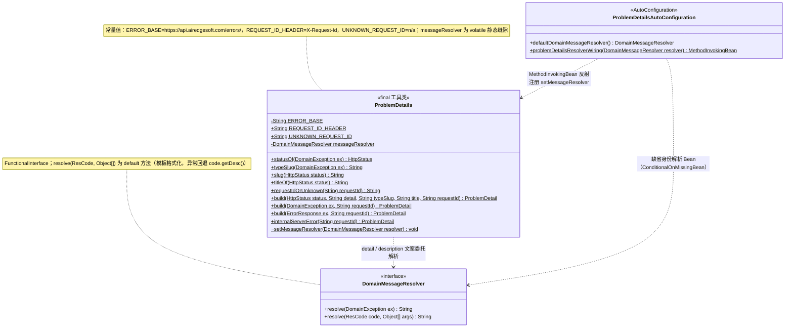
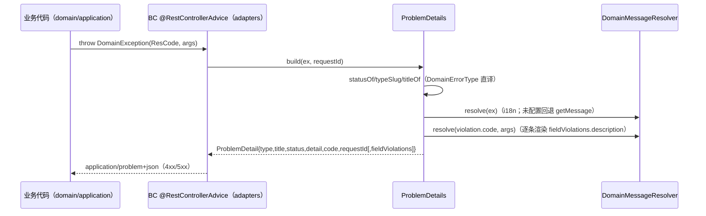

# problem — RFC 9457 Problem Details 统一错误构建与 i18n 解析装配

## 解决的问题

v4 全部业务失败都以 **RFC 9457 `application/problem+json`** 报文表达（**禁止通用 `Result` 包装**，ArchUnit 规则 4 门禁）。如果每个 BC 各写一套「异常 → 状态码 / type URI / title / 报文组装」逻辑，就会出现多份逐字重复且口径漂移的错误映射（审计 FF-16：demo-singlemodule 与 v4-alm 曾各持一份）。本包把**映射与构建逻辑收口**为共享工具：

- `ProblemDetails`：`DomainException` → HTTP 状态码（`DomainErrorType` **错误码直译**，无消息关键词兜底）、type URI slug、title、`ProblemDetail` 组装（含 `code` / `requestId` / `fieldViolations` 扩展成员）、协议层异常（`ErrorResponse`）与 500 兜底构建。
- `DomainMessageResolver`：`detail` / 字段违规 `description` 文案的 **i18n 解析缝隙**——缺省用 ResCode 模板 `String.format(args)`，宿主注入同型 Bean 即接管文案（状态码 / type / title 不受文案影响）。
- `ProblemDetailsAutoConfiguration`：把宿主（或缺省）解析器自动注册进 `ProblemDetails` 的静态缝隙，各 BC advice 零改动。

**分工边界**：各 BC 自持覆盖本 BC adapters 包的 `@RestControllerAdvice`（handler 方法与 `basePackages` 是 BC 的，见 v4-restful-api §9 第 14 条；demo 样板 `ApiExceptionHandlers`），本包只收口映射与构建。

## 标准符合性

| 权威条款 | 遵循口径 |
|---|---|
| **RFC 9457**（Problem Details for HTTP APIs，取代 RFC 7807） | 错误契约 SSOT：`type` / `title` / `status` / `detail` 标准成员 + `code` / `requestId` / `fieldViolations` 扩展成员；type URI 指向 `https://api.airedgesoft.com/errors/{slug}` 错误目录（标准成员 `instance` 当前未填充） |
| **AIP-193**（Errors） | **偏离登记 D12**：弃 `google.rpc Status` 错误信封，取 RFC 9457 problem+json；`DomainErrorType` 取值与 canonical codes 对齐（含 `ABORTED` / `RESOURCE_EXHAUSTED` / `DATA_LOSS` 等，见异常规范 §1.3） |
| **google.rpc `BadRequest.FieldViolation`**（error_details.proto，AIP-193 链接引用） | `fieldViolations` 扩展成员**语义对齐**逐字段违规明细（`field` + `code` + `description`），但不引入 Google 错误信封；载荷只带 field + ResCode + args，`description` 在本边界按 locale 渲染（领域层不拼文案） |
| 《API Design Patterns》 | 无独立「错误模型」专章；本包落实矩阵「多粒度访问控制（ABAC）」行的 403/400 附 `fieldViolations` 契约与批量 D10（`items[N]` 项级寻址）的承载 |

配套规范：`.lattice/standards/v4/v4-exception-handling.md`（异常域 SSOT：状态码锚点 = 错误码直译、5xx 收口、requestId 回路）；HTTP 线上格式 SSOT 为 v4-restful-api.md §8。

关键口径（均有单测锚定：前两项见 `ProblemDetailsI18nTest`，`requestId` 兜底见 `lro/LroProblemAdviceTest`）：

- 同一个 500 不因抛出形态不同产生两种 type：`typeSlug(INTERNAL/DATA_LOSS)` 与 `slug(INTERNAL_SERVER_ERROR)` 均为 `internal`（§1.3）。
- Spring MVC 协议异常（实现 `ErrorResponse` 的 4xx：缺参 / 缺请求头等）按自带状态码构建，**不放大为 500**、不带业务 `code`；其 5xx 一律折叠为内部错误（不外泄技术细节）。
- `requestId` 未携带 / 空白 → 兜底 `"n/a"`（`ProblemDetails.requestIdOrUnknown` 共用口径；本类不含日志输出，日志侧由使用方按同值记录）。

## 使用方法

**自动化梯队：Tier A（框架完全接管错误翻译链），但 BC 需一次性持有 advice 样板**。业务代码只 `throw new DomainException(码值, args...)`，不 try-catch、不拼错误报文；映射 / 组装 / i18n 全部由本包 + BC advice 闭环。

生效条件：

1. BC 在 adapters 包声明 `@RestControllerAdvice(basePackages = 本BC)`，handler 内委托 `ProblemDetails.build(...)`（demo `ApiExceptionHandlers` 为权威样板）。
2. i18n 接管为**可选**：宿主 / BC 声明 `DomainMessageResolver` Bean 即自动接管（经 `ProblemDetailsAutoConfiguration` 装配，已登记于 `META-INF/spring/...AutoConfiguration.imports`）；不声明则缺省 = ResCode 模板格式化，业务零感知。

```java
// 领域 / 应用层：只抛码值 + 参数（禁止自行解析文案）
throw new DomainException(DemoResultCode.TASK_NOT_FOUND, taskId);

// BC advice（adapters 包）：映射构建委托本包
@ExceptionHandler(DomainException.class)
public ProblemDetail onDomain(DomainException ex, HttpServletRequest request) {
    return ProblemDetails.build(ex, request.getHeader(ProblemDetails.REQUEST_ID_HEADER));
}

// 宿主可选：注入 i18n 解析器（按业务码取键、按 locale 渲染）
@Bean
public DomainMessageResolver i18nResolver(MessageSource messageSource) {
    return ex -> messageSource.getMessage(String.valueOf(ex.getCode()), ex.getArgs(),
            ex.getMessage(), LocaleContextHolder.getLocale());
}
```

HTTP 报文示例（`Content-Type: application/problem+json`，与单测断言一致）：

```http
HTTP/1.1 404 Not Found
Content-Type: application/problem+json

{
  "type": "https://api.airedgesoft.com/errors/not-found",
  "title": "Not Found",
  "status": 404,
  "detail": "任务不存在: 1",
  "code": 300300007,
  "requestId": "req-1"
}
```

携带字段级违规时（403 越权字段 / 400 字段约束违规 / 批量 422 `items[N]` 寻址）追加：

```json
"fieldViolations": [
  { "field": "items[0]", "code": 300300001, "description": "projectId 不能为空" }
]
```

（示例码值 `300300001` = demo `DemoResultCode.PROJECT_ID_REQUIRED`；批量违规按 `items[N]` 项级寻址，不设 `failedIndex` 单下标字段，D10。）

500 兜底（`ProblemDetails.internalServerError(requestId)`）：detail 固定为「系统内部错误，请联系管理员并提供请求追踪标识」，不泄露堆栈 / 内部信息。

## 设计方案



类职责一览：

| 类名 | 职责 | 关键属性 | 关键方法 |
|---|---|---|---|
| `ProblemDetails` | 错误码直译状态码 + type slug / title 映射 + problem+json 组装（`code` / `requestId` / `fieldViolations`），协议异常与 500 兜底 | `ERROR_BASE`、`REQUEST_ID_HEADER`、`UNKNOWN_REQUEST_ID`、volatile `messageResolver` | `statusOf` / `typeSlug` / `slug` / `titleOf` / `build`（三重载）/ `internalServerError` / `requestIdOrUnknown` |
| `DomainMessageResolver` | detail / 字段违规 description 的 i18n 解析缝隙（只管文案，不管状态码 / type） | — | `resolve(DomainException)`；default `resolve(ResCode, Object[])`（模板格式化，异常回退 `code.getDesc()`） |
| `ProblemDetailsAutoConfiguration` | 装配缺省解析器并把生效解析器注入静态缝隙 | — | `defaultDomainMessageResolver()`（`@ConditionalOnMissingBean`）、static `problemDetailsResolverWiring(...)`（`@ConditionalOnBean`） |

关键协作流程（异常 → ProblemDetail 翻译链）：



装配细节：`problemDetailsResolverWiring` 为 static `MethodInvokingBean`，在 context 启动期反射调用包级私有 `ProblemDetails.setMessageResolver`（包级私有防外部误改）；宿主 Bean 存在时缺省 Bean 退让（`@ConditionalOnMissingBean`），实现「注入即接管、advice 零改动」。

真实常量 / 媒体类型 / 错误码：

- 请求头：`X-Request-Id`（`REQUEST_ID_HEADER`）；requestId 兜底值 `n/a`。
- type URI 基址：`https://api.airedgesoft.com/errors/`；slug 集合：`not-found` / `status-conflict` / `aborted` / `already-exists` / `failed-precondition` / `resource-exhausted` / `out-of-range` / `internal` / `unavailable` / `deadline-exceeded` / `unimplemented` / `unprocessable-entity` / `unauthorized` / `forbidden` / `invalid-argument`（default），未映射状态码按 reason phrase 小写连字符派生（如 `unsupported-media-type`）。
- 媒体类型：`application/problem+json`（由 Spring MVC 对 `ProblemDetail` 返回值协商输出）。
- 业务错误码 `code`：9 位冻结码值（`30{MMM}{NNNN}`，分段治理见异常规范 §2.2）；本包不定义码值，只透传 `ex.getCode()`。