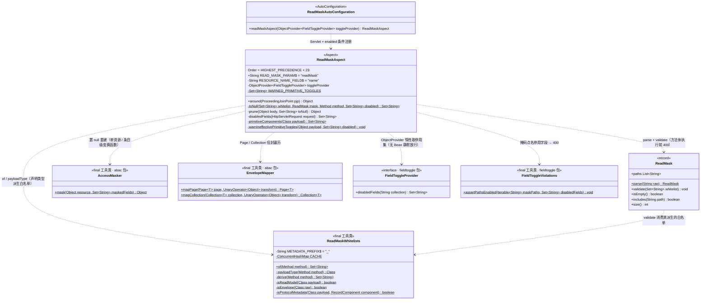
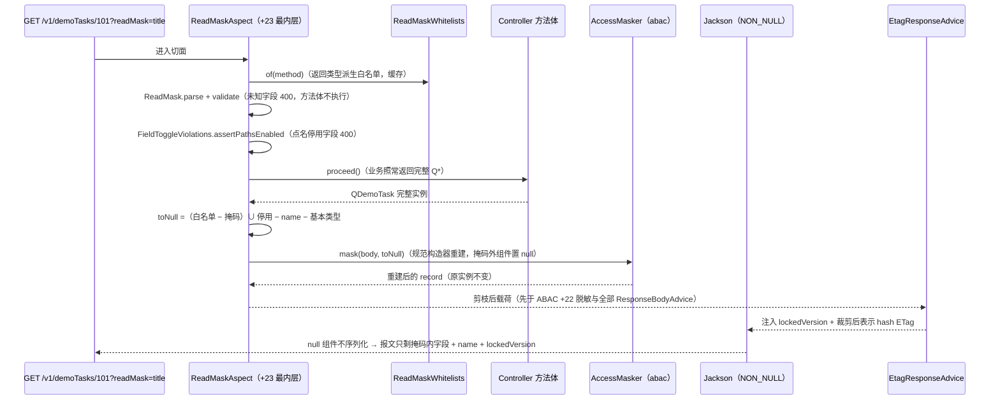

# readmask — `?readMask` 部分读取与字段投影（Tier A 全局收口，业务零感知）

## 解决的问题

列表页 / 详情页 / 机器同步往往只需要资源的部分字段。若每个端点手写「解析投影参数 + 校验字段名 + 反射裁剪 / SQL 投影」，会出现三类问题：拼写错误的字段被静默吞掉后**全量返回**（客户端以为裁剪了其实没有）、各端点裁剪口径漂移、`name` 等协议标识被误裁导致资源失去规范标识。本包把 `?readMask` 字段投影**全局收口**为框架能力：

- `ReadMaskAspect` 拦截全部 `@RestController` 方法：Controller 照常返回完整 DTO，**零注解零代码**；
- `ReadMaskWhitelists` 从 Controller 方法**声明的返回类型**（`Q*` record 组件）自动派生投影白名单——校验发生在方法体执行前（400 快速失败），彼时返回值尚不存在，声明类型是唯一真相来源；
- `ReadMask` 承载 Query 逗号式掩码的解析与白名单校验（未知字段 400 + 逐字段 `fieldViolations`，一次返回全部）；
- 剪枝复用 `abac.AccessMasker`（record 规范构造器重建置 null）+ `abac.EnvelopeMapper`（信封遍历），配合契约 `@JsonInclude(NON_NULL)` 使掩码外字段从报文消失；
- `fieldtoggle` 停用预定义字段经 `ObjectProvider` 惰性并入同一剪枝通道（掩码剪枝 ∪ 停用剔除）；
- `ReadMaskAutoConfiguration` 自动装配（`AutoConfiguration.imports` 登记，不依赖宿主 `scanBasePackages`）。

## 标准符合性

对照 SSOT：`.lattice/standards/v4/v4-restful-patterns-compliance.md` 矩阵「**部分读取与字段投影**」行；契约规范：`v4-restful-api.md` §1.1 / §7（`readMask` 参数行）。

| 权威条款 | 遵循口径 |
|---|---|
| **AIP-157**（Partial responses） | 掩码缺席 = 不投影（全量返回）；掩码裁剪资源表示；单体 GET 与集合 List 同样支持（原书 "across the board"） |
| **AIP-161**（Field masks） | 逗号分隔字段路径编码；**强化**：读侧未知字段 AIP 为 may-ignore，本项目严格 400（防拼写静默全量返回） |
| **AIP-122**（Resource names） | `name` 恒保留（规范资源名，客户端据此构造路径，§2 保留字），不受掩码影响 |
| 《API Design Patterns》**第 8 章** Partial retrievals (FieldMask) | 掩码裁剪语义与原书一致 |
| **RFC 9110**（HTTP Semantics） | `ETag` 恒为**裁剪后最终表示**的 hash（剪枝先于 `EtagResponseAdvice` 装配）；表示 hash 缓存 key 含查询串，304 语义按掩码隔离、不被投影破坏 |
| **RFC 9457**（Problem Details） | 400 错误以 problem+json + `fieldViolations` 扩展成员承载 |

**遵循口径：✅ 完全遵照（含项目强化）**。**相关偏离登记：D9**（未知掩码字段校验——原书 ch8 静默忽略 → 本项目 400 Bad Request）。**自动化梯队：🟢 Tier A（框架完全接管，业务 100% 零感知）**。

当前子集与强化口径（矩阵与主规范 §7 登记；主要行为由 `ReadMaskTest` / `ReadMaskWhitelistsTest` / `ReadMaskAspectTest` 覆盖）：

- **Query 逗号式** `?readMask=title,status`；参数可选，缺席 / 空白 → 空掩码不投影；逐段 trim、空段宽容跳过（连续 / 尾逗号不 400，区别于 updateMask 中间空路径段 400；updateMask 的尾逗号同样被 `String.split` 忽略）、去重保序。
- **不支持 `*`**：省略即全量，传 `*` 按未知字段 400。投影白名单为**顶层 record 组件**（点号子字段遍历暂不展开）。
- **恒保留**：`name`（AIP-122）、`_` 前缀协议元数据组件（如 `_access`，不入白名单、不可经投影选择、合法掩码下不被剪除）、基本类型组件（如 `boolean`，不可置 null）；`lockedVersion` 是协议信封 wire 注入字段（`Q*` 不声明），剪枝发生在信封装配之前，天然不受掩码影响。
- **白名单只对业务读模型派生**：顶层 `Q*` 或嵌套于 `Q*` 的子读模型；协议信封 / 回执（`Operation`、`BatchDeleteResponse` 等）虽是 record 也不参与（置 null 会破坏其规范形态）；非 record（String / void 等）→ 空白名单，端点整体放行（不校验不剪枝）。
- 掩码显式引用**停用预定义字段** → 400 `PREDEFINED_FIELD_DISABLED`（字段不存在语义，§20，经 `fieldtoggle.FieldToggleViolations`）。

## 使用方法

**自动化梯队：Tier A——业务层无需感知**。Controller 不声明 `readMask` 参数、不写任何裁剪代码，照常返回完整 `Q*` / `Page<Q*>` / `List<Q*>`；OpenAPI 投影参数文档由 `openapi/ReadMaskParameterOperationCustomizer` 自动补齐。

对于包含独立数据源的复合查询，Controller 可通过 `ReadMaskAspect.currentPaths()` 将已校验且合并字段开关后的有效顶层路径传给应用查询，以跳过未选区块。空集合代表缺省全量，显式只选 `name` 时返回仅含 `name` 的集合。响应裁剪仍由框架执行。

**生效条件**：

1. Servlet Web 应用 + `airedge.restful.readmask.enabled=true`（缺省 true）→ `ReadMaskAspect` 经 `ReadMaskAutoConfiguration` 自动注册（`AutoConfiguration.imports` 已登记）。
2. 端点返回类型为 `Q*` record 或其协议信封组合（`Page<Q*>` / `Etagged<Q*>` / `Optional<Q*>` / `ResponseEntity<…>` / `Collection<Q*>`，可嵌套，通配符泛型解至上界）。
3. 读模型标注 `@JsonInclude(JsonInclude.Include.NON_NULL)`（或全局 NON_NULL 策略）——置 null 的组件据此从 JSON 消失；否则仅置 null 仍会输出 `"field": null`（反模式「readMask 未真正裁剪序列化」）。

**HTTP 示例——裁剪前后**（读模型形如 `record QTask(String name, String taskId, String title)`，与单测样例一致）：

`GET /v1/demoTasks/101`（无掩码，全量）：

```json
{ "name": "demoTasks/101", "taskId": "101", "title": "齿轮箱", "lockedVersion": 3 }
```

`GET /v1/demoTasks/101?readMask=title`（掩码外 `taskId` 消失；`name` 恒保留；`lockedVersion` 为协议注入不受影响）：

```json
{ "name": "demoTasks/101", "title": "齿轮箱", "lockedVersion": 3 }
```

`GET /v1/demoTasks?readMask=title&pageToken=…`：`Page` 信封逐条目剪枝，`nextPageToken` / `totalSize` 原样保留；`:batchGet` 稀疏列表逐元素剪枝、null 缺失位不补。

**HTTP 示例——未知字段 400 快速失败**（`GET /v1/demoTasks/101?readMask=title,typo`，方法体不执行）：

```http
HTTP/1.1 400 Bad Request
Content-Type: application/problem+json

{
  "type": "https://api.airedgesoft.com/errors/invalid-argument",
  "title": "Invalid Argument",
  "status": 400,
  "detail": "readMask 含未知字段: typo",
  "code": 300010028,
  "fieldViolations": [
    { "field": "typo", "code": 300010028, "description": "readMask 含未知字段: typo" }
  ]
}
```

多个未知字段一次返回全部 `fieldViolations`（保掩码声明序）。

**Java 侧（仅框架 / 测试需要直接使用时）**：

```java
ReadMask mask = ReadMask.parse(" title , taskId ,title,status "); // paths = [title, taskId, status]
mask.validate(Set.of("name", "title", "taskId"));                 // status 未知 → 400 READ_MASK_UNKNOWN
Set<String> whitelist = ReadMaskWhitelists.of(controllerMethod);  // 返回类型自动派生（按 Method 缓存）
```

## 设计方案



类职责一览（包内 4 个类型全覆盖）：

| 类名 | 职责 | 关键属性 | 关键方法 |
|---|---|---|---|
| `ReadMask` | 投影掩码解析结果：缺席宽容、trim 去重保序、空段跳过；白名单校验未知字段 400 + 逐字段 `fieldViolations` | `paths`（`List<String>`，紧凑构造器不可变拷贝） | `parse(String)`、`validate(Set<String>)`、`isEmpty()`、`includes(String)`、`size()` |
| `ReadMaskWhitelists` | 从方法返回类型自动派生投影白名单：信封泛型逐层解包（Page / Etagged / Optional / ResponseEntity / Collection，含通配符上界）→ `Q*` 判定（顶层或嵌套于 `Q*`）→ record 组件名；`_` 前缀元数据组件剔除（`@JsonProperty` 三处探测：组件 / 访问器 / backing field） | `METADATA_PREFIX = "_"`、`CACHE`（`ConcurrentHashMap<Method, Set<String>>`，零重复反射） | `of(Method)`（空清单 = 不适用）、包级 `payloadType(Method)`（剪枝侧判定基本类型组件用） |
| `ReadMaskAspect` | 全局投影切面：前置校验（400 快速失败）→ 执行方法 → 待置 null 集 =（白名单 − 掩码）∪ 停用字段，再豁免 `name` / 基本类型 → 按返回形态分派剪枝（Optional / ResponseEntity / Etagged / Page / Collection / 单资源） | `READ_MASK_PARAM = "readMask"`、`RESOURCE_NAME_FIELD = "name"`、`toggleProvider`、`WARNED_PRIMITIVE_TOGGLES`（基本类型停用字段按「载荷#字段」只告警一次）；`@Order(HIGHEST_PRECEDENCE + 23)` | `around(ProceedingJoinPoint)`（`@Around("@within(RestController)")`）；私有 `toNull` / `prune` / `disabledFields` / `primitiveComponents` / `warnIneffectivePrimitiveToggles` |
| `ReadMaskAutoConfiguration` | 自动装配全局切面；BC 可用同型 Bean 覆盖；关闭开关整组读投影通道停用（仅建议迁移期旧端点） | — | `readMaskAspect(ObjectProvider<FieldToggleProvider>)`（Servlet + `airedge.restful.readmask.enabled` 缺省 true + `@ConditionalOnMissingBean`） |

关键协作流程（切面 → record 重建 → NON_NULL 剪枝 → ETag 装配）：



要点：

- **顺序**：`@Order(+23)` 内层于 ABAC 脱敏（+22）——方法返回后**先 readMask 剪枝、后 ABAC 脱敏**（ABAC 更靠近出口，`_access` 由其挂载）；两者都只做置 null（Map 键移除）且 `_` 前缀元数据不入白名单，先后不影响 wire 形态。
- **ETag 一致性**：同掩码恒同 hash；掩码变化 hash 变化；无掩码 = 全覆盖掩码同一表示；`@EnableRepresentationCache` 端点跨掩码复用 `If-None-Match` 恒 200（304 按掩码隔离，`ReadMaskAspectTest` 锚定）。
- **热路径成本**：无 `?readMask` 且无停用字段 → 一次参数读取 + 一次 Provider 查找后原样透传；无请求上下文（定时作业 / 裸线程）原样透传；上下文只经请求参数与请求属性传递，**无线程级状态**，无跨请求串号。

真实配置项 / 错误码：

- 配置：`airedge.restful.readmask.enabled`（缺省 `true`）；Query 参数名常量 `ReadMaskAspect.READ_MASK_PARAM = "readMask"`。
- 错误码（`DomainRestCode`）：`READ_MASK_UNKNOWN = 300010028`（400，「readMask 含未知字段: %s」）；`PREDEFINED_FIELD_DISABLED = 300010029`（400，「引用了已停用的预定义字段: %s」，停用通道详见 `fieldtoggle` 包）。
- 日志：停用字段为基本类型组件时按「载荷#字段」WARN 一次（§20 读剔除对该字段不生效，可开关字段须声明为对象类型）。
