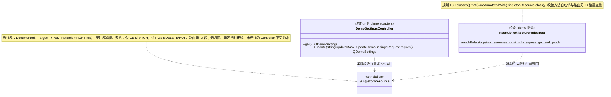

# singleton — 单例资源显式契约标记（@SingletonResource，ArchUnit 规则 13 门禁锚点）

## 解决的问题

**单例资源** = 无集合语义、无 ID 段的全局唯一配置型端点（如 `GET /v1/settings` / `PATCH /v1/settings`）——资源即实例，URI 恒为 `/v1/{name}`，不存在「集合 → 条目」两级寻址。问题在于：单例的 `POST /v1/{name}`（违规）与集合资源的命令 `POST /v1/{res}/{id}:{verb}` / 创建 `POST /v1/{res}`（合法）**URI 形态相同、语义相反**，框架无法从路由本身区分。

`@SingletonResource` 以**显式 opt-in 注解**声明「本 Controller 是单例」这一建模意图，供宿主 / demo 模块的 **ArchUnit 规则 13** 静态扫描识别：只有标注了本注解的 Controller 才受单例方法约束——未标注的 Controller 即使路径形似单例也不拦截，避免把集合级冒号命令 POST（如 `POST /v1/demoTasks/1:activate`）误伤为单例违规。

本注解**仅承载契约，无切面、无运行时逻辑、无注解成员**。

## 标准符合性

| 权威条款 | 遵循口径 |
|---|---|
| **AIP-156**（Singleton resources） | 单例无 List/Create/Delete，仅 Get 与 Update；URI 无 ID 段 |
| 《API Design Patterns》**第 12 章 Singleton resources** | 与 AIP 立场一致（矩阵「单例资源」行：✅ 完全遵照） |
| **AIP-161**（Field masks）/ AIP-134 | 单例 Update 走 PATCH + `updateMask` 口径（demo `@ValidUpdateMask`） |
| **D16**（单例资源并发凭据，偏离登记） | 单例无实例身份，`lockedVersion` 并发协议不适用——并发由应用层**值级 CAS** 兜底，冲突 409（demo `DemoSettingsController` javadoc 落点；非本注解运行时行为） |

方法约束（注解 javadoc 契约，ArchUnit 规则 13 机械化执行）：

- 仅允许 **GET**（读取单例表示）与 **PATCH**（部分更新）；
- **禁止 POST / DELETE**（注解 javadoc 契约；ArchUnit 规则 13 另行禁止 PUT）——单例无「创建」（资源恒存在）亦无「删除」（配置项只能更新）语义，集合级冒号动词 `:batchCreate` / `:batchDelete` 等随之不适用；
- 路由不得含资源 ID 路径变量。

**嵌套单例的显式扩展**（注解 javadoc 明文区分）：§5 嵌套单例子资源（`/v1/{res}/{id}/settings`）保留 **DELETE = 重置为默认值**——系对 AIP-156 must-not-Delete 的显式扩展（主规范 §5 登记）；**顶层单例无 DELETE**（「重置」即 PATCH 回默认值）。

**自动化梯队：Tier C（工具与门禁守护）**——资源形态由领域建模决定，注解 + ArchUnit 静态扫描杜绝人为违规；ArchUnit 规则由宿主 / demo 模块落地（`RestfulArchitectureRulesTest` 规则 13），本包不含规则实现。

## 使用方法

业务在单例 Controller 类上标注一次即可（声明即所得，无其他代码）：

```java
// demo 权威示例：DemoSettingsController（节选，真实代码形态）
@SingletonResource
@RestController
@RequiredArgsConstructor
@RequestMapping("/v1/demoSettings")
public class DemoSettingsController {

    @GetMapping                      // 读取单例（可配 @EnableRepresentationCache 支持 304）
    public QDemoSettings get() { ... }

    @ValidUpdateMask(whitelist = {"theme", "notifyEnabled"})
    @PatchMapping                    // 增量更新；无 POST/DELETE/PUT，路由无 ID 段
    public QDemoSettings update(@RequestParam(value = "updateMask", required = false) String updateMask,
            @RequestBody UpdateDemoSettingsRequest request) { ... }
}
```

HTTP 契约示例（与 demo 端点一致）：

```http
GET /v1/demoSettings HTTP/1.1

HTTP/1.1 200 OK
ETag: "sha256-…"
{ "name": "demoSettings", "theme": "dark", "notifyEnabled": true }
```

```http
PATCH /v1/demoSettings?updateMask=theme HTTP/1.1
Content-Type: application/json

{ "theme": "light" }

HTTP/1.1 200 OK
{ "name": "demoSettings", "theme": "light", "notifyEnabled": true }
```

违规形态（POST / DELETE / PUT 或路由含 `{id}`）在**测试期**被 ArchUnit 规则 13 阻断，而非运行时拦截。单例 PATCH body **不携带 `lockedVersion`**（D16）；读改写窗口内被他人改写 → 值级 CAS 落空 → 409 problem+json。

## 设计方案



类职责一览（本包 1 个类型；包外协作者列出示意）：

| 类名 | 职责 | 关键属性 | 关键方法 |
|---|---|---|---|
| `@SingletonResource` | 单例资源 Controller 的显式契约标记（AIP-156），ArchUnit 规则 13 的扫描锚点 | `@Documented`、`@Target(ElementType.TYPE)`、`@Retention(RetentionPolicy.RUNTIME)`；无成员 | —（纯标记注解） |

关键协作流程：领域建模判定「配置型全局唯一资源」→ Controller 类标注 `@SingletonResource` 并只写 GET/PATCH 端点 → 宿主 / demo 的 ArchUnit 规则 13 在测试期扫描所有标注类，校验方法白名单（GET/PATCH）与路由形态（无 ID 路径变量），违规即构建失败 → 运行期并发 / 投影 / 掩码等协议行为由 etag / readmask / updatemask 等包照常接管（单例并发凭据按 D16 走应用层值级 CAS）。

真实配置项 / 错误码 / 媒体类型：本包无任何配置项、错误码或媒体类型（纯标记注解，不在 `AutoConfiguration.imports` 中）；关联错误语义（409 值级 CAS 冲突、400 未知掩码字段）由 BC 应用层与 problem 包承载。