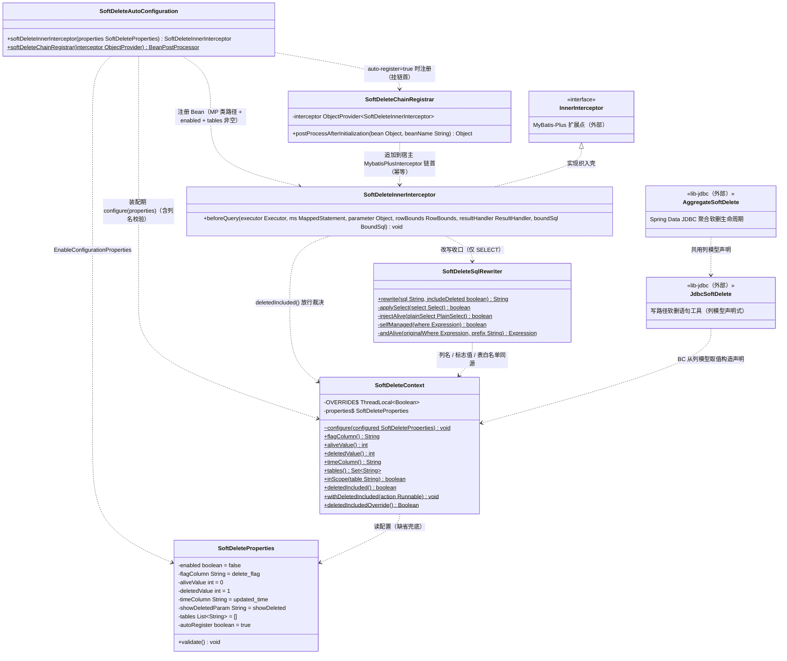
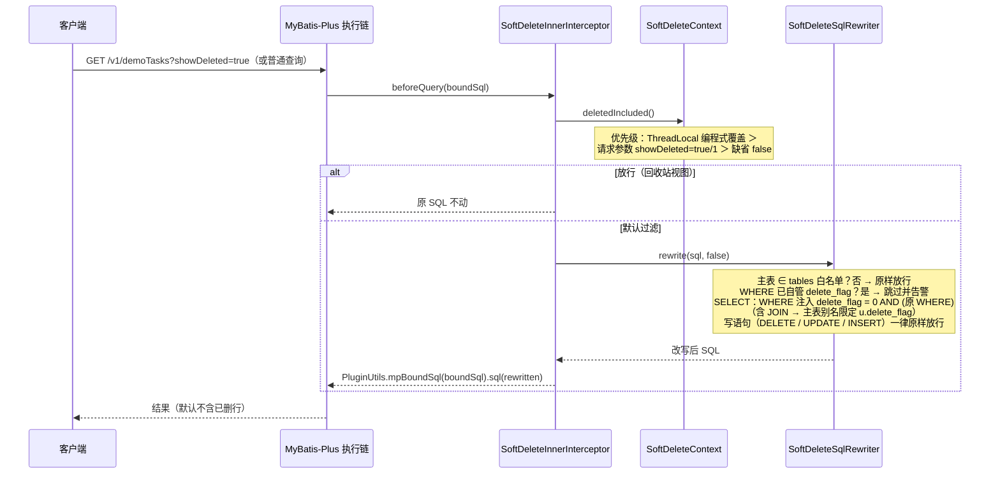

# softdelete — 软删除与回收站：读路径统一存活过滤 / 请求级放行（列模型沿用 v3 既有表）

## 解决的问题

软删除契约（删除 = 打删除标志而非物理删行）的**读侧**如果由各 BC 手拼 `delete_flag` 条件，必然出现漏过滤（已删行泄漏进普通 List）、双重过滤（回收站视图出空集）、放行语义漂移等问题。本包把读路径收口为框架能力：

- **读模型（MyBatis-Plus）**：拦截器自动为 SELECT 注入 `delete_flag = 0` 存活条件（含 JOIN 时按主表别名限定，避免多表同名列歧义），业务查询零感知；`?showDeleted=true` 请求级放行回收站视图（非 HTTP 线程可编程式放行）；
- **写路径不设统一处理**：软删 / 恢复 / 彻底删除是领域生命周期决策，由应用层 → 仓储**显式语句**执行——裸 JdbcTemplate 写模型走 lib-jdbc `JdbcSoftDelete`，Spring Data JDBC 写模型走 lib-jdbc `AggregateSoftDelete`（带版本列的聚合同语句推进版本）；demo `DemoTaskRepositoryImpl` 为权威示例；
- **作用域安全**：共享拦截器链上还有 legacy 表与无软删两列的表，故以 `tables` 白名单限定改写范围（`enabled=true` 时必填，缺失即启动失败）。

**列模型沿用 v3 既有表结构（本次不改表结构）**：`delete_flag int4`（`0` 存活 / `1` 已删）+ `updated_time int8`（Epoch 毫秒）。**无独立删除时刻列**——契约 `deleteTime` 由「已删行的 `updated_time`」推导；软删 / 恢复同语句刷新时间列（与 v3 `DataObject` 删除写口径一致，见 `backend/infrastructure/sdkImpl/.../objectframework/DataObject.java`）。列模型 SSOT = `airedge.restful.soft-delete.*` 配置：读侧拦截器与写侧语句声明均从其取值，两侧天然一致。

## 标准符合性

对照 SSOT：[.lattice/standards/v4/v4-restful-patterns-compliance.md](../../../../../../../../../../.lattice/standards/v4/v4-restful-patterns-compliance.md)「软删除与回收站机制」主题（矩阵 §2.2，遵循情况 **✅ 完全遵照**）。

| 权威 | 条款 | 遵循口径 |
|---|---|---|
| Google AIP | **AIP-164**（Soft delete） | 软删后标准 GET 照常 **200 OK** 并在报文携带 `deleteTime` 标注已删；List 默认隐藏已删行（`?showDeleted=true` 放行）；`POST /{id}:undelete` 恢复；受限 `POST /{id}:expunge` 永久删除（仅对已软删行生效） |
| 《API Design Patterns》 | 第 25 章 Soft delete | 与原书立场一致，无分歧 |
| RFC | RFC 9110 §9.2.2（DELETE 幂等） | 重复删除幂等 **204**（D2 登记，相对原书 ch7 / AIP-135 重复删除 404 的显式偏离，遵 RFC） |

**相关偏离登记**：**D1 已修正**——软删后 GET 完全遵照 AIP-164 / ch25 照常返回 200（标注已删），不再作为偏离项；删除幂等 204 见 **D2**。AIP-164 的 `purge_time` 等其余标注字段属后续轮次（最小实现集先行落地 `deleteTime`，主规范 §5.1）。

**为何不用 MyBatis-Plus 内置 `@TableLogic`**：内置逻辑删除按实体注解静态判定，不支持 `?showDeleted=true` 请求级放行、也无表级作用域——故自定义 `InnerInterceptor`（仅读侧过滤）。

**版本推进边界**（矩阵写路径口径）：软删 / 恢复属状态变更，带版本列的聚合须**同语句推进 `version = version + 1`**（对外 `lockedVersion` 代数 +1，`ETag` 为表示 hash 随之变化）——裸 JdbcTemplate / lib-jdbc 写模型由仓储在软删语句中显式追加版本列推进（demo `DemoTaskRepositoryImpl` 权威示例，其列模型声明取自本包 `SoftDeleteContext`）；Spring Data JDBC 写模型走 lib-jdbc `AggregateSoftDelete`（实体元数据解析 + 同语句版本推进）。版本推进语义只能由仓储语句携带，这正是写路径不做框架统一处理的原因。

## 使用方法

**自动化梯队：🟢 Tier A（读路径框架统一处理）——业务层无需感知**。生效条件：

1. 表具备 v3 软删两列：`delete_flag`（int4，0 存活 / 1 已删）+ `updated_time`（int8 毫秒）。**既有业务表已具备，不需要也不允许为软删另加列**；新建表 / 测试 schema 可参考 `classpath:schema/soft-delete-{postgresql,h2}.sql`；
2. 配置 `airedge.restful.soft-delete.enabled=true`（缺省 false，关闭时拦截器不注册）**且 `tables` 白名单非空**（缺失即启动失败——共享链会波及无软删列的表）；
3. 类路径存在 MyBatis-Plus → `SoftDeleteAutoConfiguration` 自动注册 `SoftDeleteInnerInterceptor` Bean，并经 `SoftDeleteChainRegistrar` **自动挂进宿主 `MybatisPlusInterceptor` 链首**（`auto-register` 缺省 true；先于分页，否则 count 语句会统计已删行）。宿主未声明链 Bean 时由本装配**自建兜底链**（仅含软删拦截器；`@ConditionalOnMissingBean` 退位式——宿主声明链则兜底退位、注册器改挂宿主链首），拦截器开箱即生效。注册器以 `BeanPostProcessor` **追加**而非另声明同型 Bean（legacy `MybatisPlusConfiguration` 的链带 `@ConditionalOnMissingBean(MybatisPlusInterceptor.class)`，另声明会让宿主链整体退让、丢掉分页与乐观锁拦截器）；BC 需自管次序时置 `auto-register=false` 自行 `addInnerInterceptor(...)`。

满足后普通 SELECT 自动注入存活条件，业务 Mapper 照常写；回收站视图只需客户端带 `?showDeleted=true`（Controller 仅做 Swagger 可见性声明，不重复消费该参数）。

### 读路径（零感知）+ 编程式放行

```java
// 普通查询：拦截器自动拼 delete_flag = 0（白名单内主表），业务无任何软删代码
List<TaskRow> rows = taskMapper.selectList(wrapper);

// 非 HTTP 线程（回收站 Service / 定时作业）编程式放行（线程作用域，自动还原）
SoftDeleteContext.withDeletedIncluded(() -> {
    List<TaskRow> all = taskMapper.selectList(wrapper); // 含已删行
});
```

### 写路径（仓储显式语句，demo `DemoTaskRepositoryImpl` 真实用法）

软删 / 恢复 / 彻底删除由仓储显式执行，**不经过本包**（写语句不自动改写）：

```java
// 列模型声明取自软删配置（与读侧拦截器同源），构造软删语句工具
JdbcSoftDelete softDelete = new JdbcSoftDelete(new JdbcSoftDelete.Columns(
        SoftDeleteContext.flagColumn(), SoftDeleteContext.timeColumn(),
        SoftDeleteContext.aliveValue(), SoftDeleteContext.deletedValue()));

// 存活守卫拼进仓储查询 WHERE（禁止手拼 delete_flag 谓词）
String alive = softDelete.aliveCondition(null);   // "(delete_flag = 0)"
String aliveT = softDelete.aliveCondition("t");   // "(t.delete_flag = 0)"

// 软删（0 行 = 不存在或已删 → 幂等 204，调用方无需报错）
int affected = softDelete.softDeleteById(jdbcTemplate, "demo_task", "id", 7L);

// 带乐观版本守卫的软删（版本比对与改写在单条 UPDATE 内原子完成，无 check-then-act 窗口）
softDelete.softDeleteById(jdbcTemplate, "demo_task", "id", 7L, "lock_version", 3L);

// 批量软删（主键升序逐条执行，加锁次序确定防死锁）
softDelete.softDeleteByIds(jdbcTemplate, "demo_task", "id", List.of(30L, 10L, 20L));

// :undelete 恢复（仅对已删行生效；0 行 = 不存在或未删除）
softDelete.restoreById(jdbcTemplate, "demo_task", "id", 7L);

// :expunge 彻底删除（真实 DELETE，仅对已软删行生效）
softDelete.expungeById(jdbcTemplate, "demo_task", "id", 7L);

// 回收站 Get 标注删除时刻（已删行的 updated_time；存活 / 不存在 → null）
Long deletedAt = softDelete.deletedAtOf(jdbcTemplate, "demo_task", "id", 7L);
```

带版本列的聚合参考 demo 仓储：软删 / 恢复语句显式追加 `lock_version = lock_version + 1` 并刷新 `updated_time`（`JdbcSoftDelete` 不代劳版本推进）。Spring Data JDBC 写模型用 lib-jdbc `AggregateSoftDelete`（表 / 主键 / 版本列取自实体元数据，软删 / 恢复同语句推进版本）。

### HTTP 语义示例（端点由 BC adapters 声明，demo 为权威示例）

```http
DELETE /v1/demoTasks/101          → 204（软删入回收站；重复删除仍 204，幂等）
GET    /v1/demoTasks/101          → 200 + body 携带 deleteTime（AIP-164，D1 已修正）
GET    /v1/demoTasks              → 200，items 默认不含已删行
GET    /v1/demoTasks?showDeleted=true → 200，放行已删行（回收站视图）
POST   /v1/demoTasks/101:undelete → 200 恢复（不存在 404；存活未删 409 ALREADY_EXISTS）
POST   /v1/demoTasks/101:expunge  → 204 物理删除（仅已软删行；未删 / 不存在 404）
```

## 设计方案



### 类职责一览

| 类 | 职责 | 关键属性 | 关键方法 |
|---|---|---|---|
| `SoftDeleteProperties` | 配置载体（前缀 `airedge.restful.soft-delete`） | `enabled=false`、`flagColumn="delete_flag"`、`aliveValue=0`、`deletedValue=1`、`timeColumn="updated_time"`、`showDeletedParam="showDeleted"`、`tables=[]`、`autoRegister=true` | 标准 getter/setter；`validate()`（装配期列名校验） |
| `SoftDeleteContext` | 请求级「是否放行已删行」上下文 + 列模型 / 作用域统一出口（读侧拦截器与写侧语句声明同源） | `OVERRIDE`（ThreadLocal）、`properties`（volatile，未装配用缺省） | `deletedIncluded()`、`withDeletedIncluded(Runnable)`、`deletedIncludedOverride()`、`flagColumn()`、`aliveValue()`、`deletedValue()`、`timeColumn()`、`tables()`、`inScope(table)`、`configure`（包私有，装配期调用） |
| `SoftDeleteSqlRewriter` | 读模型 SQL 改写器（JSqlParser）：SELECT 注入存活条件（JOIN 按主表别名限定）；白名单外主表与 WHERE 自管条件（**AST 列引用判定**）原样放行；写语句一律放行 | —（final 工具类） | `rewrite(sql, includeDeleted)` |
| `mybatis.SoftDeleteInnerInterceptor` | MyBatis-Plus 织入壳（Tier A 落点，仅读侧）：`beforeQuery` 改写 SELECT | — | `beforeQuery(...)` |
| `mybatis.SoftDeleteChainRegistrar` | 自动挂链注册器（BeanPostProcessor）：把拦截器追加到宿主 `MybatisPlusInterceptor` 链首（先于分页；幂等，不替换宿主链） | `interceptor`（ObjectProvider） | `postProcessAfterInitialization(...)` |
| `SoftDeleteAutoConfiguration` | 自动装配：注册配置并挂入 Context（含列名校验）；条件注册拦截器 Bean（`tables` 为空 fail-fast）；`auto-register=true` 时注册挂链器；宿主无链 Bean 时自建兜底链（`@ConditionalOnMissingBean` 退位式） | — | `softDeleteInnerInterceptor(SoftDeleteProperties)`、`softDeleteChainRegistrar(ObjectProvider)`（static BeanPostProcessor）、`softDeleteFallbackChain(ObjectProvider)` |
| lib-jdbc `JdbcSoftDelete`（外部） | 写路径软删语句工具（列模型声明式）：软删 / 批量软删 / 恢复 / 彻底删除 / 删除时刻探测 / 存活谓词；不推进版本列 | `Columns`（声明记录，构造期校验） | `aliveCondition`、`nowMillis`、`softDeleteById`（含版本守卫重载）、`softDeleteByIds`、`restoreById`、`expungeById`、`deletedAtOf` |
| lib-jdbc `AggregateSoftDelete`（外部） | Spring Data JDBC 写模型聚合软删生命周期：表 / 主键 / 版本列取自实体元数据，软删 / 恢复同语句推进版本，版本不符 0 行 → 409 | `JdbcTemplate`、`MappingContext`、`Columns` | `softDelete`、`restore`、`expunge`（各含期望版本重载） |

### 关键协作流程（读侧拦截与放行）



改写器细节：原 WHERE 含 OR 时加括号保语义；UNION 各分支分别注入（逐分支判作用域）；WHERE 内子查询不递归注入存活条件（但其自管标志列条件会被识别）；**跳过判定按 AST 列引用遍历**（含括号 / IN 列表 / CASE / 子查询 WHERE）——`WHERE title = 'delete_flag'` 这类字符串字面量不算自管，仍注入存活过滤；SELECT 列表投影 `delete_flag` / `updated_time` 不触发跳过；FROM 为派生表且已配置白名单 → 无法判定主表，不改写；解析失败 → `IllegalStateException`（不静默放行丢过滤条件）。

### 配置项 / 存储 schema 要点

| 项 | 值 | 说明 |
|---|---|---|
| `airedge.restful.soft-delete.enabled` | 缺省 `false` | 显式开启；关闭时拦截器不注册 |
| `airedge.restful.soft-delete.tables` | 缺省空 | **`enabled=true` 时必填**：具备软删两列的表白名单（大小写不敏感、忽略 schema 前缀）；缺失 → 启动 `IllegalStateException`。白名单为空时工具直调语义为「不限定」 |
| `airedge.restful.soft-delete.flag-column` | 缺省 `delete_flag` | **装配期校验**蛇形标识符 `[A-Za-z][A-Za-z0-9_]*`（防注入，纵深防御），非法 → 启动 `IllegalStateException`；`time-column` 同口径 |
| `airedge.restful.soft-delete.alive-value` / `deleted-value` | 缺省 `0` / `1` | 存活 / 已删标志值（v3 `delete_flag` 口径） |
| `airedge.restful.soft-delete.time-column` | 缺省 `updated_time` | 软删 / 恢复同语句刷新；已删行的该值即删除时刻 |
| `airedge.restful.soft-delete.show-deleted-param` | 缺省 `showDeleted` | 放行参数名；取值 `true`（忽略大小写）或 `1` |
| DDL 参考片段 | `classpath:schema/soft-delete-postgresql.sql` / `soft-delete-h2.sql` | 仅供新建表 / 测试 schema 参考（`delete_flag` + `updated_time` + 标志列索引）；**既有表已具备两列，禁止为软删加列** |
| 自动装配 | `AutoConfiguration.imports` 注册 `SoftDeleteAutoConfiguration` | 不依赖宿主 `scanBasePackages`；注册拦截器 Bean 并经 `SoftDeleteChainRegistrar` 自动挂链首（`auto-register` 缺省 true） |
| `airedge.restful.soft-delete.auto-register` | 缺省 `true` | 自动把拦截器追加到宿主 `MybatisPlusInterceptor` 链首（幂等，不替换宿主链）；BC 自管次序时置 `false` |
| 幂等语义 | 软删 0 行 = 不存在或已删 → 静默成功（DELETE 幂等 204，D2） | 恢复 / expunge 0 行由调用方映射 404（恢复存活未删 → 409） |
| 写路径 | lib-jdbc `JdbcSoftDelete`（声明式） / `AggregateSoftDelete`（实体元数据式） | 列模型声明从 `SoftDeleteContext` 取值构造；版本推进由仓储语句显式携带；批量软删主键升序（兼容 `DeadlockSafeExecutor` 加锁次序约定） |

测试参考：`SoftDeleteSqlRewriterTest`（注入 / OR 括号 / UNION / JOIN 别名限定 / 白名单作用域 / WHERE 自管跳过（含字符串字面量不误判、子查询 / IN 列表识别）/ 写语句放行 / 自定义列与标志值）、`SoftDeleteInnerInterceptorTest`（织入壳与放行）、`SoftDeleteAutoConfigurationTest`（开关 / tables fail-fast / 列名校验 / 自动挂链首 / 宿主无链自建兜底链 / auto-register=false / BC 覆盖退让）；写路径语句见 lib-jdbc 的 `JdbcSoftDeleteTest` / `AggregateSoftDeleteTest`。真实 PostgreSQL 端到端见 `deploy-full` 的 `DemoTaskPostgresIntegrationTest`（`integration` 组）。
