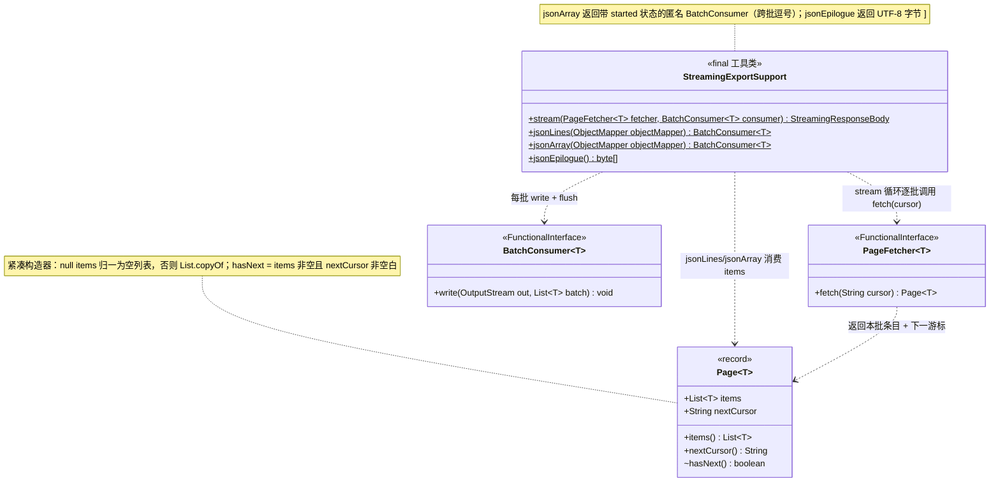
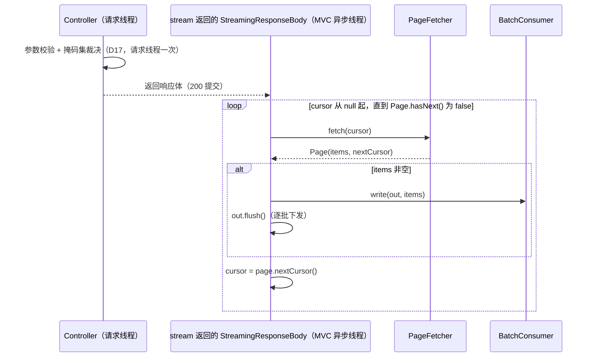

# streaming — 巨量数据流式导出基建（游标分批拉取 + NDJSON / JSON 数组逐批写出）

## 解决的问题

导出端点可能返回海量行，一次性 `List` 装载再序列化会撑爆内存。本包提供 `StreamingExportSupport`：基于 Spring MVC `StreamingResponseBody`（异步写出，不占用请求线程整段生成）+ **分批游标**——`PageFetcher` 按游标逐批拉取（每批一个查询，**内存只持一批**），`BatchConsumer` 逐批写出、逐批 flush。内置两种消费器：

- **NDJSON**（`jsonLines`）：每行一个 JSON 对象 + `\n`，流式友好、消费方逐行解析——巨量导出首选；
- **JSON 数组**（`jsonArray` + `jsonEpilogue`）：跨批逗号由消费器内部状态维护，结束时补 `]` 信封——仅小结果集适用。

本包是纯工具（无注解、无切面、无自动装配），导出端点的资源建模、分页契约、权限剪枝由业务显式决策（Tier D）。

## 标准符合性

| 权威条款 | 遵循口径 |
|---|---|
| 《API Design Patterns》**第 18 章 Bulk operations**（矩阵「巨量数据与同步」行，另参照 AIP-158 / AIP-160） | **机器全量/增量同步禁止私有 `:sync`/`:export` 动词**，统一走标准 List + 游标分页 + `filter` + `readMask`；本工具承载的是**流式取数型导出能力**（一次性 NDJSON 流），非同步通道（主规范 §0.1 三分口径） |
| **AIP-136**（Custom methods） | 导出为集合级自定义方法 `GET /v1/{res}:export`——无副作用纯取数动词按 **AIP-136:53** 用 GET（矩阵「自定义方法」行口径），动词 camelCase |
| **D17**（流式导出 ABAC 粒度，偏离登记） | 标准读路径行级脱敏恒生效（§19.2）；流式导出改为**集合段一次裁决**——ABAC 裁决依赖请求级身份，只能在请求线程按集合段解析一次无权字段集，捕获为不可变掩码后在异步写出线程逐条置 null（demo `DemoTaskBatchController.export` 为权威落点，本包自身不含 ABAC 逻辑） |

**自动化梯队：Tier D（核心领域语义，框架提供基建）**——分块传输、内存管理属专用批处理流水线，是否流式、批大小、脱敏范围由业务决策；本包只提供拉取/写出循环与序列化消费器。

## 使用方法

业务需显式编写导出端点（Controller 返回 `StreamingResponseBody`）。demo 权威示例 `GET /v1/demoTasks:export`（`DemoTaskBatchController`）的接入形态：

```java
@GetMapping("/v1/demoTasks:export")
public StreamingResponseBody export(
        @RequestParam(value = "batchSize", required = false, defaultValue = "50") int batchSize,
        HttpServletRequest request) {
    // 参数校验必须在返回流之前完成：一旦开始写出，200 已提交，流内 400 无法再表达
    if (batchSize < 0) {
        throw new DomainException(DomainErrorType.INVALID_ARGUMENT, DemoResultCode.EXPORT_BATCH_SIZE_INVALID, batchSize);
    }
    // 请求线程按集合段一次裁决掩码集（D17）：停用字段 ∪ ABAC 无权字段；异步线程原请求已失活
    Set<String> masked = exportService.maskedFields(RequestCollections.of(request));
    return StreamingExportSupport.stream(cursor -> {
        Page<QDemoTask> page = exportService.page(batchSize, cursor, masked); // 复用 List 游标分页契约
        return new StreamingExportSupport.Page<>(page.items(), page.nextPageToken());
    }, StreamingExportSupport.jsonLines(objectMapper));
}
```

最小可用形态（类 javadoc 示例）：

```java
return StreamingExportSupport.stream(
        cursor -> repository.fetchPage(cursor, pageSize), // PageFetcher：cursor 入、Page(items, nextCursor) 出
        StreamingExportSupport.jsonLines(objectMapper));
```

HTTP 请求 / 响应（NDJSON，逐批 flush）：

```http
GET /v1/demoTasks:export?batchSize=50 HTTP/1.1

HTTP/1.1 200 OK

{"name":"demoTasks/1","title":"齿轮箱","qty":3}
{"name":"demoTasks/2","title":"联轴器","qty":7}
...（每行一个 JSON 对象，末批 nextPageToken 为 null 即结束）
```

JSON 数组形态（小结果集；单测 `StreamingExportSupportTest.jsonArray_spansBatchesWithEpilogue`）：`jsonArray` 消费器跨批输出 `[1,2,3`，写出结束后由调用方追加 `StreamingExportSupport.jsonEpilogue()`（`]`）封口，得到 `[1,2,3]`。

终止语义（单测锚定）：`Page.hasNext()` = items 非空 **且** nextCursor 非空白——二者任一缺失即末批；`nextCursor=null` 即终止，空批不触发额外拉取。`Page` 紧凑构造器把 null items 归一为空列表并 `List.copyOf` 防御性拷贝。

注意（demo javadoc 口径）：流式响应非资源 record，`ReadMaskAspect` / `IncludeAccessAspect` / `@EtagResource` 均不适用（无法预计算整体表示 hash）；投影 / 脱敏须如 demo 在应用层显式执行。

## 设计方案



类职责一览（本包 1 个文件，含 4 个类型）：

| 类名 | 职责 | 关键属性 | 关键方法 |
|---|---|---|---|
| `StreamingExportSupport` | 装配流式响应体（拉取/写出/flush 循环）+ NDJSON / JSON 数组消费器工厂 | 私有构造器（纯静态工具） | `stream(PageFetcher, BatchConsumer)`、`jsonLines(ObjectMapper)`、`jsonArray(ObjectMapper)`、`jsonEpilogue()` |
| `StreamingExportSupport.Page<T>` | 带游标的一页数据（不可变 record） | `items: List<T>`、`nextCursor: String` | 紧凑构造器归一拷贝；`hasNext()`（包级私有） |
| `StreamingExportSupport.PageFetcher<T>` | 分批游标拉取器 SPI（首页 cursor 传 null） | — | `fetch(String cursor): Page<T>` |
| `StreamingExportSupport.BatchConsumer<T>` | 逐批消费写出 SPI（OutputStream 由 StreamingResponseBody 提供，可抛 IOException） | — | `write(OutputStream out, List<T> batch)` |

关键协作流程（分批循环）：



真实配置项 / 媒体类型：

- 本包无配置项、无错误码；demo 端点参数 `batchSize`（缺省 50，负值 → 400 `EXPORT_BATCH_SIZE_INVALID`）。
- 输出形态：NDJSON（每行一个 JSON 对象）或 JSON 数组（`jsonArray` + `jsonEpilogue`）；字节编码恒 UTF-8。本包与 demo 端点均不设置 Content-Type（demo `@GetMapping` 未声明 `produces`），媒体类型标注由端点按需自行声明。
- 无自动装配（不在 `AutoConfiguration.imports` 中）——静态工具随取随用。