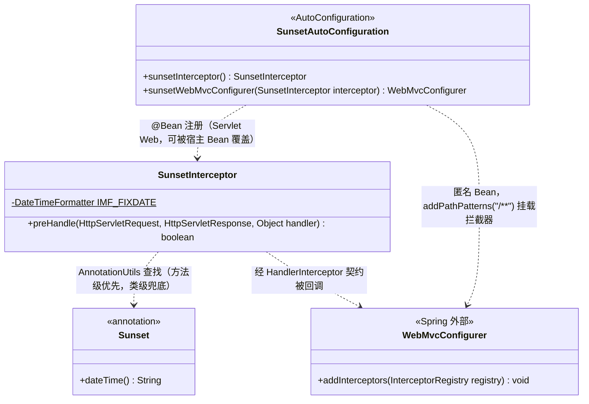

# sunset — 端点弃用声明：@Sunset 标注后自动下发 Deprecation 与 Sunset 响应头

## 解决的问题

API 版本演进中，旧端点被新形态替代后需要一段**弃用过渡期**：仍可用，但要让客户端在运行时明确感知「已弃用 + 计划停用时刻」，以便安排迁移。靠文档 / 邮件通知容易遗漏，靠每个 Controller 手写 `response.setHeader(...)` 则是重复样板。

本包提供 `@Sunset` 注解 + `SunsetInterceptor` 拦截器：在 Controller 方法（或类）上标注计划停用时刻后，命中请求自动下发两个响应头——

- `Deprecation: true` —— 端点已弃用（仍可用）；
- `Sunset: <HTTP-date>` —— 计划停用时刻（IMF-fixdate 形态，如 `Sunset: Wed, 30 Jun 2027 00:00:00 GMT`）。

未标注的端点零影响（拦截器直接放行、不写任何头）。迁移指引另经 OpenAPI description / `Link rel="sunset"` 后续扩展，本组件只做最小头下发。

## 标准符合性

对照 SSOT：`.lattice/standards/v4/v4-restful-patterns-compliance.md` §2.2「版本管理与兼容性」主题行。

| 标准 | 条款 | 遵循口径 |
|------|------|----------|
| AIP-180 | Backward compatibility（破坏性变更判定） | `/v1` 内「只增不减」；改删字段、收窄过滤、新增必填均判破坏性（CI `openapi-diff` 门禁阻断） |
| AIP-185 | API Versioning（版本代际） | 破坏性变更强制开辟 `/v2`；旧端点经 `@Sunset` 显式标注进入弃用过渡期 |
| AIP-181 | Stability levels（稳定性通道） | 项目参考其思想实施两值通道 draft / stable（T1/T2，主规范 §11.2，项目自定义层级、非 AIP-181 原生术语） |
| 《API Design Patterns》(Geewax) | 第 24 章 Versioning | 向前兼容与破坏性变更判定矩阵对齐 |
| RFC 8594 | The Sunset HTTP Header Field | `Sunset` 头值为 IMF-fixdate（RFC 9110 §5.6.7 HTTP-date），由拦截器从 ISO-8601 instant 格式化 |
| IETF Deprecation 头 | `Deprecation: true` | 代码 / 矩阵口径为「IETF Deprecation 头」。**已知偏差**：该头已定稿为 **RFC 9745**，其取值应为 `@<unix-seconds>`（sf-date）形态；本实现沿用早期草案的 `true`，**不满足 RFC 9745**，待后续收敛为 sf-date |

矩阵判定本主题为 **✅ 完全遵照**、无 D# 偏离登记（口径以矩阵引用的 IETF Deprecation 头为准）；需注意上文 `Deprecation: true` 与 RFC 9745 定稿形态存在偏差，属待收敛的实现差距，未登记为 D#。`@Sunset` 是矩阵「版本管理与兼容性」主题 **🟣 Tier C 门禁守护** 中的运行时提示组件：破坏性变更判定由 CI `openapi-diff` 门禁承担，本包只负责弃用期的标头下发。

## 使用方法

**业务感知程度：声明即所得**——标头下发本身零代码（拦截器全局自动装配），但**弃用决策必须由业务显式声明**：在待弃用的 Controller 方法或类上标注 `@Sunset(dateTime = "...")`（Tier C 主题下的 opt-in 注解，不打注解 = 不下发头）。

生效条件：

1. `SunsetAutoConfiguration` 经 `META-INF/spring/org.springframework.boot.autoconfigure.AutoConfiguration.imports` 自动装配（`@ConditionalOnWebApplication(SERVLET)`）：注册 `SunsetInterceptor` Bean（`@ConditionalOnMissingBean` 可覆盖）+ 一个匿名 `WebMvcConfigurer` Bean 把拦截器挂到 **`/**`** 全路径；
2. 请求命中 `HandlerMethod` 且方法或类上有 `@Sunset`（**方法级优先，类级兜底**——类级标注对全部端点生效）；
3. `dateTime()` 必须为合法 ISO-8601 / RFC 3339 instant 字符串（如 `2027-06-30T00:00:00Z`）；**解析失败在拦截期抛出（请求期 500）**——注解常量应在评审时静态核对，非法值首次命中即暴露。

真实示例（demo 权威用法：`airedge-v4/demo-singlemodule/.../adapters/DemoTaskController.java` 的 `:rename` 端点）：

```java
@Sunset(dateTime = "2027-06-30T00:00:00Z")
@PostMapping({"/{taskId}:rename"})
@EtagResource("taskId")
public QDemoTask rename(@PathVariable(value = "taskId") String taskId,
        @RequestBody RenameDemoTaskRequest request) {
    commandService.rename(taskId, request.title());
    return requireTask(taskId);
}
```

HTTP 请求 / 响应（端点功能照常，仅附加两个标头）：

```http
POST /v1/demoTasks/123:rename HTTP/1.1
Content-Type: application/json

{"title":"新标题","lockedVersion":3}
```

```http
HTTP/1.1 200 OK
Deprecation: true
Sunset: Wed, 30 Jun 2027 00:00:00 GMT
ETag: "sha256-..."

{ ...更新后的资源表示... }
```

类级标注（对控制器全部端点生效，见 `SunsetInterceptorTest.SunsetHolder`）：

```java
@Sunset(dateTime = "2028-01-01T00:00:00Z")
@RestController
public class LegacyController { ... }   // 所有端点下发 Sunset: Sat, 01 Jan 2028 00:00:00 GMT
```

## 设计方案



> `Sunset` 为方法 / 类级运行时注解（`@Target({METHOD, TYPE})`、`@Retention(RUNTIME)`、`@Documented`）；`SunsetInterceptor` 实现 Spring `HandlerInterceptor`。`WebMvcConfigurer` 为外部接口，实际注册的是 `SunsetAutoConfiguration` 内的匿名实现（仅覆写 `addInterceptors`）。

### 类职责一览

| 类名 | 职责 | 关键属性 | 关键方法 |
|------|------|----------|----------|
| `@Sunset`（注解） | 端点弃用声明：计划停用时刻 | `dateTime()`（必填，ISO-8601 instant 字符串；注解常量限制，无默认值） | — |
| `SunsetInterceptor` | 命中标注端点时下发 `Deprecation: true` + `Sunset: <IMF-fixdate>`；非 `HandlerMethod` / 未标注直接放行 | `IMF_FIXDATE`（`"EEE, dd MMM yyyy HH:mm:ss 'GMT'"`，`Locale.US` + UTC） | `preHandle(request, response, handler)`（`Instant.parse` 解析 `dateTime()` 后格式化写头，恒返回 true） |
| `SunsetAutoConfiguration` | 自动装配：拦截器 Bean + 全局 `/**` 挂载 | — | `sunsetInterceptor()`、`sunsetWebMvcConfigurer(SunsetInterceptor)` |

### 关键协作流程（Sunset 标头下发）

1. 请求经 DispatcherServlet 匹配到 `HandlerMethod`，全局拦截器链回调 `SunsetInterceptor.preHandle`；
2. `AnnotationUtils.getAnnotation(handlerMethod.getMethod(), Sunset.class)` 查方法级注解，未命中再查 `handlerMethod.getBeanType()` 类级注解；
3. 均未命中（或 handler 非 `HandlerMethod`）→ 返回 true 放行，不触碰响应；
4. 命中 → `response.setHeader("Deprecation", "true")` + `response.setHeader("Sunset", IMF_FIXDATE.format(Instant.parse(sunset.dateTime())))`，返回 true 继续正常业务处理（**只加头，不拦截请求**）；
5. `dateTime()` 非法 → `Instant.parse` 在请求期抛异常（500），首次命中即暴露标注错误。

### 配置项 / 标头形态

| 项 | 值（以代码为准） |
|----|------------------|
| 注解参数 | `dateTime()`：ISO-8601 instant（如 `2027-06-30T00:00:00Z`），必填、解析失败快速失败（请求期 500） |
| 响应头 | `Deprecation: true`；`Sunset: <IMF-fixdate>`（RFC 8594 §2 / RFC 9110 §5.6.7，如 `Wed, 30 Jun 2027 00:00:00 GMT`） |
| 拦截范围 | `/**` 全路径；仅标注端点写头 |
| 注解查找优先级 | 方法级 > 类级（类级对全部端点生效） |
| 可配置 Bean | 宿主声明自定义 `SunsetInterceptor` Bean 即覆盖默认装配（`@ConditionalOnMissingBean`）；无独立 `application.yml` 配置项 |
| 错误码 | 本包不定义业务错误码（非法 `dateTime` 走容器 500，非 problem 契约错误） |

测试参考：`src/test/java/com/airedgesoft/lib/restful/sunset/SunsetInterceptorTest.java`（方法级 / 类级下发、未标注与非 `HandlerMethod` 零触碰、IMF-fixdate 形态断言）。