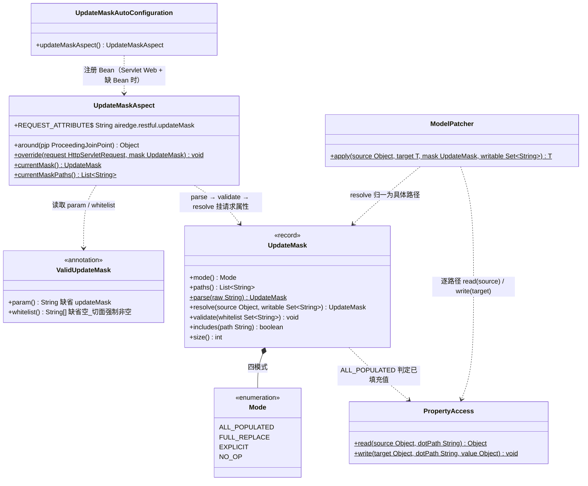

# updatemask — PATCH 增量更新的字段掩码解析、白名单校验与属性覆盖

## 解决的问题

PATCH 增量更新如果靠业务手写 `if (req.title() != null) entity.setTitle(...)`，会产生大量样板代码，且极易出现两类事故：

1. **拼写错误静默丢更新**：客户端传 `?updateMask=titel`，服务端不认识就悄悄忽略，用户以为改成功了；
2. **掩码外字段被误写**：请求体里带了不该改的字段（如 output-only 字段、状态机字段），被顺手写进聚合。

本包把「掩码语法解析 → 可写字段白名单校验 → 仅掩码字段覆盖」收口为框架能力：Controller 打一个 `@ValidUpdateMask` 注解声明白名单，切面在方法执行前完成解析与 400 快速失败；`ModelPatcher` 反射工具按掩码把请求体值覆盖到聚合/PO，掩码外字段绝对不受影响。

## 标准符合性

对照 SSOT：[.lattice/standards/v4/v4-restful-patterns-compliance.md](../../../../../../../../../../.lattice/standards/v4/v4-restful-patterns-compliance.md)「部分更新与掩码形态」主题（矩阵 §2.2）。

| 权威 | 条款 | 遵循口径 |
|---|---|---|
| Google AIP | **AIP-134**（Standard methods: Update）、**AIP-161**（Field masks） | **🅰️ 遵循 AIP**（原书与 AIP 冲突处取 AIP）：仅 `PATCH`，掩码以 **Query 逗号式** `?updateMask=title,description` 承载（AIP-134 HTTP 映射条款：body 仅载资源字段，其余请求字段映射 Query） |
| 《API Design Patterns》 | 第 6 章 Standard methods (Update)、第 7 章 Partial update | 弃原书「PUT 全量替换 + Body fieldMask」演示形态 |
| RFC | RFC 9457（Problem Details） | 校验失败经 `DomainException` → `application/problem+json`，附 `fieldViolations` 逐字段明细 |

**AIP-134 掩码三态（+ 显式路径，共四模式 `UpdateMask.Mode`）**：

- **省略 / 未传** → `ALL_POPULATED`：更新请求体中所有已填充（非 null）的可写字段（AIP-134:104）；
- **显式空串 / 空白** → `NO_OP`：不更新任何字段（AIP-134:107-109）；
- **`*`** → `FULL_REPLACE`：全量替换所有可写字段，掩码内显式 `null` = 清空（AIP-134:110）;
- **逗号分隔路径** → `EXPLICIT`：仅声明字段参与变更，掩码内显式 `null` = 清空。

**相关偏离登记**（矩阵 §3）：

- **D6**：掩码 Query 逗号式（相对原书 ch8 Body fieldMask；正是 AIP-134 映射条款的规范形式，**对 AIP 非偏离**）；
- **D9**：未知掩码字段 **400**（`UPDATE_MASK_UNKNOWN`，原书 ch8 为静默忽略；AIP-161 写侧 should，项目强化防拼写静默丢更新）；
- **D15**：schema 内**只读字段被显式指定**同判 400（与未知字段同语义；对 AIP-161 must-ignore 的显式偏离——只读字段不在白名单内，点名即 400）。

**边界**：本包只做「语法 + 静态白名单」的 400 校验（§19.3 校验链第 1 步）；字段级写权限 / 值约束的 403 由 `abac.AbacWriteGuard` 承担；预定义字段停用判定由 `fieldtoggle` 包承担——掩码**点名**停用字段 → 400 `PREDEFINED_FIELD_DISABLED`，**省略 / `*` 掩码**则经 `UpdateMaskAspect.override(...)` 从候选集剔除停用字段（不 400）；请求体 `lockedVersion` 并发校验由 `etag` 包承担。

## 使用方法

**自动化梯队：🔵 Tier B（声明式注解驱动）**——业务只需在 Controller 方法上声明 `@ValidUpdateMask(whitelist = {...})`，解析 / 三态归一 / 400 校验零手写；覆盖动作可选用 `ModelPatcher` 反射工具或领域方法。

### 1. Controller 声明白名单（demo 真实用法）

摘自 `demo-singlemodule` 的 `DemoTaskController#update`（白名单常量与应用服务单一信源；状态机字段 `status` 严禁列入，§4.4.3）：

```java
@ValidUpdateMask(whitelist = {DemoTaskCommandService.MASK_FIELD_TITLE,
        DemoTaskCommandService.MASK_FIELD_DESCRIPTION, DemoTaskCommandService.MASK_FIELD_ESTIMATED_COST})
@PatchMapping({"/{taskId}"})
@EtagResource("taskId")
public QDemoTask update(@PathVariable("taskId") String taskId,
        @RequestParam(value = "updateMask", required = false) String updateMask,
        @RequestBody UpdateDemoTaskRequest request) {
    // currentMaskPaths()：切面已归一为具体路径清单（List<String>），Command 契约不感知模式
    commandService.update(request.toCommand(taskId, UpdateMaskAspect.currentMaskPaths()));
    return requireTask(taskId);
}
```

要点：

- 切面把**归一后的 EXPLICIT 具体路径**挂到请求属性 `airedge.restful.updateMask`，经 `UpdateMaskAspect.currentMask()` / `currentMaskPaths()` 取用，不侵入 Command record 签名；
- `whitelist` 为空是编程错误：切面直接抛 `IllegalStateException`（fail-closed，防止省略掩码退化）；
- 无 HTTP 请求上下文（单测直调 / 定时作业）时切面放行，可改用 `UpdateMask.parse` + `validate` 手工链。

### 2. ModelPatcher 属性覆盖（框架反射工具）

```java
// 值源 record（请求体）；目标为可变实体 / PO
record UpdateTaskRequest(String title, String description, Object customFields) {}

UpdateMask mask = UpdateMask.parse("title,description"); // 或 UpdateMaskAspect.currentMask()
ModelPatcher.apply(source, target, mask, Set.of("title", "description"));
// title 覆盖为新值；description 在掩码内且值为 null → 清空；掩码外字段不变

// 点号路径：Map 键写入 / 嵌套 bean 导航（目标嵌套层必须已存在，缺失快速失败）
ModelPatcher.apply(source, target, UpdateMask.parse("customFields.trackingCode"), null);
ModelPatcher.apply(source, target, UpdateMask.parse("address.street"), null);
```

省略 / `*` 掩码**必须显式传 `writable` 白名单**：null / 空白名单 = 候选集为空（fail-closed，绝不回退枚举请求体属性）。demo 的应用服务对含业务不变量的字段（如标题必填不可清空）改用领域方法逐项应用（`task.rename(...)`），`ModelPatcher` 适用于无额外不变量的直覆盖场景。

### 3. HTTP 请求 / 响应示例

```http
PATCH /v1/demoTasks/623780000000101?updateMask=title,description
Content-Type: application/json

{ "title": "新标题", "description": null, "lockedVersion": 3 }
```

→ `200 OK`：`title` 更新、`description` 清空（掩码内显式 null），返回更新后读模型 + 新 `ETag`。

```http
PATCH /v1/demoTasks/623780000000101?updateMask=title,typoField
```

→ `400 Bad Request`（`application/problem+json`，code `300010013`）：`fieldViolations` 一次性列出全部未知字段（`field` = `typoField`，`code` = `UPDATE_MASK_UNKNOWN`），方法体不执行。

省略掩码（不带 `updateMask` 参数）→ 仅更新 body 中非 null 的白名单字段；`?updateMask=`（空串）→ no-op；`?updateMask=*` → 白名单全量替换（null 清空）。

## 设计方案



### 类职责一览

| 类 | 职责 | 关键属性 | 关键方法 |
|---|---|---|---|
| `ValidUpdateMask` | 方法级注解：声明掩码参数名与可写字段白名单（camelCase 路径） | `param`（缺省 `updateMask`）、`whitelist`（缺省 `{}`，切面强制非空） | — |
| `UpdateMaskAspect` | `@Around` 切面（`@Order(HIGHEST_PRECEDENCE + 16)`）：解析 + 白名单校验 + 三态归一，结果挂请求属性；无请求上下文放行 | `REQUEST_ATTRIBUTE = "airedge.restful.updateMask"` | `around`、`currentMask()`、`currentMaskPaths()`、`override(request, mask)`（供字段开关切面收窄候选集） |
| `UpdateMask` | 掩码解析结果 record：四模式解析、去重保序、白名单校验、模式归一 | `mode`、`paths`（不可变 `List.copyOf`） | `parse(String)`、`resolve(Object, Set)`、`validate(Set)`、`includes`、`size` |
| `UpdateMask.Mode` | AIP-134 掩码模式枚举 | `ALL_POPULATED` / `FULL_REPLACE` / `EXPLICIT` / `NO_OP` | — |
| `ModelPatcher` | 「已校验掩码 → 属性覆盖」静态工具；不做白名单 / 权限校验 | —（final 工具类） | `apply(source, target, mask, writable)` 返回 target 便于链式 |
| `PropertyAccess` | 点号路径反射读写（`ModelPatcher` 与 `abac.AbacWriteGuard` 共用）；record 组件 / `getX` / `isX` 读，`setX` 写，Map 段按键 | —（final 工具类） | `read(Object, String)`、`write(Object, String, Object)` |
| `UpdateMaskAutoConfiguration` | 自动装配：注册切面（工具类静态无需装配） | — | `updateMaskAspect()`（`@ConditionalOnWebApplication(SERVLET)` + `@ConditionalOnMissingBean`，BC 可同型覆盖） |

### 关键协作流程

1. **解析**：`UpdateMask.parse(raw)` —— `null` → ALL_POPULATED；空白 → NO_OP；`*` → FULL_REPLACE；其余按逗号拆分、逐段 trim、`LinkedHashSet` 去重保序；空段（连续逗号）→ 400 `UPDATE_MASK_INVALID`；点号路径原样保留。
2. **白名单校验**：`mask.validate(whitelist)` —— 未知字段一次性收集全部，抛 `DomainException(UPDATE_MASK_UNKNOWN)` 并附逐字段 `fieldViolations`；只读字段不在白名单内，点名即同判 400（D15）。
3. **三态归一**：`mask.resolve(requestBody, whitelist)` —— ALL_POPULATED 取白名单中请求体值非 null 的字段；FULL_REPLACE 取全部白名单字段；NO_OP 归一为空清单；候选集**只**取白名单（fail-closed）。归一结果挂请求属性，下游 `List<String>` 契约无需感知模式。
4. **覆盖**：`ModelPatcher.apply` 对归一后的每条路径 `PropertyAccess.read(source, path)` → `PropertyAccess.write(target, path, value)`；掩码内 null = 清空；嵌套层缺失 → `IllegalStateException` 快速失败（配置错误不静默）。

### 配置项 / 错误码

| 项 | 值 | 说明 |
|---|---|---|
| 自动装配 | `META-INF/spring/...AutoConfiguration.imports` 注册 `UpdateMaskAutoConfiguration` | 不依赖宿主 `scanBasePackages` |
| `300010012` | `UPDATE_MASK_INVALID` → 400 | 掩码含空路径段（连续逗号） |
| `300010013` | `UPDATE_MASK_UNKNOWN` → 400 | 白名单外字段，`fieldViolations` 逐字段列出 |
| `300010029` | `PREDEFINED_FIELD_DISABLED` → 400 | 点名已停用预定义字段（由 `fieldtoggle` 包判定，非本包） |
| 编程错误 | `IllegalStateException` | `whitelist` 为空；`PropertyAccess` 缺访问器 / 嵌套导航失败 |