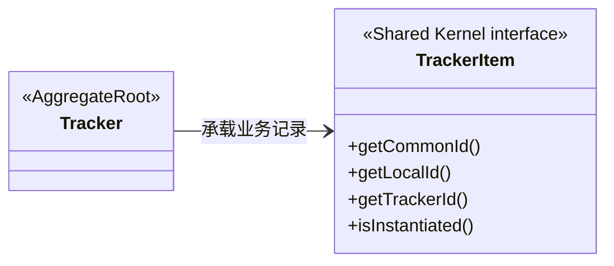
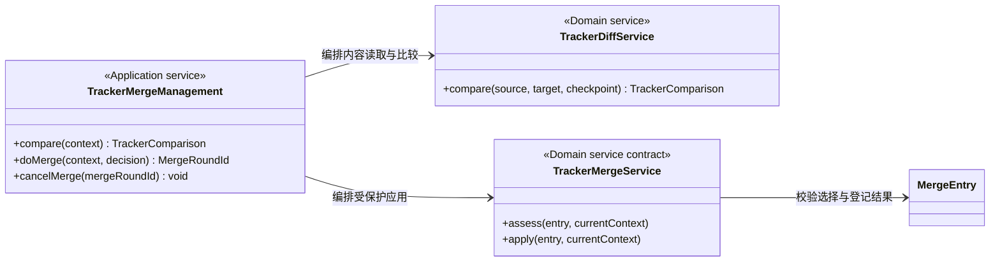
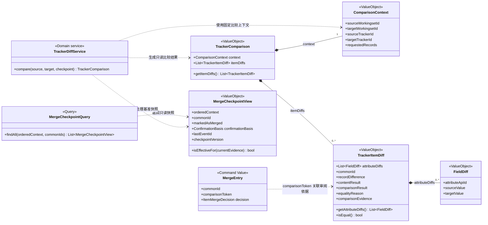
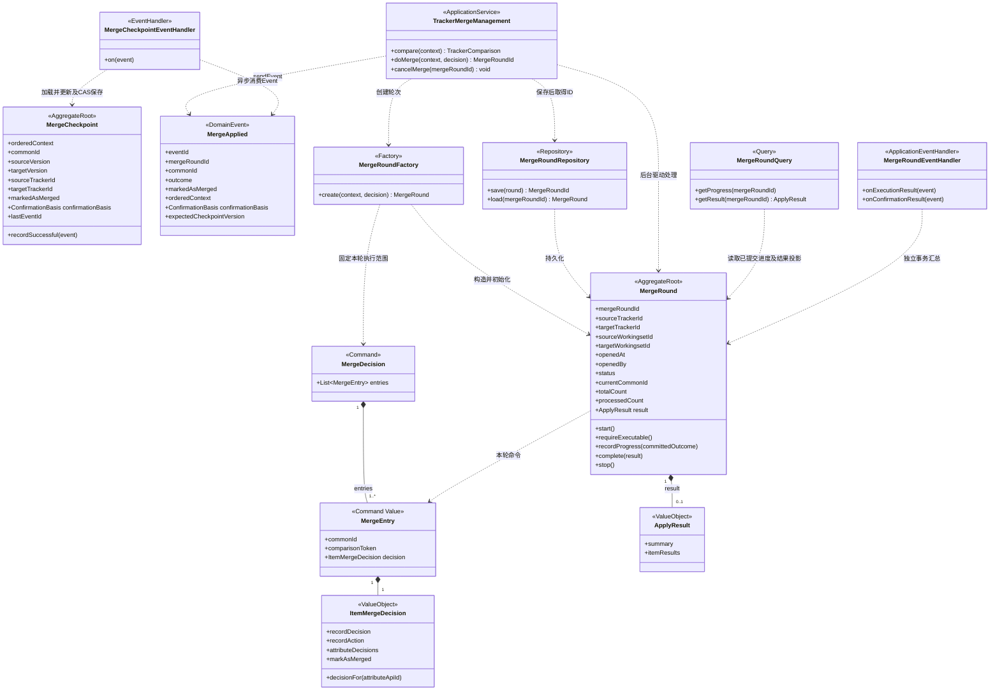
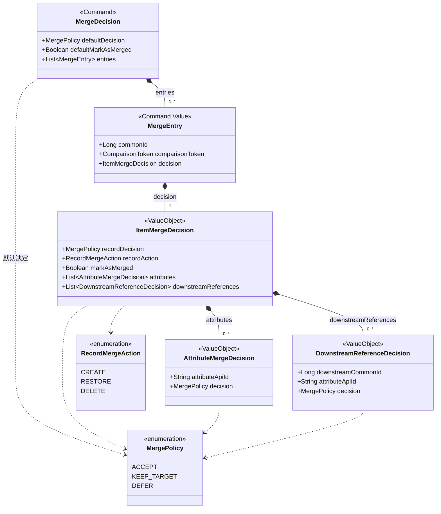
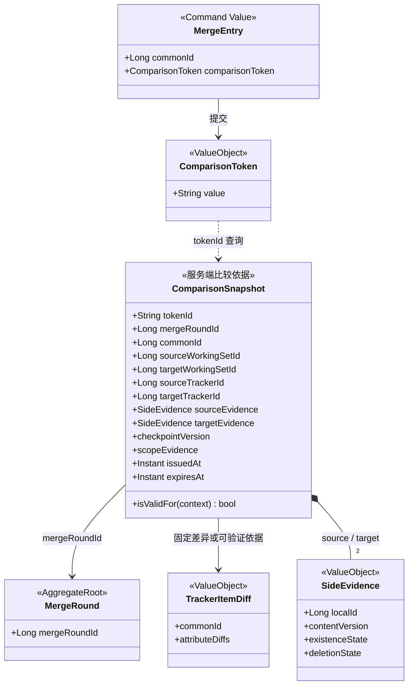
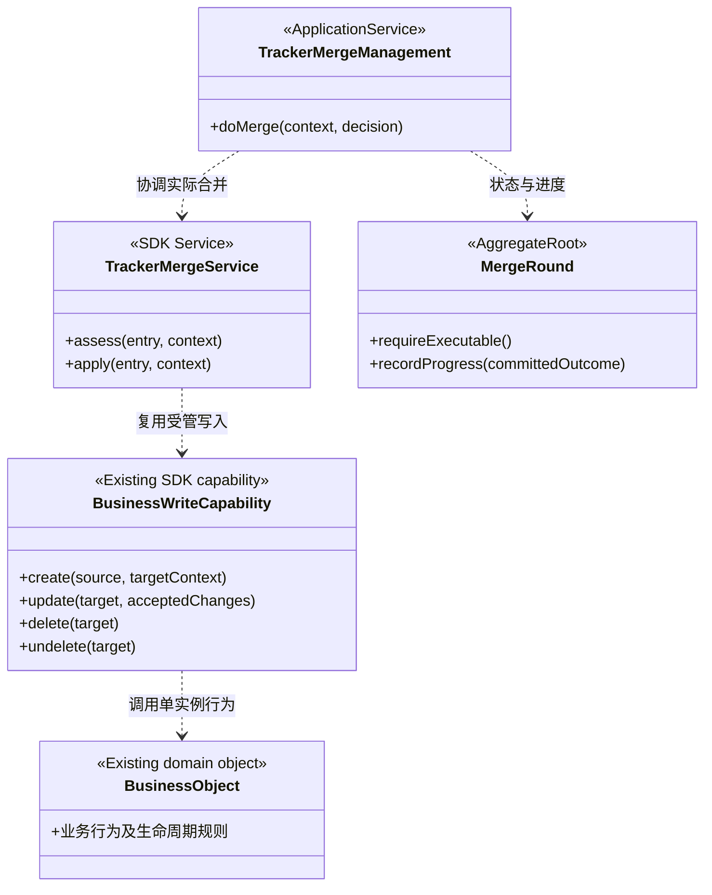
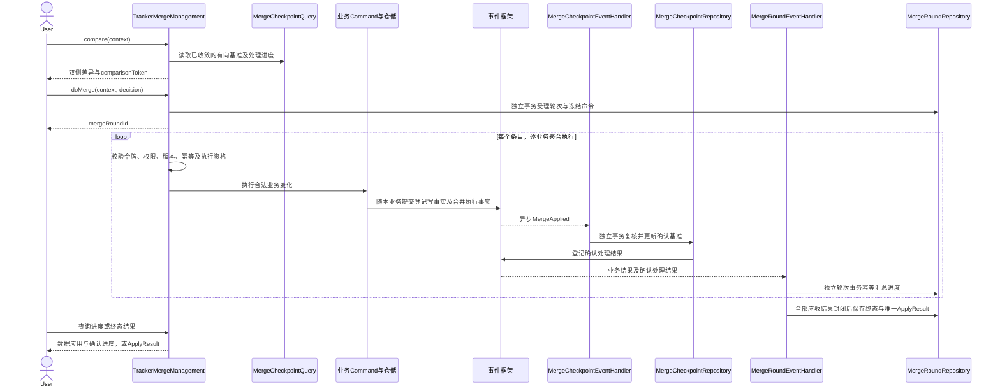
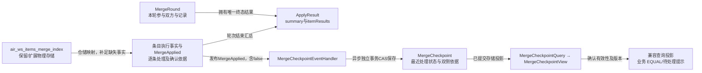

# Shared Kernel 工作集引用、比对与合并 — 领域设计

> **日期**：2026-10-27
> **设计版本**：v2.21；领域设计方案，不是已落地实现说明。
> **阅读原则**：主类图只展示业务声明；版本、幂等、因果顺序及异步查询保护仍需兑现；事件框架实现不在本专题展开。

## 阅读导航

- [1. 业务边界与验收提纲](#merge-scope)
- [2. 统一语言](#merge-ul)
- [3. 核心类图与属性方法](#merge-model)
- [4. 比对及用户策略](#merge-rules)
- [5. 主流程与增量时序](#merge-sequences)
- [6. 执行保护与生命周期](#merge-lifecycle)
- [7. merge index 的映射与演进](#merge-storage)
- [8. 规范引用与悬空修复](#reference-design)
- [9. 专项审查风险](#merge-review)
- [10. 用例与契约测试](#merge-acceptance)
- [11. 文档分工](#merge-alignment)

<a id="merge-scope"></a>

## 1. 业务边界与验收提纲

业务本质：**Tracker 承载记录集合；比对记录存在性和属性值，再叠加用户决定，执行记录增减或属性值修改，并确认本轮差异是否已处理。**

- 记录就是 TrackerItem，不新增 Record 业务实体。

- Requirement、Bug 是记录的具体业务表达。

- 实现中的 branch 在本规格中统一为 Tracker，旧 branch_id 对应 TrackerId。

**定向视角**

1. **source（来源）**：本次提供候选记录/属性值的一侧；**target（目标）**：本次接收变化的一侧。
2. **A → B / B → A 均可选择**：UI 切换箭头就交换本次角色；即使来源自派生后未修改，也可展示与目标不同的内容。
3. **不推断历史变化来源**：比较的“变化”是当前方向下的差异表达，不要求来源曾执行修改。
4. **派生关系不变**：SourceTrackerId 描述 Tracker 的固定派生来源，与本次 source/target 角色分别表达。

边界保持不变：

- 仅允许相邻父子 WorkingSet 中直接对应的 UNSHARED Tracker 比对和合并。
- 子 Tracker.sourceTrackerId 必须等于父工作集绑定的对应 Tracker.id；工作集层级和 Tracker 来源分别验证。
- 不允许跨不对应 Tracker、跨级或兄弟工作集。ParentTrackerId 是目录层级，不替代来源关系。
- CommonId 对齐记录族，LocalId 是当前变体身份；两侧 LocalId 不同不构成属性值变化。
- WorkingSet 是上下文，不成为 TrackerItem 的固有属性。
- COW、来源读取和写保护由 SK 处理；不在业务实体上恢复实例化方法。

验收先看四种组合：

1. 标题 ACCEPT、描述 **KEEP_TARGET**，**markAsMerged=true**：标题改变、描述不变，确认整条记录冻结差异，包括描述的保留取舍。
2. 全部适用差异 **KEEP_TARGET**，**markAsMerged=true**：目标不变，本轮差异确认已处理；确认依据未变化时不反复展示。
3. 标题 ACCEPT、描述 **KEEP_TARGET**，**markAsMerged=false**：标题改变、描述不变，整条记录尚未确认。
4. 全部适用差异 **KEEP_TARGET**，**markAsMerged=false**：目标不变，本轮差异继续待处理。

当前表达将数据决定与处理确认分开，不使用通用 differenceKey 或混合条目、属性、关系的 scope；实例化代码中的 MutationScope 是执行上下文，不受此处术语精简影响。

- 另验证：描述 **DEFER**/未选择时请求 true 应被拒绝；使用 false 时可先接受标题而描述继续待处理。

- 确认成功须能从存储读回 comparisonEvidence、最终 sourceEvidence/targetEvidence。

另外验证：来源删除而目标已编辑时不得无声删除；执行中断重试不重复新增、删除或签入。

<a id="merge-ul"></a>

## 2. 统一语言

通用身份、快照及生命周期见 [08 UL](./08-UL.md)。

TrackerItem 是一条带身份和属性值的业务记录，不是页面 DTO。

旧 IGNORE 表达“保留目标并确认处理”的组合，由兼容适配明确含义，不恢复为同时控制数据与确认的统一枚举。

### 2.1 引用与比对合并术语

**CanonicalReference（规范引用）**：

- **含义**：具体源实例拥有的逻辑引用，以目标 CommonId 与 Tracker 派生族标识表达目标，在工作集上下文中解析。
- **避免混淆**：无归属的公共可变关系、跨工作集固定目标 LocalId

**MergeRound（合并轮次）**：

- **含义**：在相邻父子工作集的对应非共享 Tracker 之间，一轮有明确范围的比较、选择、应用与结果确认，可跨多个请求。
- **避免混淆**：登录会话、单次数据库事务

**MergeRoundId（合并轮次标识）**：

- **含义**：标识一轮合并的公开身份，属性名为 mergeRoundId；同一轮的执行重试沿用该标识。
- **避免混淆**：登录会话标识、旧 merge index 的 batch_id

**FieldDiff（属性值差异）**：

- **含义**：以 attributeApiId 定位属性的两侧业务值差异，只表示当前选定方向的来源值与目标值差异，不推断历史修改来源。
- **避免混淆**：物理列位置差异、通用 differenceKey

**TrackerItemDiff（记录差异）**：

- **含义**：一个 CommonId 的冻结记录存在性、属性值差异与比较依据，唯一拥有 FieldDiff。
- **避免混淆**：另一种 TrackerItem 实体、当前最新值

**MergeEntry（合并条目）**：

- **含义**：本次单条命令携带 CommonId、comparisonToken 和用户选择；不属于轮次聚合实体。
- **避免混淆**：一项属性就是一条业务记录、当前视图覆盖历史修订

**MergeDecision（批量合并决策）**：一次提交的应用命令，包含轮次、批量默认策略与 MergeEntry 集合。

**MergePolicy（合并处理策略）**：枚举 ACCEPT / KEEP_TARGET / DEFER，表达数据处理选择，不是可替换算法服务。

**AttributeMergeDecision（属性合并决策）**：attributeApiId 与 MergePolicy 的组合。

**ItemMergeDecision（条目合并决策）**：

- **含义**：一条记录的 recordDecision、必要时明确的 recordAction、按 attributeApiId 组织的 attributeDecisions，以及独立的 markAsMerged。
- **避免混淆**：用 ACCEPT/IGNORE 一个决定同时决定数据与确认；把 DEFER 当作 IGNORE

**MarkAsMerged（标记为已合并）**：

- **含义**：确认本轮整条记录差异已经处理的独立意图，既可接受数据后确认，也可保留目标后确认。
- **避免混淆**：双侧内容相同、请求标志就是已成功事实

**ApplyResult（应用结果）**：

- **含义**：一轮合并结束后的唯一结果，由 summary 和 itemResults 组成，随 MergeRound 保存；条目明细说明实际数据处理、确认与失败原因。
- **避免混淆**：单一 Boolean、拒绝数据等于执行失败

**ConfirmationBasis（处理确认依据）**：

- **含义**：一次实际成功确认所依据的有序比较上下文及提交时双侧内容/存在性证据，是成功事件及轮次条目明细中的不可变值；确认的是当前方向的处理事实。
- **避免混淆**：请求 markAsMerged、比较前目标版本、恒为 1 的 sourceRevision

**MergeCheckpoint（合并处理基准）**：

- **含义**：同一方向和 CommonId 的最近处理状态，跨 MergeRound 保留；以 markedAsMerged、确认依据及结果来源判断后续业务比对是否按 EQUAL 处理。
- **避免混淆**：历史共同内容、内容相同、仅本轮 Entry 结果、可丢弃的查询缓存；它是权威处理事实，可由现有合并索引持久化。

**业务比对相等（EQUAL）**：

- **含义**：当前内容实际相同，或当前方向的处理基准仍有效，因而无需再次处理该条差异。
- **避免混淆**：业务 EQUAL 必然代表属性值相同；实际内容差异仍可保留供明细与审计查看。

**KEEP_TARGET（保留目标）**：

- **含义**：明确不应用来源差异，保留目标数据；是否确认本轮已处理由 markAsMerged 单独决定。
- **避免混淆**：不接受就必然待处理、不接受就必然已合并

**DEFER（暂不决定）**：

- **含义**：尚未作出数据处理决定，不改变目标，不伪装为执行成功。适用差异中存在 DEFER 或未选择项时，拒绝 markAsMerged=true；明确保留并确认必须选择 KEEP_TARGET + true。
- **避免混淆**：旧 IGNORE 的同义词

**ACCEPT（接受）**：

- **含义**：应用来源记录存在性变化或选定属性值；是否确认整条记录的冻结差异，由独立的 markAsMerged 决定。

**MergeRoundCompleted（合并轮次完成事件）**：

- **含义**：全部本轮执行结果汇总确认后，由 TrackerMergeManagement 单独提交轮次完成事实；不表示全部差异已确认或内容一致。条目事务仅提交条目进度，不能提前发布该事件。

**MergeRoundFailed（合并轮次失败事件）**：

- **含义**：TrackerMergeManagement 将轮次判定为 FAILED 时提交的轮次事实；不等同于单条执行失败，也不撤销先前已提交的条目。条目失败及其进度先按 §6.1 的可靠结果事务记录。

### 2.2 标识、值对象与执行上下文索引

MergeRoundId 是跨请求的轮次身份；MergeBatchId 是轮次内可重试的执行批次标识，不替代 mergeRoundId 或 actionVersion。

| 类型 | 字段/取值 | 语义 |
|------|-----------|------|
| `CanonicalReference` | ownerLocalId, sourceCommonId, targetCommonId, targetTrackerId, kind | 引用记录归属于具体源实例 ownerLocalId；逻辑目标用 CommonId 与派生族根 TrackerId 表达，不固定目标变体 |
| `MergeDirection` | `TO_PARENT`、`TO_CHILD` | 由用户选定的有序 source/target 及父子层级推导；两种方向均可，不独立保存可变值 |
| `ItemMergeDecision` | recordDecision、recordAction、attributeDecisions、markAsMerged | 每条记录一份当前选择；数据决定与处理确认独立 |
| `MergeCheckpoint` | 有序双侧上下文、commonId、markedAsMerged、confirmationBasis、lastEventId | 跨轮次保存最近处理状态；有效确认使业务比对 EQUAL，不改写真实内容差异 |
| `ApplyResult` | summary、itemResults | 一轮合并的最终汇总；由 Round 组合持有，执行中为空，终态恰有一份 |
| `recordAction` | CREATE / RESTORE / DELETE | 接受记录存在性或生命周期差异时选择的目标操作；普通属性更新不适用，不等同于历史新增/删除 |
| `ComparisonContext` | 双侧工作集/Tracker、requestedRecords | 固定比较方向与范围；不是新的工作集归属 |
| `TrackerComparison` | context、itemDiffs | 只读比较结果，复用 TrackerItemDiff/FieldDiff；不带合并选择与执行结果 |
| `ApplyLease` | owner, expiresAt, fencingToken | 只在 Apply 短事务窗口使用 |

<a id="merge-model"></a>

## 3. 核心类图与属性方法

### 3.1 Tracker 与记录



- 记录的属性值由具体类型和现有对象框架承载，图中不增加公共可变属性袋或强制业务实体继承。

### 3.2 比对与合并的职责协作

**定向差异比对**以用户选定的一侧为 source（来源）、另一侧为 target（目标），比较记录存在性、生命周期状态及属性值；ACCEPT 始终表示按当前方向将选定来源内容应用到目标，不判断历史上是谁修改。



- Management 位于聚合外，负责批量读取当前方向 Checkpoint、上下文准备及事务；比较算法只消费固定双侧内容和处理基准快照，不查库、不实例化。

- 普通查询仍返回 TrackerItem/T/List<T>；明确的比对查询以 TrackerComparison 组织结果，其中的逐记录结果为 **TrackerItemDiff**，不是恢复另一套业务实体包装。

- **source / target 是本次角色**，不是历史修改的发起方，也不等同于 SourceTrackerId 的派生来源关系。
- **切换方向重新比较**：A → B 与 B → A 固定各自的来源与目标；进入合并后本轮方向不可变，反向操作建立新轮次，不将旧选择、结果或确认直接搬用。

### 3.3 Compare 领域模型：上下文、记录差异与属性差异

以下模型展开只读的 Compare 场景，复用 §3.4 的 **TrackerItemDiff** 和 **FieldDiff**。不新增 CompareRound、CompareEntry 或另一套条目身份。



**组合属性与接口读取方式**

- **MergeEntry.comparisonToken** 关联可信审阅依据；应用服务加载对应 TrackerItemDiff 并重新校验。
- **TrackerItemDiff.attributeDiffs: List<FieldDiff>**：通过 `getAttributeDiffs()` 返回只读属性差异集合；集合中的 `FieldDiff.attributeApiId` 标识具体属性。
- TrackerItemDiff 与 FieldDiff 的组合由只读属性表达；审阅依据可采用服务端快照或可验证令牌。
- Compare 与 Merge 复用相同的不可变差异值语义；图中 getter 是读取契约，不意味着业务方可以修改差异集合或覆盖历史冻结内容。
- TrackerItemDiff 对 Checkpoint 的依赖只表达计算输入；冻结结果保存业务状态、命中原因及所读 checkpointVersion，不长期持有可变 Checkpoint 对象。

1. **ComparisonContext（比较上下文）**
   - 固定来源/目标工作集及 Tracker、请求记录范围；继续遵守相邻父子与直接对应 UNSHARED Tracker 的边界。
   - requestedRecords 是 ALL 或 CommonId 集合；有序 source/target 固定本次方向，不另设历史变化归属模式。
   - 方向和请求范围固定在上下文中；逐记录的内容版本及存在性证据保存在 TrackerItemDiff.comparisonEvidence，不将全体条目证据塞入一个大上下文。
2. **TrackerComparison（Tracker 比较结果）**
   - context 与 itemDiffs 组成不可变的比较结果，可按页返回；不是聚合根，不建立独立生命周期或写事务。
   - 比较结果不带可执行选择或 ApplyResult；可展示来自 MergeCheckpoint 的确认有效性与 EQUAL 原因，没有进入合并时也能独立查看。
3. **TrackerItemDiff / FieldDiff（记录差异 / 属性差异）**
   - 一条 TrackerItemDiff 对应一个 CommonId，保存记录存在性、内容依据及属性差异；每个 FieldDiff 仍由它唯一拥有。
   - FieldDiff 仅保存冻结的来源值、目标值及属性标识；记录存在性与删除状态由 TrackerItemDiff 表达，不保存历史修改归属。
   - §3.4 复用同一冻结比较上下文和逐记录证据，不独立维护第二份方向或内容解释。
4. **与 MergeEntry 衔接**
   - 进入合并时，由服务端将所审阅的比较上下文和记录差异冻结为本轮依据；MergeEntry 通过 comparisonToken 关联审阅依据并携带 decision，执行结果由应用服务返回或独立保存。
   - 复用差异的值语义，不共享可变状态；不另存一份独立 FieldDiff 集合，也不将前端差异直接作为写指令。普通业务读取仍返回 TrackerItem/T/List<T>。

**方向切换的业务含义**

| 当前方向 | source | target | ACCEPT 的含义 |
|----------|--------|--------|---------------|
| A → B | TrackerA | TrackerB | 将选定 A 内容应用到 B |
| B → A | TrackerB | TrackerA | 将选定 B 内容应用到 A |

- 即使 A 自派生以来未修改，只要它与 B 的当前内容不同，A → B 仍展示 A 视角的差异；不把“差异”限定为 A 的历史改动。
- 方向切换不会放宽相邻父子、直接对应 UNSHARED Tracker 的范围约束；父到子与子到父均可作为本次方向。
- 差异是用户选定方向下的记录与属性值比较；有效处理基准可将其业务结果判为 EQUAL。内容前提失配或规则不允许才形成执行冲突，不依据历史修改来源判定。

### 3.4 Merge 领域模型：轻量轮次与命令



1. **MergeRound** 管理轮次身份、方向、发起人、时间与状态，并组合持有终态 ApplyResult；仓储保存轮次及其结果。
2. **MergeEntry** 为批量命令中的不可变入参，包含 commonId、comparisonToken 和 decision，不是轮次聚合实体。
3. **ItemMergeDecision** 为用户决定，通常只作入参；需要跨会话恢复未提交选择时，可独立保存草稿。
4. **ApplyResult** 是轮次终态的不可变汇总值，由 summary 与 itemResults 组成。执行中尚未形成结果，结束时恰有一份，故组合数量为 1 对 0..1；菱形在 MergeRound 一侧。
5. **MergeCheckpoint** 跨轮次独立管理最近处理状态。Management 发布 MergeApplied，事件处理器调用其行为并保存；不由 Management 直接写入。每个已保存基准以 lastEventId 引用最近采纳的成功事件；一个事件被 0..1 个当前基准引用。该关联不表示拥有事件，也不依赖轮次最终结果。

MergeApplied 每次表达一条记录的数据处理成功事实，包含 APPLIED/UNCHANGED、请求的 true/false、最终内容依据和条目身份；确认是否实际完成由异步处理结果确定；不携带轮次 ApplyResult。重复投递沿用 eventId，不创建新事实，处理器按 eventId 幂等。

itemResults 是轮次内已冻结执行范围的逐条最终状态：commonId、actionVersion、outcome、markedAsMerged、confirmationBasis、reason，以及成功时的 eventId。不引入新的领域类；重试尝试历史作为持久化细节保留，不重复计入汇总。未执行/延期条目明确标注，不伪装成功。取消或失败轮次也形成部分执行结果，保留已经提交的事实。

doMerge 返回 mergeRoundId 作为受理及查询凭据，不返回逐条 ApplyResult；MergeRoundQuery 在执行中提供进度，终态返回唯一 ApplyResult。成功请求重试查询已提交条目事实，不等待轮次结束，也不重新发布事件。轮次完成、失败或取消的状态与 ApplyResult 在轮次收尾事务中一起保存，终态结果不再覆盖。

comparisonToken 关联服务端可信冻结依据，或携带可验证的双侧身份、内容/存在性版本、方向和 Checkpoint 版本。执行时重新加载复核；令牌失效须重新比较，不能把旧决定应用到未审阅的新内容。

### 3.5 合并用户输入：批量、条目、属性与引用决定

构造及归一化必须拒绝重复 CommonId、重复属性决定和非法记录操作；决定完整性按冻结差异验证。命令及值对象不可变，校验不只依赖前端。无效的 DEFER/未选 + true 组合不能进入执行。



**层级与优先级**

1. **MergeDecision** 是创建合并轮次时提交的批量命令，不携带尚未生成的 mergeRoundId；服务端在 doMerge 中创建并绑定轮次；defaultDecision 和 defaultMarkAsMerged 都可为空，仅作为显式声明的批量默认值，不直接决定具体记录操作。entries 是本次提交范围，不代表 Tracker 全量记录。
2. **MergeEntry** 以 commonId 定位本轮记录，comparisonToken 关联审阅依据，decision 表达该条用户决定。请求中 commonId 不得重复；若包含相同下游对象的多条写操作，依赖组规划须校验冲突与权限。
3. **ItemMergeDecision** 是一条记录的决定。recordDecision 只适用于存在性/生命周期差异；ACCEPT 还须明确合法 recordAction。普通属性更新无需填写 recordDecision 和 recordAction。
4. **AttributeMergeDecision** 以稳定 attributeApiId 指定属性；一个条目同一属性不得重复。**DownstreamReferenceDecision** 以目标业务上下文的 downstreamCommonId 加引用属性标识指定用户选择的下游引用，不使用来源 LocalId 作为最终目标。关系类型或多重边需要额外标识时，必须补充并校验，不能假设该组合恒唯一。
5. **决定的归一化**：明确的属性/下游决定优先于适用的条目决定，条目决定优先于批量默认决定；均缺失视为 DEFER。条目决定作为默认值仅应用于其适用的属性/引用范围；recordAction 不能由批量 ACCEPT 猜出。归一化后的决定、范围与版本一起冻结，未选择不自动变为保留目标。
6. **确认优先级**：条目的 markAsMerged 非空时优先，否则使用批量 defaultMarkAsMerged；两者均为空按 false。true 必须在归一化后所有适用差异明确决定，DEFER/未选择时拒绝；确认意图与数据决定独立。
7. 全局决定只作用于本次 entries 中、用户有权限且适用的差异，不自动扩大条目范围或绕过下游引用、删除与确认规则。执行前由 Management 加载可信上下文，领域服务校验并按依赖组处理。

旧 MergeRequestModel 的 allAction、allMarkAsMerged、mergeItems 和 MergeItem 的 cellDecisions、downStreamObjects 是输入来源：上图是目标契约，不宣称旧代码已按这些优先级实现。旧 allMarkAsMerged 的 true 是强制覆盖语义，而此处默认值允许条目覆盖，兼容适配须显式处理，不能直接按字段同名映射。

### 3.6 比较令牌：签发、关联和校验

**ComparisonToken** 是用户审阅记录差异时获得的不可变凭证，用于在应用时识别审阅依据；它不保存用户决定，也不是业务对象主键。推荐使用**不透明随机标识 + 服务端短期比较快照**；也可使用经过认证的自包含令牌，但不能信任未经校验的前端内容。



| 字段 | 含义和关联 |
|------|------------|
| tokenId / value | 服务端生成的高熵不透明引用；存储侧按 tokenId 查找，客户端只能原样提交；访问仍须鉴权。 |
| mergeRoundId、commonId | 与轮次及单条 MergeEntry 精确绑定；令牌不能跨轮次或记录复用。若先比对后开轮次，由服务端绑定方向和比较批次，再在提交时创建或校验轮次关联。 |
| source/target WorkingSetId、TrackerId | 固定有序方向和绑定上下文，校验相邻父子、直接来源及当前授权；切换方向须重新签发。 |
| sourceEvidence / targetEvidence | 记录身份、内容版本、存在性和删除状态；不存在侧使用可验证的不存在性证据。非版次对象 revision=1 不能替代内容并发版本。 |
| checkpointVersion | 用户审阅时读取的有向 MergeCheckpoint 版本；缺记录也需可验证未出现的条件，应用时与写入 CAS 配合。 |
| scopeEvidence | 覆盖本条记录冻结差异、可选择属性及被选下游引用候选的标识/版本依据；记录操作及依赖写集合须在执行时重新授权和复核。 |
| issuedAt / expiresAt | 签发和过期时间，过期后拒绝使用并重新比较；时间不能代替版本校验。 |

**签发、提交与重试**

1. **签发**：查询应用服务加载上下文，调用 TrackerDiffService；按 CommonId 保存冻结差异或可重建的 ComparisonSnapshot，再签发 token。
2. **提交**：前端将 token 原样放入 MergeEntry。Management 加载快照，核对轮次、身份、方向、双侧内容、Checkpoint、权限及选择范围，再调用领域规则和受管写入口；不匹配或过期须重新比较，不静默使用最新值。
3. **留存**：快照独立于轮次聚合和选择草稿，可短期保存；执行记录独立保留审计及幂等所需证据，不依赖过期快照。令牌不暴露敏感属性。
4. **重试**：成功请求按稳定幂等键核对请求身份及内容后返回原结果；未提交/失败请求重新验证令牌、版本和权限，过期则重新比较。

### 3.7 属性与方法详细说明

| 对象 | 属性/方法 | 含义 |
|------|-----------|------|
| MergeRound | mergeRoundId、双侧 WorkingSetId/TrackerId、openedAt、openedBy、status | 固定轮次身份、方向、发起人与状态 |
| MergeRound | start()、requireExecutable()、recordProgress(committedOutcome)、complete(result)、stop() | 管理轮次状态，不加载全部条目 |
| MergeEntry | commonId、comparisonToken、decision | 单条命令的定位、审阅依据及用户决定 |
| ItemMergeDecision | recordDecision、recordAction | 存在性决定及必要的 CREATE/RESTORE/DELETE；普通属性更新不适用 |
| ItemMergeDecision | attributeDecisions、markAsMerged、decisionFor(id) | 属性决定及整条处理确认；未选择按 DEFER |
| TrackerItemDiff | recordDifference、comparisonEvidence、attributeDiffs | 服务端比较结果，保存双侧状态和属性差异 |
| TrackerItemDiff | contentResult、comparisonResult、equalityReason | 真实内容、业务比较结果与 EQUAL 原因 |
| ApplyResult | summary、itemResults | 轮次汇总与逐条最终状态；条目保留实际处理结果、确认依据及成功事件身份 |
| MergeCheckpoint | orderedContext、commonId、markedAsMerged、confirmationBasis、lastEventId | 跨轮次最近处理状态；有序方向独立，历史结果另存 |
| MergeCheckpoint | recordSuccessful(event) | 事件处理器调用并 CAS 保存；Management 不直接写入 |
| MergeCheckpointQuery / MergeCheckpointView | findAll(orderedContext, commonIds)、isEffectiveFor(evidence) | 批量读取基准快照并判断确认有效性，不暴露写模型 |

ItemMergeDecision 是不可变值对象，ApplyResult 是轮次内不可变值对象；两者不自行查询或保存，MergeEntry 不持有服务或仓储。


### 3.8 战术职责与业务写入

本节遵循 V4 单聚合事务与异步事件规则；业务类型实现公共契约，应用层编排，领域服务不持有事务。旧 Backend 2.1 的 DataObject/SDK 与跨聚合事务方式不约束本设计。



BusinessWriteCapability 是已有能力的图示占位，不新增同名接口或平行 CRUD 门面。SK 仅面向 TrackerItem 契约；具体业务对象通过已有类型能力适配。只有现有能力不足时才细化扩展点。

- **业务写入**：CREATE 构造完整合法目标并设置身份；UPDATE 仅应用接受的属性；DELETE/RESTORE 调用 delete/undelete。写入口负责 COW、对象规则、版控及关系；KEEP_TARGET 不改对应数据，DEFER 不伪装成功。
- **服务分工**：assess 的比较/裁决逻辑无 I/O；apply 的 SDK 实现可编排已有业务能力。Management 加载可信上下文、控制事务和派发事件，不自行计算业务规则；禁止循环内逐条查库及缺数据时静默补查。
- **事件形成**：实际写入取得最终身份与版本后，合并领域逻辑形成 MergeApplied，由应用层随实际提交登记、提交后异步交付。Round 只对自身状态变化形成轮次事件，不承担其他业务对象的变更事实。事件最小依据在主图明确，不能藏在 otherInfo；事务内成功事实仅在提交后对外生效。
- **Checkpoint 行为**：recordSuccessful 校验方向、CommonId、成功 outcome 及确认依据；true 必有最终依据，false 清空当前依据。Handler 负责加载、调用和 CAS 保存，幂等凭证与基准同事务落库，旧事件不能覆盖新基准。
- **创建与重建**：Factory 创建有效新 Round，身份生成由应用采用的身份能力提供；load 重建已有聚合，不重跑创建规则。Entry、Decision、ApplyResult 不单独建立 Repository。
- **规模边界**：ApplyResult 仍属于 Round，结果明细可用从属存储与分页读模型承载；读取进度不加载全部明细。终态汇总和明细引用必须一致，不能在终态后继续改写结果。

### 3.9 轮次不变量

1. Round 只执行受理时绑定的不可变命令；不同输入不能借同一轮次身份替换原命令。
2. committedOutcome 是本组已成功写入、随本事务提交的执行事实参数，不新增领域实体；包含条目身份、选择修订、处理状态及去重依据。Round 结合原处理状态更新进度，不能信任客户端计数。
3. 每个 CommonId 最多计数一次；失败重试成功仅替换该条状态，不重复加计数，始终满足 processedCount ≤ totalCount。重放已成功操作不再写业务对象或发事件。
4. 同一轮次同一时刻只允许一个有效执行者；轮次版本和执行保护拦截重复后台任务。取消与处理组按相同轮次锁顺序串行化：已获得保护的组可先提交，stop 随后阻止新组。
5. 尚有进行中的组时不得 complete；正常结束、取消、失败均由收尾事务验证实际条目事实，原子保存终态与唯一 ApplyResult。未执行条目单列，不能补成成功计数；终态不可重开或覆盖结果。
6. 业务内容、索引、Round 和 Checkpoint 各自提交，经异步事件收敛；部分成功不得表述为整组回滚，详见 §6。

<a id="merge-rules"></a>

## 4. 比对及用户策略

### 4.1 先对齐记录，再比较属性值

1. 按 CommonId 对齐两侧 Tracker 中的记录。
2. 两侧都存在且可读时，按 attributeApiId 对齐并比较属性值，并单独比较生命周期状态。
3. 一侧未查到时区分当前确实不存在、软删除、历史不可读及权限遮蔽；证据不足不得自动删除或假定可新建，不能从存在性差异推断历史新增/删除。
4. 相同值不产生属性差异；零差异只有在比较完整时才意味着相同。
5. 物理来源、LocalId、TrackerId、isInstantiated、复制后的对象 key 不自动成为可合并业务差异。

- 富文本按约定的有效内容比较；引用按 CommonId、Tracker 派生族与关系含义比较，不照搬 LocalId；集合区分有序、无序及新增/移除。

- 属性不兼容或暂不支持的页签明确标为“未比较”，不伪装相同。

- 编号、系统字段、计算属性和业务状态受既有业务写入规则限制，不能任意覆盖。

VIRTUAL 只改变读取方式，比对不触发物理实例化。

**记录差异与目标操作分开表达**

| 当前方向下的状态 | 可裁决的目标操作 | 约束 |
|------------------|------------------|------|
| 来源存在且有效，目标不存在 | CREATE | 明确 ACCEPT + CREATE，遵循既有创建规则，保留 CommonId、为目标分配 LocalId |
| 来源存在且有效，目标在回收站 | RESTORE | 明确 ACCEPT + RESTORE，验证恢复与内容规则，保留目标原身份 |
| 来源不存在或处于删除态，目标有效 | DELETE 或 KEEP_TARGET | DELETE 必须明确选择并通过删除规则；KEEP_TARGET 保留目标，不因差异自动删除 |

- recordAction 仅与 ACCEPT 的存在性/生命周期决定配合；KEEP_TARGET、DEFER 或普通属性更新不携带有效记录操作。
- 表中操作仍受冻结状态、授权和对象生命周期规则校验；不可读不等于来源不存在，缺少可裁决依据时拒绝执行。

#### 真实差异与业务比对结果

| 当前状态 | contentResult | comparisonResult | equalityReason |
|----------|---------------|------------------|----------------|
| 内容完整可比且实际相同 | EQUAL | EQUAL | CONTENT_MATCH |
| 内容不同，当前方向已确认且证据匹配 | DIFFERENT | EQUAL | MERGE_CONFIRMED |
| 内容不同，未确认/已取消确认/依据变化 | DIFFERENT | DIFFERENT | NONE |
| 无权限、证据不可读或比较不完整 | NOT_COMPARABLE | NOT_COMPARABLE | NONE |

1. **先校验可比性和权限**，再匹配当前方向 Checkpoint；旧确认不能掩盖不可读或缺失证据。
2. **默认业务视图使用 comparisonResult**：有效确认的记录计为 EQUAL，不进入待处理差异数量和徽章；原始 recordDifference / attributeDiffs 可保留供明细查看。
3. **不抹平真实内容**：FieldDiff 仍保存来源值和目标值，业务 EQUAL 不写假值或伪造相同版本。
4. **markAsMerged=false 后重比内容**：真实仍不同则 DIFFERENT，实际已相同则 EQUAL，不人为制造差异。

### 4.2 数据决定与处理确认是两个维度

| 条目数据决策（存在性或属性决定的汇总） | markAsMerged | 实际含义 |
|--------------------------------------|--------------|----------|
| 全部适用差异已决定，含 ACCEPT（可混合 KEEP_TARGET） | true | 应用 ACCEPT，保留 KEEP_TARGET，确认整条记录冻结差异 |
| 全部适用差异 KEEP_TARGET | true | 目标不变，确认整条记录冻结差异 |
| 全部适用差异已决定，含 ACCEPT（可混合 KEEP_TARGET） | false | 应用 ACCEPT，保留 KEEP_TARGET，整条记录仍未确认 |
| 全部适用差异 KEEP_TARGET | false | 目标不变，整条记录仍未确认 |
| 存在适用 DEFER/未选择项（可混合 ACCEPT/KEEP_TARGET） | false | 合法：仅执行已接受的决定，未决定项不执行，整条记录未确认 |
| 存在适用 DEFER/未选择项（可混合 ACCEPT/KEEP_TARGET） | true | 拒绝选择/执行，不把未决定项视为 KEEP_TARGET，也不作部分确认 |

此表描述条目内各项决定的汇总，不新增枚举或覆盖 attributeDecisions；具体存在性与属性操作仍须合法且互不矛盾。

- **未选择默认不改变数据。**

- **DEFER** 表示未作决定，不是 IGNORE，也不隐式转换成 **KEEP_TARGET**。

- **只要冻结差异中仍有适用的 DEFER 或未选择项，就拒绝 markAsMerged=true；不作部分属性确认。

- ** 请求确认前，用户须明确将这些项决定为 ACCEPT 或 KEEP_TARGET；**markAsMerged=false** 时可保留未决定项并应用其他已接受决定。

- recordDecision 只对存在性差异有效；两侧均存在的普通属性更新中它不适用，不能以其 **DEFER** 屏蔽已接受属性。

- 记录存在性决定、recordAction 与属性决定不能矛盾；接受 CREATE 仍须建立完整合法记录，不是只拼几个选中字段。

- 适用性由冻结 diff 与合法记录操作确定，不能通过填写 **DEFER** 把差异改为不适用。

- 普通属性更新的 recordDecision 不适用；明确选择的 CREATE/DELETE/RESTORE 所完整覆盖的差异按该操作裁决，不要求给不适用项补虚假的属性决定。

- 第一阶段保持条目级确认：true 确认本轮整条记录的冻结差异，包括明确选择 **KEEP_TARGET** 的保留目标取舍，不包括尚未决定的项。

- 页面必须明确这一影响；不得把一次 true 误称“仅确认标题”。

- 未来如确需属性级确认，再单独细化，不预先加入泛化 scope 模型。

- 非法确认组合在命令校验时拒绝，不执行非法选择；执行入口仍复核完整性，防止旧数据或绕过入口的选择触发写入。

- 这不是内容版本失配的 CONFLICT，也不将 true 静默改成 false。

### 4.3 处理确认、处理基准与业务相等

- 标记绑定对应 Tracker、方向、CommonId、有序比较上下文及实际验证的双侧内容依据。

- 任一侧业务内容或生命周期变化后重新评估；不修改数据的确认也必须复核版本和权限。

- 反向合并不无条件复用原方向的确认。

#### 最近处理状态：MergeCheckpoint

1. **领域作用**：承载原合并索引中最近处理的双方 ID、版次及 MERGED 状态。它是当前方向的已处理判定依据，不是历史共同值参照。
2. **定位**：唯一键为 (sourceWorkingsetId, sourceTrackerId, targetWorkingsetId, targetTrackerId, commonId)；不能按 A/B 排序丢失方向，先校验 WorkingSet 与 Binding 合法。
3. **true 成功提交**：更新当前 Checkpoint，保存本次实际提交的最终双侧 ConfirmationBasis；以后证据不变，即使值不同也业务 EQUAL。
4. **false 成功提交**：将本方向 Checkpoint 标为未确认，当前 confirmationBasis 为空；旧 true 留在历史，不能回退读取旧 true 继续抑制差异。
5. **取消确认入口**：通过合法轮次提交 KEEP_TARGET + false，独立记录 UNCHANGED 事实，再异步更新 Checkpoint；处理中不可继续使用旧 true 抑制差异。
6. **冲突/失败**：不更新 Checkpoint，不取消已有确认；若双侧证据已变化，旧确认自然失效。
7. **并发/重试**：Checkpoint.rowVersion 通过 CAS 校验；旧 actionVersion 的幂等成功仅返回历史结果，不重新更新当前基准，避免旧 true 覆盖较新的 false。

#### 处理确认依据的字段落点

- ConfirmationBasis 是统一不可变值：条目提交时随成功事件及执行事实持久化，轮次结束后归入 ApplyResult.itemResults 的 confirmationBasis，最近确认由 MergeCheckpoint.confirmationBasis 关联同一已提交事实；不独立维护两套证据。最终依据随业务处理事实保存；Checkpoint 与 Round 分别消费，不能跨聚合原子更新。

- 它不是冻结 diff 的别名：diff 保存比较前证据，**confirmationBasis** 保存本次实际提交时的证据，特别是目标修改后的版本。

| ConfirmationBasis 属性 | 含义与来源 |
|------------------------|------------|
| comparisonEvidence | 本轮冻结比较上下文的不可变引用或快照，包含有序双侧 WorkingSet/Tracker、CommonId 及审阅范围；必须可回读，不使用后续请求上下文替代 |
| sourceEvidence | 本次提交所验证的来源 LocalId、业务内容版本及存在/删除状态；不存在时保存可复核的不存在性证据 |
| targetEvidence | 本次实际写入后或合法保留后的目标 LocalId、业务内容版本及存在/删除状态；不是比较前目标版本；不存在时同样保存不存在性证据 |

- 方向、双侧 WorkingSet/Tracker 与 CommonId 从不可变 Round/Entry 归属取得；actionVersion 由所属执行结果记录提供。

- 仓储须保留这些关联及历史修订，投影只消费完整关联事实，不以方向可变的最新上下文补齐。

- sourceRevision=1 不能充当内容版本；仅有时间戳且不能可靠回读也不构成证据。

- 约束：最终结果 markedAsMerged=true 当且仅当确认消费者已接受非空 **confirmationBasis**，事件请求本身不构成确认完成；markedAsMerged=false 时该字段为空，之前已成功确认的依据保留在对应历史结果，不复制到当前未确认结果。

- 后续比对通过 MergeCheckpointQuery 返回的 MergeCheckpointView.isEffectiveFor(currentEvidence) 匹配双侧状态及有序比较上下文；任一项变化即恢复真实内容比较，不修改历史结果。

**确认失败不得写已合并。** false 经事件取消确认，处理中按 §6.2 显示；确认失败保留已应用数据，不回滚源业务事实。

非版次对象 revision=1 不能替代内容版本或历史依据。

### 4.4 结果、确认和冲突

- 条目执行明细的 outcome 与 markedAsMerged 独立。

- 例如 APPLIED + false 表示数据已变但尚未确认，UNCHANGED + true 表示保留目标并完成确认。

- 拒绝并确认不是执行失败。

- 业务 comparisonResult 与执行 outcome 属于不同层次：KEEP_TARGET + true 可是 UNCHANGED，而后续业务比对为 EQUAL；APPLIED + false 后仍可能有剩余差异。不存在 EQUAL 执行 outcome。

Entry 不另存独立可漂移的冲突状态；summaryStatus() 汇总最近有效结果，展示“冲突/失败”“已应用未确认”“已确认”“待处理”等。

- 历史已提交确认不能被一个尚未提交的新选择自动撤销，但旧确认不再覆盖新内容版本。

双侧内容或存在性前提失配时，本次选择不应用且确认不成立；需重新比较和裁决，不允许跳过版本与权限校验。仅有两侧值不同不自动构成执行冲突。

### 4.5 比对合并不变量

1. 比对合并仅限相邻父子工作集中直接对应的 UNSHARED Tracker；子 Tracker.sourceTrackerId 等于父 Tracker.id，禁止跨级、兄弟或不对应 Tracker。
2. 定向差异按本次 source/target 比较，不要求来源曾修改；允许父到子或子到父，ACCEPT 始终应用当前来源内容。
3. 方向在比较上下文和轮次内固定；切换方向重新比较，反向合并建立新轮次，不搬用旧选择、结果或确认。
4. 比较冻结方向、双方内容和存在状态；Diff 不持排他锁。权限不足、历史不可读不伪装成记录删除。
5. 决定必须属于冻结差异范围。接受存在性/生命周期变化须明确 recordAction，不能以 source 不存在自动删除 target；记录操作与属性决定不得矛盾；编号、系统字段、业务状态等遵循既有对象写入规则。
6. 应用复核双方内容依据、执行记录并发版本、固定选择修订、有效 lease/fencing。失配时不覆盖目标、不写确认成功。
7. 幂等键为 (mergeRoundId, commonId, actionVersion)。选择的任一数据决定、recordAction 或确认标志改变产生新修订；相同选择重试不递增、不重复新增/签入。
8. **markAsMerged=true** 的处理事实绑定方向、CommonId 与提交时双侧内容，任一侧业务变化后重新评估；反向操作须独立评估。
9. 未确认成功也记录业务结果，并异步取消当前方向确认；不从历史任意挑选 MERGED，查询处理中的保护见 §6.2。

<a id="merge-sequences"></a>

## 5. 主流程与增量时序

### 5.1 记录比对、数据应用与处理确认

<a id="merge-main-sequence"></a>



业务写入还须发出 TrackerItemChanged，沿 [实例化协议](../workingsetModel/07-item-instantiation-events.md) 异步保护派生链；LightTrackerItem 独立确认，不加入业务或轮次事务。冲突／失败通过可靠处理结果推进轮次，不发成功 MergeApplied。

### 5.2 选择如何提交

标题 ACCEPT、描述 KEEP_TARGET、markAsMerged=true 可封装为 ItemMergeDecision，与 commonId、comparisonToken 一起放入 MergeEntry。批量命令 MergeDecision 携带默认策略及 entries，轮次身份由 doMerge 创建后返回；选择是意图，ApplyResult 才表达实际结果。

### 5.3 创建、执行与轮询接口

| 接口 | 职责与返回 |
|------|------------|
| compare(context) | 比较并签发审阅令牌，不创建轮次 |
| doMerge(context, decision) | 调用工厂创建轮次，保存后返回 MergeRoundId，后台继续处理 |
| cancelMerge(mergeRoundId) | 调用 Round.stop() 停止后续条目，保留已提交事实并形成终态结果 |
| MergeRoundQuery.getProgress(mergeRoundId) | 返回已提交 status、totalCount、processedCount、currentCommonId；前端轮询至终态 |
| MergeRoundQuery.getResult(mergeRoundId) | 终态返回唯一 ApplyResult；执行中为空，不制造临时最终结果 |

1. **工厂创建**：MergeRoundFactory.create(context, decision) 校验并固定方向、范围及初始状态，不访问数据库；Management 调用仓储保存取得 ID。发起人来自可信调用上下文。
2. **可靠受理**：创建短事务一并保存轮次、不可变命令快照及可恢复的待执行任务，提交后才返回 ID；不能只启动一个内存线程。命令快照是恢复输入，不新增聚合实体。请求幂等键绑定上下文与决定，重复提交返回原轮次，内容不同不复用。
3. **轮次处理**：Management 加载 Round 并调用 start()；SDK 实现按冻结 entries 编排循环。每组先调用 requireExecutable()，再由合并领域逻辑解释决定，经已有业务写入能力执行。Round 仅维护轮次不变量和进度，不持有业务聚合、仓储、线程或事务设施。
4. **进度推进**：Round 独立消费业务及确认结果，重复事实不重复计数；依赖组按顺序和结果协调，不跨聚合原子提交。
5. **收尾与恢复**：处理结束调用 complete(result)，原子保存终态及 ApplyResult；停止或失败也保留部分结果。后台故障根据持久化输入和条目事实恢复，终态不重开。轮询只读、不触发执行，具体刷新间隔由前端决定。

令牌先按比较上下文签发，创建后由服务端绑定新轮次；不能要求客户端提前提供 roundId。取消确认也提交明确的 KEEP_TARGET + false 决定，不恢复额外公开入口。

<a id="merge-lifecycle"></a>

## 6. 执行保护与生命周期

> V4：每次只修改一个聚合，事件框架保证可靠交互；不在本领域设计框架的多阶段事务、Outbox 或 Saga 实现。

<a id="merge-execution"></a>

### 6.1 逐条记录应用与确认

1. **受理**：冻结方向、MergeDecision、comparisonToken 与 actionVersion；相同请求复用轮次。存在适用 DEFER／未选择且 markAsMerged=true，受理即拒绝。
2. **执行准入**：按目标条目及有向确认键控制竞争，校验轮次可执行、授权、双侧内容和存在性证据、Checkpoint 版本。ApplyLease／fencing 若由执行框架提供，仅作为准入与失效执行者守卫，不创建跨聚合事务。
3. **单业务聚合写入**：通过业务命令执行 CREATE／UPDATE／delete／undelete。创建保留 CommonId、一次分配 LocalId；索引由事件建立。修改触发写事件保护虚拟派生链，不同步写全部后代。引用与其他业务聚合独立提交；逻辑依赖组只表示顺序及完成条件，不承诺整组原子性。
4. **保存实际事实**：成功业务提交包含可恢复的操作凭据和对应事件登记，不包含 Round 或 Checkpoint 更新。事实记录实际目标版本、来源证据与方向。输入来源以冻结证据为准，后续变化使确认失效，不伪称双侧跨聚合原子冻结。
5. **无数据变化**：KEEP_TARGET 的 UNCHANGED 或仅取消确认仍需可靠处理事实；由独立 Round 事务校验并记录该条目处理依据、登记 MergeApplied，不调用空业务更新。它不能伪装成属性修改。
6. **确认请求**：MergeApplied 携带本次实际执行结果、请求确认标记和 confirmationBasis。事件中的 markedAsMerged 是本次成功执行所请求的确认，尚不证明 Checkpoint 已更新；最终 ApplyResult 的同名字段只表达实际被接受的确认。true 必有完整依据，false 不回用旧 true。
7. **独立确认**：Handler 在单 Checkpoint 事务验证方向、身份、因果顺序及当前版本，调用 recordSuccessful，登记确认成功／过期冲突等处理结果。处理失败不回滚已提交业务内容；可重试基础设施错误重试消费，业务依据失效则明确拒绝确认。
8. **轮次汇总**：Round Handler 分别接收业务与确认结果，在单 Round 事务更新进度。执行中展示数据已应用／确认处理中；确认被拒绝时保留数据成功事实及原因，不能把已应用内容谎报为已回滚。
9. **收尾**：所有已派发条目、必要关系步骤和确认处理都有确定结果后，Round 保存终态与唯一 ApplyResult。已应用但确认失败的条目保留 APPLIED、markedAsMerged=false 及 reason；失败轮次仍保留成功部分。后台派生实例化不必全部结束，但必须符合固定旧内容可读契约。
10. **取消与重试**：取消阻止新派发，等待在途操作结果后收尾；不能立即冻结结果再丢弃迟到成功。重试确认不重放业务命令；目标业务已成功的请求命中原操作凭据。终态不重开，新决定创建新轮次。

### 6.2 定向处理事实与持久化映射

#### 事件写入与 CQRS 查询边界

- MergeCheckpoint 独立于 MergeRound。MergeCheckpointEventHandler 为应用层消费者，独立持有一次索引基准聚合事务；不得加入原业务事务。
- MergeApplied 至少携带 eventId、mergeRoundId、CommonId、actionVersion、目标操作身份、outcome、markedAsMerged、orderedContext、confirmationBasis、expectedCheckpointVersion。重复事件沿用身份；处理凭据与 Checkpoint 同聚合事务保存。
- 同一有向确认键的操作必须有可验证先后关系。actionVersion 仅在原命令内有意义，不能跨轮次排序。以预期基准版本及前置操作身份验证因果关系；前置事件未收敛时等待，确有竞争时报告冲突，不能按到达时间或时间戳覆盖。
- true 保存最终有效依据；false 取消当前确认。CAS 失配须区分重复、因果缺口和真正冲突，不能盲目重试成覆盖新结果。CONFLICT／FAILED 不产生成功基准。
- MergeCheckpointQuery 返回只读 View；业务基准与查询投影允许延迟，页面同时提供对应操作的确认处理进度。新确认未可见时不声称已合并，新的 false 未处理时也不能继续利用旧 true 向用户声称当前已确认。
- 为防旧 true 在取消确认窗口继续抑制差异，查询必须同时核验有向键的最新已受理操作与已应用位置；尚未收敛时返回“确认处理中”，不签发可执行的普通 comparisonToken。无法可靠取得该进度时等待／重试，不猜测 EQUAL。这是查询接入契约，不规定底层框架实现。
- 业务 EQUAL 仍要求已收敛的有效 Checkpoint 与当前双侧证据匹配。不能把允许投影延迟误解为允许返回过期确认。批量查询按有向键读取，避免 N+1。

### 6.3 事务、一致性与仓储边界

| 步骤 | 单事务聚合 | 提交内容 | 后续事件交互 |
|---|---|---|---|
| 受理、无数据处理事实、进度、终态 | MergeRound | 本轮状态、从属处理事实及最终 ApplyResult | 驱动执行／确认及轮次结果通知 |
| 目标数据变化 | 具体 TrackerItem 业务聚合 | 内容、操作凭据及写事件登记 | 派生实例化、合并处理事实 |
| 轻量索引更新 | LightTrackerItem | 来源、实例化及生命周期摘要 | 按 SK 事件协议收敛 |
| 确认／撤销确认 | MergeCheckpoint | 最近处理状态、依据及消费凭据 | 告知 Round 确认处理结果 |
| 引用关联变化 | 单 Reference 或 Association | 自身合法变化及处理事实 | 报告依赖步骤结果 |

仓储保存各自聚合；查询模型可组合多个已提交事实，但不因此合并写事务。air_ws_items_merge_index 可以保留为存储映射，不能因为共用表就恢复跨聚合提交。数据应用与确认状态分开记录，事件框架实现不在这里展开。

## 7. merge index 的映射与演进

### 7.1 逻辑存储模型

| 逻辑存储 | 关键字段 | 关键约束 |
|----------|----------|----------|
| `merge_round` | apply_result（终态）, merge_round_id, source_workingset_id, target_workingset_id, source_tracker_id, target_tracker_id, comparison_context, status, row_version | 轮次身份；状态 CAS |
| `merge_checkpoint` | 有序双侧 WorkingsetId/TrackerId, common_id, marked_as_merged, confirmation_basis, last_event_id, row_version | UNIQUE(有序双侧上下文, common_id)；true 必有依据，false 不回用旧 true；在独立Checkpoint事务中CAS |

- confirmation_basis 是 current_result 中明确的嵌套持久化值（或同事务从属记录），包含 comparison_evidence、source_evidence、target_evidence；映射 JSON/独立列/从属存储均可，但不能只在内存构造。

- 旧物理表缺少依据时须补足，不得仅凭旧 MERGED 标记伪造。

- 历史结果也按同一结构保留。

- 逻辑结构不要求采用同名物理表；comparison_context 保留 **requestedRecords** 及冻结比较上下文，frozen_diff 集中保存双侧内容与存在性依据。

- 记录方向与双侧内容/存在性证据；不依赖历史修改归属。

### 7.2 可以保留旧表，不能照搬旧表语义

- air_ws_items_merge_index 可以继续存储领域事实，仓储映射构造 Round/Entry/比较依据及确认；无需一类一表。

- 缺少的事实需新增字段、从属存储或既有快照能力补足，不靠对象构造猜出。

| 旧数据 | 领域归属 | 限制 |
|--------|----------|------|
| branch_a/b、merge_direction | Tracker 对及本轮 source/target | A/B 排序不代表父子或实际方向 |
| batch_id、merge_seq | 兼容分组和历史排序 | 不是 mergeRoundId，也不证明整轮完成 |
| common_id、local_id_a/b | 记录族与双侧实例 | Entry 用 CommonId 组织，不相互替换 LocalId |
| revision_a/b | 历史内容证据的一部分 | 区分比较前和执行后；非版次变化需其他依据 |
| diff_type | recordDifference 等历史线索 | 无法补出完整属性差异 |
| merge_action | 数据决定线索 | 核对实际属性操作，不能替代完整 attributeDecisions |
| 最近方向记录及 merge_status 的取消/未确认状态 | MergeCheckpoint.markedAsMerged=false | 必须读取最近有效处理事实，不能仅筛选历史 MERGED 或取任意旧 true；无显式状态时补足字段/记录 |
| merge_status=MERGED 及双侧 ID/版次 | MergeCheckpoint 已确认状态与 ConfirmationBasis 来源 | 方向、ID、内容/存在性证据匹配时业务 EQUAL；不证明实际属性值相同或整轮完成 |
| operator/time/remark | 审计依据 | 时间与备注不能可靠还原字段决定 |

接受更新但不标记时也必须保存新领域执行结果，不能因为旧表过去不写 MERGED 就丢失已执行事实。旧确认记录可以保留，由适配区分数据动作与确认，不能将旧 MERGED 记录跨方向或无版本依据复用。

### 7.3 轮次、执行历史、处理基准与投影



专门轮次表并非必要条件，但一旦使用 **MergeRound**，就可靠记录其身份和过程；不能从旧 batch_id 或一段相近时间拼出虚假的历史轮次。方向、版本或选择依据缺失时保留旧审计事实，不拼造新的确认。

### 7.4 一个条目的完整例子

来源标题“电源要求”、描述“新描述”；目标标题“电源”、描述“旧描述”。当前选择：标题 ACCEPT、描述 **KEEP_TARGET**、**markAsMerged=true**。

- 目标标题改为“电源要求”，描述仍为“旧描述”。
- 该条目的 outcome=APPLIED、markedAsMerged=true；成功事件异步更新基准，轮次终态再纳入 ApplyResult.itemResults。
- 确认的是本轮整条记录差异；描述不接受也是已审阅取舍。
- 条目 **confirmationBasis.comparisonEvidence** 保存本轮有向有序比较上下文，sourceEvidence 保存已验证来源证据，targetEvidence 保存标题更新后、描述保留的实际目标版本，不能被自身标题更新立即失效。
- 事件处理成功后更新 MergeCheckpoint=true。下次同方向且证据不变时，描述虽不同，contentResult=DIFFERENT、comparisonResult=EQUAL、equalityReason=MERGE_CONFIRMED。
- 任一侧内容/生命周期或有序比较上下文变化后，Checkpoint 不再命中，重新展示实际差异。
- 本次若 markAsMerged=false，则 APPLIED + false 异步使 Checkpoint 未确认，处理中不使用旧确认，下次描述仍为 DIFFERENT；历史 true 不能继续抑制它。

### 7.5 渐进路径

- 现网 WorkingsetMergeAndDiffService 由目标 TrackerDiffService、TrackerMergeService 与查询投影分担职责；Management 仍持有事务，领域服务不取得事务所有权。

- 先封装旧记录、固定现有接受/确认组合测试；再为新请求保存冻结方向及内容、选择修订、真实结果和确认；为有向确认补足可验证的历史证据；最后由领域事实重建兼容查询。

- 过渡期间同一记录只有一个权威写路径，不让两套系统各自执行再对账。

- 参考实现：[比较合并服务](../../infrastructure/sdkImpl/src/main/java/com/airedgesoft/plm/sdkimpl/service/workingset/WorkingsetMergeAndDiffService.java)、[更新合并](../../infrastructure/sdkImpl/src/main/java/com/airedgesoft/plm/sdkimpl/service/workingset/merge/UpdateMergeSupport.java)、[merge index](../../infrastructure/sdkImpl/src/main/java/com/airedgesoft/plm/sdkimpl/dao/po/MergeIndexPO.java)。

- 本方案是目标语义，未宣称这些代码已经完整兑现。

<a id="reference-design"></a>

## 8. 规范引用与悬空修复

### 8.1 规范引用与上下文解析

持久化引用只保存：

```text
ownerLocalId + sourceCommonId + targetCommonId + targetTrackerId + kind
```

- ownerLocalId 标识引用记录归属的具体源实例；sourceCommonId 用于逻辑比对。

- targetTrackerId 保存 SourceTrackerId 派生族的根 TrackerId，而不是某个工作集当前绑定的派生 TrackerId。

- 不同变体可拥有不同的引用集合，复制时重建 ownerLocalId，不能共享同一份可变关系记录。

解析时使用当前 WorkingSet 的 Binding 得到具体 Tracker，再解析目标 CommonId。以下情况返回 dangling：

- 当前 WorkingSet 未绑定目标 Tracker；目标在当前 Tracker 为 DELETED；当前 Tracker 中没有目标轻量条目；派生初始集合由快照确定，之后本地创建或合并新增的条目同样可以被引用；当前用户无目标读取权限。

不得把其他 Tracker 的 LocalId 回写为兜底。兼容与回填见本章 §8.4。

- delete2 清理 ownerLocalId 属于该 LocalId 的引用以及明确以该 LocalId 为物理端点的关系。

- 不得因一个变体被删就按 CommonId 删除整个派生族的规范引用；其他工作集中的目标变体仍可能有效。

- 仅在被删变体上下文中失效的逻辑目标按 dangling 语义解析，关系投影按具体上下文失效。

- 是否在整个派生族不再存在后清理逻辑引用，应由单独的族级清理规则决定。

### 8.2 完整对象读取、实例化与引用合并

- VIRTUAL 引用集合按有效来源切点读取，以目标实例身份在内存中重建；查询不创建 ownerLocalId 关系行。

- 真实实例化再重建属于目标的关系、页签和附件，引用独立新增/删除同样经过受管写入与 COW。

- 完整对象扩展端口与代码仍见 [06 Java demo](./06-tracker-item-java-demo.md)。

- 引用比对和合并比较逻辑目标，去重必须结合 targetCommonId、targetTrackerId、kind 及具体业务多重边规则，不能仅按 CommonId。

- 目标 LocalId 由目标 WorkingSet 的 Binding 重新解析，不复制来源上下文的 LocalId；引用操作参与权限、依赖顺序和血缘保护，逐关系聚合提交。

### 8.3 领域服务

| 服务 | 责任 |
|------|------|
| `ReferenceResolutionService` | CanonicalReference 在当前 Binding 上解析为具体变体 |

### 8.4 引用兼容与迁移

- 规范引用经 ACL 双读、校验、回填 CommonId 后逐步替换旧 LocalId 引用；校验逻辑目标的 Tracker 派生族、关系含义及 ownerLocalId 归属。

- 兼容层仅用于迁移，不成为公开领域模型。

- 每步提供双读比对、回滚开关与契约测试。

<a id="merge-review"></a>

## 9. 专项审查风险

以下从 07 迁入，保留风险 ID 与优先级；规格已明确不代表实现已验证。

### 9.1 R04 — P0：定向差异、处理确认与执行保护

1. **方向固定**
   - 用户可选择 A → B 或 B → A；比较上下文与 MergeRound 固定有序来源/目标，不能用 A/B 物理排序代替方向。
   - 切换方向重新比较并建立新的合并轮次；不自动反向复用选择或处理确认。
2. **冻结依据与事件收敛**
   - 固定审阅依据；逐聚合提交业务、确认和轮次结果，历史按 actionVersion 留存，允许部分成功并明确展示。
   - ACCEPT/KEEP_TARGET 与 markAsMerged 独立，成功修改但未标记同样须保存结果。
3. **存在性裁决**
   - 来源存在而目标不存在、来源不存在而目标存在只是当前状态差异，不等于历史新增或删除。
   - 新增、恢复、软删除须由明确选择的 recordAction 与业务规则决定；无权限或历史不可读不得伪装成不存在。
4. **仍待验证**
   - 双侧版本、授权、记录操作冲突矩阵、重试与确认失效仍需可执行验证。
   - ApplyLease 不替代血缘写保护；普通业务写不能穿透版本复核和提交防线，需要一致锁顺序与写入 CAS。

### 9.2 R09 — P1：引用与完整业务对象读取

引用规则见本专题 §8；完整类型适配参考 [06 BusinessObjectData 与内容端口](./06-tracker-item-java-demo.md)。

- VIRTUAL 业务对象需要用目标身份表示其关系集合，同时按来源有效 cut 读取引用，不应因此持久化新的 ownerLocalId 关系行。

- 真实实例化再重建属于目标的关系、页签与附件。

- 关系单独新增/删除也属于业务写，不能绕过 COW。

合并引用的去重不能仅按 CommonId，需考虑 targetTrackerId、kind 和业务多重边语义；具体关系类型由 BC 定义，SK 只提供规范定位。

- 当前无权限被统一表达为 dangling，可以隐藏目标存在性，但内部应能区分缺失、未绑定、已删除和不可访问；对外暴露程度由权限策略决定，不回写他人 LocalId。

- 不要求本规格设计权限模型，但需明确目标归属授权、后台来源读取和为保护后代执行技术 COW 的权限边界。

<a id="merge-acceptance"></a>

## 10. 用例与契约测试

### 10.1 差异与合并用例

| Feature | 名称 | 验收要点 |
|---------|------|----------|
| F3.1 | 定向记录差异比对 | 固定方向与双侧内容，按 CommonId/attributeApiId 生成真实差异；有效 MergeCheckpoint 可使不同内容业务比对 EQUAL，缺失/失效/未确认则重比内容 |
| F3.2 | 数据决定与应用 | 每条记录一份 ItemMergeDecision；存在性使用 recordDecision + recordAction，属性更新使用 attributeDecisions。ACCEPT/KEEP_TARGET/DEFER 控制数据；更新/删除沿用受管 COW 与对象规则；delete2 不属于合并动作 |
| F3.3 | 引用合并 | 合并 CanonicalReference 的逻辑目标，按目标派生族、CommonId、kind 及业务多重边规则去重；具体 LocalId 由目标 WorkingSet 的 Binding 重新解析，不复制来源 Tracker 的 LocalId |
| F3.4 | 并发与短锁 | 审阅无排他锁；Apply 验证本轮方向、双侧内容、选择修订、执行记录及 Checkpoint 并发版本、lease/fencing，不覆盖新内容 |
| F3.5 | 方向切换 | A → B 与 B → A 均支持；切换重新比较，反向合并建立新轮次，source/target 不等同于派生来源，不沿用原方向选择或确认 |
| F3.6 | 独立处理确认与基准 | true 成功保存最终依据及 Checkpoint，下次命中为业务 EQUAL；false 成功取消本方向确认，重新按真实内容比较；DEFER/未选 + true 拒绝，数据与确认独立提交，处理中的状态明确展示 |

### 10.2 引用用例

| Feature | 名称 | 验收要点 |
|---------|------|----------|
| F5.1 | 规范引用解析 | 持久化有 ownerLocalId 归属的 CanonicalReference（逻辑目标为 targetCommonId + targetTrackerId + kind）；targetTrackerId 保存派生族根 TrackerId，不持久化具体派生 Tracker/localId，查询时按当前 Binding 解析 |
| F5.2 | 悬空引用修复 | 扩展 Binding 后重新解析；目标 Tracker 未绑定或目标在回收站时保持悬空，不写入错误 localId；目标 delete2 清理该 LocalId 拥有或作为物理端点的关系；不得清空仍被其他变体使用的 CommonId 级逻辑引用 |
| F5.3 | 外部条目跳转 | 当前 WorkingSet 未绑定目标 Tracker 时解析为 External/dangling，可按权限跳转到目标可见上下文，但不伪造本地变体 |

### 10.3 不变量 → 契约测试

本次战术调整补充的验收项：

| 测试 ID | 覆盖规则 | 关键断言 |
|---------|----------|----------|
| IT-DDD-01 | 业务实际写入 | 接受创建/属性修改/删除/恢复调用已有业务能力，身份、属性、生命周期及COW结果正确；不以事件代替CRUD |
| IT-DDD-02 | 进度幂等 | 同条目重复回调、失败后成功及成功重放不重复计数；进度不超过总数，非法状态转换被Round拒绝 |
| IT-DDD-03 | 取消与收尾 | 取消阻止新组，已持有保护的组按串行顺序结束；进行中不能冻结结果，终态结果只生成一次 |
| IT-DDD-04 | Checkpoint不变量 | 拒绝错误方向、不完整依据和过期确认；处理失败不回滚已提交业务，Round 保留真实应用结果 |
| IT-DDD-05 | 创建与重建 | 工厂校验新输入，保存后取得ID；仓储重建保留身份、状态、结果，不重复创建或派发事件 |
| IT-DDD-06 | 结果规模 | 查询进度不加载全部条目明细；终态汇总与从属结果一致，分页不改变聚合归属 |

以下是测试计划，不是执行结果。保留原测试 ID；斜体表示规则仍待细化，不表示其他测试已经通过。

| 测试 ID | 覆盖规则 | 关键断言 |
|---------|----------|----------|
| IT-REF-01 | 具体 ownerLocalId | 删一个变体不清空全族规范引用 |
| IT-REF-02 | 上下文解析 | 未绑定/删除/缺失/无权均不回写他人 LocalId，外部结果符合权限策略 |
| IT-REF-03 | *VIRTUAL 关系加载与写入* | 按有效 cut 重建目标关系，查询不写 owner 行；引用修改进入同一 COW 协议 |
| IT-MRG-01 | 合并范围 | 仅允许相邻父子工作集的直接对应 UNSHARED Tracker；拒绝相同 Tracker、SHARED、不对应 Tracker、跨级和兄弟工作集 |
| IT-MRG-02 | 方向与版本复核 | 校验固定来源/目标及双侧内容；方向或内容前提改变不覆盖、不确认，不能只交换 UI 箭头继续原轮执行 |
| IT-MRG-03 | 定向应用与确认 | ACCEPT 将当前来源选定内容应用到目标；KEEP_TARGET 保留目标；两者均可独立确认，标记不证明内容一致 |
| IT-MRG-04 | Apply 幂等 | mergeRoundId/commonId/actionVersion 重放不重复新增/删除/签入 |
| IT-MRG-05 | 无历史修改也可比较 | A 未修改、B 已修改时，A → B 仍展示定向差异并可选择 A 的内容；反向比较交换角色，不推断历史修改归属 |
| IT-MRG-06 | 记录级处理确认 | markAsMerged=true 绑定方向及最终双侧依据；未变可抑制，任一侧变化重新评估 |
| IT-MRG-07 | *Add/Delete/引用冲突矩阵* | ACTIVE/DELETED/不存在目标、目标修改、引用类型均有明确且可重复结果 |
| IT-MRG-08 | 事件与完成 | 内容、索引、Checkpoint、Round 分别提交；处理中的确认不呈现为已合并 |
| IT-MRG-09 | 相邻上下文边界 | 允许相邻父子工作集的直接对应 UNSHARED Tracker；拒绝跨不对应 Tracker、跨级、兄弟和共享模式；工作集层级与 SourceTrackerId 分别校验 |
| IT-MRG-10 | 轮次身份 | mergeRoundId 不等于登录会话或 batch_id；相同依据的执行重试沿用本轮，重比较不得静默搬用旧选择 |
| IT-MRG-11 | 存在性差异与记录操作 | 来源存在/目标不存在及其反向仅代表状态差异；CREATE/RESTORE/DELETE 由明确 recordAction 与业务规则决定，无权/不可读不等于不存在 |
| IT-MRG-12 | 结果与执行保护 | 旧 fencingToken、执行记录版本或过时选择不能提交；结果区分已应用未确认、已确认、冲突和失败 |
| IT-MRG-13 | 已决定项四组合与结果 | 适用差异均已 ACCEPT/KEEP_TARGET 后，接受/保留目标 × 标记/不标记均成立；拒绝并确认不是失败，接受不标记仍保存数据结果 |
| IT-MRG-14 | 属性标识与集合归属 | 按 attributeApiId 定位属性；entries 不等于 Tracker 全量记录，diff 唯一拥有 FieldDiff，Entry 当前选择/结果各一份且不覆盖历史 |
| IT-MRG-15 | DEFER 与条目确认完整性 | 任一适用属性/存在性差异 DEFER 或未选 + true 均在选择/执行入口拒绝；不保存非法新选择、不改实体/确认；false 可应用其他接受项且未决定项保持待处理；不适用 recordDecision 不阻断普通属性更新 |
| IT-MRG-16 | 确认依据持久化与失效 | true 原子保存非空 confirmationBasis，读回历史可还原有序比较上下文及最终双侧证据；目标自身更新不立即使确认失效，后续任一侧/有序比较上下文变化重新评估；false/冲突/失败不携带成功依据，非版次 revision=1 不作内容版本 |
| IT-MRG-17 | 轮次终态与汇总 | 依据已提交条目结果及轮次汇总规则进入终态；COMPLETED 不等于全部 markedAsMerged=true，冲突不伪装成功；FAILED/CANCELLED 不撤销已提交条目，终态轮次不直接 start 或被重试隐式重开 |
| IT-MRG-18 | FAILED 条目重试 | 轮次仍允许执行且选择/比较依据未变时，原 actionVersion 的 FAILED 可重试；重新取租约并完整复核，不将失败当成功幂等命中；已提交成功项不重复新增/签入，失败尝试历史保留，终态轮次拒绝直接重试 |
| IT-MRG-19 | 内容不同但已确认 | KEEP_TARGET + true 后两侧值不同且证据未变，contentResult=DIFFERENT、comparisonResult=EQUAL、原因 MERGE_CONFIRMED；保留实际 FieldDiff，不计待处理徽章 |
| IT-MRG-20 | false 取消旧确认 | 先 true 再同方向成功 false，旧 true 历史不再抑制；下次按具体内容返回 DIFFERENT 或真实 EQUAL；DEFER 不冒充已完成数据操作 |
| IT-MRG-21 | 基准失效与方向隔离 | 任一侧 ID/内容版本/存在性/生命周期或有序比较上下文变化导致不命中；反向查独立基准；无权/不可比不得被确认掩盖 |
| IT-MRG-22 | 确认顺序与防重放 | 重复／乱序事件不覆盖较新决定；确认失败可重试且不重复业务写；旧true不能覆盖新false |
| IT-MRG-23 | 事件更新基准 | 成功 true/false 均传播 MergeApplied；处理器失败只影响本Checkpoint事务，已提交业务不回滚；重复结果幂等，旧事件不覆盖新基准；CONFLICT/FAILED 不发布成功事件 |
| IT-MRG-25 | 轮次结果归属 | 执行中 result 为空；COMPLETED/COMPLETED_WITH_CONFLICTS/FAILED/CANCELLED 收尾后恰有一份 ApplyResult，与终态原子保存；逐条成功事件不等待汇总，重复请求不新增轮次结果 |
| IT-MRG-24 | CQRS 基准查询 | 比对仅消费 Query 返回的 View；按方向批量查询，包含版本与缺失语义；提交后查询读取新状态，写侧 CAS 拦截查询后的并发变化 |


<a id="merge-alignment"></a>

## 11. 文档分工

| 内容 | 唯一权威位置 |
|------|--------------|
| 引用、比对与合并 UL | 本文 §2 |
| 比对合并类图、声明及不变量，跨轮次 MergeCheckpoint 与业务 EQUAL | 本文 §3–4 |
| 主时序及增量交互 | 本文 §5 |
| 执行、事务、事件、仓储与一致性 | 本文 §6 |
| 合并存储及现网演进 | 本文 §7 |
| 引用解析、清理、关系合并及迁移 | 本文 §8 |
| 专项审查风险与契约测试 | 本文 §9–10 |
| 通用身份、工作集、Tracker、快照、COW 与删除能力 | [01](./01-domain-model.md)；通用实现见 [05](./05-implementation-design.md)，代码见 [06](./06-tracker-item-java-demo.md) |
| 总体导航与跨主题审查 | [00](./00-overview.md) / [07](./07-ddd-review.md) |

- 其他文档的原专项章节只保留入口链接；修改引用与比对合并设计时先改本文，再检查其他文档的入口与通用能力衔接。

- 待验证的是历史可得性、确认失效、并发和恢复；文档集中不代表实现验证通过。

身份与快照读取遵循 [V4 本体 §4](../workingsetModel/01-domain-model.md#4-身份来源与生命周期)：工作集内 CommonId 唯一，LocalId 全局唯一；HEAD 与指定 snapshot 均逐实例选择切点内最大适用版次，单版次始终为 1，但 1 不能作为内容未变的证明。
