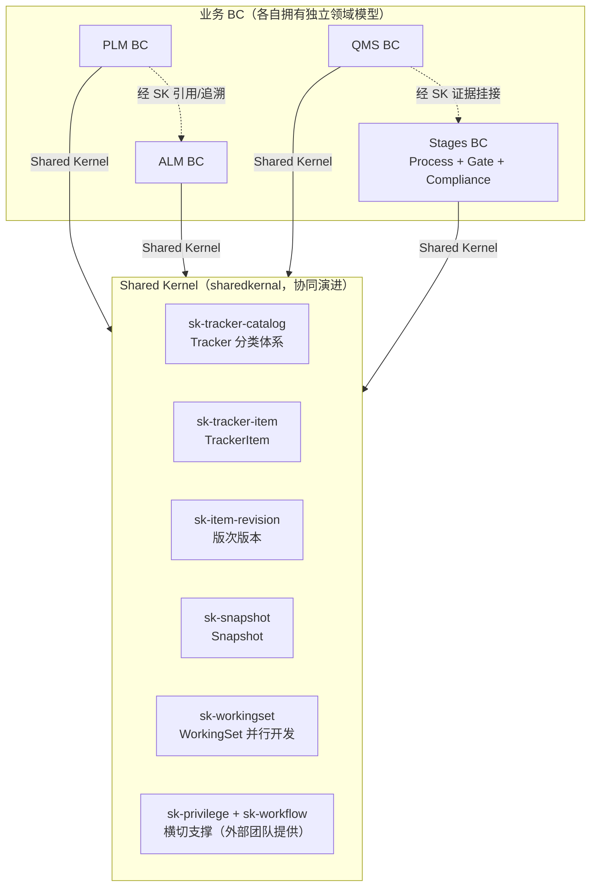

# Shared Kernel 工作集领域建模 — 概述与阅读导航

> **文档版本**: v2.21
> **最后更新**: 2026-10-27
> **模块归属**: `sharedkernal`
> **定位**: 本文件为旧版设计导航。V4 工作集本体以 [workingsetModel](./workingsetModel/00-overview.md) 为准；根目录 00–08 保留历史推演与示例，不作为 V4 的实现约束。比对合并专项见 [09](./merge&diff/09-merge-domain-design.md)。

> **2026-11-04 共识入口**：[轻量记录与代理的区别及类图](./workingsetModel/01-domain-model.md#light-record-and-proxy)、[统一契约／类型化加载用例](./workingsetModel/02-use-cases.md#loading-and-proxy)、[一致性与验收](./workingsetModel/03-consistency.md)。LightTrackerItem 是持久化事实，代理是可选运行时实现，两者不合并为领域概念。

## 1. 背景与目标

AirEdge 需要为 PLM、ALM、QMS、Stages 提供统一的 Tracker、Item 版次、快照、工作集、权限与工作流能力。本规格聚焦 `sk-workingset`，并定义它与 `sk-tracker-catalog`、`sk-tracker-item`、`sk-item-revision`、`sk-snapshot` 的协作边界。**权限与工作流能力分别由 `sk-privilege`、`sk-workflow` 团队提供，本规格只在接入点消费，不定义其模型。**

Shared Kernel 是各业务 BC 共同拥有并直接依赖的稳定领域模型子集。它定义 `TrackerItem` 等共享能力，但不感知 Requirement、Bug、Task、Part 等具体业务类型；具体 BC 可以实现共享能力，并通过 Shared Kernel 定义的扩展端口提供类型特有的加载、版次读取、实例化与删除实现。

工作集能力解决三个问题：

1. 在同一项目内建立具名工作上下文；
2. 对共享 Tracker 提供同一份数据的即时可见，对非共享 Tracker 提供独立演化；
3. 使用全局 `InstanceIdentity(commonId, localId)`、来源快照、COW、Diff/Merge，在只批量生成身份索引而不批量复制 Item 内容的前提下保持身份和数据正确性。

## 2. 战略定位

> 本节是 SK 组成、业务 BC、Context Map、集成模式与模块分层的**唯一正文**；其他文档通过本概述定位，不维护第二份战略正文。

### 2.1 SK 组成（基础协议 + 五模块 + 两横切）

| 模块 | 职责 | 关键领域概念 |
|------|------|--------------|
| Shared Kernel 基础对象协议 | 所有业务实例共用的身份、派生血缘与删除生命周期 | BusinessObject、InstanceIdentifiable、Deletable、InstanceIdentity、DeletionState |
| `sk-tracker-catalog` | Tracker 分类体系（Class Hierarchy） | TrackerType、Tracker、不可变 TrackerSharingMode、FieldSchema |
| `sk-tracker-item` | 通用工作项 | TrackerItem、BusinessObjectData、FieldValue |
| `sk-item-revision` | TrackerItem 版次版本 | RevisionItem、Revision、Revisionable |
| `sk-snapshot` | 版本快照 | Snapshot、TrackerSnapshot、SnapshotRef |
| `sk-workingset` | **离散数据并行开发（本规格重点）** | WorkingSet、WorkingSetTrackerBinding、Tracker、TrackerSnapshot、LightTrackerItem、MergeRound |
| `sk-privilege` | 权限（横切支撑，**由权限团队提供，本规格只消费**） | PrivilegeType、PrivilegeMask |
| `sk-workflow` | 工作流（横切支撑，**由工作流团队提供，本规格只消费**） | Workflow、State、Transition |

### 2.2 业务 BC（消费者）

| BC | 业务职责 | 消费 SK 的方式 |
|----|----------|----------------|
| **PLM** | 产品线/变型/需求/BOM | 受管控的需求/BOM 实现 TrackerItem；WorkingSet 表达产品线变型上下文；Snapshot 固化阶段快照 |
| **ALM** | 发布/迭代/任务/测试 | 受管控的任务/缺陷实现 TrackerItem；WorkingSet 维护版本并行开发；Merge 汇入主干 |
| **QMS** | 审计/不合格/CAPA/质量记录 | 受管控的质量记录实现 TrackerItem；Snapshot 固化证据；Reference 建立追溯 |
| **Stages** | Process + Gate + Compliance（由 GateFlow 演进） | sk-workflow 状态机驱动 Stage/Gate；WorkingSet 管理流程版本线；Compliance 证据挂 Snapshot |

> **BC 演进映射**（当前系统 → 目标）：`GF/GateFlow → Stages`；`DQA → QMS`；PLM 保持；新增独立 ALM。

### 2.3 战略设计总览（Context Map）



### 2.4 集成模式

| 关系 | 模式 | 说明 |
|------|------|------|
| 业务 BC → SK | **Shared Kernel** | 四 BC 直接依赖 TrackerItem、BusinessObject、Tracker、WorkingSet 等稳定共享模型并协同演进；SK 不反向依赖具体业务类型 |
| SK 公开/内部边界 | **共享模型 + 隐藏机制** | BC 实现 TrackerItem 与内容端口；SK 实现统一 TrackerItemInstantiator；LightTrackerItem、来源指针、实例化闭包和 COW 算法保持内部 |
| 类型能力接入 | **Plugin / SPI** | 各 BC 提供 TrackerItemContentPort，包括内部物理复制；SK 统一协调实例化闭包，注册元数据集中装配 |
| 业务 BC 之间 | **Separate Ways + 经 SK 关联** | 互不侵入，经 SK 的 Reference/Snapshot/Workingset 建立追溯 |
| SK 内部模块 | **Partnership** | 通过已定义的稳定协议、类型 SPI 与上下文协作，不直接访问其他聚合内部状态；同步一致性由 Management 协调 |
| 权限（sk-privilege） | **外部横切依赖** | 本规格只在接入点消费权限判定（创建/解析/写入/删除/合并），不定义权限模型 |
| 工作流（sk-workflow） | **外部横切依赖** | 本规格只在接入点消费状态流转：受管对象按需实现 `Routeable`、由工作流引擎探测驱动；不定义 Workflow/State/Transition 模型 |

### 2.5 SK 内部模块分层（每个模块内部）

```
interfaces（REST / 事件契约）
     ↓
application（Application Layer Management / CQRS：Command + Query）
     ↓
domain（AggregateRoot / Entity / ValueObject / DomainService / Factory / Repository 接口）

application → infrastructure（Repository 实现 / 持久化 / 消息）
infrastructure → domain（实现领域声明的端口）
```

以上是职责视图，不要求另建平行 domain 包。AirEdge 由 biz Management 持有写事务，SDK 定义共享协议/inner，sdkImpl 负责 Loader、Instantiator/ContentPort 适配和跨实例编排，具体对象使用 DataObject Framework 持久化。

---

## 3. 核心领域判断

```text
WorkingSet --包含--> WorkingSetTrackerBinding --选择--> Tracker --承载--> LightTrackerItem
                                                   |
                                                   +--服从--> TrackerSharingMode
```

- `WorkingSet` 是配置与工作上下文，不是数据版本线。
- `Tracker` 同时承担业务对象容器、结构定义和数据版本线，是 Tracker 目录能力的聚合根；WorkingSet、LightTrackerItem 和 MergeRound 具有各自的一致性边界。不再建立独立 TrackerBranch/BranchId。
- Tracker 具有 `trackerId`、`parentTrackerId`、`sourceTrackerId` 和不可变 `TrackerSharingMode`。`parentTrackerId` 表达业务父子层级，`sourceTrackerId` 表达派生来源，两者不得混用。
- `isDerived()` 是计算方法：`sourceTrackerId != null`；不额外持久化可漂移的布尔属性。
- `WorkingSetTrackerBinding` 只记录工作集选择的 Tracker，不携带 mode。
- SHARED 模式下多个工作集 Binding 指向同一个 Tracker，修改立即互相可见，无需同实例 Diff/Merge。
- `InstanceIdentity(commonId, localId)` 是所有可派生业务实例共有的能力，不从属于 WorkingSet；`trackerId` 表达实例所在的数据上下文。
- `TrackerItem` 是 Shared Kernel 对外统一的条目契约。业务代码直接使用 TrackerItem、List<TrackerItem>、Requirement 或 List<Requirement>；SK 通过类型 SPI 组装具体业务对象，依赖方向始终为具体 BC → SK。
- `LightTrackerItem` 是 Tracker 下始终存在的内部轻量表示，承载身份、来源和存储状态；VIRTUAL 与 INSTANTIATED 都使用它。它与 TrackerItem 组合，不继承 TrackerItem。
- 原生实例满足 `commonId == localId`；派生实例保留 CommonId 并分配新 LocalId。VIRTUAL 索引以 `sourceLocalId + sourceRevision` 精确指向来源内容，实例化后两者重置为自身 LocalId 与本地版次。
- UNSHARED 模式下，派生工作集立即创建一个新 Tracker，以 `sourceTrackerId` 指向来源 Tracker，捕获 `TrackerSnapshot(sourceTrackerId, capturedAt)`，并批量建立 LightTrackerItem 身份索引；Item 内容通过 COW 延迟实例化。
- 对外以 `TrackerItemLocator(workingSetId, commonId)` 定位当前工作集中的有效条目；解析 Binding 后，内部以 LightTrackerItem 固有的 `trackerId + commonId` 唯一约束访问索引。SHARED 场景下多个 Locator 可以解析到同一共享变体。
- 受 Tracker 管理的任一实例发生更新或删除前，以该实例为根、按 CommonId 与 SourceTrackerId 派生关系找到全部后代，并将闭包内的 VIRTUAL 变体按派生顺序实例化；随后才执行统一 BusinessObject API。
- `LightTrackerItem`、`ItemSourceRef`、InstantiationState、InstantiationClosure 与 COW 算法属于工作集内部机制，不进入具体业务对象模型。
- 引用、比对与合并的规则统一见 [09 业务边界](./09-merge-domain-design.md#merge-scope) 与 [09 规范引用](./09-merge-domain-design.md#reference-design)。
- 查询不触发物理实例化；VIRTUAL 条目使用目标身份与确定来源内容组装具体业务对象。所有受管对象的持久化修改统一经过工作集命令入口，SK 自动准备闭包并加载可写对象；业务代码不判断内部存储状态。

## 4. 不可妥协的不变量

| 不变量 | 说明 |
|--------|------|
| Tracker 共享策略不可变 | 创建 Tracker 时确定 SHARED/UNSHARED；之后没有修改或转换命令。配置错误时创建新 Tracker 并执行显式数据迁移，原 Tracker 身份不变 |
| Tracker 身份统一 | TrackerId 是 Tracker 唯一主键；系统不再定义 BranchId 或 TrackerBranch |
| 两类关系正交 | ParentTrackerId 只表达业务父子层级；SourceTrackerId 只表达派生来源 |
| 派生判断唯一 | `isDerived()` 等价于 `sourceTrackerId != null`，不持久化第二份布尔事实 |
| Binding 不拥有 mode | 同一 `(workingSetId, trackerId)` 组合只能有一个有效 Binding；同一工作集在一个 SourceTrackerId 派生族中只能选择一个 Tracker |
| 共享 Tracker 可多绑定 | SHARED Tracker 可以被多个 WorkingSet Binding 复用 |
| 派生 Tracker 单绑定 | UNSHARED 派生 Tracker 只允许一个有效 WorkingSet Binding，并具有不可变 SourceTrackerId 和 TrackerSnapshot |
| 快照时刻不可漂移 | HEAD 在用户点击创建时由服务端捕获为 TrackerSnapshot 时间戳；异步任务不得改用执行时刻，VIRTUAL Item 只能读取该时刻的来源集合与内容 |
| 实例身份全局一致 | 所有可派生业务实例都提供 CommonId/LocalId；两者与 TrackerId 相互独立 |
| 原生与派生可判定 | 原生实例 commonId=localId；派生实例 commonId≠localId。sourceLocalId 是内容来源指针，不用于判定血缘 |
| 来源定位精确 | VIRTUAL 使用 sourceLocalId+sourceRevision；非版次对象 revision=1，历史内容还须由确定的来源 cut 读取；INSTANTIATED 使用自身 localId+当前本地版次 |
| 血缘链连续 | 派生、COW、合并不改变 CommonId；派生层级由 SourceTrackerId 关系确定，每一跳生成新 LocalId，且 ID 永不复用 |
| 变更前实例化闭包 | 更新或删除任一节点前，当前节点及其全部派生后代都必须拥有独立物理行；来源变更不得穿透到后代 |
| 实例化身份正确 | 复制物理行时保留 CommonId，使用目标 LocalId，重写 Tracker、产品空间等归属，并把来源指针重置为自身 |
| 删除能力统一 | 受 Tracker 管理对象的 delete 先实例化闭包再把当前实例放入回收站；普通 BusinessObject 直接执行自身生命周期；undelete 从回收站恢复；delete2 从回收站彻底删除实体、索引、版次和关系，不保留删除占位状态 |
| 查询身份一致 | 来源只提供业务内容；对外对象使用当前 TrackerId、CommonId、LocalId 和归属，不返回来源对象身份 |
| 读写边界明确 | 查询返回完整业务对象但不自动持久化；命令入口在同一写协议内完成闭包准备、业务行为、内容与轻量索引同步 |
| 合并可复现 | [09 执行与确认协议](./09-merge-domain-design.md#merge-execution) |
| 比对合并对象 | [09 分类记录模型](./09-merge-domain-design.md#merge-model) |
| 正确性不依赖异步投影 | 通用规则见 01；引用与合并见 [09 事务与一致性](./09-merge-domain-design.md#merge-execution) |

## 5. 范围

本规格覆盖：

- WorkingSet 生命周期与 WorkingSetTrackerBinding；
- 共享内核级 InstanceIdentity 能力与派生血缘；
- Tracker 的共享复用、隔离派生、父子层级与来源关系；
- TrackerItem 解析、COW、回收站、恢复和彻底删除；
- CanonicalReference 解析；
- 非共享 Tracker Diff/Merge、冲突、锁、审计与恢复；
- 领域事件、一致性边界和现网演进映射。

不覆盖具体 REST 路由、前端交互、完整数据库 DDL，以及各业务 BC 的内部模型。

## 6. 输入与依据

| 输入 | 使用方式 |
|------|----------|
| Codebeamer 旧工作集文档 | 参考工作集、变体、差异与合并的业务语义，不假设其内部实现 |
| AirEdge 当前实现 | 校准 COW 索引、实例视图、异步 Job、merge index 和上下文机制 |
| 参考图 000005/000006/000007/000009 | 参考 BC 全景、版次协作、删除编排、Factory/Registry |
| 《Working Set 的 DDD 领域建模：技术建议备忘录》v2（2026-10-08） | 参考 WorkingSet/Tracker/Binding 的职责以及共享/隔离规则；该资料不是 Codebeamer 官方内部实现说明 |
| 本轮明确业务规则 | Tracker 与 TrackerBranch 统一为 Tracker；TrackerSharingMode 创建后不可变；SourceTrackerId 与 ParentTrackerId 分责 |

## 7. 文档分工与阅读导航

| 文档 | 回答的问题 | 正文责任 |
|------|------------|----------|
| [00-overview.md](./00-overview.md) | 为什么做、边界在哪里、从哪里读？ | 背景、战略定位、总体判断、核心不变量、范围、输入与导航 |
| [01-domain-model.md](./01-domain-model.md) | 概念是什么、行为与规则是什么？ | 身份、工作集/Tracker、通用能力、删除、领域服务与通用事务矩阵；专项设计链接至 09 |
| [02-class-diagrams.md](./02-class-diagrams.md) | 模型与能力怎样关联？ | 当前模型的结构视图，不独立定义另一套规则 |
| [03-use-cases.md](./03-use-cases.md) | 需要实现哪些业务闭环、怎样验收？ | Epic、Feature、验收条件 |
| [04-sequence-diagrams.md](./04-sequence-diagrams.md) | 用例按什么顺序协作？ | SQ0–SQ6，受理/Job/恢复/发布和命令调用流程 |
| [05-implementation-design.md](./05-implementation-design.md) | 如何存储、读取、保护并迁移？ | 数据库约束、历史读取、批量算法、COW 执行与恢复；引用/合并专项链接至 09、现网映射和迁移 |
| [06-tracker-item-java-demo.md](./06-tracker-item-java-demo.md) | Java 契约和扩展点如何配合？ | 参考代码、实例化协调能力与内容端口、业务编排；不是已落地实现 |
| [07-ddd-review.md](./07-ddd-review.md) | 哪些张力仍需决策、怎样验证规则？ | DDD 审查、实现风险、待闭合协议、不变量→契约测试映射 |
| [08-UL.md](./08-UL.md) | 术语统一叫什么？ | 通用统一语言词汇表；引用/比对合并术语链接至 09 |
| [09-merge-domain-design.md](./09-merge-domain-design.md) | 合并轮次、条目比对和处理事实如何表达？ | 引用、比对合并的 UL、规则、类图、时序、执行存储、风险、验收与测试 |

建议先读 00，按需查阅 08；随后按“01 规则 → 02 结构 → 03 用例 → 04 协作 → 05 实现 → 06 代码 → 07 审查 → 08 UL → 09 比对合并专题”阅读。通用模型变更先更新 01，通用术语更新 08；引用与比对合并专项只维护 09，其余文档保留跳转，不复制契约正文。

### 7.1 权威内容定位

| 主题 | 权威入口 |
|------|----------|
| 背景、战略定位与阅读导航 | 本文 |
| 通用领域模型、身份与能力 | [01](./01-domain-model.md) |
| 通用结构、用例与协作流程 | [02 类图](./02-class-diagrams.md) / [03 用例](./03-use-cases.md) / [04 时序](./04-sequence-diagrams.md) |
| 通用实现、迁移及 Java 示例 | [05 实现](./05-implementation-design.md) / [06 Demo](./06-tracker-item-java-demo.md) |
| 跨主题 DDD 审查及通用测试计划 | [07](./07-ddd-review.md) |
| 通用统一语言 | [08](./08-UL.md) |
| 引用、比对与合并专项 | [09](./09-merge-domain-design.md)；章节分工见其 §11 |

### 7.2 文档维护边界

同一领域契约只维护一份权威正文。其他文件可以保留符合其职责的图、算法、验收断言与代码，但通过链接引用语义，不另立“新版方案”。05 维护通用实现约束；引用、比对与合并的规则、图、执行、存储及测试统一维护在 09，原章节只保留跳转；README 的导航已合并到本节，原独立入口不再保留。

以上现网映射和迁移建议是设计说明，不代表已经完成代码或数据库验证。
