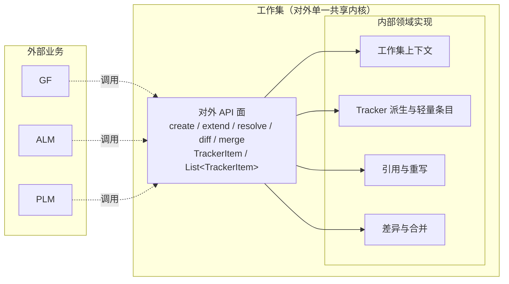
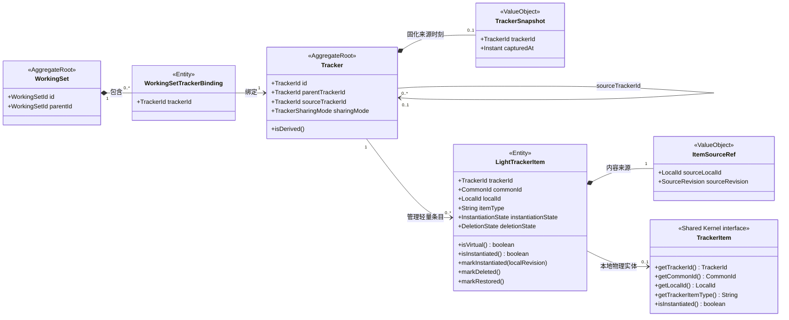
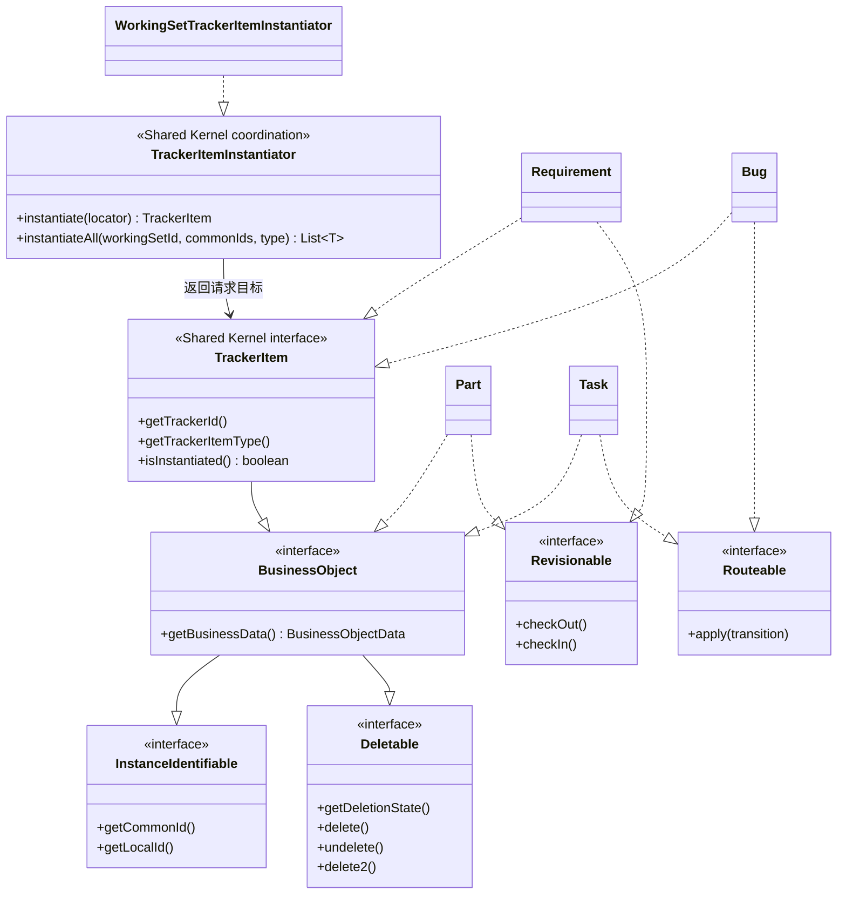
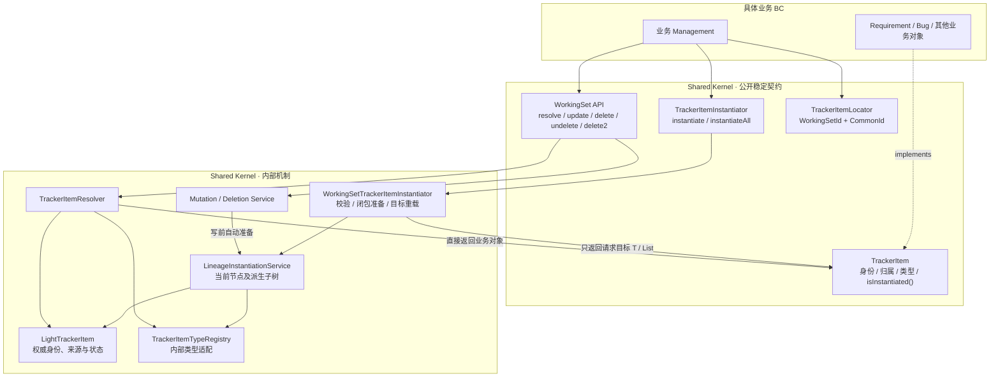
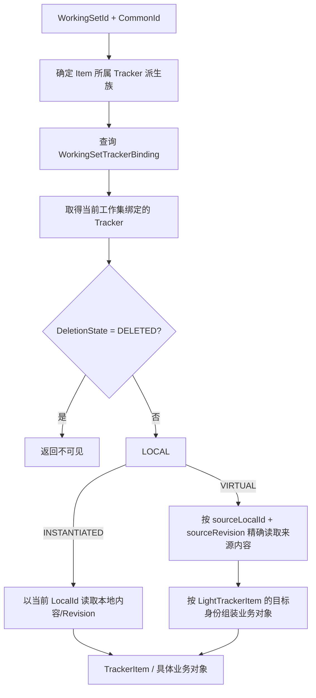
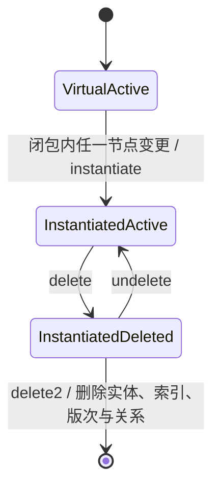
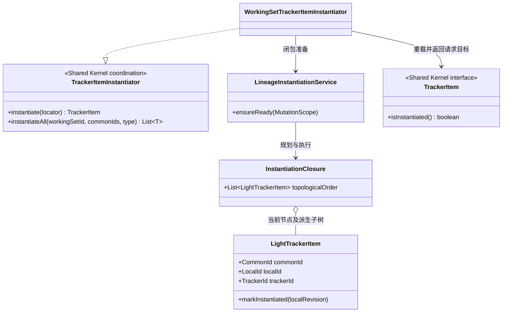
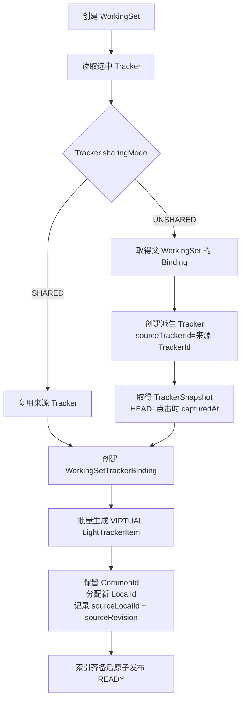

# Shared Kernel 工作集领域建模 — 类图

> V4 类图以 [工作集领域模型](./workingsetModel/01-domain-model.md) 为准。本页为历史设计；[§5.1](./workingsetModel/01-domain-model.md#light-record-and-proxy) 区分 LightTrackerItem 持久化索引、可选 TrackerItem 代理和 Requirement。轻量索引不实现 TrackerItem，代理不是新的领域聚合。

> 代理具体实现统一为 **LightTrackerItemProxy**。完整代理、Requirement 工厂、CQRS 查询及命令类图见 [V4 04](./workingsetModel/04-query-command-demo.md)，含箭头与多重性说明。

> **文档版本**: v2.21
> **最后更新**: 2026-10-27
> **模块归属**: `sharedkernal` / `sk-workingset`

本文件只展示当前有效关系。Tracker 同时承担定义与数据版本线职责；不再定义 TrackerBranch 或 BranchId。

## 1. 共享内核对外边界

工作集作为基础能力对外提供时，外部业务模块将它视为一个整体。共享内核提供统一 API 面，内部再按领域职责分解，形成“对外统一、对内分解”的边界。

边界说明：

- 业务 BC 通过 Shared Kernel 的 TrackerItem、命令和查询契约使用工作集能力，可依赖公开的 Tracker/WorkingSet 模型，但不直接操纵 LightTrackerItem、来源指针和合并执行机制。
- 对外 API 负责鉴权、参数转换和用例编排；业务规则仍由内部聚合与领域服务执行，API 本身不承载领域状态。
- 内部四个区域是同一共享内核内的职责划分，不是四套独立对外服务；它们可以协作完成一个用例，但不能分别向外暴露另一套工作集契约。
- `create / extend` 管理工作集上下文，`resolve` 统一解析有效条目，`diff / merge` 提供非共享 Tracker 的差异与合并能力；引用解析和重写由统一 API 在内部协调。

## 2. 核心领域关系

关系约束：

- `TrackerSharingMode` 只属于 Tracker，创建后不可变；Binding 不重复保存该属性。
- `parentTrackerId` 表达业务父子层级，`sourceTrackerId` 表达派生来源；`isDerived()` 等价于 `sourceTrackerId != null`。
- SHARED 模式下多个 Binding 指向同一个 Tracker；UNSHARED 模式下每个子工作集绑定一个新的派生 Tracker。
- `LightTrackerItem` 是 Tracker 下每个条目的轻量化工作集表示，不论其是否已实例化都存在；`InstantiationState` 描述它是否已有本地物理 TrackerItem。
- `trackerId + commonId` 是 LightTrackerItem 的内部唯一定位约束；`commonId + localId` 是实例身份，不再引入额外的组合键值对象。
- `LightTrackerItem` 与其本地物理 TrackerItem 的 trackerId、commonId、localId、itemType 必须一致；VIRTUAL 时没有本地物理实体，INSTANTIATED 时存在本地 TrackerItem。
- 原生变体的来源指向自身；派生 VIRTUAL 变体的来源指向快照选中的实例版次。`markInstantiated()` 同时把来源重置为自身 LocalId 和本地版次。
- `markDeleted()/markRestored()` 只同步真实 TrackerItem 的删除状态；delete2 由领域服务协调并最终删除 LightTrackerItem 本身。
- `LightTrackerItem` 是 **Entity（实体）** 而非聚合根：其唯一约束（`trackerId + commonId`）与状态迁移由血缘写保护与数据库约束保障；独立维护只为避免超大聚合与全 Tracker 写竞争。
- WorkingSetId 不属于 LightTrackerItem 或 TrackerItem。公开用例以 `WorkingSetId + CommonId` 定位，经 Binding 解析出 TrackerId 后，再以 `trackerId + commonId` 查找 LightTrackerItem；SHARED Tracker 因而可以被多个 WorkingSet 复用同一条目。

## 3. 能力组合

### 3.1 业务对象能力组合

`BusinessObject` 统一具有 `InstanceIdentifiable` 和 `Deletable` 能力。`TrackerItem` 是 Shared Kernel 对外统一的稳定业务契约；Requirement、Bug 通过直接实现它声明受 Tracker/WorkingSet 管理，业务方可以使用 `TrackerItem`、`List<TrackerItem>` 或具体业务类型。`LightTrackerItem` 是 SK 内部按 Tracker 管理的轻量条目表示，不是对外业务契约，也不是 TrackerItem 的子类型。`TrackerItemInstantiator` 是 SK 的统一实例化协调契约，由 SK 实现并直接返回请求目标 TrackerItem/T 或 List<T>。具体 BC 只提供类型特有的内容适配，不承担跨聚合闭包协调。`isInstantiated()` 是只读加载事实，不是可编辑业务状态或写入许可。`Revisionable` 与 `Routeable` 仍是正交可选能力。

为保持讨论视图简洁，本文件各图暂不展开内容访问端口；加载、历史读取、内存重建、保存和物理删除的契约见 [01 领域模型](./01-domain-model.md) 与 [06 Java Demo](./06-tracker-item-java-demo.md)。图中省略不意味着删除这些职责，也不由 Instantiator 承担。

### 3.2 对外统一、对内分解（能力组合图 2）

边界与关系说明：

- BC 可以依赖并实现 TrackerItem；SK 不反向依赖 Requirement、Bug 等具体类型。
- TrackerItem 不再声明 instantiate，也不持有服务/LightTrackerItem 引用。isInstantiated() 为加载时只读观察，无 setter、不独立持久化，旧值可能过时，不能据此跳过受管写入口。
- TrackerItemInstantiator 是 SK 公开协调能力，不是 BC 类型 SPI；接收工作集定位上下文，准备目标及其 Tracker 派生子树中的 VIRTUAL 条目，返回请求目标而非闭包。
- 已实例化根仍需检查未实例化后代；来源祖先只读取并保护，不自动复制整族。
- 显式实例化不保存 detached 编辑；update/delete 无须调用方先实例化，仍自动准备同一闭包并重新验证并发状态。
- 具体 BC 的类型复制、历史读取和存储由内部内容适配承担；本文件各图暂不展开内容端口，不将其职责混入公开 Instantiator。
- LightTrackerItem 与 TrackerItem 组合而非继承：前者管理权威来源/状态，后者为完整业务对象契约。VIRTUAL 查询组装对象的标记为 false，本地物理对象加载为 true。
- Tracker 管理条目不意味着聚合必须加载全部条目；索引独立维护，跨条目写保护与原子持久化仍由 SK 协调。

## 4. TrackerItem 解析关系

解析器必须进行来源链循环检测、权限校验，并保证批量查询与单条查询都返回 `TrackerItem` 或其具体业务类型，且语义一致。VIRTUAL 来源内容只用于构造当前工作集上下文中的业务对象，不因此创建目标物理行。

## 5. COW 与删除

- 派生 Tracker 与 LightTrackerItem 身份索引不使用延迟创建；只有 Item 物理内容使用 COW。
- 对任一节点执行 update/delete 前，先按 CommonId 查询轻量条目，再结合 SourceTrackerId 派生图筛选当前 Tracker 子树，按 Tracker 拓扑顺序实例化所有 VIRTUAL 条目。
- 实例化服务按 sourceLocalId/sourceRevision 复制确定物理行，复用目标 LocalId，改写 Tracker、产品空间等归属，再调用 `markInstantiated(localRevision)` 重置来源指针和状态；闭包全部完成后才允许提交原始变更。
- delete 复用同一实例化流程，再软删除当前实例；后代保留独立物理内容。undelete 因而可以直接复用统一 BusinessObject API。
- delete2 只允许处理回收站中的已实例化实例；成功时删除实体、LightTrackerItem 索引、版次以及所有以该对象为端点的领域关系，不保留删除占位状态，也不能恢复。

## 6. 引用与合并模型

详细内容已迁入 [09 比对合并类图](./09-merge-domain-design.md#merge-model)，此处仅保留跳转入口。

引用模型见 [09 规范引用](./09-merge-domain-design.md#reference-design)；执行保护见 [09 执行协议](./09-merge-domain-design.md#merge-execution)。

## 7. 创建工作集协作图

该流程不存在修改 TrackerSharingMode 的路径；任何服务都只能读取这一固有属性。索引批量创建的是派生实例身份和来源指针，不是业务内容行。
