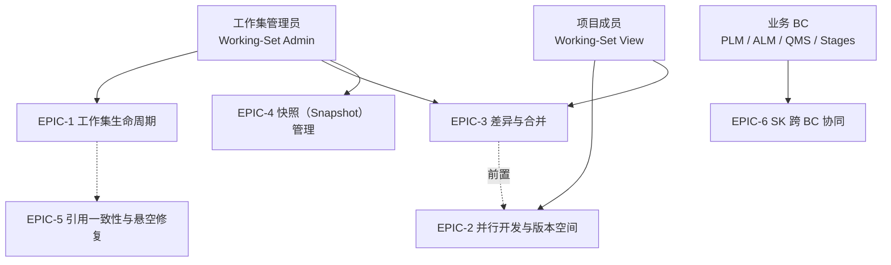

# Shared Kernel 工作集领域建模 — 核心用例（Epic / Features）

> V4 用例以 [用例与协作](./workingsetModel/02-use-cases.md) 为准。本页保留历史设计；统一条目访问、类型化业务处理与代理适用场景见 [§4.1](./workingsetModel/02-use-cases.md#loading-and-proxy)。

> **文档版本**: v2.21
> **最后更新**: 2026-10-27
> **模块归属**: `sharedkernal` / `sk-workingset`
> **核心前提**: `TrackerSharingMode` 在 Tracker 创建时确定，创建后永久不可变；工作集用例只能读取，不能选择或修改该属性。

---

## 1. 用例总览

---

## 2. Epic 总览

| Epic | 名称 | 一句话目标 | 主要参与者 |
|------|------|-----------|-----------|
| EPIC-1 | 工作集生命周期 | 建立/维护具名工作上下文及 WorkingSetTrackerBinding | 工作集管理员 |
| EPIC-2 | 并行开发与版本空间 | 回答“条目在当前工作集里是哪个版本”，任一节点变更前实例化其派生闭包 | 项目成员 |
| EPIC-3 | 差异与合并 | 发现并搬运来源↔派生 Tracker 间的字段级变更 | 目标工作集管理员 |
| EPIC-4 | 快照（Snapshot）管理 | 固化某时刻的版本快照，支持基于快照派生 Tracker | 工作集管理员 |
| EPIC-5 | 引用一致性与悬空修复 | 保证条目间指向在创建/扩展后仍正确 | SK 自动 |
| EPIC-6 | SK 跨 BC 协同 | 四 BC 直接依赖稳定共享模型并协同演进，SK 不反向感知具体业务类型 | 各 BC |

---

## 3. Features 明细

### EPIC-1 工作集生命周期

| Feature | 名称 | 验收要点 |
|---------|------|----------|
| F1.0 | Tracker 创建与固化 | Tracker 创建时必须选择 SHARED/UNSHARED，并写入默认 WorkingSet 的首个 Binding；TrackerId 是唯一主键，不再创建 BranchId。之后任何更新 API 均不接受 sharingMode |
| F1.1 | 创建工作集 | 点击创建时为所选 Tracker 捕获 TrackerSnapshot；SHARED 复用来源 Tracker；UNSHARED 创建新 Tracker，设置 sourceTrackerId 并继承 sharingMode，再为快照中的 Item 批量生成 `commonId + 新 localId + sourceLocalId + sourceRevision` 索引，不复制内容行 |
| F1.2 | 扩展工作集 | 向已有工作集追加 `WorkingSetTrackerBinding`；按 Tracker 策略复用或派生 Tracker；完成后重新解析悬空 CanonicalReference；Binding 不物理移除（可隐藏） |
| F1.3 | 编辑基本信息 | Name 唯一性校验；Color/Owner 更新后刷新工作集缓存与 common 表 |
| F1.4 | 删除工作集 | 非默认、无子集、无进行中 Provisioning/Merge；终止 Binding 并保留历史；只清理无其他有效引用的 UNSHARED 派生 Tracker，共享 Tracker 保留；事件驱动缓存/读模型刷新 |
| F1.5 | 重挂父工作集 | 变更 parentId；刷新自己与新旧父的缓存；校验仍同项目 |
| F1.6 | 替换工作集 | 两阶段：创建影子 WorkingSet，按固化策略复用共享 Tracker 或基于 TrackerSnapshot 创建非共享派生 Tracker，批量建立身份索引并通过 COW 迁移 → Finalize 切换 → 删除旧集；禁止全量复制 Item 内容 |

### EPIC-2 并行开发与版本空间

| Feature | 名称 | 验收要点 |
|---------|------|----------|
| F2.1 | 切换工作集上下文 | smartUrl（/workingset/{id}/workspace/{id}/...）重写；`RequestThreadHolder.setWorkingset()`；策略链兜底（空工作区/追踪器不在集/无快照/带快照） |
| F2.2 | 查询业务条目 | resolve/resolveAll 通过 Binding 与 LightTrackerItem 返回 TrackerItem、List<TrackerItem> 或 T/List<T>；VIRTUAL 来源内容组装成目标身份的业务对象，查询不触发物理实例化 |
| F2.3 | 派生链 COW 实例化 | 任一节点更新前，按 CommonId 查询全部变体，并以 SourceTrackerId 派生图筛选当前 Tracker 子树；按拓扑顺序实例化所有 VIRTUAL 变体。物理行按 sourceLocalId/sourceRevision 读取，复制后校正身份和归属，再把来源指针重置为自身 LocalId/本地版次 |
| F2.4 | 统一强类型查询 | VIRTUAL 返回当前变体身份，但内容按 sourceLocalId/sourceRevision 精确读取；INSTANTIATED 的来源指针指向自身 LocalId/当前本地版次；非版次对象 sourceRevision 恒为 1；单条与批量查询遵循同一规则 |
| F2.7 | 批量业务处理 | 批量读取按类型与来源分组，禁止 N+1；严格查询按请求顺序返回且不悄悄遗漏。mutateAll 由 SK 自动准备闭包再传入 List<T>，业务方不判断存储状态；内容、版次、删除状态和轻量索引同步提交 |
| F2.5 | 变更徽章 | 黄=本工作集变更，蓝=子工作集变更；按实际处理确认和内容依据刷新，不因数据接受就无条件清除 |
| F2.6 | 删除生命周期 | delete 与更新共用派生链实例化：先实例化当前节点及全部后代，再通过通用 delete 把当前真实实例放入回收站；undelete 从回收站恢复；delete2 只接受 INSTANTIATED+DELETED 对象，并彻底删除实体、LightTrackerItem 索引、版次及关系等全部领域数据。三个操作均不改动已独立实例化的后代业务状态 |

### EPIC-3 差异与合并

详细内容已迁入 [09 比对合并用例与验收](./09-merge-domain-design.md#merge-acceptance)，此处仅保留跳转入口。

### EPIC-4 快照（Snapshot）管理

| Feature | 名称 | 验收要点 |
|---------|------|----------|
| F4.1 | 创建永久快照 | `SnapshotFactory.fromWorkingSet()` 为每个选定 Tracker 保存 `trackerId + capturedAt`；Item 集合由该时间点的时态数据解析，不逐项固化成员 |
| F4.2 | 基于快照派生 Tracker | 创建输入支持 HEAD 或 snapshotId；HEAD 表示用户点击创建的一瞬间，服务端在受理异步任务前记录 capturedAt；派生 Tracker 保存不可变 sourceTrackerId 与 TrackerSnapshot |
| F4.3 | 快照成员查询 | 读模型按 TrackerSnapshot.capturedAt 返回该时刻可见的 Item 集合，并与实例视图联动展示 |

### EPIC-5 引用一致性与悬空修复

详细内容已迁入 [09 引用用例与验收](./09-merge-domain-design.md#merge-acceptance)，此处仅保留跳转入口。

### EPIC-6 SK 跨 BC 协同

| Feature | 名称 | 验收要点 |
|---------|------|----------|
| F6.1 | 共享能力依赖 | 四 BC 直接实现 TrackerItem、BusinessObject，并使用同一套强类型查询/命令契约；不得依赖 LightTrackerItem、来源指针和实例化闭包等内部机制 |
| F6.2 | 类型扩展端口 | 每种受管类型注册 TrackerItemContentPort（含 instantiateLocal），TrackerItemInstantiator 由 SK 统一实现；类型/输出类/capabilities 为注册元数据，DERIVE/INSTANTIATE 为基础接入能力，DIFF/MERGE 需独立策略支持；SK 按 itemType 调用，业务调用方不处理内部 COW |
| F6.3 | 契约测试 | 四 BC 与 SK 联合契约测试；SK 发布附带"影响面清单" |
| F6.4 | 协同演进评审 | SK 变更需四 BC 联合评审；破坏性变更提供迁移脚本与双读过渡 |

---

## 4. 用例与 SK 模块/聚合的覆盖关系

| Epic | 涉及 SK 模块 | 主要领域概念 |
|------|--------------|----------|
| EPIC-1 | sk-workingset | WorkingSet、WorkingSetTrackerBinding、Tracker |
| EPIC-2 | Shared Kernel 身份协议 + sk-workingset + sk-tracker-item + sk-item-revision | InstanceIdentifiable、InstanceIdentity、LightTrackerItem、TrackerItem |
| EPIC-3 | sk-workingset | [09 定向比对与合并模型](./09-merge-domain-design.md#merge-model) |
| EPIC-4 | sk-snapshot | Snapshot |
| EPIC-5 | sk-tracker-item + sk-workingset | TrackerItem、Reference |
| EPIC-6 | 全部 SK 模块 | 跨 BC 编排 |

---

## 显式实例化能力

契约与实现见 [01-domain-model.md §4.2](./01-domain-model.md)；时序见 [04-sequence-diagrams.md SQ6](./04-sequence-diagrams.md)。

验收条件：请求目标及其派生子树中的 VIRTUAL 节点全部生成本地内容并重置来源；已实例化根仍检查后代，重复执行不复制已有物理行；祖先不无条件实例化；无权限、已删除、定位或类型不匹配时拒绝；并发不重复创建；有界事务失败回滚实体/索引/Outbox；只返回请求目标 T/List<T>，保留顺序和重复项，不接收或保存 detached 编辑。返回对象 isInstantiated=true，旧查询对象不会自动刷新；后续 update/delete 仍重新规划保护。
