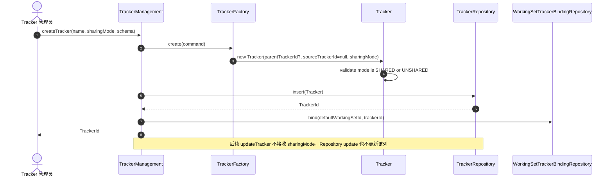
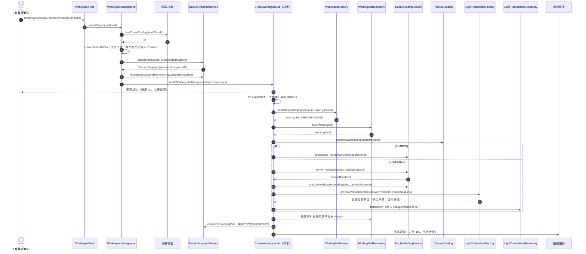
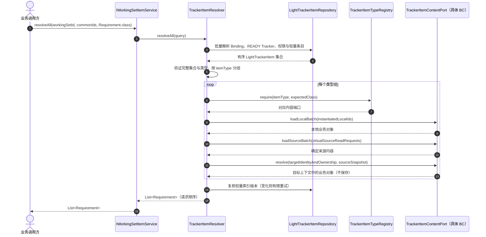
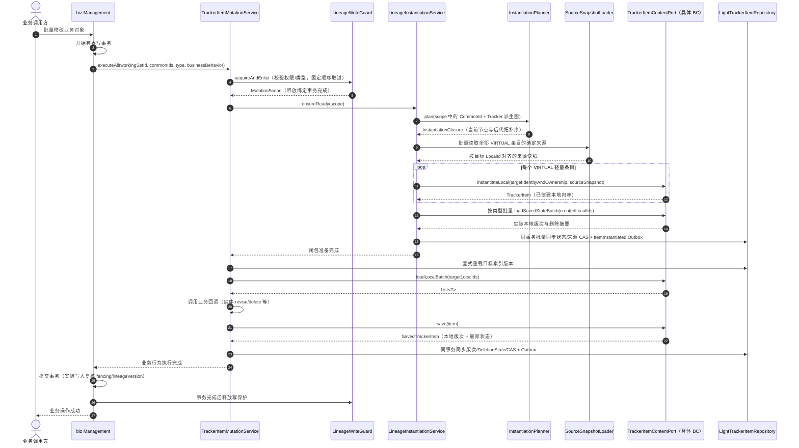
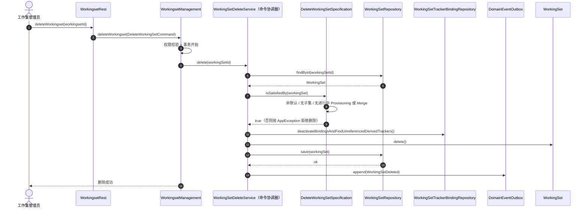
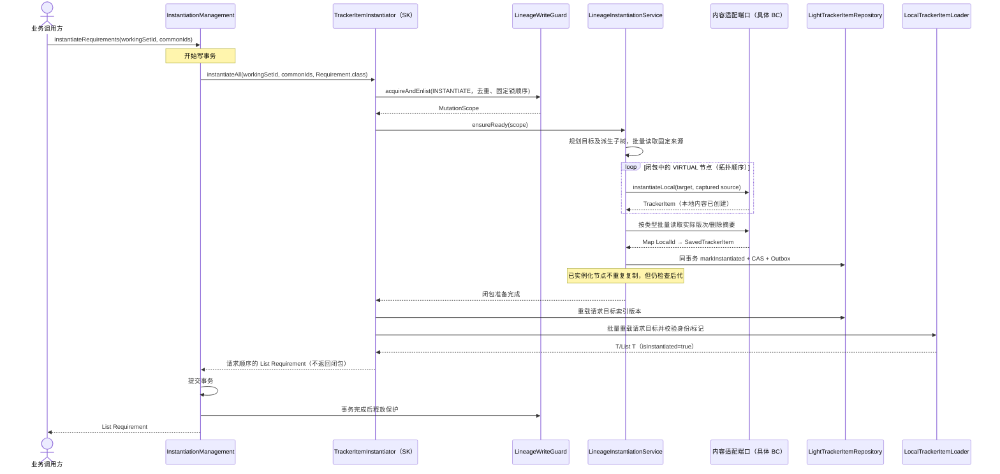

# Shared Kernel 工作集领域建模 — 用例流程时序图

> V4 时序以 [用例与协作](./workingsetModel/02-use-cases.md) 为准。本页保留历史设计；加载入口决定是否组装代理，写入统一由 Management 与 TrackerItemInstantiator 协调，不由代理启动跨变体事务。

> **文档版本**: v2.21
> **最后更新**: 2026-10-27
> **模块归属**: `sharedkernal` / `sk-workingset`
> **核心前提**: `TrackerSharingMode` 在 Tracker 创建后永久不可变；以下流程只读取该属性。
>
> 说明：SQ0~SQ5 覆盖 Tracker 共享策略固化、工作集生命周期、上下文切换与变体解析、派生链实例化、字段级合并、删除校验。
> 其中 SQ3 借鉴参考图 000006（checkOut 签出）的"聚合根 + 通用能力 + 工厂"协作模式，
> SQ5 借鉴参考图 000007（删除）的"领域服务 + Specification + Repository"编排模式。

---

## SQ0 创建 Tracker 并固化共享策略



**要点**：sharingMode 只在创建时写入；Tracker 直接与默认 WorkingSet 建立首个 Binding，不再创建另一类数据线对象。配置错误时创建新 Tracker 并执行独立迁移。

---

## SQ1 创建工作集（异步 Job 编排）



**要点**：HEAD 表示用户点击创建的一瞬间，服务端必须在异步 Job 入队前记录 capturedAt。非共享 Tracker 根据 TrackerSnapshot 批量生成轻量索引：保留 CommonId、分配新 LocalId，并以 sourceLocalId/sourceRevision 精确指向来源内容；非版次对象 sourceRevision=1。

---

### 创建/扩展的恢复与发布协议

`WorkingSetProvisioning` 记录可恢复步骤：

```text
AcceptCreateWorkingSet
→ ResolveSelectedTrackers
→ CaptureTrackerSnapshotsAtRequestTime
→ RetainReadCuts
→ EnqueueProvisioning
→ ForEach Tracker:
    ReadImmutableSharingMode
    → SHARED: ReuseSourceTracker → CreateBinding（复用已有条目，不生成派生索引）
    → UNSHARED: ResolveParentBinding → CreateDerivedTracker(sourceTrackerId, trackerSnapshot)
        → CreateBinding
        → BatchProvisionLightTrackerItems(commonId, newLocalId, sourceLocalId, sourceRevision, VIRTUAL)
→ PublishReadyAtomically
→ Complete
```

每一步具有稳定幂等键。重试时已经完成的步骤跳过，不重新创建 Tracker、Binding 或索引。WorkingSet/派生 Tracker 在索引尚未齐备时保持 PROVISIONING，正常查询只使用 READY 的 Binding 和 Tracker；完成与发布必须原子切换，不能把部分生成的集合当成完整工作集。

快照 cut 的时态读取、保留与来源扁平化见 [05 §2](./05-implementation-design.md)。

---

## SQ2 单条与批量强类型业务查询



**要点**：业务方使用同一种业务类型处理两类存储状态。SK 内部按目标身份组装 VIRTUAL 内容，查询不创建物理行；普通查询不返回回收站对象。工作集上下文显式传入 API，不依赖 ThreadLocal 决定实体归属。单条 resolve 复用批量语义。

---

## SQ3 业务命令自动准备当前节点及全部派生后代



**要点**：业务代码只操作 T/List<T>。CommonId 与 SourceTrackerId 决定闭包，sourceLocalId 实例化后指向自身，不用于遍历派生树。单次本地内容/索引迁移保持原子一致；原业务变更只有在整个闭包准备完成后才能提交。失败回滚走同一事务完成释放路径。undelete 由单独 RESTORE 意图校验并加载回收站对象，delete2 由后续专用清理用例执行。

---

<a id="merge-main-sequence"></a>

## SQ4 分类记录比对、数据应用与处理确认

详细内容已迁入 [09 完整主时序](./09-merge-domain-design.md#merge-main-sequence)，此处仅保留跳转入口。

## SQ5 删除工作集（Specification 校验）

> 借鉴参考图 000007 的删除编排：应用服务 → 领域服务（跨聚合编排）→ Specification → Repository 逻辑删除。



**要点**：删除是跨聚合操作，由 Management/命令协调器编排，Specification 负责领域判定；共享 Tracker 可能仍被其他 Binding 引用，不得级联删除。只有无有效 Binding、无在用派生后代及历史保留义务的 UNSHARED 派生 Tracker 才能进入后续清理；缓存与读模型经可靠事件刷新。

---


## SQ6 显式实例化目标及派生闭包



单条入口复用批量语义。请求不传 detached 对象，不保存业务编辑；旧查询对象的 isInstantiated() 不会自动刷新。来源祖先只读取与保护，后续 update/delete 仍重新规划闭包，不能把“已实例化”当作写许可。公开协调由 SK 实现，类型物理复制由 BC 内容端口实现。
