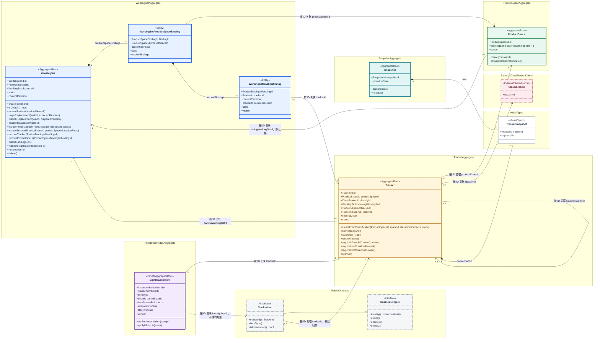
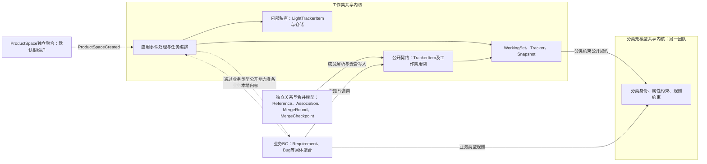
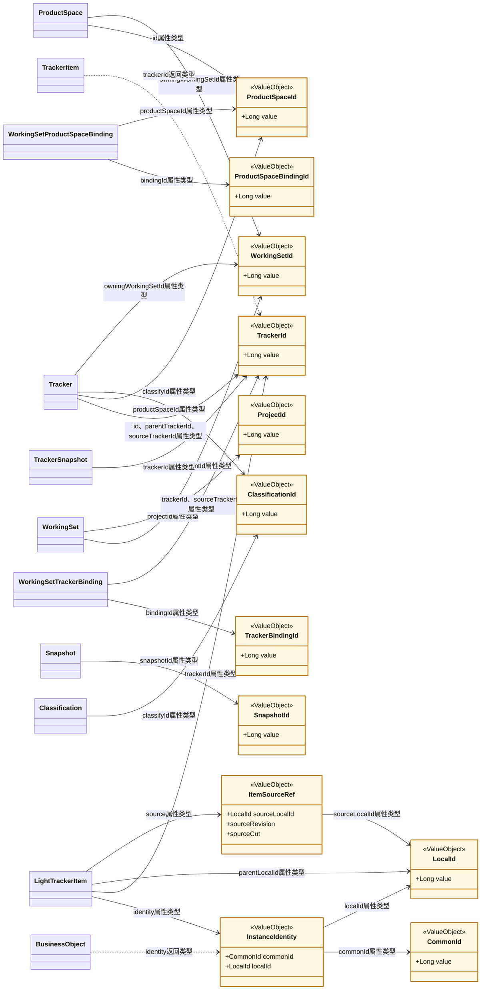
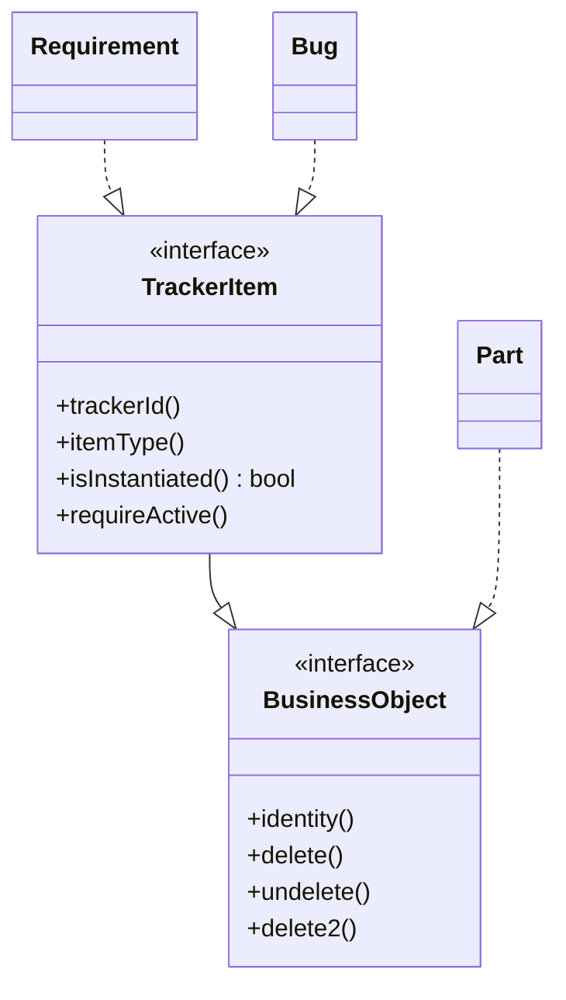
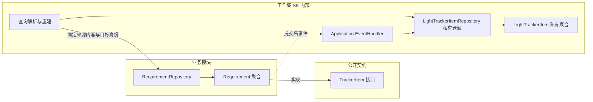

# 领域模型与统一语言

## 1. 核心语言

完整词汇及字段语义以 [10 UL](./10-ubiquitous-language.md) 为准；本节列出主图概念。

| 名词 | 定义与边界 |
|------|------------|
| WorkingSet | 具名工作上下文，通过 Binding 选择 Tracker；默认工作集是平台预置根，不是全部业务数据的事务容器 |
| 默认工作集 | 平台元数据初始化预置，ID 固定为 1；不可删除、不可隐藏，是 Tracker 原始创建入口 |
| ProductSpace | 默认工作集内维护的独立聚合，用户工作区最小单元；创建后按全部分类初始化 Tracker |
| 分类元模型 | 另一共享内核维护的三层分类、属性及规则定义；启动前预置，本文只依赖公开契约 |
| Tracker | 分类在产品空间、工作集内的持久化投影及记录容器；遵守分类约束，原始与派生使用同一模型 |
| WorkingSetProductSpaceBinding | WorkingSet 内部实体，显式表达空间纳入，组织 0..* 个 Tracker 绑定；空空间仍保留 |
| WorkingSetTrackerBinding | WorkingSet 内部实体，归属于一个空间绑定，记录该空间下 Tracker 的选择、状态和历史 |
| SHARED / UNSHARED | Tracker 创建时确定的共享属性，永久不可变；共享复用同一 Tracker，非共享在派生用例创建新 Tracker |
| ParentTrackerId | 业务目录父级；不表达派生来源 |
| SourceTrackerId | 直接派生来源；派生后不可修改，isDerived 由是否有来源推导 |
| CommonId / LocalId | CommonId 在一个工作集有效范围内唯一，跨工作集同族变体可相同；LocalId 全局唯一，原生两者相等、派生两者不同 |
| TrackerItem | Shared Kernel 对外公开的接口协议，继承 BusinessObject；业务聚合实现该协议，不持有 LightTrackerItem |
| LightTrackerItem | 工作集 Shared Kernel 内部私有独立聚合，维护目标条目的索引、归属和固定来源；不实现 TrackerItem，生命周期摘要通过业务事件同步 |
| TrackerSnapshot | 来源 Tracker 与 capturedAt 组成的不可变时间切点 |
| HEAD | 无 snapshotId；选择用户提交时间点的时间戳，读取该切点各实例的最新适用版次，不是持续变化的最新值 |
| Snapshot | 可复用、可追踪保留义务的快照实体，持有一个或多个 TrackerSnapshot |
| WorkingSetProvisioning | 创建、扩展或替换的持久化流程管理器，跟踪步骤、重试和发布条件 |
| contentRevision | 工作集有效内容范围的发布序号，区分替换前后视图；不等于条目版次 |

原生条目的创建遵守所属 Tracker 的生命周期归属：共享条目由默认工作集维护，非共享条目由所属工作集维护。不能仅按工作集层级判断原生／派生。请求 WorkingSetId 是操作上下文，条目的权威生命周期归属由 Tracker.owningWorkingSetId 解析，二者不能混用。

CommonId 标识派生家族，不单独表达直接父子链路；直接来源关系另行保留。sourceLocalId 是当前内容定位，实例化后改为自身，不能兼作不可变的派生历史。派生时立即分配 LocalId，实例化不更换身份；读取固定有效来源内容，不跟随父对象最新值。

## 2. 整体领域主图：空间、分类投影与工作集

**边界图例**：蓝色 WorkingSetAggregate 框内的 WorkingSet 和两层 Binding 属于同一聚合；绿色 ProductSpaceAggregate、黄色 TrackerAggregate、紫色 PrivateItemIndexAggregate、青色 SnapshotAggregate 各为独立聚合边界。框名仅用于图示分组，不新增领域类型或强制包结构。

灰色 PublicContracts 是公共协议，粉色 ExternalClassificationKernel 是外部分类共享内核，均不表示本图中的业务聚合。ValueTypes 单独展示 TrackerSnapshot 的类型定义；Tracker 与 Snapshot 各自持有其值副本，不共享一个跨聚合可变实体。跨框关联表示按身份引用，不扩大事务范围。

跨聚合关联箭头仅表示由强类型 ID 表达的领域关系，**禁止实现为对方聚合对象字段或级联加载映射**。只有聚合内实体和值对象可以直接持有。Tracker 的两类层级分别无环；图中仅画派生关系。Tracker 和 Snapshot 各自持有快照值的副本，不共享可变从属对象。图中多重性表达生命周期允许的范围，约束还需看下表。

Tracker 管理逻辑条目；内部 LightTrackerItem 独立维护索引。两者通过 LocalId 对应，不是组合关系。稳定状态每个受管条目恰有一条索引；事件传播期间允许索引尚未建立或状态暂时滞后。派生索引存在而本地内容行不存在，是合法的长期 VIRTUAL 状态。图中虚线表示身份对应依赖，不表示对象引用或所有权。

### 2.1 边界及数量约束

| 关系 | 解释 |
|---|---|
| ProductSpace → 默认 WorkingSet | 多个空间在同一个默认根维护生命周期；不是默认根的内部实体 |
| Tracker → ProductSpace、Classification | 每个 Tracker 各有一个空间和分类；空间与分类均可对应多个 Tracker |
| Tracker → owningWorkingSet | 每个 Tracker 唯一生命周期归属；共享的多个 Binding 不增加归属 |
| WorkingSet → 空间绑定 → Tracker绑定 | 两层实体都属于 WorkingSet 聚合；空间绑定引用 ProductSpace，Tracker绑定引用 Tracker |
| TrackerItem → Tracker | 条目以 Tracker 确定归属与分类约束，Tracker 不组合整个业务聚合集合 |
| LightTrackerItem ⇢ TrackerItem | 通过 LocalId 对应，稳定状态 1:1；同步窗口可缺失或滞后，不是聚合组合 |

上图在两层 Binding 与快照值对象上使用组合箭头；不将 ProductSpace 或 Tracker 聚合组合到 WorkingSet。分类的三层结构、业务对象内部结构不在本图展开。工作集与产品空间是两个组织维度，不建立“一个产品空间只能有一个工作集”的错误数量约束。ProjectId 不与 ProductSpaceId 合并，业务项目映射由业务模块决定。

### 2.2 共享内核与业务模块边界

图中应用协作箭头不表示核心代码依赖业务实现。SK 通过公开能力接口调用类型适配器，由组装层注册；业务对象不持有私有索引。ProductSpace 的模块部署归属不改变其独立聚合和默认根生命周期规则。

### 2.3 身份值对象与使用关系

本图展示 ID 的属性类型，不展示聚合所有权。一个值对象类型可同时用于对象自身身份及对它的外部引用；值相同不要求共用同一 Java 实例。图中 Long 是标量封装示例，存储编码由身份能力合同决定。

- WorkingSetId 同时用于工作集身份、父级及生命周期归属；TrackerId 同时用于 Tracker 身份、目录父级及派生来源，不按字段角色重复定义 ID 类型。
- ProductSpaceBindingId 与 TrackerBindingId 必须区分，防止两类移出／隐藏命令传错身份。
- ClassificationId 代表分类共享内核公开的身份类型，ProjectId 代表项目模块的身份合同；适配实际公开名称，不在工作集另造含义相同的类型。
- CommonId 和 LocalId 类型不同；原生时底层标量相等，但不是同一类型。InstanceIdentity 组合它们，不扩大为另一套工作集／Tracker 复合身份。
- 默认根以 WorkingSetId 的常量表达标量 1。可选父级由可空／Optional 字段语义表达，不使用 0 等伪 ID。
- ID 值对象不可变、按值相等、校验自身有效格式，不提供 load／save 方法，不持有 Repository 或聚合引用，不单独建身份仓储。
- WorkingSet 内部可以直接持有两层 Binding 集合；应用服务可以显式加载多个聚合或传入只读事实，但不能将其写成跨聚合持久化对象图。

## 3. 不变量与归属

| 维护者 | 必须保证 |
|--------|----------|
| WorkingSet | 默认根 ID=1，不可删除、不可隐藏；普通父子关系遵守项目范围，平台默认根不按项目重复创建；同一 Tracker／派生族不可重复纳入；发布新增或替换范围前验证准备完成 |
| ProductSpace | 生命周期归属默认工作集；创建事件触发逐分类投影，全部预期 Tracker 与绑定完成才确认初始化完成 |
| Tracker | 必须关联产品空间和分类；遵守分类属性及规则约束；sharingMode 永久不可变；只有 UNSHARED 因隔离而派生；派生时固定直接来源和 TrackerSnapshot；目录父级与来源分别校验 |
| LightTrackerItem | localId 不变；同族 commonId 不变；VIRTUAL 指向可读来源；实例化后指向自身；自身身份及归属不可变；内容状态通过事件最终一致 |
| Snapshot | 捕获空间绑定（包括空空间）、Tracker成员与内容切点；捕获后 cuts 不变；释放不能破坏现存变体或其他保留义务 |
| 应用协调与持久化防线 | 项目内名称唯一；每个 UNSHARED 派生 Tracker 最多一个有效绑定；同一工作集有效范围内 commonId 唯一；(workingSetId, trackerId) 不重复；同一有效工作集范围内 (productSpaceId, classifyId) 投影唯一；localId 全局唯一；并发层级操作不得成环 |

单个聚合不能通过检查自己的集合保证跨聚合唯一性。领域规则决定允许与否，唯一约束、版本和必要的串行化保证并发时仍成立。派生 Tracker 的创建工作集身份可作为不可变归属事实，用于限制跨工作集绑定。

Binding 状态区分准备中、有效、已终止；visible 是展示选择，不等于解除绑定。扩展仅发布新增 Binding，不让已就绪条目整体不可用。

### 产品空间纳入与 Tracker 选择

产品空间与工作集有显式关联。WorkingSetProductSpaceBinding 是 WorkingSet 内部实体，不是独立聚合；其 Tracker 绑定集合允许为空。ProductSpace 本体只有一份，生命周期仍归默认工作集，纳入多个工作集不复制、不迁移空间。

1. 同一工作集有效范围内，同一 ProductSpace 只有一个有效空间绑定。
2. Tracker 绑定必须归属于一个空间绑定，且 Tracker.productSpaceId 必须匹配；不得绕过空间纳入单独绑定 Tracker。
3. includeProductSpace 显式纳入空间；includeTracker 校验空间已纳入。一个工作集事务可同时建立所需空间绑定和 Tracker 绑定，Tracker 聚合创建仍在独立事务完成。
4. removeTracker 只结束指定 Tracker 绑定，不级联结束空间绑定。最后一个 Tracker 移除后，该空间仍出现在本工作集空间列表中。
5. removeProductSpace 是显式空间移出操作，不是删除 ProductSpace。普通入口要求先移除该空间内有效 Tracker 绑定，拒绝隐含级联销毁；准备中的绑定或任务也必须先终止。
6. 空间列表按空间绑定查询，不能从 TrackerBinding 去重推导；空间内分类列表、条目列表再按 Tracker 绑定查询。
7. contentRevision 发布范围同时涵盖空间绑定与 Tracker 绑定；只复制非空 Tracker 清单会漏掉合法空空间。

空间绑定和 Tracker 绑定各有自己的 Binding 身份；方法参数须明确类型，避免把两种 bindingId 混用。具体存储可以分表，但只能由 WorkingSet 聚合入口维护，不能建立两个独立领域仓储绕开聚合守卫。

### 3.1 默认根与 Tracker 创建入口

默认工作集由平台元数据初始化数据在系统启动前预置，ID 固定为 1。运行时只加载并校验，不通过普通 create 工作集接口生成；缺失或身份不符属于平台初始化错误，不自动分配一个替代根。默认工作集不可 delete、delete2 或隐藏，也不能通过容器操作间接隐藏它。

创建任何子工作集之前，所有业务数据均处于默认工作集。普通 REST 触发的 Tracker 创建只允许在默认工作集执行，固化 sharingMode，独立提交 Tracker 后通过事件建立默认绑定。子工作集拒绝直接新建 Tracker，只能从直接父工作集纳入：SHARED 复用原 Tracker，UNSHARED 派生新副本。SK 内部派生工厂不是对外新建入口。

Tracker 逐层纳入，来源必须在直接父工作集的有效范围内；不能跳过中间工作集直接从祖先选 Tracker。业务条目是否允许在子工作集原生创建遵循条目规则，不受“禁止子工作集新建 Tracker”这一容器规则替代。

默认工作集初始没有产品空间或 Tracker；平台预置的是默认根和分类元模型。用户创建 ProductSpace 后，通过 ProductSpaceCreated 事件读取全部分类，逐分类创建独立 Tracker 聚合，再分别建立默认绑定。产品空间、Tracker 与 Binding 不在一个跨聚合事务中初始化，详见 [09 产品空间与分类投影](./09-product-space-classification-projection.md)。

共享 Tracker 及其 TrackerItem 的生命周期在默认工作集维护；非共享 Tracker 及条目在各自所属工作集维护。纳入共享对象只增加可访问绑定，不转移生命周期归属。产品空间自身始终在默认工作集维护，不随子工作集派生。

### 3.2 单次纳入、重复请求与重新纳入

| 场景 | 结果 |
|---|---|
| 首次纳入 SHARED | 为目标工作集建立一条 Binding；跨工作集可共享，同一工作集不可重复绑定 |
| 首次纳入 UNSHARED | 以直接父 Tracker 为来源，创建新 Tracker 副本及目标绑定 |
| 已纳入后再次提交新的纳入请求 | 抛出重复纳入异常；不静默跳过、不返回第二个副本 |
| 相同 requestId、相同参数重试 | 返回原任务及已分配身份，属于请求幂等，不是再次纳入 |
| 同一请求的 Tracker 选择列表重复 | 输入校验拒绝 |
| 派生副本删除完成后重新纳入 | 从直接父工作集再次派生，分配新的 TrackerId 及条目 LocalId，不复活旧副本 |

Binding.sourceTrackerId 标识本次选择的直接父 Tracker，Tracker.sourceTrackerId 标识派生来源；SHARED 的绑定也记录选择入口，但不因此修改共享 Tracker。检查重复纳入须覆盖准备中和已发布的占用，不能只按目标副本 TrackerId 去重；不同请求并发选择同一来源时，最多一个成功。

删除副本仍须满足“空且无派生子级”等删除守卫。异步删除尚未完成时保留纳入占用；收到完成事实并结束旧绑定后才允许新请求。不能仅隐藏绑定、发出删除请求或删除一个显示记录就视为允许重新纳入。历史绑定和请求映射保留审计，旧完成事件不能关闭新绑定。

内容替换保留工作集身份与父子关系，准备完整新范围后切换 contentRevision；旧、新 Binding 可以并存，当前读取只选择发布范围。恢复输入可来自更早历史，但新 Tracker 和条目的直接派生关系重置到目标的直接父工作集；历史内容复制到目标后 source 指向自身。SHARED 只改变绑定，不复制或删除共享数据。身份、写入屏障和父级缺项边界见 [06](./06-workingset-content-replacement.md)。

## 4. 身份、来源与生命周期

### 4.1 成员唯一性

一个工作集当前有效内容范围内，一个 CommonId 最多解析到一个条目；跨工作集可以有多个具体业务对象共享 CommonId，其 LocalId 各不相同。SHARED 被多个工作集绑定时复用同一个对象及 LocalId，不是重复创建多个同 ID 对象。历史范围与业务版次不算当前新增成员；多版次行也不能据此误判 LocalId 冲突。

加入 Tracker 时必须校验其条目与当前工作集全部已选 Tracker 的 CommonId 不冲突，不能只校验 Tracker 内部。后续共享 Tracker 新增成员也必须维护所有相关有效工作集的成员唯一性；并发准入的具体责任仍须在详细设计落实，事件事后发现冲突不能冒充强唯一保证。

### 4.2 快照版次选择

| 输入 | 时间切点 | 内容选择 |
|---|---|---|
| HEAD | 用户提交请求时确定的 capturedAt，无 snapshotId；不能使用后台任务实际执行时间 | 取该时刻每个实例的最新适用业务版次 |
| 指定 snapshot | 由 snapshotId 查询其不可变 capturedAt | 取每个实例在该切点之前或当时已生效的最大版次 |

所有业务对象至少有版次 1。多版次对象修改会升版次；单版次对象始终是版次 1，但内容并发版本仍可变化。先按切点确定实例存在性、生命周期及可见成员，再在各实例内选版次；不能从所有对象中选一个全局最大版次，也不能让后来版次泄漏进来。同一时刻按存储的提交可见性规则处理边界，采用不晚于 capturedAt 的已提交版本。

**选版次不等于取得历史内容。** 单版次对象需要版次 1 在 capturedAt 时的内容证据；若当前行已覆盖，需要历史存储或受保留的完整事件内容提供。不可回读时明确失败／等待，不能降级为当前值。关系和成员集合也遵循同一切点。HEAD 时间由请求接入层可信地固定，重试沿用原值。

### 4.3 Tracker 移除与删除

| 场景 | 规则 |
|---|---|
| 有相关 TrackerItem 的 Tracker 物理删除 | 拒绝；VIRTUAL 条目同样是存在的条目，不能只统计本地业务行；软删除尚未清除的条目也不能当空 |
| SHARED 从工作集移除／业务称删除 | 仅解除当前工作集 Binding；即使含共享条目也不删除 Tracker、条目或关系，其余工作集继续使用 |
| UNSHARED 删除 | 必须为空且无派生子级，即空的派生叶子；否则拒绝，不级联删除条目或后代 |
| 空 Tracker 移除 | 允许结束相应 Binding；若请求同时销毁 UNSHARED Tracker，仍须满足无派生子级及既有历史保留条件 |

解绑与对象销毁分别提交并由事件衔接；结束绑定不等于内容已被物理清除。目录子级与派生子级分别检查，不能把 sourceTrackerId 和 parentTrackerId 混用。有内容的 UNSHARED 单独解绑是否开放仍需业务明确，本规则不自动授权。

### 4.4 条目生命周期

| 状态／动作 | 规则 |
|-----------|------|
| 原生创建 | 一次分配身份值作为 CommonId 和 LocalId；直接建立本地内容，source 指向自身 |
| 派生索引 | 保留 CommonId，预分配新 LocalId；VIRTUAL 无本地内容，source 指向快照选定的真实来源 |
| instantiate | 使用预分配 LocalId，重写目标归属；本地内容提交后发出完成事件；索引消费成功后重置 source，状态转为 INSTANTIATED |
| delete | 保存修改前完整状态后，提交业务对象 DELETED 状态并登记事件；索引在独立事务中响应事件；后代业务状态不变 |
| undelete | 仅从 INSTANTIATED + DELETED 恢复为 ACTIVE，保留原身份 |
| delete2 | 仅从回收站彻底删除，先满足历史保留和关系清理条件；清除当前实例内容、索引、版次及所属关系，不留下第三种删除状态 |

`ItemSourceRef.sourceRevision` 为正整数，非版次对象固定为 1；它不是内容并发版本。`sourceCut` 固定有效内容时刻：当 VIRTUAL 父项再次派生并扁平化来源时，继承其有效来源切点，不能错误使用新子 Tracker 的捕获时刻。来源切点必须可持久化回读，不能靠当前父索引临时推算。实例化后来源转为自身，本地更新通过内容并发版本与实际本地版次管理。

实例化状态与删除状态是不同维度。isInstantiated 只是加载事实，不是跳过受管写入的许可。索引中的删除态是业务生命周期摘要，不提供绕过业务对象的独立软删除入口。

## 5. 公开能力与值对象

此图只展示接入契约，不替业务 BC 决定聚合边界。BusinessObject 不强制公共可变属性 Map，也不强制继承骨架类。delete2 表达领域许可与意图，实际清理由应用用例完成。

InstanceIdentity、TrackerItemLocator(workingSetId, commonId)、ItemSourceRef、TrackerSnapshot 是不可变且自校验的值。领域 ID 可以采用具名类型；不新增另一套与 InstanceIdentity 重复的业务组合键。闭包执行计划可以包含已加载实体，但属于执行上下文，不因使用 record 就称为不可变值对象。

### 5.1 内外边界与仓储

私有指模块封装：LightTrackerItem、仓储及内部事件处理 API 不出现在业务接口签名中。业务聚合不持有索引对象、索引仓储或索引 ID 属性；它保留自身身份、trackerId 和加载时的实例化事实。实现 TrackerItem 不会自动产生事件，业务命令接入统一事件发布协议。

### 5.2 LightTrackerItem 的行为

| 声明 | 作用 |
|---|---|
| identity、trackerId、itemType | 对应目标条目身份及归属；索引以目标 LocalId 标识自身，无须额外业务身份 |
| parentLocalId | 直接父变体身份，原生条目为空；实例化后不改成自身 |
| source | 固定 sourceLocalId、sourceRevision、sourceCut；revision=1 不替代并发版本 |
| instantiationState、lifecycleState | 本地内容是否完成建立，以及最后确认的业务生命周期摘要 |
| lastAppliedVersion、version | 已消费业务版本与索引自身并发版本，各自独立 |
| provisionOriginal / provisionDerived | 按已提交创建事实或派生计划建立合法索引 |
| applyLifecycle(event) | 校验身份、事件顺序并同步生命周期，拒绝过期更新 |
| confirmInstantiation(receipt) | 验证本地内容提交证据后转为 INSTANTIATED，source 指向自身 |

事件去重凭据与物理删除后的已处理版本由内部消费存储保留，不为此增加公共领域类型。索引不自行执行业务对象的 delete 或 undelete。

## 6. 创建、重建与实例化

1. 原生创建由业务工厂建立身份和合法内容，业务提交后以事件建立私有索引。
2. 派生创建直接在 SK 内建立 LightTrackerItem 独立聚合，可靠确定目标身份、归属及可恢复内容。流程见 [05](./05-workingset-creation-lrt.md)。
3. 查询从私有索引和有效内容重建 Requirement 等内存对象；不创建身份、不写业务行，也不需要代理。
4. 异步实例化只转换已有逻辑条目的存储承载，不是补建此前不存在的领域聚合。业务内容与索引各自提交，完成事件连接两个事务。
5. 逻辑条目与索引聚合共享对应身份，不意味着同一个聚合。稳定状态 1:1 是跨聚合收敛规则，不是每一时刻的数据库联合不变量。

TrackerItem 是协议，不是新增持久化根；Requirement 等具体实现承担业务不变量。Tracker、LightTrackerItem、具体业务聚合及引用关联分别拥有仓储和事务边界，Tracker 不组合拥有这些聚合。查询模型可以协作重建，不能直接保存 detached 查询对象。

## 7. 必须维持的语义

- 原生和派生身份创建后不变；查询、实例化与重试不得分配替代 LocalId。
- 固定旧内容必须可恢复；索引未同步不允许退回源最新值。
- 本地权威内容已建立时，查询不能因迟到索引继续展示旧 source；读取协议见 [03](./03-consistency.md)。
- 不再要求业务内容与索引同事务提交；只有各聚合变更与其可靠事件登记在本聚合事务内完成。
- 本阶段不声明或使用任何 TrackerItem 代理实现。公开返回 TrackerItem 或业务类型，索引始终在 SK 内部。

业务写入到派生实例化、再到索引确认的完整协作见 [07 条目实例化](./07-item-instantiation-events.md)。TrackerItemInstantiator 只处理已加载的目标身份及固定内容，事件发出与接收由应用层接入事件框架。
