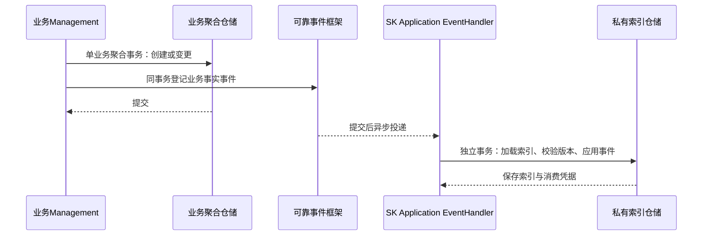

# 用例与事件协作

> 2026-11-06 · LightTrackerItem 为 SK 内部私有独立聚合。

## 1. 用例入口

| 用例 | 责任 |
|---|---|
| 创建、扩展工作集 | WorkingSetProvisioning 推进逐聚合阶段；见 [05](./05-workingset-creation-lrt.md) |
| 替换工作集内容 | 保留目标叶子工作集，按历史 snapshot 准备完整新范围并切换；见 [06](./06-workingset-content-replacement.md) |
| 创建产品空间 | 默认工作集创建独立 ProductSpace，事件逐分类初始化 Tracker 和默认绑定，见 [09](./09-product-space-classification-projection.md) |
| 空间纳入／移出 | 维护WorkingSet内部空间绑定；空空间保留，显式移出不删除ProductSpace |
| 创建 Tracker | REST 入口仅允许默认工作集 ID=1；必须指定产品空间及分类，校验空间内唯一投影、固化 sharingMode，独立提交后通过事件准备默认 Binding |
| 纳入 Tracker | 只能从直接父工作集逐层纳入；共享只绑定，非共享派生副本；新请求重复纳入报错 |
| resolve / resolveAll | 内部批量解析索引与固定来源，返回 TrackerItem 或 T/List<T> |
| 创建、编辑、删除业务对象 | 业务 Management 加载权威状态，提交业务聚合及事件；不写索引 |
| instantiate / instantiateAll | 编排本地内容建立及完成事件；多条目分别提交 |
| Tracker 移除／删除 | SHARED 只解绑；UNSHARED 物理删除要求空且无派生子级，见 01 §4.3 |
| 快照与删除工作集 | 固定切点和保留义务；解绑、关系及资源清理逐聚合推进 |

拓展复用创建的增量准备流程，并在新增范围发布后恢复既有悬空引用及因缺端点未建立的合法关联，见 [05 §10](./05-workingset-creation-lrt.md#10-拓展工作集增量纳入与关系恢复)。扩展仅发布新增 Binding；替换完整范围的协议见 [06](./06-workingset-content-replacement.md)，不修改 parentId。重挂仍须另行定义层级与派生兼容性规则。

## 2. 原生创建与生命周期同步

新增响应创建事件；delete、undelete、delete2 分别响应软删除、恢复及物理删除事实。非 TrackerItem 对象如 Part 不进入索引协议。受管对象所属 Tracker 的权限与可写状态由命令入口校验，不能把迟到的索引创建当作业务授权。

物理删除事件必须保留目标身份、类型、归属、最终业务版本；不能要求消费者再查询已不存在的业务行。跨对象关系清理另行发送事件推进，未完成保留义务时不执行不可恢复的数据清除。

## 3. 源修改与派生实例化

完整事件契约、用例图、类图、时序图、流程图及索引确认规则见 [07 条目实例化](./07-item-instantiation-events.md)。

1. Command 捕获修改前完整聚合状态，提交本业务变化并发出 TrackerItemChanged。
2. 应用 Handler 检查所有层级与分叉中的虚拟后代，按来源及切点筛选，逐目标业务聚合实例化并发出 ItemInstantiated。
3. 完成事件消费者独立更新 LightTrackerItem：确认目标内容、source 指向自身、标记 INSTANTIATED；不改写业务生命周期。
4. 当前被编辑对象也为虚拟时，先准备自身本地内容再修改；同一业务聚合可以在一次事务中完成这两步，索引始终通过事件确认。

## 4. 查询与写入

查询批量读取内部索引，按类型与来源切点分组加载内容，再由工厂重建目标身份的业务对象，保持输入顺序。查询不实例化、不产生业务创建事件。业务方不接触 LightTrackerItem，也不需要代理。

写命令重新加载权威状态及版本；虚拟目标先完成本地内容准备再执行 edit/delete。已提交本地内容的凭据优先于尚未确认的索引摘要；不能用 isInstantiated 的旧查询值判断是否可直接落库。创建同步窗口和删除过滤见 [03](./03-consistency.md)。

## 5. 事件契约与职责

事件至少包含 eventId、目标 LocalId/CommonId、trackerId、itemType、聚合版本、操作类型和 occurredAt。修改事件另含 beforeVersion/afterVersion/beforeImage；实例化完成事件含目标内容已提交版本及本次来源依据。发生时间不替代聚合顺序。

业务工厂与仓储维护内容；私有 LightTrackerItemRepository 维护索引；Application Handler 负责事务及事件协作；领域行为校验状态转换，领域服务负责已加载事实的来源匹配和内容构造。事件框架负责可靠持久化、投递、重试与补偿，不在领域对象中访问消息基础设施。

生命周期命令先解析归属：SHARED Tracker 及其条目归默认工作集，UNSHARED 归所属工作集。请求所处页面不能改变权威归属；后台消费者亦遵守该规则。

WorkingSet 通过空间绑定组织 Tracker 选择，两层均为内部实体。移除 Tracker 仅结束对应 Tracker绑定，最后一个移除后仍返回该空间。新建／拓展与查询均支持显式空空间，不能以Tracker列表是否为空判断空间是否纳入。
