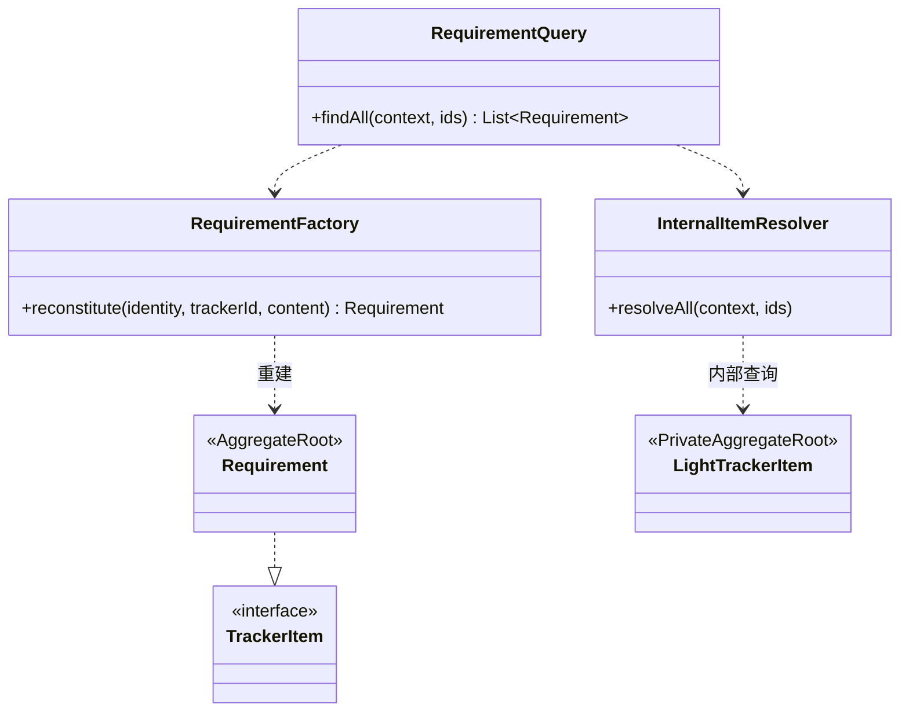

# 查询、命令与事件简例

> 2026-11-06 · Java 示意，省略框架注解与类型细节；不声明代理。

## 1. 公共协议与业务对象

```java
public interface TrackerItem extends BusinessObject {
    TrackerId trackerId();
    ItemType itemType();
    boolean isInstantiated(); // 加载事实，不是并发写许可
}
// Requirement implements TrackerItem；Part implements BusinessObject。
// Requirement 不持有 LightTrackerItem 或其仓储。
```

## 2. 查询重建



内部解析器批量解析索引，优先核对目标本地权威内容和删除证据，否则读取固定 source。跨模块只传目标身份和内容等必要值，不返回索引对象。工厂沿用身份恢复内存对象，不生成物理副本；调用方获得 List<Requirement>。这些虚线是使用依赖，无聚合所有权和数量含义。

## 3. 写命令与消费

```java
// 业务应用层：只保存本业务聚合，不访问索引仓储。
void deleteRequirement(Id id, Version expected) {
    tx.required(() -> {
        Requirement item = requirements.loadForCommand(id, expected);
        var before = item.captureBeforeImage();
        item.delete();
        requirements.save(item);
        events.register(item.deletedEvent(before));
    });
}

// SK 内部应用层：示意正常已建索引路径，去重与乱序必须先处理。
void onLifecycleChanged(ItemLifecycleEvent event) {
    tx.requiresNew(() -> {
        if (receipts.alreadyApplied(event.eventId())) return;
        var index = indexes.load(event.localId());
        index.applyLifecycle(event); // 校验身份、版本及合法转换
        indexes.save(index);
        receipts.record(event); // 同一消费事务
    });
}
```

虚拟目标命令需要先准备本地内容；可在同一目标业务聚合事务内准备并修改，或采用可恢复的准备流程后重新校验版本。索引始终通过事件独立更新。上述代码仅展示已准备内容的命令路径，完整链路见 [07](./07-item-instantiation-events.md)。loadForCommand 验证权威版本，不接受查询对象直接保存。

创建事件使用 provisionOriginal；索引缺失时应按 [03](./03-consistency.md) 等待／重建，不能直接套用上例的 load。delete2 清理索引后仍保留消费终态凭据。ItemInstantiated 消费者调用 confirmInstantiation，不能重复运行原生创建工厂。
