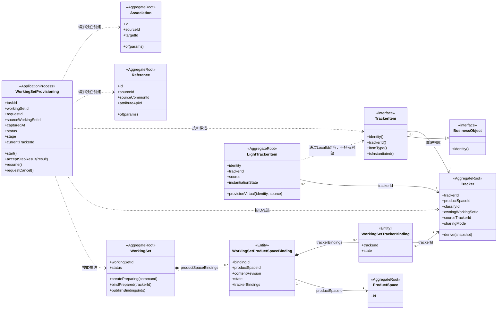
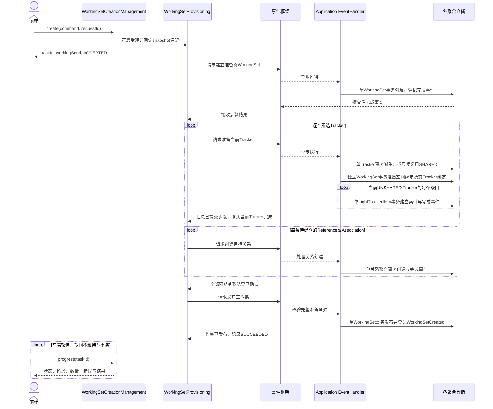
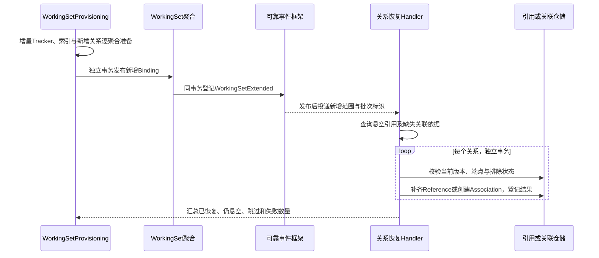

# 工作集创建：多阶段 LRT

创建与拓展见本文；保留既有工作集身份并完整更换内部内容，见 [06 工作集内容替换](./06-workingset-content-replacement.md)。三者复用 WorkingSetProvisioning，但发布范围和取消边界不同。

> 2026-11-05 · V4 设计。LRT 使用通常的 Long-Running Task（长时间运行任务）含义；不是长数据库事务。事件持久化、可靠投递、重试及补偿框架由其他团队提供。

## 1. 创建的业务含义

创建工作集是一个持续推进的应用流程：建立工作集 → 逐 Tracker 准备逻辑条目 → 建立引用关联 → 校验完整性 → 发布可用。受理成功不等于工作集已可用，前端通过任务标识轮询进度。

本流程创建默认根之下的子工作集；默认工作集 ID=1 已由平台元数据预置，不走本 LRT，且不可删除、不可隐藏。所选 Tracker 必须来自直接父工作集，不能从更早祖先跨级纳入。子工作集不存在独立新建 Tracker 的 REST 入口，任务中的创建仅指内部派生。

**批量建立 LightTrackerItem，就是批量建立已有明确身份和归属的逻辑条目的轻量存储；其载体是私有 LightTrackerItem 独立聚合。** 每条索引作为 SK 内部独立聚合，对应唯一目标条目，不是等待工厂认领的孤儿。业务查询可据此重建 Requirement 等完整内存对象；本地内容行可长期不存在。后续异步实例化只转换存储承载，不重新创建条目。

“批量”描述任务调度和读取方式；严格禁止一个写事务插入多个条目聚合。读取可以分页和批量，写入每个条目分别提交。若以后要求单次 bulk insert 跨多个条目原子提交，那是改变本轮事务约束，不能作为优化默认引入。

本次派生直接建立私有索引聚合，不等待尚无本地内容的业务对象发出创建事件。原生业务创建则由提交后的事件建索引；两条路径复用身份唯一规则。后续本地内容实例化通过完成事件确认索引，不重复创建。

## 2. 模型与边界

沿用 WorkingSetProvisioning 作为持久化应用流程，不新增与其重复的业务任务聚合。taskId 标识 LRT；workingSetId 标识业务工作集。流程记录预期工作、已完成工作和失败原因，不拥有业务对象。

TrackerItem 是具体业务聚合的根契约，不另存 TrackerItemImpl。Reference、Association 的具体端点和版次规则沿用 [引用关联模型](../workingsetReference/02-domain-design.md)，这里不重新定义。关系端点按 ID 引用，关系不属于条目内部实体；图中流程的虚线是调用依赖，不表示所有权，故不标业务多重性。

## 3. 阶段与完成条件

创建／拓展输入分别声明所选产品空间及其 Tracker 子集，允许显式选择空空间。处理 Tracker 前，在目标 WorkingSet 准备对应空间绑定；来源空间／Tracker须符合直接父级选择规则。空间已纳入时拓展复用其绑定，Tracker 的重复纳入规则不因此放宽。来源同一空间的全部 Tracker 移出后，空间绑定仍保留。

发布校验覆盖两层绑定，空间查询按已发布空间绑定返回，不能只按有 Tracker 的空间构造结果。取消只撤销本任务未发布的新增选择，不移除此前已经有效的空间绑定。

| 阶段 | 处理 | 完成证据 |
|------|------|----------|
| 受理 | 校验请求、幂等受理、确定 snapshot 与历史保留，生成 taskId 和预分配 workingSetId | 请求及流程可恢复，切点可回读 |
| 建立工作集 | 单个 WorkingSet 事务创建准备态工作集，登记完成事件 | 工作集已提交，但未对普通业务开放 |
| 准备 Tracker 与条目 | 按固定选择顺序逐个处理 Tracker；SHARED 复用，UNSHARED 生成新 Tracker，随后分页逐条目建立轻量状态 | 每个预期 Tracker 和条目有唯一目标身份及成功回执；分页扫描已结束 |
| 建立引用关联 | 在所有 Tracker 的条目身份准备完成后，按来源关系规则生成目标关系 | 全部预期关系已提交，或有业务允许的明确悬空／排除结果 |
| 校验与发布 | 检查预期清单、关系结果与保留义务；单个 WorkingSet 事务发布本次空间绑定及Tracker绑定 | WorkingSetCreated 已提交，普通业务可访问 |
| 完成 | 流程接收工作集发布事实，记录成功 | 查询可返回 SUCCEEDED 与 workingSetId |

Tracker 与条目阶段逐 Tracker 运行；关系阶段放到全部身份准备后，避免 A 的引用指向尚未处理的 Tracker B 时误判目标不存在。可提前计算关系计划，但不能仅凭预留 ID 就把未确认的端点作为完整就绪证据。

目标 WorkingSet 对来源选择维护准备占用和有效绑定，拒绝同来源／同族的新重复请求；同 requestId 重试恢复原步骤。请求列表重复直接报错。绑定与来源关联见 [01 §3.2](./01-domain-model.md#32-单次纳入重复请求与重新纳入)。

本任务新建的准备态资源不接受普通业务写入，也不允许其他任务提前绑定或引用。构建步骤只能幂等补齐既定计划，不能在校验后继续改变目标成员范围。发布依据封闭的完成清单；这使跨聚合准备结果能够稳定交给 WorkingSet 做最后一次状态转换。SHARED 复用既有资源，其生命周期变化需遵守既有绑定与保留规则。

SHARED 只创建工作集绑定，不生成新 Tracker、条目或复制已有关系。UNSHARED 派生保留 CommonId，分配新的 LocalId 和目标 TrackerId，固定有效 sourceLocalId/sourceRevision/sourceCut。源条目本身是 VIRTUAL 时继承其有效来源，不用新任务时间覆盖旧内容切点。

## 4. 事件推进与事务划分

图中的相邻调用是多个独立事务，不允许 Handler 外层包一个总事务。流程状态更新也不与业务聚合写入强行捆绑；业务事务登记完成事实，流程异步接收并幂等推进。源数据读取不算修改另一个聚合，但必须读取固定一致切点。

轮询与后台阶段并行发生；图末尾的轮询块仅表示独立查询通道，不表示完成后才允许查询。流程接受步骤结果和登记下一步消息需可靠衔接；业务完成回执可重放，避免“业务已提交、下一步未发出”造成任务停滞。

沿用 TrackerDerived、WorkingSetCreated 等领域事件。条目轻量创建是逻辑条目创建事实，后续 ItemInstantiated 只表达存储变化。步骤请求和步骤回执是 LRT 的应用消息，不必把每次分页扫描或进度增加都命名为领域事件。所有消息携带 taskId、步骤标识、目标身份及必要依据；进度只由提交成功的事实推进。

## 5. 全量身份映射与关系建立

流程保存可恢复的来源到目标映射，例如 `(taskId, sourceTrackerId, commonId) → targetTrackerId + targetLocalId`。它属于应用构建清单，不是新的领域聚合，也不是关系血缘。重试复用第一次分配的身份；提交成功但回执丢失时，按步骤键查询并补回执，不能重新分配 ID。

关系端点使用目标 LocalId，轻量条目已逻辑存在即可成为合法端点，不要求有 Requirement 本地内容行。数据库约束不能把“必须存在具体业务内容表行”误当作“目标条目存在”；存在性依据是该条目已提交的轻量身份及类型。

引用与关联仍各自生成新关系身份，按各自规则去重。仅复制来源 snapshot 上有效且允许派生的关系：内部端点映射到目标变体，范围外端点按既有规则保留／排除／形成允许的悬空；不擅自克隆外部对象。钉版需要有效版次映射，不能仅凭新 LocalId 或相同版次数字认定已匹配。SHARED 目标保持原身份。

引用或关联创建可以使用类型工厂提供的端点事实，不必先实例化条目。非本次派生所有的外部关系不能被任务取消时删除。具体上游复制、下游关联排除与悬空规则以引用专项为准。

## 6. 创建期间源持续修改

受理时固定 capturedAt 并可靠建立历史保留义务，必须早于异步扫描源成员。不能先返回一个无法回读的切点，再寄望后续事件补齐已经丢失的状态；保留与源修改的衔接由历史／事件框架提供确认协议。

源更新仍按 [03](./03-consistency.md) 登记完整 beforeImage 并异步实例化现有依赖。即使源事件被消费时目标索引尚未生成，LRT 也须按 snapshot 从历史或保留事件恢复原成员与内容。目标索引创建后，若其来源已变化且需要实例化，独立调度目标实例化，不要求源事件回滚，也不重建条目身份。

完成发布不要求所有条目 INSTANTIATED；只要求每个条目的有效内容可可靠解析。若某旧内容暂不可读，任务保持待处理／重试，不虚报完成。临时任务保留在完成时转换为 VIRTUAL 条目或 Snapshot 的持续保留义务，不能一次性全部释放。

## 7. 最小 API 与进度

create 的 command 包含目标名称、父工作集 ID、来源工作集 ID、所选产品空间 ID 集合、各空间所选来源 Tracker ID 集合及 snapshot 选择；按既有规则校验父子关系与来源。HEAD 在用户提交请求的接入时刻固定为 capturedAt（无 snapshotId），显式 snapshot 保留所选切点；重试不重新解释 HEAD。请求人来自认证上下文。taskId 与工作集、Tracker、条目的 ID 各自独立，不互相替代。

| 入口 | 返回与语义 |
|------|------------|
| create(command, requestId) | taskId、预分配 workingSetId、ACCEPTED；相同 requestId 和相同参数返回原任务，参数冲突拒绝 |
| progress(taskId) | status、stage、currentTrackerId、各阶段 completed/total、lastUpdatedAt、可重试错误、workingSetId |
| retry(taskId) | 恢复原任务和原映射，不创建新工作集 |
| cancel(taskId) | 请求取消，返回当前状态；只接受尚未发布的任务 |

状态采用 ACCEPTED、RUNNING、FAILED、CANCELLING、CANCELLED、SUCCEEDED；阶段使用受理／工作集／条目／关系／发布。自动重试时可保持 RUNNING 并显示错误；框架停止自动恢复后标 FAILED，允许人工重试。扫描尚未结束时 total 可未知，前端展示“已处理 N”；不能把当前已发现数量当最终总数。百分比仅作展示，完成依据是预期范围封闭且全部步骤有结果。

前端建议按服务端建议间隔轮询，终态停止。源任务页面可展示准备进度，普通工作集业务只查询已发布 Binding。进度查询是 CQRS 投影，可稍有延迟；WorkingSet 的已发布事实是是否可用的权威依据，任务投影落后不重复发布。

## 8. 恢复、取消与发布

1. **不重复推进**：每步骤稳定幂等键，回执去重，数量不因重复事件增加；来源扫描有稳定分页和结束证据。
2. **部分失败**：Tracker 已建但索引未完成，继续原 Tracker；条目已建但关系失败，只重试关系。不得通过删库重跑整个任务实现重试。
3. **单聚合取消守卫**：取消首先与 WorkingSet 发布竞争同一个工作集状态版本。取消确认后禁止发布；已经发布则拒绝取消，转普通删除用例。
4. **迟到事件**：取消期间可能仍有在途步骤提交；流程接收后纳入补偿，不能仅凭处理前一次任务状态查询就假定绝不会提交。重复清理、迟到成功均幂等处理。
5. **逐聚合补偿**：只清理本任务创建且未发布、无其他保留依赖的资源；关系、条目、Tracker 分别提交，先清关系再清端点。复用 SHARED 资源绝不删除。准备态资源撤销属于创建流程补偿，不开放为绕过正常 delete/delete2 的业务捷径。
6. **发布许可**：使用该任务固定的预期范围与提交回执，验证条目和关系完成结果，禁止用数据库行数或进度百分比单独决定 READY。发布与取消最终由 WorkingSet 状态守卫裁决。

## 9. 验收提纲

- 重复 create／重放事件／丢失回执只产生一个目标身份和一条索引；稳定状态每条目对应唯一索引。
- 逐 Tracker 创建中 A 指向尚未处理的 B，关系阶段能正确映射；环形引用不要求提前物理实例化。
- SHARED 复用、UNSHARED 派生与外部端点规则正确，不复制整张关系网。
- 每个事务只修改一个业务聚合；批量索引插入和多关系保存不能暗含跨聚合事务。
- 源修改、源删除及源事件先消费再建目标索引，均能恢复 snapshot 对应内容。
- 任一阶段失败、重启和取消后迟到事件，能够恢复／补偿，未发布资源不暴露为可用工作集。
- 所有轻量条目逻辑存在且可重建即可发布，不以全部物理内容行生成作为完成条件。

## 10. 拓展工作集：增量纳入与关系恢复

创建只选择部分 Tracker，因此目标工作集并非来源工作集的完整副本。拓展是在既有工作集中增量选择一批 Tracker，复用 WorkingSetProvisioning，不创建新的 WorkingSet，也不改变已有条目的身份或来源切点。

### 10.1 与创建的共同流程及区别

| 阶段 | 拓展处理 |
|---|---|
| 受理 | extend(workingSetId, selectedTrackerIds, snapshot, requestId) 返回 taskId；固定本批来源切点及保留义务 |
| 增量校验 | 所选 Tracker 必须来自直接父工作集；已纳入或准备中的 Tracker／派生族再次纳入报错，不静默排除；并发重复选择由 WorkingSet 守卫裁决 |
| 准备 | 逐 Tracker 复用 SHARED 或派生 UNSHARED；逐私有 LightTrackerItem 聚合建立新目标身份 |
| 建立新增关系 | 使用“原有有效绑定＋本批准备身份”解析新条目的引用关联；新增到原有、新增到新增均须覆盖 |
| 发布增量 | 单 WorkingSet 事务激活新增 Binding 并登记 WorkingSetExtended；已有内容持续可用 |
| 恢复旧关系 | 提交后按新纳入身份寻找既有悬空引用与因缺端点未建立的关联，逐关系聚合提交 |
| 完成 | 本批关系恢复扫描结束，每个候选有已恢复、仍悬空、已排除或冲突结果；失败项可重试 |

旧关系恢复发生在新增范围发布后，避免将现有可见关系指向尚未公开的准备态资源。发布后任务可显示“内容已纳入，关系恢复中”；修复失败不撤销已发布 Tracker，重试仅处理未完成关系。取消仅适用于增量发布前，发布后不得以任务取消删除已经纳入的资源。

### 10.2 哪些关系可以恢复

1. **已有悬空 Reference**：逻辑目标已保留，仅因目标 Tracker 未纳入导致物理定位为空。新端点可解析时补齐原引用，保持关系 ID、属性、逻辑目标和钉版意图。
2. **缺端点而未建行的 Association**：没有关系聚合可直接修改，必须依据原创建时保留的合法关系意图，使用新的关系 ID 幂等建立关联；不称为 undelete。
3. **仍缺其他端点或版次**：保留待解析依据，不强行恢复。钉版找不到映射时不得退回 HEAD，也不回落父工作集对象。
4. **用户已经删除、改目标或明确排除**：不恢复、不覆盖；任务按当前关系版本复核并记录跳过／冲突原因。
5. **恢复范围**：只补因未纳入 Tracker 而缺失的关系；下游遍历不能成为复制整个外部关系网的理由。同一关系从两侧发现时按逻辑关系键去重。

例如首次只纳入 A，A 中条目引用或关联 B 中条目；后来纳入 B，即可补齐 A 到 B 的关系。只补入 B 的部分目标时，仅恢复可确定的那部分关系。

### 10.3 恢复依据必须保留

Reference 已有行保存逻辑目标。未建行的 Association 则需要在内部持久化构建清单中保存来源关系标识、逻辑端点、类型、原 snapshot、缺失原因及排除状态；也可引用受保留保护的原关系历史。此清单是流程恢复依据，不新增公开领域聚合。

恢复沿用原关系意图，不根据拓展时来源的最新关系猜测此前缺失的关系；新纳入条目自身的初始关系使用本批 snapshot。来源关系后续修改不会静默改写旧目标工作集的关系意图。只保存 CommonId 而没有关系与切点证据，无法可靠恢复未建行关联。

恢复与用户改删可能并发：更新已有 Reference 使用关系版本守卫；创建缺失 Association 使用稳定幂等键及排除凭据，防止迟到任务重新加入用户已拒绝的关系。

### 10.4 事件时序

新增进度阶段为“恢复既有关系”。允许部分关系因未纳入目标继续悬空；只有依据有效且本批应恢复却失败的项目阻塞任务成功。扫描范围封闭、候选结果齐备后才能完成，不能仅以新增索引数量判断。

验收覆盖：A 后补 B、同批 A/B、重复拓展、部分端点仍缺失、钉版无法映射、用户删除与恢复竞争、发布后修复失败重试，以及原有内容在整个拓展期间持续可用。

重复拓展需区分同请求幂等与新请求重复异常。非共享副本满足守卫并删除完成后，可重新纳入并生成新副本；旧删除回执不得影响新副本。另验收默认根不被重复创建／删除／隐藏、子工作集直接创建 Tracker 被拒绝、跨级纳入被拒绝。

快照选择及 Tracker 移除／删除统一遵循 [01 §4](./01-domain-model.md#4-身份来源与生命周期)。创建和拓展须校验整个工作集有效范围的 CommonId 唯一性，不能只检查本次 Tracker。

逐层纳入保留来源 Tracker 的 productSpaceId 与 classifyId。SHARED 的 owningWorkingSetId 保持 1；UNSHARED 新副本归目标工作集。发布前同时校验目标有效范围内产品空间／分类唯一投影；不因派生创建产品空间或分类副本。
