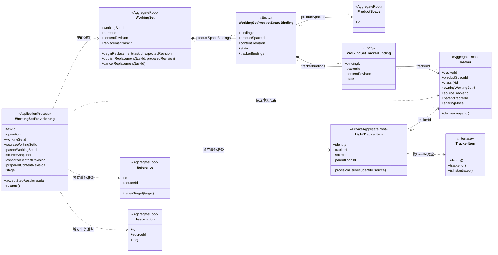
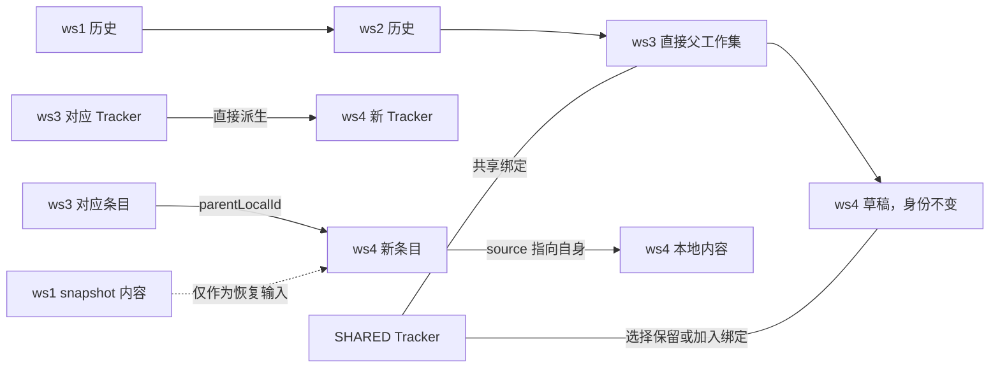
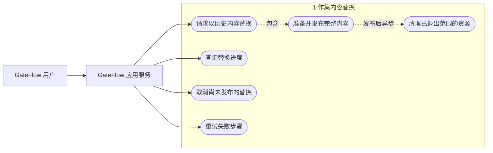
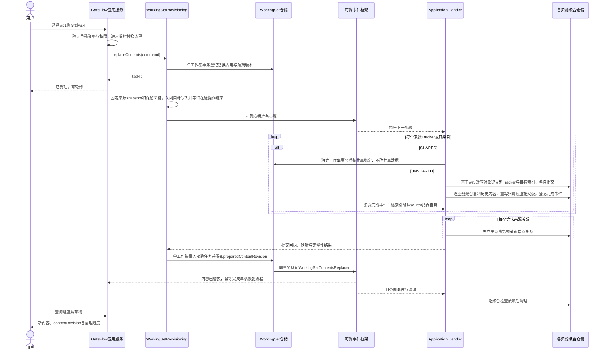
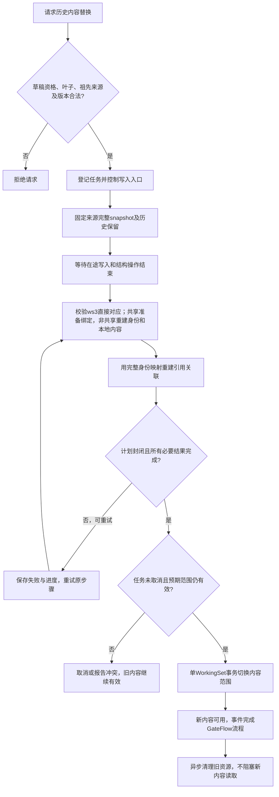

# 工作集内容替换：以历史版本恢复当前草稿

> 2026-11-06 · V4 设计。GateFlow 表达“恢复历史版本到草稿”，工作集 SK 表达“替换工作集内容”。采用异步 LRT、单聚合事务和准备后发布。

## 1. 场景与边界

继承链为 ws1 → ws2 → ws3 → ws4，ws4 是当前草稿对应的叶子工作集。选择 ws1、ws2 或 ws3 的一个确定 snapshot，将该时刻的 UNSHARED 内容恢复到 ws4，并按该时刻的选择恢复 SHARED Tracker 绑定；共享数据保持跨工作集共享。

**ws4 保留身份与容器属性；其当前有效内容整体换成重新准备的一组内容。** 来源历史不修改，ws4 的旧内容退出当前可见范围，后续按保留义务清理。本用例不做逐字段合并，也不保留草稿特有条目。

| GateFlow 用语 | SK 表达 | 维护者 |
|---|---|---|
| 历史版次 | 来源 WorkingSet 与确定 snapshot | GateFlow 解释版本，SK 读取内容 |
| 当前草稿 | 可替换的目标叶子 WorkingSet | GateFlow 判断草稿资格，SK 判断结构与任务冲突 |
| 恢复到草稿 | replaceContents | SK 执行内容替换 |
| 恢复进度 | WorkingSetProvisioning 的 REPLACE 操作 | 应用流程与查询投影 |

SK 不引入 GateFlow 的“草稿”“发布版”状态。GateFlow 应用服务校验业务权限和版本生命周期，调用 SK；两个模块通过公共命令、结果与事件交互，不相互持有聚合。

### 1.1 本设计采用的范围

1. 来源必须是目标的历史祖先，目标必须是可修改的叶子；本轮不支持替换已有子工作集的中间节点。
   历史祖先只提供内容输入；Tracker 结构来源仍为直接父工作集。replaceContents 是显式替换用例，不是普通重复纳入，也不开放子工作集新建 Tracker 入口。默认工作集 ID=1 不作为替换目标。
2. 全量指来源 snapshot 上全部有效空间绑定、Tracker绑定、条目内容及其合法引用关联，包含空空间和空 Tracker；来源没有的草稿 Tracker、条目和关系不再出现在当前视图。
3. 源回收站、审计记录、运行实例、已执行任务等不自动成为恢复内容。GateFlow 必须明确哪些数据属于版本化设计集合；集合外数据保留，不因“全量”被删除。
4. 目标名称、权限、项目、WorkingSetId、父工作集 ID 保留。UNSHARED TrackerId、条目 LocalId 和所属新关系 ID 重新生成，CommonId 沿用对应家族；SHARED Tracker 及其条目身份保留，仅调整 Binding。
5. 以上内部身份重新生成是本设计选择。若业务必须保留旧草稿条目的 LocalId，则是另一种逐条目覆盖协议，不能直接套用本方案。

## 2. UL 与最少新增状态

复用 WorkingSetProvisioning，只增加 REPLACE 操作和必要字段，不新增替换任务领域聚合。

| 名称 | 含义 |
|---|---|
| replaceContents | 保留工作集身份，更换其完整有效内容范围 |
| contentRevision | 工作集内容范围的发布序号；用于选择有效 Binding、固定一次读取及拒绝过期命令，不是业务条目 revision |
| replacementTaskId | 当前替换任务身份；同一工作集最多一个未结束的替换 |
| expectedContentRevision | 请求基于哪一份当前内容；过期请求拒绝 |
| sourceSnapshot | 历史内容输入及绑定选择的固定切点；用于复制与审计，不作为替换后跨代派生指针 |
| WorkingSetContentsReplaced | 当前有效内容范围已切换的事实，含任务、工作集、新旧 contentRevision 和来源 snapshot |

contentRevision 的必要性：WorkingSetId 保留时，仅靠它无法区分用户手中的旧草稿和替换后的新草稿。它也防止旧异步事件、旧分页游标和旧修复任务被误应用到新内容范围。

## 3. 聚合设计与类图

1. **WorkingSet 聚合**维护替换互斥、有效范围及发布／取消转换。空间绑定及其 Tracker 绑定均为内部实体；允许旧、新准备 Binding 并存，但同一内容范围内不能重复选择同一 Tracker 或同族。
2. **Tracker 聚合**各自保存派生来源，不拥有全部索引或业务对象。派生创建后的归属和 sharingMode 不变。
3. **LightTrackerItem 私有聚合**先确立目标身份、归属及直接父变体。恢复历史内容的 UNSHARED 条目在发布前完成本地内容写入，再消费完成事件确认索引 source 指向自身；不以 ws1 作为发布后的跨代读取依赖。业务对象仍通过 TrackerItem 协议访问，索引私有。
4. **Reference、Association 聚合**按新端点独立构造，不属于 WorkingSet 或条目内部实体；其端点按 ID 引用，图中省略具体端点类型展开。
5. **WorkingSetProvisioning**保存任务计划、映射和回执，是应用流程，不组合拥有上述业务聚合。`..>` 是使用依赖，`-->` 是按 ID 的关联，只有 Binding 使用组合箭头。

切换不逐个更新所有 Tracker 或条目的 active 标记。在一个 WorkingSet 事务中更换 contentRevision，读取按该序号选择已准备的空间绑定及其 Tracker 绑定。准备资源必须在发布前封闭并受保护，发布不能把一次跨聚合无锁扫描当作原子证明。

### 3.1 身份与继承链

**内容取自历史版本，结构归属重置到直接父级。** ws1 仅是本次恢复的内容输入及审计依据；替换后的派生链仍为 ws3 → ws4，不建立 ws1 → ws4 的跨代运行时来源。

| 指针／身份 | 替换后的规则 |
|---|---|
| ws4.parentId | 保持 ws3 |
| 新 Tracker.sourceTrackerId | ws3 中对应 Tracker；不得直接指向 ws1 |
| 新 Tracker.parentTrackerId | 按目标 Tracker 目录结构重建映射；这是目录父级，不是工作集派生父级，不可混用 |
| 新条目 parentLocalId | ws3 中同族对应变体的 LocalId，表达直接父变体；与可变内容定位分开 |
| 新条目 trackerId | ws4 的新 Tracker |
| 新条目 sourceLocalId/sourceRevision | 历史输入复制成本地内容后指向自身及实际本地版次，非版次对象为 1 |
| snapshot 审计依据 | 保留 ws1 的读取切点及输入版本，不用它充当新 Tracker 的直接派生切点 |

parentLocalId 是私有索引内对既有“直接来源关系”的明确命名，实例化后不随 source 改写。新 Tracker 的直接派生依据取自 ws3，恢复任务单独记录 ws1 内容输入；因此 ws3 后续变化不能通过来源事件覆盖已恢复的本地内容。父级与内容相异是合法状态，差异比对据实际内容计算。

本轮采用发布前完成本地内容恢复的方式避免跨代 COW 依赖。每个目标业务聚合独立写入并发送完成事件，索引再独立确认；两者全部准备完成后才发布。若将来要保留 VIRTUAL 优化，需要另行定义目标自有的不可变内容承载，不能重新指向 ws1 或假装读取内容不同的 ws3。

**直接父级缺项**：若 ws3 无对应 Tracker 或条目，不能随意指向其他对象，也不能为了恢复修改历史 ws3。准备检查报告具体缺项并阻止本轮发布，保留旧草稿；父级已删除但仍可验证的历史身份是否允许作为直接父变体，需要生命周期规则明确。如何将完全无父项的历史内容重新引入，另行确定身份政策，不默认跨代或补造父对象。

ws3 与 ws4 对应 Tracker 保持直接来源关系，满足既有相邻父子比对的结构条件。恢复不代表已与 ws3 合并：不得继承旧草稿的已合并确认，旧检查点不能使恢复后的差异被误判为 equal。

## 4. 用例图

Mermaid 以流程节点表达用例及参与者，不将下图当作类之间的继承关系。

最小接口：`replaceContents(targetId, sourceId, snapshot, expectedContentRevision, requestId)` 返回 taskId；进度、重试和取消复用创建 LRT 的入口。同一 requestId 参数不一致时拒绝，失败重试沿用原 snapshot 和身份映射。

## 5. 多阶段时序图

图中连续仓储调用是不同事务。任务状态与资源状态通过回执收敛；WorkingSet 与 GateFlow 自身状态也分别提交。GateFlow 应用在恢复进行中禁止发布草稿、再创建后续版本或发起第二次恢复，完成事件失败可重放，不因事件延迟重复切换内容。

## 6. 流程图与发布条件

重试从失败步骤恢复，图中返回准备阶段不表示重建已成功资源。发布条件包括：来源扫描结束、新身份及直接父级映射完整、非共享本地内容与索引确认完成、关系有确定结果、有效内容可读、任务占用有效、无尚未处理的旧写入。允许业务规定的悬空关系，但不允许把失败记录伪装为允许悬空。

## 7. 必须明确的业务与一致性规则

### 7.1 替换期间读写

- **读取**：准备期间继续读旧完整范围；发布后读新完整范围。一次查询／分页固定 contentRevision，不在多个子查询间重新取当前范围。旧内容需保留至已开始的读取结束或其有效期届满。
- **写入**：本设计选择替换期间暂停 ws4 的业务写入及拓展、合并、重挂、派生新子工作集等结构操作；来源历史仍按其自身规则使用。
- **进入屏障**：只在 WorkingSet 上设置标记，再让业务提交前查询一次是不够的。所有写入口必须经过可恢复的准入控制；关闭新准入后等待已准入操作提交或退出，才能确认写入已停止。该控制由应用任务框架实现，不跨聚合数据库事务。
- **恢复入口**：切换后释放准入，旧命令的 contentRevision 不匹配时明确拒绝，要求重新加载；不得自动把旧 LocalId 翻译成新条目继续执行。
- **生命周期竞争**：新增子工作集、草稿发布与恢复必须使用同一准入规则。只在受理时检查一次“叶子”无法保证发布时仍是叶子。

### 7.2 SHARED Tracker 只改变绑定

| 目标绑定选择 | 处理 |
|---|---|
| 历史选择与当前均包含 | 保持绑定到同一共享 Tracker，发布新范围时复用身份 |
| 历史包含、当前不包含 | 加入同一共享 Tracker 的 Binding |
| 当前包含、历史不包含 | 从新范围移除 Binding；不删除共享 Tracker、条目或其关系 |

共享内容保持当前共享语义，不回写历史属性值、不复制新索引、不重置共享对象的来源和父子指针。暂停 ws4 写入不意味着冻结其他工作集对共享对象的合法修改。旧资源清理和任务取消补偿必须排除共享数据，不能以“退出 ws4”为删除理由。

因此“全量替换”精确定义为：**UNSHARED 内容按历史恢复，SHARED 成员选择按历史恢复，共享内容继续共享。** 同一 contentRevision 保证绑定范围一致，不意味着共享数据跨时间不变。

### 7.3 引用、关联与外部身份

1. 全部新身份准备后再建关系：UNSHARED 内部端点映射到新 LocalId，SHARED 端点沿用原身份；共享对象自身的关系不复制、不改写；来源中有效的悬空引用及允许恢复的缺失关联意图也按原 snapshot 承接，供未来拓展恢复。
2. 新范围不继承旧草稿专有的关系、删除决定或待恢复清单；否则不再是选定历史内容的完整恢复。旧清单保留在旧内容范围，不得由迟到修复任务应用到新范围。
3. 钉版关系须有可验证映射，无映射继续按规则悬空或阻塞，不复制数字版次冒充映射。
4. 外部聚合持有旧 LocalId 的引用不能自动改指新条目。旧对象依赖继续受保留保护；需要跟随草稿当前内容的引用，应通过已约定的工作集、Tracker 族与 CommonId 解析。
5. Reference／Association 的修复仍逐聚合提交。任务、回执和修复候选须限定内容范围；旧业务事件只影响旧目标身份，不得用 CommonId 在新范围中重新找一个对象更新。

### 7.4 失败、取消及旧资源

| 时点 | 处理 |
|---|---|
| 准备失败 | 旧范围继续可读，任务停留失败／重试；写入暂停期间应展示明确状态，允许取消释放 |
| 发布前取消 | WorkingSet 以任务 ID 和版本守卫裁决；补偿只清理本任务准备资源 |
| 发布提交后回执丢失 | 查询 WorkingSet 的当前范围与发布凭据补回执，不执行第二次替换 |
| 发布后任务清理失败 | 新内容继续可用，单独报告清理待处理；不能回滚已经接受的新业务写入 |
| 用户希望撤销已完成恢复 | 发起新的内容替换，不把旧任务倒放；须仍有合法可恢复的旧内容依据 |

退出可见范围不等于对每个旧业务对象执行 delete。已独立存在的旧对象保留其业务生命周期和外部依赖；资源回收需经过合法删除、历史与引用保留检查，delete2 仍只允许从软删除态执行。不能因为 ws4 已切换就直接清空旧表行。

## 8. 最小评审与验收

- ws1/ws2/ws3 分别替换 ws4：WorkingSetId、parentId 不变，UNSHARED 内容等于历史有效集合，SHARED 绑定选择一致且数据继续共享。
- 来源没有的草稿新增条目退出当前视图；来源多出的条目、空 Tracker、属性值及关系均被承接。
- 每一步只修改一个聚合；来源不被修改，LightTrackerItem 仍为私有独立聚合。
- 中途失败、重复事件、取消与发布竞争不会暴露半新半旧范围。
- 读分页跨发布保持同一范围，旧命令和迟到修复事件不误写新范围。
- 在途编辑、并发拓展、创建子工作集和 GateFlow 发布受同一准入控制。
- SHARED 加入、保留、移除只改变绑定，共享数据与其他工作集不受删除影响；UNSHARED 固定历史不可读时不退回最新值。
- 新旧内部身份不同，外部旧引用不被静默重定向；旧资源清理不破坏依赖。
- 替换后直接父级仍为 ws3，内容来源定位为目标自身；恢复输入 ws1 只保留为审计依据。父级缺项阻止发布，旧合并确认不沿用。

落地前必须确认 GateFlow 的版本化集合边界、直接父级缺项的身份政策、外部引用是否要求稳定 LocalId，以及准入／排空能力。这些条件影响本方案能否直接采用，不能由事件最终一致性自动解决。

替换必须显式准备完整空间选择，包含来源 snapshot 中无 Tracker 的空间。目标独有空间退出新范围只结束对应空间绑定，不删除 ProductSpace；这是 replaceContents 的完整范围切换，不是 removeTracker 的隐式级联。ProductSpace 初始归属和生命周期不因替换变化。
