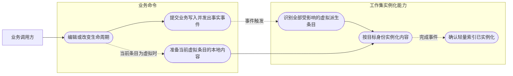
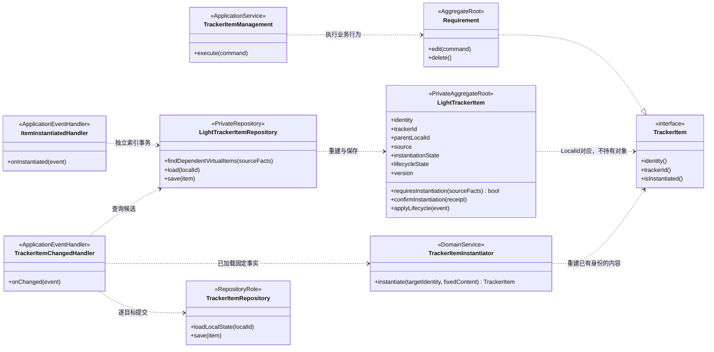
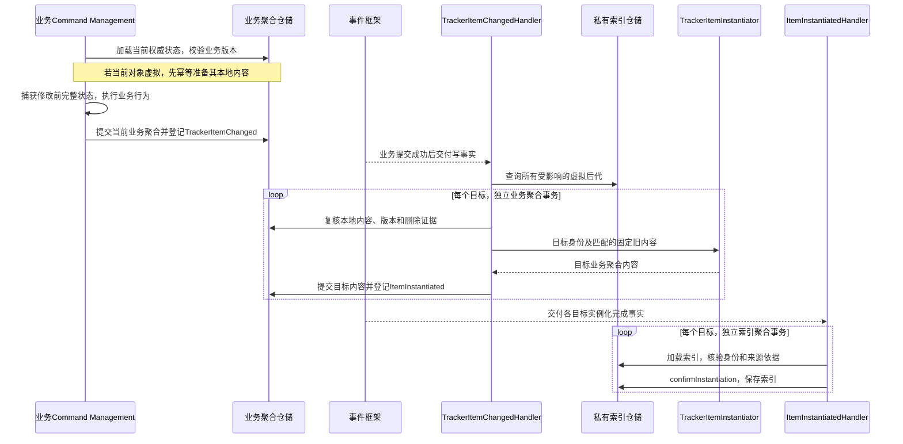
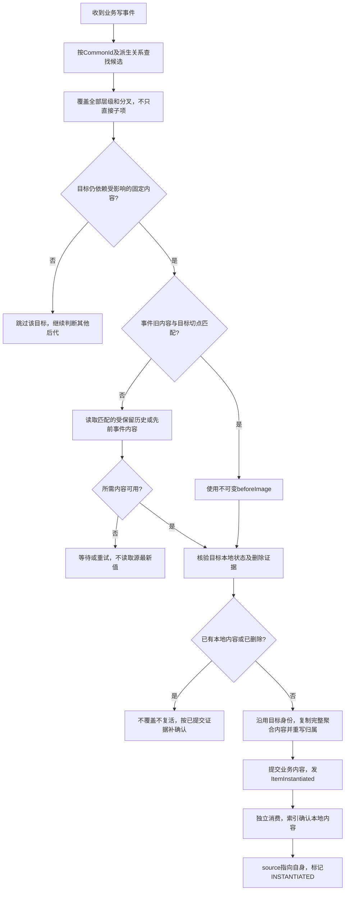

# 条目实例化：业务写事件与派生链路保护

> 2026-11-07 · V4。单聚合事务，事件交互；可靠投递、重试及补偿由事件框架提供，本文不设计其事务实现。

## 1. 领域语义与用例

**VIRTUAL → INSTANTIATED 是已有逻辑条目的存储转换，不是新建一个领域聚合。** 创建派生索引时已经确定目标 LocalId、CommonId、Tracker 归属及有效内容依据；业务查询能够重建该身份的完整聚合。实例化只是把固定内容写入目标本地存储，再确认索引状态。

TrackerItem 是公开协议；Requirement 等是具体业务聚合。LightTrackerItem 是 SK 内部私有独立聚合，业务对象不持有它。业务聚合负责内容，索引聚合负责来源与实例化事实；二者独立提交，通过事件收敛。

上图是用例与参与关系示意。用户关注业务写入，不需要操作私有索引，也不依赖代理。

## 2. 谁发什么事件

| 事件 | 发出位置与时机 | 接收者与作用 |
|---|---|---|
| TrackerItemChanged | 具体业务 Command 提交实际内容／生命周期变化时 | SK 应用层识别派生保护范围；生命周期消费者同步当前条目索引 |
| ItemInstantiated | 目标业务聚合本地内容成功建立时 | SK 应用层确认目标 LightTrackerItem 的来源与实例化标记 |
| 业务创建事实 | 原生业务聚合首次创建时 | SK 建立原生索引；不当作已有派生条目的实例化 |

业务类型已有等价写事件时，由应用层适配成上述契约，不额外重复发布相同事实。实现 TrackerItem 本身不会自动发事件，所有受管写入口必须接入发布协议。普通 Part 不进入此链路。

### 2.1 TrackerItemChanged

| 属性 | 含义 |
|---|---|
| eventId | 本次写事实身份，供重复消费识别 |
| localId、commonId、trackerId、itemType | 被修改的逻辑条目身份、归属与业务类型 |
| operation | 编辑、delete、undelete、delete2 等实际发生的业务变化 |
| beforeVersion、afterVersion | 本次变化的业务并发版本；不同于业务版次 revision |
| beforeImage | 修改前完整、不可变的聚合内容及生命周期，含实例化所需从属数据 |
| occurredAt | 事实发生时间，用于观察与审计，不代替事件顺序 |

beforeImage 在业务版本校验保护下捕获，与实际修改前状态一致。它不是活的 Java 对象引用，也不是引用关联网络的深拷贝；附件等外部内容使用受保留保护的稳定引用。仅有一个无法回读的旧行 ID 不满足输入要求。

### 2.2 ItemInstantiated

| 属性 | 含义 |
|---|---|
| eventId、causationEventId | 完成事实身份及触发写事件身份；显式实例化使用其请求标识关联 |
| localId、commonId、trackerId、itemType | 已建立本地内容的目标身份；始终沿用预先分配的 LocalId |
| sourceLocalId、sourceRevision、sourceCut | 本次实例化实际采用的固定来源依据，用于确认仍是该目标预期内容 |
| localRevision、contentVersion | 已提交的目标本地业务版次和内容并发版本 |

ItemInstantiated 只证明本地内容建立成功，不表示生命周期变为 ACTIVE，不代表业务创建，更不代表整条派生链完成。之后再发生业务修改，仍正常发出 TrackerItemChanged。

## 3. 聚合与协作类图

虚线全部表示依赖，无聚合组合关系。TrackerItemRepository 是业务类型仓储的协作角色，不要求 SK 引用 Requirement 类或新增第二套权威内容仓储；具体业务模块提供类型实现。实例化领域服务不持有事务、不发送消息、不自行查询数据库。应用 Handler 调用其计算结果，业务类型工厂验证合法内容并完成归属重写。

## 4. 从写入到索引确认的完整时序

源业务提交不等待所有派生目标完成；一个目标失败不回滚源和其他已成功目标。事件发出表达“实际已发生的写入”，不能在内容未提交时宣布已实例化。发布与提交的一致性、事件完整保存及后续可靠处理是框架接入契约，本文不指定其实现方式。

### 4.1 当前被编辑对象也是虚拟条目

先使用其已有身份及固定内容准备本地存储，再校验并执行本次修改。此过程不创建新身份；可以在同一**目标业务聚合**事务内完成本地内容建立和业务变化，分别登记实例化事实与业务变化事实。索引仍由独立事件消费确认。

若当前应用接口将准备与修改拆为两个调用，修改阶段必须重新验证业务版本，不复用无校验的旧查询对象。无论采用哪种组织，后代保护使用的是本次业务变化前内容，不能拿修改后的内容作为后代初始值。

## 5. 派生链处理流程

“考虑所有虚拟后代”不等于“同 CommonId 全部复制一份相同 beforeImage”。直接血缘、有效来源及 sourceCut 共同决定处理范围。中间节点已实例化也不能直接停止遍历：更深节点可能仍通过扁平化来源依赖更早源对象。每个目标独立判断，无需按父到子的完成顺序递归复制。

例如 A → B → C：A 修改时，检查 B、C 及其他分叉中仍依赖 A 旧内容的虚拟条目；B 修改时，实例化 B 自身并保护 B 的相关后代，不修改 A。C 若保留更早 snapshot，应使用那个切点的内容，不能套用 B 本次 beforeImage。

## 6. 索引确认与可见性

confirmInstantiation 必须在单索引聚合内完成：

1. 核验目标身份、Tracker 归属及此次来源依据；索引已被移除或事件属于旧内容范围时不得重新建立目标。
2. 接受本地内容已成功提交的完成事实，重设 sourceLocalId 为目标 LocalId、sourceRevision 为实际本地版次；sourceCut 不再指向旧源。保留直接父变体关系及必要审计依据。
3. 将 instantiationState 置为 INSTANTIATED，更新索引自身版本。生命周期由相应业务事件维护；实例化确认不得把 DELETED 改回 ACTIVE。
4. 重复完成事实幂等处理；过期确认不得把已经更新的本地版次回退。内容已建立但索引确认失败，仅重试确认，不重复覆盖内容。

异步窗口中，本地权威内容与删除证据优先于滞后的 VIRTUAL 标记；尚无本地内容时，只能读取受保留的固定来源。索引已物理删除不得因迟到完成事件而复活。目标 isInstantiated 是加载事实，不作为命令并发许可。

ItemInstantiated 不再触发同一派生链的内容变化处理，避免无限事件循环。真正的后续业务 edit/delete 等才发出新的写事实。新索引在源事件扫描结束后才出现时，创建／拓展流程仍须使用其 snapshot 保留义务补齐，不能只依赖一次事件枚举。

## 7. 删除、关系及失败边界

- delete 当前对象之前准备本地内容，提交软删除及写事件；后代保留各自原生命周期，不随源一起进入回收站。
- undelete、delete2 同样发布业务事实。delete2 不得先破坏后代仍需的历史内容和附件保留依据；具体事件承载及保留由既有协议保证。
- 实例化只保存当前业务聚合及从属实体，不将独立 Reference、Association 一起跨聚合保存。已有目标关系继续使用目标身份，不在内容复制时重新克隆整张关系网。
- 去重、目标并发版本及来源匹配是业务处理条件；框架负责重投不能替代这些条件。重复、乱序和并发编辑不能覆盖新内容或复活删除条目。
- 当前写事件、目标实例化完成事实及索引确认可分别观察；“源修改成功”不等于“全部派生实例化完成”。失败展示与告警接入框架，但不新增公共领域任务聚合。

## 8. 最小验收

1. 根源更新覆盖多层、多分叉的受影响虚拟目标；每个目标内容符合自己的固定切点。
2. 虚拟中间节点被编辑时保留原身份，当前写入与后代保护都发生，祖先不变。
3. 目标内容已提交、索引仍为 VIRTUAL 时读到本地新内容；确认失败重试不覆盖后续编辑。
4. 生命周期事件先于完成事件到达，索引仍保持正确删除状态；delete2 后迟到完成不复活。
5. 实例化不会发布业务创建事件或递归触发相同链路；原生创建独立走创建协议。
6. 源事件早于新派生索引、历史输入暂不可读、任务重试均有恢复路径。
7. 每次事务只写一个业务聚合或一个索引聚合；领域对象和领域服务不负责事件框架事务实现。
