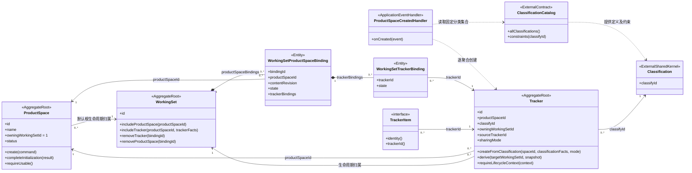
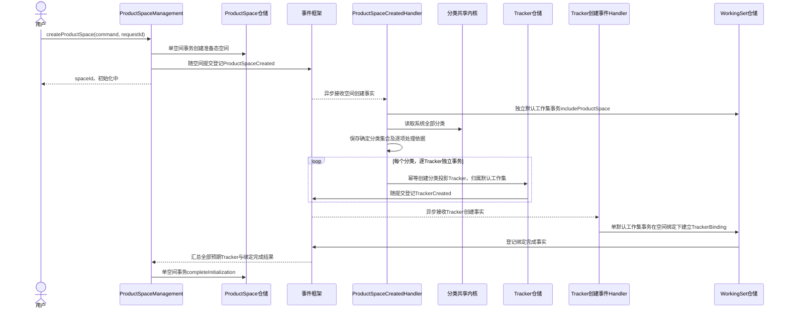

# 产品空间、分类投影与生命周期归属

## 1. 领域定位

**产品空间是用户工作区的最小单元；Tracker 是分类元模型在该空间、工作集内的持久化投影。** 产品空间、工作集与 Tracker 各为独立聚合，不组合成一个大型事务边界。

三层分类元模型由另一团队负责，作为独立共享内核供业务 BC 和工作集共享内核使用。本设计只依赖分类身份、属性约束和规则约束的公开能力，不展开三层内部结构，不复制维护另一套分类模型。

| 概念 | 负责的内容 | 生命周期归属 |
|---|---|---|
| 分类元模型 | 三层分类定义、属性与规则约束 | 分类共享内核 |
| ProductSpace | 用户工作空间的身份、状态及使用资格 | 默认工作集 ID=1 |
| WorkingSet | Tracker 选择、派生范围与内容发布 | 工作集共享内核 |
| SHARED Tracker 及其 TrackerItem | 跨工作集共享的容器与业务对象 | 默认工作集 ID=1 |
| UNSHARED Tracker 及其 TrackerItem | 各工作集自己的容器与业务对象 | 该 Tracker 所属工作集 |

产品空间可用于组织产品线、立项项目等工作；不直接将 ProductSpace 与既有 projectId 视为同一个身份。业务项目怎样关联产品空间由其业务模型定义。

## 2. 初始状态与分类投影

系统启动前，默认工作集 ID=1 和三层分类元模型数据已同步至平台元数据库。系统运行时分类配置常驻内存，通过分类共享内核公开能力读取；内存缓存不是工作集自己维护的第二套分类权威数据。

初始默认工作集**没有产品空间，也没有 Tracker**。分类存在不意味着对应 Tracker 已存在。用户创建产品空间后，系统读取全部分类形成确定集合，逐个分类创建 Tracker 聚合并持久化。

“投影”是从分类定义建立具有自身身份和生命周期的 Tracker，不是只读 CQRS 投影，也不是深拷贝一份可脱离分类约束的元模型。Tracker 保存 classifyId，通过分类共享内核取得适用的属性及规则约束；条目创建、编辑和实例化都遵守这些约束。

## 3. 身份、归属与唯一性

ProductSpace 与 WorkingSet 的关联由 WorkingSetProductSpaceBinding 显式记录，不从 Tracker 反推。该实体及其组织的 TrackerBinding 全部属于 WorkingSet 聚合。所有 Tracker 移出后空间绑定继续有效；空间移出必须显式执行，不能顺带删除默认工作集里的 ProductSpace。

| 属性／约束 | 含义 |
|---|---|
| ProductSpace.id | 产品空间身份，不等于工作集 ID 或分类 ID |
| Tracker.productSpaceId | Tracker 所属产品空间；派生时保持 |
| Tracker.classifyId | 投影依据的分类身份；派生时保持 |
| Tracker.owningWorkingSetId | 生命周期所属工作集；SHARED 固定为 1，UNSHARED 为创建或派生所在工作集 |
| Tracker.sourceTrackerId | 非共享派生的直接父 Tracker，与分类来源不同 |
| 产品空间内的分类唯一投影 | 同一工作集有效范围内，同一 productSpaceId、classifyId 最多一个 Tracker |

一个分类可对应多个产品空间的多个 Tracker，所以不能对 `(workingSetId, classifyId)` 设置全局唯一。同一产品空间也会在多个工作集出现同一 Tracker 的共享绑定或非共享派生版本，不能对所有物理 Tracker 使用 `(productSpaceId, classifyId)` 全局唯一。

默认工作集创建时，以 `(productSpaceId, classifyId)` 保证原始 Tracker 不重复；子工作集按其有效范围保证唯一投影。来源家族唯一、工作集内 CommonId 唯一、单 Tracker 不重复纳入的规则同时有效，不被分类唯一性取代。

请求重试复用已创建 Tracker 和任务映射。新增产品空间即使用相同分类，也必须获得新的 Tracker 身份；不能复用其他空间的 Tracker。SHARED 表示同一空间的 Tracker 跨工作集共享，不表示多个产品空间合用一个分类 Tracker。

## 4. 聚合类图

Classification 只标记外部概念，不在此断言其内部聚合边界。ProductSpace 与 Tracker 是关联，不是组合；Handler 不拥有聚合。TrackerItem 的生命周期归属通过所属 Tracker 确定，无须在公共业务对象中持有 LightTrackerItem。

## 5. 产品空间创建与 Tracker 初始化

1. ProductSpaceCreated 至少携带 eventId、productSpaceId、requestId 和创建上下文，不携带可变的分类对象集合。
2. 消费者第一次读取全部分类后，可靠固定分类身份集合及可恢复的规则依据；重试沿用同一集合，不能因每次读缓存不同而漏建或无限追加。三层具体怎样枚举由分类共享内核提供，工作集不擅自限定为某一层。
3. 每个分类创建一个 Tracker。Tracker 的 sharingMode 必须来自已确认的创建配置并永久固定；该配置由分类或空间模板何处提供，是接口接入项，不能在处理器中写死。
4. 单个 Tracker 保存成功不等于空间可用；默认空间绑定、所有预期 Tracker 和其默认绑定完成后，ProductSpace 才确认初始化完成。分类集合为空时仍须建立默认空间绑定，随后按空集合完成，后续分类新增不混入已经结束的创建请求。
5. 进度记录与消息重试由应用流程和事件框架承接，不新增拥有所有 Tracker 的领域聚合，不把循环放进 ProductSpace 实体方法，也不在循环外包总事务。

## 6. 生命周期入口

### 6.1 共享对象

共享 Tracker 及其条目的创建、归档、delete、undelete、delete2 等生命周期操作，统一在默认工作集维护，并遵守各自业务守卫。子工作集只有共享 Binding 的纳入／移出能力，不能以子工作集身份独立删除或恢复共享对象。

业务界面若从子工作集发起共享对象操作，应用入口必须明确解析为默认工作集的权威对象并校验相应权限，或者拒绝该入口；不得静默创建一份子工作集生命周期。共享对象变化被其他绑定工作集看到，具体缓存刷新由查询接入处理。

### 6.2 非共享对象

默认工作集中的原始非共享对象由默认工作集维护；派生 Tracker 及其条目由目标子工作集维护。后续逐层派生继续建立新的生命周期归属，不改变源对象归属。删除目标对象只影响目标生命周期，源与后代通过既有 COW 和事件规则保持各自内容。

### 6.3 产品空间

产品空间自身生命周期在默认工作集维护，子工作集使用同一产品空间身份，不派生产品空间副本。空间删除不能暗含删除所有 Tracker：各 Tracker 的非空、派生子级、绑定与历史保留守卫仍然有效。空间归档／删除的级联政策需单独明确，本创建流程不授权跨聚合级联销毁。

## 7. 失败恢复与并发

- **重复事件**：以产品空间和分类作为稳定创建键，恢复已有 Tracker；业务唯一约束同时防止不同事件创建同分类的第二份投影。
- **默认绑定失败**：仅重试绑定，不重建 Tracker；没有准备完整的空间不报告可用。
- **部分分类失败**：保留已提交结果，重试失败分类。创建另一产品空间使用独立范围，不互相覆盖进度。
- **直接 REST 创建冲突**：默认工作集的手动 Tracker 创建与空间初始化必须复用相同产品空间／分类唯一性规则；禁止绕过空间、分类创建无归属 Tracker。
- **分类配置变化**：活动配置提供可校验的约束依据；创建中配置变更不得静默改变已冻结集合。新增分类是否为既有空间补建、规则变化是否迁移既有数据，由分类团队与本模块另行约定。
- **空间失效与迟到消息**：初始化期间发生取消或删除请求，消费者复核空间状态；在途创建结果仍需登记，不能将空间重新标为可用。清理遵守逐聚合规则，不删除共享外部资源。

## 8. 验收与详细设计接入项

1. 初始只有默认工作集和分类配置，无产品空间、无 Tracker。
2. N 个分类创建一个空间，产生 N 个原始 Tracker 及默认绑定；创建第二个空间，另产生 N 个 Tracker。
3. 同一空间同一分类重复事件不新增 Tracker；不同空间相同分类合法共存。
4. 子工作集只能逐层纳入已有 Tracker；派生保留 productSpaceId、classifyId，非共享归属改为目标工作集，共享归属仍为 1。
5. 空间创建、每个 Tracker 创建、默认绑定、空间完成分别提交；失败可重试，无跨聚合事务。
6. 子工作集移出共享 Tracker 不改变共享对象生命周期；非共享条目写入不得借用其他工作集归属。
7. Tracker 与业务条目遵守分类属性／规则约束；分类详情及缓存实现不泄漏进工作集模型。

详细设计需明确：分类集合与规则依据接口、sharingMode 配置来源、空间初始化进度接口、空间生命周期完整状态、分类演进策略，以及产品空间与项目的业务关联。已确认的唯一性和生命周期归属不作为待定项。

空间关联验收：空间初始化无分类时仍可被查询；子工作集最后一个 Tracker 移出后空间保留；空间内禁止绑定其他空间的 Tracker；显式移出空间不删除 ProductSpace 本体；同一空间可以在多个工作集独立纳入。
