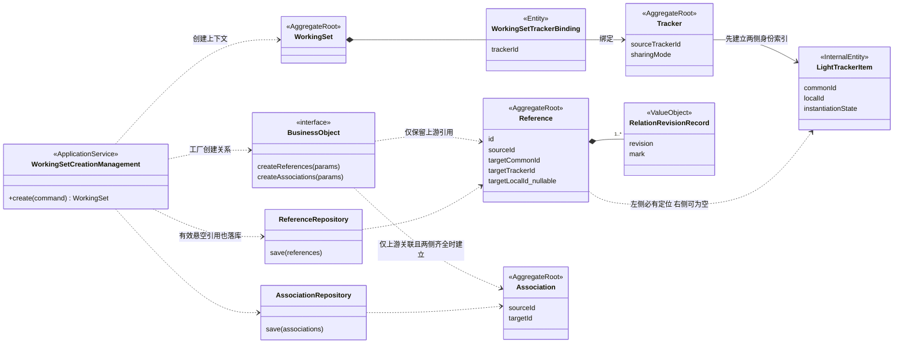
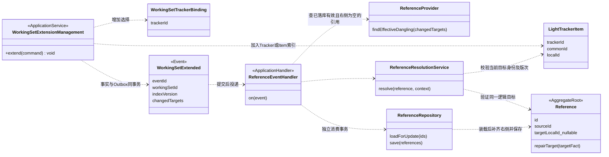
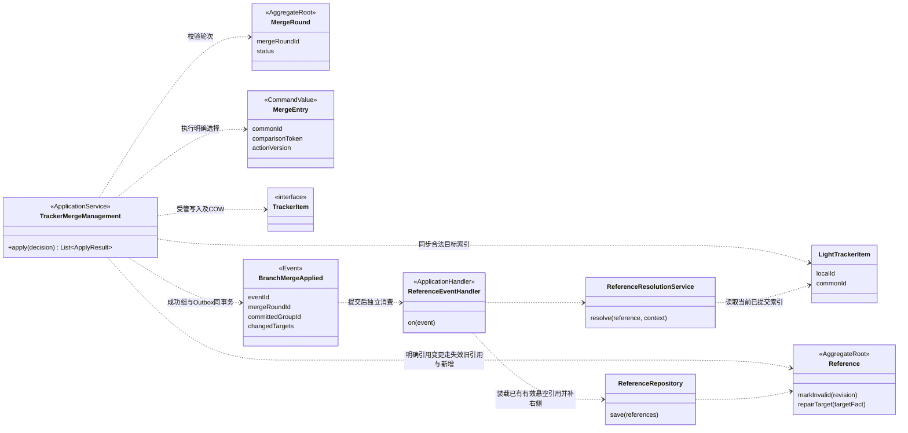

# 领域模型与场景类图

> 新版本领域设计。统一语言见 [CONTEXT](./CONTEXT.md)，事件协议见 [05](./05-event-driven-repair.md)。

## 1. 统一口径

- **Reference、Association 各为独立聚合根**；BusinessObject 提供工厂和端点事实，不组合包含关系。
- 直接使用 Reference，不声明 CanonicalReference 或第二套引用事实。
- 关系没有 CommonId / SourceRelationId 血缘，Reference.originRowId 恒空；Item 的 CommonId 仍用于解析目标。
- 创建关系行与复制 Item 内容分开，关系由各自 Repository 保存。

## 2. 聚合与职责

| 模型 | 数据 / 行为 |
|---|---|
| Reference | 引用方、属性、逻辑目标、所钉版次、可空右侧物理定位、传播怀疑、版次记录；of / markUnchanged / markInvalid / discardRevision / repairTarget |
| RelationRevisionRecord | 值对象：引用方 revision 与 RowMark；每引用每版次一条 |
| Association | 两端身份、类型、0..1 AssociationRule、传播怀疑；规则整体置删，换端点删旧加新；无通用属性扩展能力 |
| ReferenceService | 批量签出 / 取消签出，调用引用聚合行为 |
| ReferenceGuardService / AssociationGuardService | 归属、有效性、元数据、范围、去重与授权事实的写前断言 |
| ReferenceResolutionService | 按 Binding、索引和版次解析目标 |
| PropagationSuspectService | 跨关系批量置位 / 清除；行内状态由各关系维护 |

PropagationSuspect 不共享可变状态，具体写接口待传播设计闭合。应用服务定义用例事务，领域对象维护自身不变量，仓储负责聚合装载与保存。LiteBusinessObjectService 提供只读概要，不能替代 LightTrackerItem 索引。

## 3. 身份、钉版与去重

| 字段 | 含义 |
|---|---|
| id | 建立关系行时分配的引用 ID |
| sourceId / sourceCommonId | 引用方具体 LocalId / 业务身份 |
| attributeApiId | 引用属性 |
| targetCommonId / targetTrackerId | 目标逻辑身份 / Tracker 派生族根 |
| targetRevisionId? | 所钉目标版次；空表示跟随最新 |
| targetLocalId? | 当前工作集内的右侧物理定位；可为空 |
| RelationRevisionRecord | 引用方各版次的有效性事实 |

目标逻辑身份与右侧物理定位分开，修复只能补齐同一逻辑目标的定位。引用按元数据作用域内的“引用方＋属性＋目标逻辑身份＋所钉版次”去重；关联按同源＋同目标去重，类型不同不允许重复。页签是否隔离去重作用域待元数据确认。

解析顺序：Binding → Tracker 族与 CommonId → 目标变体 → 最新 / 所钉版次。钉版须有可验证的历史对应关系；不能套用来源 revisionId 或仅比较版次数字。无对应时保持悬空，不降级 HEAD、不解除钉版、不回落父对象。任意外部对象 / 固定外部历史引用另需作用域契约。

### 3.1 悬空引用的数据库语义

**悬空引用是已存在的有效引用，右侧为空不等于失效。** 逻辑目标必须保留，查询不能因目标缺失而丢掉引用行。

| 引用行 | 左侧 | 右侧物理定位 | 当前版次记录 | 含义 |
|---|---|---|---|---|
| R1 | A' | B' | ADDED / UNCHANGED | 有效、两侧齐全 |
| R2 | A' | NULL | ADDED / UNCHANGED | 有效悬空引用 |
| R3 | A' | 任意 | INVALIDATED | 当前版次失效，不参与修复 |

修复 R2 调用 repairTarget：核验同一逻辑目标后，补齐同一行右侧并更新并发版本。ID、属性、逻辑目标、钉版与有效记录不变。用户不可读只影响回显，不能据此清空已填右侧。

## 4. 引用生命周期

| 操作 | 聚合行为与结果 |
|---|---|
| 新增 | of：当前引用方版次记 ADDED，初始化怀疑态 |
| 签出 | markUnchanged：追加新版本记录，幂等且不覆盖已有 ADDED / INVALIDATED |
| 删除 | markInvalid：仅当前版次失效，历史不动 |
| 换目标 / 属性 / 钉版 | 旧引用当前版次失效＋新增引用 |
| 取消签出 | discardRevision：撤销工作版次记录；须装载全部参与记录，**包括 INVALIDATED**；记录集空则删除聚合 |
| 读取 | 取 revision ≤ N 的最后记录求有效性；首条记录之前不存在，历史读取受来源切点约束 |

非版次对象 revision=1，并发保护仍须真实行版本 / 内容证据。

## 5. 创建与扩展决策

| 范围 / 关系 | 处理 |
|---|---|
| 上游引用，目标已纳入 | 新引用方引用当前目标变体；钉版额外校验 |
| 上游引用，目标 Tracker / Item 未纳入 | 保存有效行，右侧 NULL，保留目标逻辑身份 |
| 目标为已绑定 SHARED Item | 复用共享目标；未绑定则悬空 |
| 引用方为 SHARED | 复用同一对象及关系，不改写共享集合 |
| 下游引用 | 不复制、不留待修复关系，原工作集关系不动 |
| 普通 UI 新增引用 | 仍须目标合法；派生已有悬空引用使用专门入口，不放宽普通新增守卫 |

分类依据全部实际 Binding / 索引，不能只看 REST 入参或本次新增共享 Tracker。跨产品按每条关系实际归属处理。

### 5.1 上游关联与下游关联的取舍

| 关系 | 创建 | 拓展 |
|---|---|---|
| 上游关联，两侧齐全 | 建行 | 按新增对象自身上游规则建立合法关联 |
| 上游关联，缺端点 | 保留关系意图，暂不建行 | 新端点纳入后按原意图幂等建立合法关联 |
| 下游关联 | 丢弃 | 永久丢弃，不恢复；下游悬空关联不落库 |

“永久丢弃”作用于新工作集，不删除来源 / 外部对象原关系，也不批量删除其他合法上游关联。A、B 同批纳入时，A 关联 B 按 A 的上游规则处理一次，不从 B 的下游重复复制；以后新增对象的合法上游关联不等于恢复旧下游关联。

## 6. COW、无血缘与一致性

1. 冻结来源切点 → 建立身份索引 → 保存上游引用及合法上游关联 → 发布。引用方内容可为 VIRTUAL，不强制复制 Item。
2. 目标起始版次只承接切点上的有效关系，不复制父对象全部历史。COW 沿用本地关系，不覆盖已失效记录、不在 COW 中补旧缺失关联；拓展可按保留意图恢复；修复右侧也不复制内容。
3. 批次到关系 ID 的幂等映射属于构建机制，不进入关系血缘；缺端点未建行的合法关联须保留可恢复意图或受保护历史，不能仅保留目标身份。
4. 签出 / 取消签出的关系记录可同步协调；若异步，必须有准备状态与因果顺序保护。未准备完整不可编辑引用、Diff/Merge 或发布；取消后迟到事件不能复活工作版次。具体接入方式待评审。
5. 分支合并与工作集拓展的悬空修复采用提交后事件，消费者独立事务；详见 [05](./05-event-driven-repair.md)。

## 7. 传播与删除守卫

- FORWARD：被引用对象变化影响引用方；BACKWARD：引用方变化影响被引用对象。
- 两类关系均有怀疑传播。已确认的上下游取舍用于隔离内部变化，不得通过反向传播绕过隔离或改写共享关系全局配置；具体实现待类型策略核验。
- 钉版不跟随 HEAD 换内容，是否报告 HEAD 变化待类型策略确定。修复不清怀疑、不 markAsMerged。
- 删除前查询跨版次有效引用，并限定实际目标变体；不可读不等于无引用。历史已删或明确合并裁决产生的悬空，不授权绕过普通删除守卫；delete2 不按 CommonId 清全族引用。

## 8. 各业务场景的模型类图

虚线表示协作 / 身份依赖，组合线表示聚合内部结构；图中服务名表示职责，不要求另建重复类。

### 8.1 创建工作集的引用与关联

以下 Management 是场景职责视图：create(command) 的命令包含父工作集、Tracker 选择与 snapshot；extend(command) 包含目标工作集及新增选择。图中返回表示本次同步提交结果，不表示后续引用修复完成。合并图只保留当前场景的 apply 入口，完整接口见 [09 §5.3](../09-merge-domain-design.md#53-management-用例接口)。

先索引再关系；仅处理上游。有效悬空 Reference 仍落库，缺端点 Association 不落库，Item 内容保持 COW。

### 8.2 拓展工作集与悬空引用修复

新增 Tracker 或 Item 发布后发事件。处理器核验已有有效引用并补齐右侧；不新增已存在的引用；因缺端点未建行的合法关联按保留意图另行创建，明确排除的下游关联不恢复。幂等与乱序处理见 [05](./05-event-driven-repair.md)。

### 8.3 分支合并的引用处理与修复

明确换目标按失效旧引用＋新增处理；已有悬空引用按成功组事件补齐。MergeRound 不包含引用，消费失败不回滚合并；Diff 只读不发事件。合并接入见 [09 §8.5](../09-merge-domain-design.md#reference-diff-merge-repair)。

V4 拓展补充：新增范围发布后，既有悬空引用补齐目标，缺端点未建行的合法关联按原创建切点及保留意图建立。明确排除、主动删除或换目标的关系不恢复；事件、进度和并发规则以 [工作集拓展设计](../workingsetModel/05-workingset-creation-lrt.md#10-拓展工作集增量纳入与关系恢复) 为准。
