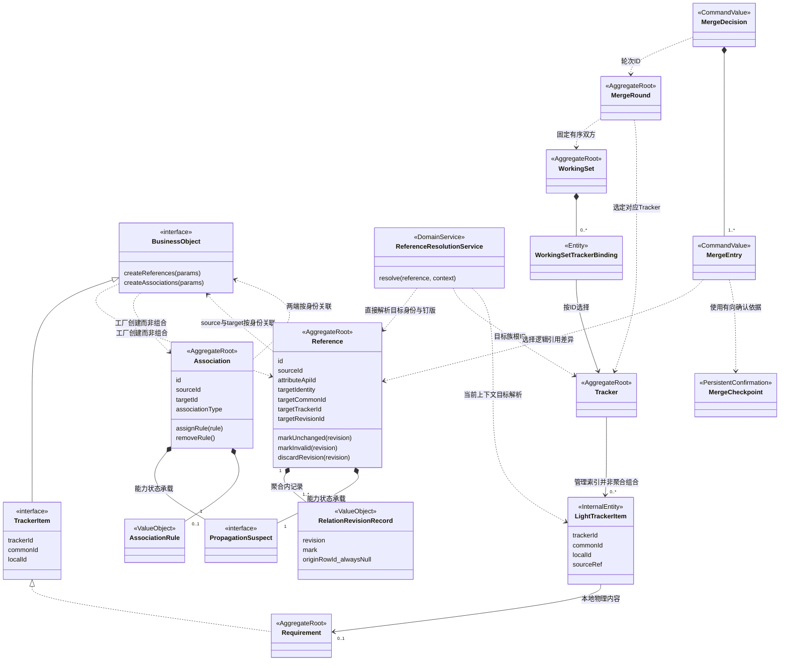
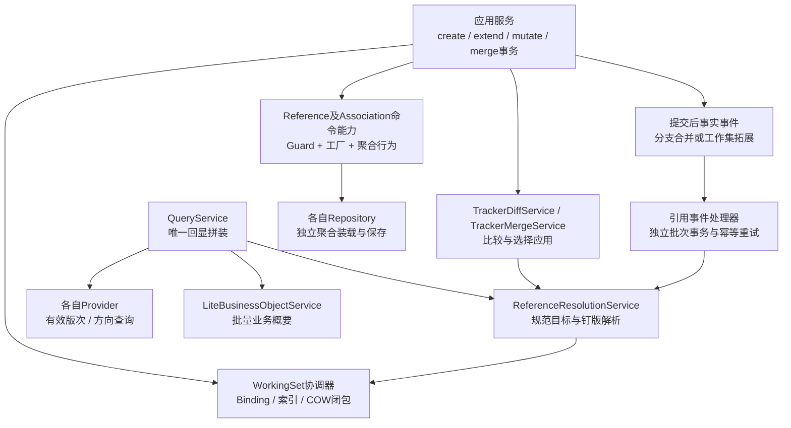

# 模型关系总览

Reference、Association 是独立聚合根；整体规则见 [02](./02-domain-design.md)，事件协议见 [05](./05-event-driven-repair.md)。

## 1. 聚合边界类图

`*--` 表示聚合内从属记录 / 值对象或命令值组合；`..>` 表示使用、工厂或身份关联。工厂创建关系不代表聚合包含；各关系各自持有传播状态。

## 2. 模型职责

| 模型 | 与关系模型的边界 |
|---|---|
| BusinessObject | 基础能力与创建工厂；不组合包含 Reference / Association |
| TrackerItem | 受 Tracker 管理的业务对象契约，具体实现可作为关系两端 |
| Tracker | 类型、共享策略、数据版本线与派生族；不包含全 Tracker 关系集合 |
| LightTrackerItem | 内部身份、来源与存储状态索引，不是 TrackerItem 子类或业务概要对象，不持有关系 |
| WorkingSet / Binding | 选择目标 Tracker 与解析上下文；SHARED 对象及关系可多工作集复用 |
| Reference / Association | 分别组合版次记录、规则及自身传播能力，跨聚合按身份关联 |
| Merge | 用例 / 服务协作，不另建聚合 |
| MergeRound | 轻量轮次聚合，只管轮次身份、双方与状态，不包含关系或全部条目 |
| MergeDecision / MergeEntry | 不可变命令值，携带决定和比较依据 |
| MergeCheckpoint | 独立有向确认事实，不是解析缓存，修复不会自动确认 |

VIRTUAL 只描述 Item 内容。引用行已落库、右侧可空；后续 COW 不重复建关系。

## 3. 应用协作

应用服务编排事务，领域服务协调跨对象规则，聚合维护不变量，仓储保存聚合。事件处理器使用独立消费事务。

## 4. 示例

父工作集 A → B，子工作集只纳入 A：

1. 建 A' 索引和 Reference R'；左侧 A'、右侧 NULL，记录有效，A' 内容可为 VIRTUAL。
2. 拓展或合并纳入 B'，提交后事件将同一 R' 右侧补为 B'；无对应钉版则保持悬空。
3. A' 签出只追加 R' 版次记录；删除使当前记录失效，取消签出撤销该记录。后续事件不能复活失效引用。

缺端点关联不建行，后续不自动补建。
